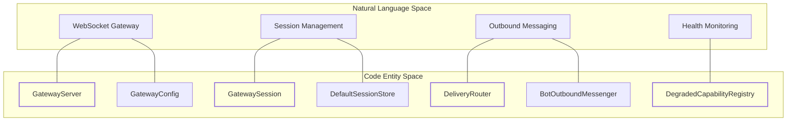
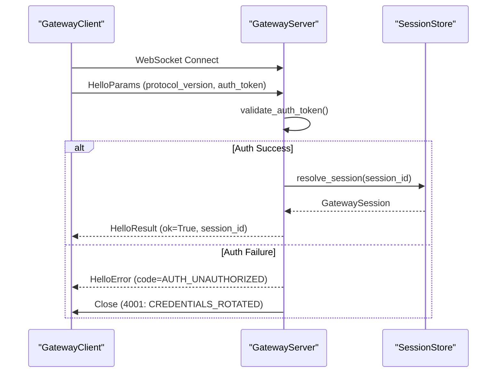

<!-- source: DeepWiki mcp.deepwiki.com · repo MervinPraison/PraisonAI · page 14.1 WebSocket Gateway · fetched 2026-10-26 -->

# WebSocket Gateway

Relevant source files

The following files were used as context for generating this wiki page:

- [src/praisonai-agents/praisonaiagents/gateway/__init__.py](src/praisonai-agents/praisonaiagents/gateway/__init__.py)
- [src/praisonai-agents/praisonaiagents/gateway/config.py](src/praisonai-agents/praisonaiagents/gateway/config.py)
- [src/praisonai-agents/praisonaiagents/gateway/degraded_state.py](src/praisonai-agents/praisonaiagents/gateway/degraded_state.py)
- [src/praisonai-agents/praisonaiagents/gateway/protocols.py](src/praisonai-agents/praisonaiagents/gateway/protocols.py)
- [src/praisonai-agents/praisonaiagents/tools/messaging_tools.py](src/praisonai-agents/praisonaiagents/tools/messaging_tools.py)
- [src/praisonai-agents/tests/unit/test_gateway.py](src/praisonai-agents/tests/unit/test_gateway.py)
- [src/praisonai-agents/tests/unit/test_gateway_code_skew.py](src/praisonai-agents/tests/unit/test_gateway_code_skew.py)
- [src/praisonai-agents/tests/unit/test_gateway_config.py](src/praisonai-agents/tests/unit/test_gateway_config.py)
- [src/praisonai-agents/tests/unit/test_gateway_degraded_state.py](src/praisonai-agents/tests/unit/test_gateway_degraded_state.py)
- [src/praisonai-agents/tests/unit/test_gateway_liveness_policy.py](src/praisonai-agents/tests/unit/test_gateway_liveness_policy.py)
- [src/praisonai-agents/tests/unit/test_gateway_routing.py](src/praisonai-agents/tests/unit/test_gateway_routing.py)
- [src/praisonai-agents/tests/unit/test_gateway_turn_lock.py](src/praisonai-agents/tests/unit/test_gateway_turn_lock.py)
- [src/praisonai-agents/tests/unit/test_route_bindings.py](src/praisonai-agents/tests/unit/test_route_bindings.py)
- [src/praisonai-agents/tests/unit/tools/test_ask_conversation_tool.py](src/praisonai-agents/tests/unit/tools/test_ask_conversation_tool.py)
- [src/praisonai-agents/tests/unit/tools/test_send_message_tool.py](src/praisonai-agents/tests/unit/tools/test_send_message_tool.py)
- [src/praisonai-bot/praisonai_bot/__init__.py](src/praisonai-bot/praisonai_bot/__init__.py)
- [src/praisonai-bot/praisonai_bot/bots/_outbound_media.py](src/praisonai-bot/praisonai_bot/bots/_outbound_media.py)
- [src/praisonai-bot/praisonai_bot/bots/_outbound_messenger.py](src/praisonai-bot/praisonai_bot/bots/_outbound_messenger.py)
- [src/praisonai-bot/praisonai_bot/bots/delivery.py](src/praisonai-bot/praisonai_bot/bots/delivery.py)
- [src/praisonai-bot/praisonai_bot/cli/commands/gateway.py](src/praisonai-bot/praisonai_bot/cli/commands/gateway.py)
- [src/praisonai-bot/praisonai_bot/cli/features/gateway.py](src/praisonai-bot/praisonai_bot/cli/features/gateway.py)
- [src/praisonai-bot/praisonai_bot/cli/features/onboard.py](src/praisonai-bot/praisonai_bot/cli/features/onboard.py)
- [src/praisonai-bot/praisonai_bot/gateway/admin.py](src/praisonai-bot/praisonai_bot/gateway/admin.py)
- [src/praisonai-bot/praisonai_bot/gateway/port_utils.py](src/praisonai-bot/praisonai_bot/gateway/port_utils.py)
- [src/praisonai-bot/praisonai_bot/gateway/preflight.py](src/praisonai-bot/praisonai_bot/gateway/preflight.py)
- [src/praisonai-bot/praisonai_bot/gateway/redis_pubsub.py](src/praisonai-bot/praisonai_bot/gateway/redis_pubsub.py)
- [src/praisonai-bot/praisonai_bot/gateway/server.py](src/praisonai-bot/praisonai_bot/gateway/server.py)
- [src/praisonai-bot/tests/unit/bots/test_channel_registry.py](src/praisonai-bot/tests/unit/bots/test_channel_registry.py)
- [src/praisonai-bot/tests/unit/bots/test_outbound_media.py](src/praisonai-bot/tests/unit/bots/test_outbound_media.py)
- [src/praisonai-bot/tests/unit/bots/test_outbound_messenger.py](src/praisonai-bot/tests/unit/bots/test_outbound_messenger.py)
- [src/praisonai-bot/tests/unit/cli/test_gateway_config_resolution.py](src/praisonai-bot/tests/unit/cli/test_gateway_config_resolution.py)
- [src/praisonai-bot/tests/unit/cli/test_gateway_restart_flags.py](src/praisonai-bot/tests/unit/cli/test_gateway_restart_flags.py)
- [src/praisonai-bot/tests/unit/gateway/test_gateway_admin_api.py](src/praisonai-bot/tests/unit/gateway/test_gateway_admin_api.py)
- [src/praisonai-bot/tests/unit/gateway/test_gateway_cli_parity.py](src/praisonai-bot/tests/unit/gateway/test_gateway_cli_parity.py)
- [src/praisonai-bot/tests/unit/gateway/test_gateway_doctor.py](src/praisonai-bot/tests/unit/gateway/test_gateway_doctor.py)
- [src/praisonai-bot/tests/unit/gateway/test_gateway_readiness.py](src/praisonai-bot/tests/unit/gateway/test_gateway_readiness.py)
- [src/praisonai-bot/tests/unit/gateway/test_identity_resolver_wiring.py](src/praisonai-bot/tests/unit/gateway/test_identity_resolver_wiring.py)
- [src/praisonai-bot/tests/unit/gateway/test_pid_lock_windows.py](src/praisonai-bot/tests/unit/gateway/test_pid_lock_windows.py)
- [src/praisonai-bot/tests/unit/gateway/test_preflight.py](src/praisonai-bot/tests/unit/gateway/test_preflight.py)
- [src/praisonai-bot/tests/unit/gateway/test_redis_pubsub_reconnect.py](src/praisonai-bot/tests/unit/gateway/test_redis_pubsub_reconnect.py)
- [src/praisonai-bot/tests/unit/gateway/test_reload_observability.py](src/praisonai-bot/tests/unit/gateway/test_reload_observability.py)
- [src/praisonai-code/tests/unit/doctor/test_gateway_readiness_checks.py](src/praisonai-code/tests/unit/doctor/test_gateway_readiness_checks.py)

The **WebSocket Gateway** is a real-time coordination server provided by the `praisonai-bot` package. It serves as the control plane for multi-agent deployments, managing protocol negotiation, session persistence, and cross-channel communication [src/praisonai-bot/praisonai_bot/gateway/server.py:1-6](). It enables agents to interact with users across various messaging platforms (Telegram, Slack, Discord) while maintaining a unified session state [src/praisonai-bot/praisonai_bot/gateway/server.py:4-6]().

## System Architecture and Data Flow

The Gateway operates as an asynchronous server that bridges external messaging platforms and the internal PraisonAI agent execution environment.

### Code Entity Mapping
The following diagram maps high-level gateway concepts to their specific implementation classes and files.

**Diagram: Gateway Entity Mapping**

**Sources:** [src/praisonai-bot/praisonai_bot/gateway/server.py:26-51](), [src/praisonai-bot/praisonai_bot/bots/delivery.py:144-163](), [src/praisonai-agents/praisonaiagents/gateway/degraded_state.py:145-155]()

### Connection Lifecycle
The gateway implements a strict protocol negotiation phase using `HelloParams` and `HelloResult` to ensure version compatibility between clients and the server [src/praisonai-agents/praisonaiagents/gateway/__init__.py:163-165]().

**Diagram: Protocol Negotiation Flow**

**Sources:** [src/praisonai-bot/praisonai_bot/gateway/server.py:75-89](), [src/praisonai-agents/praisonaiagents/gateway/protocols.py:55-65](), [src/praisonai-agents/praisonaiagents/gateway/__init__.py:163-167]()

---

## Core Components

### Session Management
The `GatewaySession` represents a persistent interaction context. Sessions are stored using a `SessionStoreProtocol`, with `DefaultSessionStore` providing the standard implementation [src/praisonai-bot/praisonai_bot/gateway/server.py:49-50]().
*   **TurnLock:** A cluster-wide serialization mechanism (`TurnLockProtocol`) ensures that only one agent turn executes per session at a time, preventing race conditions in state updates [src/praisonai-agents/praisonaiagents/gateway/__init__.py:153-156]().
*   **Liveness Policy:** The `LivenessPolicy` monitors application-level heartbeats. If a client misses too many beats, the server reaps the session with `LIVENESS_TIMEOUT_CLOSE_CODE` (4002) [src/praisonai-bot/praisonai_bot/gateway/server.py:83-89]().

### Outbound Messaging & Delivery
Outbound communication is handled by the `DeliveryRouter`, which resolves symbolic targets (e.g., `"origin"`, `"telegram"`, or a specific alias) to concrete platform adapters [src/praisonai-bot/praisonai_bot/bots/delivery.py:5-8]().
*   **BotOutboundMessenger:** Adapts the `DeliveryRouter` to the `OutboundMessengerProtocol` expected by agent tools like `send_message` [src/praisonai-bot/praisonai_bot/bots/_outbound_messenger.py:10-17]().
*   **ChannelDirectory:** Manages reachable channels, friendly aliases, and home channels for each platform, persisting them to `channel_directory.json` [src/praisonai-bot/praisonai_bot/bots/delivery.py:144-162]().

### Degraded State Registry
The `DegradedCapabilityRegistry` provides a unified, thread-safe record of system health [src/praisonai-agents/praisonaiagents/gateway/degraded_state.py:145-151]().
*   **DegradedOwner:** Represents a failing component (e.g., a channel with an invalid token or an unreachable model provider) [src/praisonai-agents/praisonaiagents/gateway/degraded_state.py:67-85]().
*   **Fail-Closed Read:** The `assert_owner_available` function prevents agents from attempting work on known-failed channels, raising `OwnerUnavailable` instead [src/praisonai-agents/praisonaiagents/gateway/degraded_state.py:35-46]().

---

## Configuration and Scaling

### Multi-Channel Configuration
The gateway is configured via `gateway.yaml` (or `bot.yaml`), defined by `MultiChannelGatewayConfig` [src/praisonai-agents/praisonaiagents/gateway/config.py:213]().
*   **Hot-Reloading:** The `ReloadScope` allows the gateway to refresh its configuration (including rotating `auth_token` values) without a full process restart [src/praisonai-agents/praisonaiagents/gateway/protocols.py:46]().
*   **Config Doctor:** The `migrate_config_with_doctor` function applies declarative rules to move legacy configurations to the current version [src/praisonai-agents/praisonaiagents/gateway/config.py:147-157]().

### Redis Pub/Sub Scaling
For high-availability deployments, the gateway uses Redis for horizontal scaling:
*   **Presence Tracking:** Synchronizes client connection status across multiple gateway instances.
*   **Message Routing:** Uses Redis pub/sub to deliver messages to clients regardless of which specific server node they are connected to [src/praisonai-agents/praisonaiagents/gateway/__init__.py:222-223]().

---

## CLI and Operations

The gateway is managed through the `praisonai gateway` command group [src/praisonai-bot/praisonai_bot/cli/commands/gateway.py:12-15]().

| Command | Purpose | Key Parameters |
| :--- | :--- | :--- |
| `start` | Launches the WebSocket server | `--host`, `--port`, `--config`, `--preflight` |
| `doctor` | Validates credentials and migrates config | `--fix`, `--config` |
| `channels` | Lists and probes connected bot channels | `--probe` |
| `status` | Shows health and degraded states | N/A |

**Sources:** [src/praisonai-bot/praisonai_bot/cli/commands/gateway.py:125-171](), [src/praisonai-bot/praisonai_bot/cli/commands/gateway.py:18-33]()

### Preflight Checks
Before starting, the gateway can perform `preflight` checks to validate bot tokens. If a token is invalid, the server fails fast to prevent silent message drops [src/praisonai-bot/praisonai_bot/cli/commands/gateway.py:131-135](). SSL certificate verification errors are specifically classified to distinguish them from authentication failures [src/praisonai-bot/tests/unit/gateway/test_gateway_doctor.py:167-180]().

**Sources:**
*   `src/praisonai-bot/praisonai_bot/gateway/server.py`
*   `src/praisonai-agents/praisonaiagents/gateway/protocols.py`
*   `src/praisonai-agents/praisonaiagents/gateway/degraded_state.py`
*   `src/praisonai-bot/praisonai_bot/bots/delivery.py`
*   `src/praisonai-bot/praisonai_bot/cli/commands/gateway.py`
*   `src/praisonai-agents/praisonaiagents/gateway/config.py`

---

