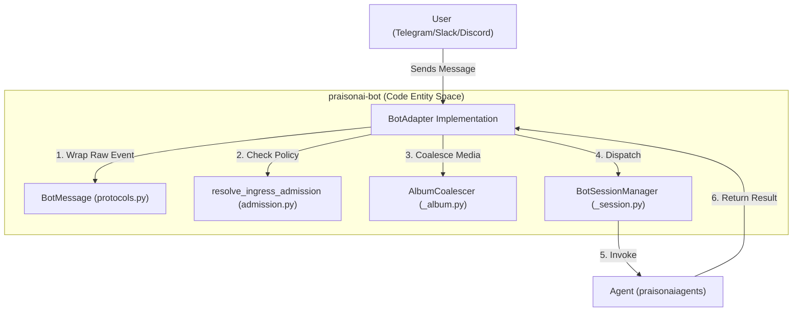
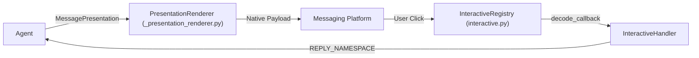

<!-- source: DeepWiki mcp.deepwiki.com · repo MervinPraison/PraisonAI · page 14.2 Messaging Bots · fetched 2026-10-26 -->

# Messaging Bots

Relevant source files

The following files were used as context for generating this wiki page:

- [src/praisonai-agents/praisonaiagents/bots/__init__.py](src/praisonai-agents/praisonaiagents/bots/__init__.py)
- [src/praisonai-agents/praisonaiagents/bots/agent_reply.py](src/praisonai-agents/praisonaiagents/bots/agent_reply.py)
- [src/praisonai-agents/praisonaiagents/bots/base.py](src/praisonai-agents/praisonaiagents/bots/base.py)
- [src/praisonai-agents/praisonaiagents/bots/config.py](src/praisonai-agents/praisonaiagents/bots/config.py)
- [src/praisonai-agents/praisonaiagents/bots/failure.py](src/praisonai-agents/praisonaiagents/bots/failure.py)
- [src/praisonai-agents/praisonaiagents/bots/format.py](src/praisonai-agents/praisonaiagents/bots/format.py)
- [src/praisonai-agents/praisonaiagents/bots/interactive.py](src/praisonai-agents/praisonaiagents/bots/interactive.py)
- [src/praisonai-agents/praisonaiagents/bots/pairing_types.py](src/praisonai-agents/praisonaiagents/bots/pairing_types.py)
- [src/praisonai-agents/praisonaiagents/bots/presentation.py](src/praisonai-agents/praisonaiagents/bots/presentation.py)
- [src/praisonai-agents/praisonaiagents/bots/protocols.py](src/praisonai-agents/praisonaiagents/bots/protocols.py)
- [src/praisonai-agents/praisonaiagents/bots/silence.py](src/praisonai-agents/praisonaiagents/bots/silence.py)
- [src/praisonai-agents/praisonaiagents/gateway/adapters/__init__.py](src/praisonai-agents/praisonaiagents/gateway/adapters/__init__.py)
- [src/praisonai-agents/praisonaiagents/gateway/adapters/recipe_adapter.py](src/praisonai-agents/praisonaiagents/gateway/adapters/recipe_adapter.py)
- [src/praisonai-agents/tests/unit/gateway/test_recipe_failure_reply.py](src/praisonai-agents/tests/unit/gateway/test_recipe_failure_reply.py)
- [src/praisonai-agents/tests/unit/test_agent_presentation_reply.py](src/praisonai-agents/tests/unit/test_agent_presentation_reply.py)
- [src/praisonai-agents/tests/unit/test_base_platform_adapter.py](src/praisonai-agents/tests/unit/test_base_platform_adapter.py)
- [src/praisonai-agents/tests/unit/test_bot_loop_guard.py](src/praisonai-agents/tests/unit/test_bot_loop_guard.py)
- [src/praisonai-agents/tests/unit/test_bots.py](src/praisonai-agents/tests/unit/test_bots.py)
- [src/praisonai-agents/tests/unit/test_callback_payload_store.py](src/praisonai-agents/tests/unit/test_callback_payload_store.py)
- [src/praisonai-agents/tests/unit/test_degraded_delivery.py](src/praisonai-agents/tests/unit/test_degraded_delivery.py)
- [src/praisonai-agents/tests/unit/test_failure_reply.py](src/praisonai-agents/tests/unit/test_failure_reply.py)
- [src/praisonai-agents/tests/unit/test_gateway_dead_letter_policy.py](src/praisonai-agents/tests/unit/test_gateway_dead_letter_policy.py)
- [src/praisonai-agents/tests/unit/test_identity_canonicalizer_protocol.py](src/praisonai-agents/tests/unit/test_identity_canonicalizer_protocol.py)
- [src/praisonai-agents/tests/unit/test_presentation_adapt.py](src/praisonai-agents/tests/unit/test_presentation_adapt.py)
- [src/praisonai-bot/praisonai_bot/bots/_album.py](src/praisonai-bot/praisonai_bot/bots/_album.py)
- [src/praisonai-bot/praisonai_bot/bots/_commands.py](src/praisonai-bot/praisonai_bot/bots/_commands.py)
- [src/praisonai-bot/praisonai_bot/bots/_delivery.py](src/praisonai-bot/praisonai_bot/bots/_delivery.py)
- [src/praisonai-bot/praisonai_bot/bots/_durable_adapter.py](src/praisonai-bot/praisonai_bot/bots/_durable_adapter.py)
- [src/praisonai-bot/praisonai_bot/bots/_failure.py](src/praisonai-bot/praisonai_bot/bots/_failure.py)
- [src/praisonai-bot/praisonai_bot/bots/_ingress.py](src/praisonai-bot/praisonai_bot/bots/_ingress.py)
- [src/praisonai-bot/praisonai_bot/bots/_media.py](src/praisonai-bot/praisonai_bot/bots/_media.py)
- [src/praisonai-bot/praisonai_bot/bots/_outbox.py](src/praisonai-bot/praisonai_bot/bots/_outbox.py)
- [src/praisonai-bot/praisonai_bot/bots/_presentation_renderer.py](src/praisonai-bot/praisonai_bot/bots/_presentation_renderer.py)
- [src/praisonai-bot/praisonai_bot/bots/_protocol_mixin.py](src/praisonai-bot/praisonai_bot/bots/_protocol_mixin.py)
- [src/praisonai-bot/praisonai_bot/bots/_reliability.py](src/praisonai-bot/praisonai_bot/bots/_reliability.py)
- [src/praisonai-bot/praisonai_bot/bots/_resilience.py](src/praisonai-bot/praisonai_bot/bots/_resilience.py)
- [src/praisonai-bot/praisonai_bot/bots/discord.py](src/praisonai-bot/praisonai_bot/bots/discord.py)
- [src/praisonai-bot/praisonai_bot/bots/slack.py](src/praisonai-bot/praisonai_bot/bots/slack.py)
- [src/praisonai-bot/praisonai_bot/bots/telegram.py](src/praisonai-bot/praisonai_bot/bots/telegram.py)
- [src/praisonai-bot/praisonai_bot/bots/whatsapp.py](src/praisonai-bot/praisonai_bot/bots/whatsapp.py)
- [src/praisonai-bot/tests/unit/bots/test_adapter_list_channels.py](src/praisonai-bot/tests/unit/bots/test_adapter_list_channels.py)
- [src/praisonai-bot/tests/unit/bots/test_custom_command_bridge.py](src/praisonai-bot/tests/unit/bots/test_custom_command_bridge.py)
- [src/praisonai-bot/tests/unit/bots/test_failure_reply_wiring.py](src/praisonai-bot/tests/unit/bots/test_failure_reply_wiring.py)
- [src/praisonai-bot/tests/unit/bots/test_ingress.py](src/praisonai-bot/tests/unit/bots/test_ingress.py)
- [src/praisonai-bot/tests/unit/bots/test_outbox_ordering.py](src/praisonai-bot/tests/unit/bots/test_outbox_ordering.py)
- [src/praisonai-bot/tests/unit/bots/test_outbox_reconcile.py](src/praisonai-bot/tests/unit/bots/test_outbox_reconcile.py)
- [src/praisonai-bot/tests/unit/bots/test_queue_dead_letter_age.py](src/praisonai-bot/tests/unit/bots/test_queue_dead_letter_age.py)
- [src/praisonai-bot/tests/unit/bots/test_reliability.py](src/praisonai-bot/tests/unit/bots/test_reliability.py)
- [src/praisonai-bot/tests/unit/bots/test_slack_reconcile.py](src/praisonai-bot/tests/unit/bots/test_slack_reconcile.py)
- [src/praisonai-bot/tests/unit/bots/test_telegram_callback_store_wiring.py](src/praisonai-bot/tests/unit/bots/test_telegram_callback_store_wiring.py)
- [src/praisonai-bot/tests/unit/bots/test_whatsapp_identity_canonicalizer.py](src/praisonai-bot/tests/unit/bots/test_whatsapp_identity_canonicalizer.py)
- [src/praisonai-bot/tests/unit/bots/test_whatsapp_presentation_renderer.py](src/praisonai-bot/tests/unit/bots/test_whatsapp_presentation_renderer.py)
- [src/praisonai-bot/tests/unit/gateway/test_gateway_delivery_router.py](src/praisonai-bot/tests/unit/gateway/test_gateway_delivery_router.py)
- [src/praisonai-bot/tests/unit/gateway/test_unknown_user_policy_wiring.py](src/praisonai-bot/tests/unit/gateway/test_unknown_user_policy_wiring.py)
- [src/praisonai-bot/tests/unit/test_bot_album.py](src/praisonai-bot/tests/unit/test_bot_album.py)
- [src/praisonai-bot/tests/unit/test_bot_fixes.py](src/praisonai-bot/tests/unit/test_bot_fixes.py)

The PraisonAI messaging bot system provides a robust, multi-channel bridge between AI agents and popular messaging platforms. It handles the complexities of platform-specific protocols, interactive UI rendering, and delivery resilience through a tiered architecture split between the core SDK and the `praisonai-bot` package.

## Architecture Overview

The system follows a protocol-first design where the core SDK (`praisonaiagents.bots`) defines interfaces and portable presentation primitives, while the `praisonai-bot` package provides concrete implementations for Telegram, Slack, Discord, and WhatsApp.

### Bot Data Flow and Entity Mapping

The following diagram maps the conceptual "Natural Language Space" (user messages) to the "Code Entity Space" (classes and protocols).

**Diagram: Inbound Message Pipeline**

Sources: [src/praisonai-agents/praisonaiagents/bots/protocols.py:18-30](), [src/praisonai-bot/praisonai_bot/bots/telegram.py:164-180](), [src/praisonai-bot/praisonai_bot/bots/_session.py:57-58]()

## Platform Adapters

Each messaging platform is supported via a dedicated adapter class that implements `ChatCommandMixin` and `MessageHookMixin`.

| Adapter | File Path | Primary Library |
| :--- | :--- | :--- |
| `TelegramBot` | [src/praisonai-bot/praisonai_bot/bots/telegram.py:77-97]() | `python-telegram-bot` |
| `SlackBot` | [src/praisonai-bot/praisonai_bot/bots/slack.py:90-114]() | `slack-bolt` |
| `DiscordBot` | [src/praisonai-bot/praisonai_bot/bots/discord.py:58-78]() | `discord.py` |
| `WhatsAppBot` | [src/praisonai-bot/praisonai_bot/bots/whatsapp.py:134-153]() | Meta Graph API (Cloud) / `neonize` (Web) |

### Platform Capabilities
Adapters declare their features via the `PlatformCapabilities` dataclass, allowing the shared delivery machinery to adapt behavior (e.g., fallback to text if media is unsupported).
*   `max_message_length`: Limits for message splitting [src/praisonai-agents/praisonaiagents/bots/protocols.py:119-120]().
*   `supports_edit`: Enables progressive streaming of agent thoughts [src/praisonai-agents/praisonaiagents/bots/protocols.py:121-122]().
*   `reconciles_unknown_send`: Allows the `OutboundQueue` to check if a message landed after a crash [src/praisonai-agents/praisonaiagents/bots/protocols.py:95-101]().

Sources: [src/praisonai-agents/praisonaiagents/bots/protocols.py:72-117](), [src/praisonai-bot/praisonai_bot/bots/discord.py:170-184]()

## Interactive Presentation System

PraisonAI uses a portable UI system called **Message Presentation**. Agents author UI using generic blocks, which are then rendered into native components (like Telegram Inline Keyboards or Slack Blocks).

### Presentation Primitives
*   **`PresentationAction`**: Defines what happens on click (`COMMAND`, `CALLBACK`, `URL`, `REPLY`) [src/praisonai-agents/praisonaiagents/bots/presentation.py:60-68]().
*   **`PresentationBlock`**: Portable UI units including `TEXT`, `BUTTONS`, `SELECT`, `TABLE`, and `CHART` [src/praisonai-agents/praisonaiagents/bots/presentation.py:80-90]().
*   **`adapt_presentation`**: A critical function that truncates labels, handles button overflow, and degrades unsupported elements (e.g., converting a `SELECT` menu to a `BUTTON` grid for Telegram) [src/praisonai-bot/praisonai_bot/bots/_presentation_renderer.py:101-105]().

**Diagram: UI Rendering and Callback Loop**

Sources: [src/praisonai-agents/praisonaiagents/bots/presentation.py:92-121](), [src/praisonai-agents/praisonaiagents/bots/interactive.py:138-172](), [src/praisonai-bot/praisonai_bot/bots/_presentation_renderer.py:28-49]()

## Delivery Resilience and the Outbox

To prevent message loss during network outages or process crashes, the system employs an `OutboundQueue` (Outbox).

### OutboundQueue Mechanics
The `OutboundQueue` is a SQLite-backed persistent store that tracks every message from `pending` to `sent` [src/praisonai-bot/praisonai_bot/bots/_outbox.py:27-42]().
*   **Deduplication**: Uses `idempotency_key` to prevent duplicate sends [src/praisonai-bot/praisonai_bot/bots/_outbox.py:32-32]().
*   **Ordering**: Supports `strict` FIFO per conversation lane or `best_effort` global ordering [src/praisonai-bot/praisonai_bot/bots/_outbox.py:124-132]().
*   **Reconciliation**: On restart, messages in the `sending` state are moved to `recovered`. If the adapter supports `reconciles_unknown_send`, it queries the platform to see if the message actually landed before re-attempting [src/praisonai-bot/praisonai_bot/bots/_outbox.py:15-25]().
*   **Dead Letter Policy**: Messages that fail repeatedly are moved to a permanent failure state only after they exceed both `max_attempts` and a `dead_letter_min_age` (default 6 hours) [src/praisonai-bot/praisonai_bot/bots/_outbox.py:89-93]().

Sources: [src/praisonai-bot/praisonai_bot/bots/_outbox.py:113-162](), [src/praisonai-bot/praisonai_bot/bots/_resilience.py:69-72]()

## Bot Supervision and Control

### Command System
The `CommandRegistry` provides a unified set of slash commands available across all platforms [src/praisonai_bot/praisonai_bot/bots/_commands.py:116-123]().
*   `/status`: Shows bot health and uptime [src/praisonai-bot/praisonai_bot/bots/_commands.py:127-127]().
*   `/learn`: Triggers the skill-learning pipeline to ground the agent in new data [src/praisonai-bot/praisonai_bot/bots/_commands.py:139-139]().
*   `/stop`: Cancels the current agent task [src/praisonai-bot/praisonai_bot/bots/_commands.py:129-129]().

### Security and Admission
*   **`CommandAccessPolicy`**: Restricts privileged commands (like `/learn`) to `admin_users` [src/praisonai-bot/praisonai_bot/bots/_commands.py:24-34]().
*   **`UnknownUserPolicy`**: Controls behavior when an unlisted user messages the bot. Policies include `deny`, `allow`, or `pair` (which triggers a pairing flow) [src/praisonai-agents/praisonaiagents/bots/config.py:112-113]().
*   **`WebhookFilter`**: Evaluates inbound webhook payloads against configured rules to filter spam or irrelevant events [src/praisonai-agents/praisonaiagents/bots/webhook_filter.py:92-96]().

Sources: [src/praisonai-bot/praisonai_bot/bots/_commands.py:41-50](), [src/praisonai-agents/praisonaiagents/bots/config.py:14-34](), [src/praisonai-bot/praisonai_bot/bots/_unknown_user.py:64-66]()

---

