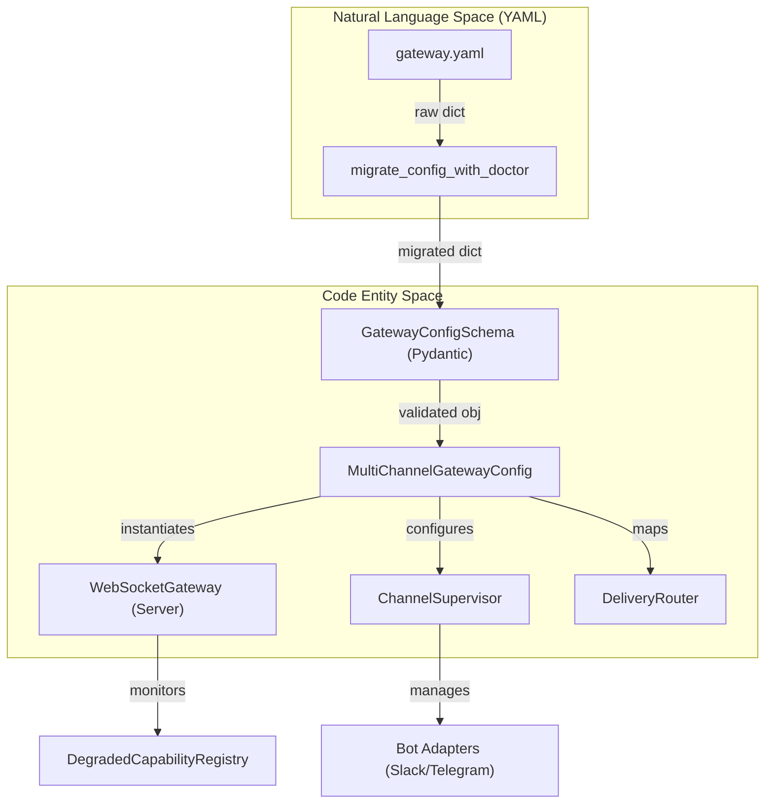
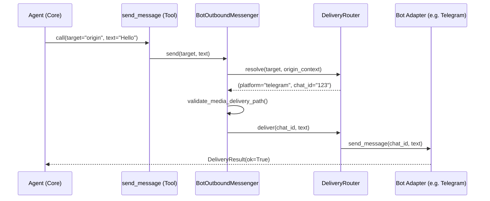

<!-- source: DeepWiki mcp.deepwiki.com · repo MervinPraison/PraisonAI · page 14.3 Gateway Configuration · fetched 2026-10-26 -->

# Gateway Configuration

Relevant source files

The following files were used as context for generating this wiki page:

- [examples/yaml/gateway.yaml](examples/yaml/gateway.yaml)
- [src/praisonai-agents/praisonaiagents/gateway/__init__.py](src/praisonai-agents/praisonaiagents/gateway/__init__.py)
- [src/praisonai-agents/praisonaiagents/gateway/config.py](src/praisonai-agents/praisonaiagents/gateway/config.py)
- [src/praisonai-agents/praisonaiagents/gateway/degraded_state.py](src/praisonai-agents/praisonaiagents/gateway/degraded_state.py)
- [src/praisonai-agents/praisonaiagents/gateway/protocols.py](src/praisonai-agents/praisonaiagents/gateway/protocols.py)
- [src/praisonai-agents/praisonaiagents/tools/messaging_tools.py](src/praisonai-agents/praisonaiagents/tools/messaging_tools.py)
- [src/praisonai-agents/tests/unit/snapshot/test_agent_snapshot_root.py](src/praisonai-agents/tests/unit/snapshot/test_agent_snapshot_root.py)
- [src/praisonai-agents/tests/unit/test_gateway.py](src/praisonai-agents/tests/unit/test_gateway.py)
- [src/praisonai-agents/tests/unit/test_gateway_code_skew.py](src/praisonai-agents/tests/unit/test_gateway_code_skew.py)
- [src/praisonai-agents/tests/unit/test_gateway_config.py](src/praisonai-agents/tests/unit/test_gateway_config.py)
- [src/praisonai-agents/tests/unit/test_gateway_degraded_state.py](src/praisonai-agents/tests/unit/test_gateway_degraded_state.py)
- [src/praisonai-agents/tests/unit/test_gateway_liveness_policy.py](src/praisonai-agents/tests/unit/test_gateway_liveness_policy.py)
- [src/praisonai-agents/tests/unit/test_gateway_routing.py](src/praisonai-agents/tests/unit/test_gateway_routing.py)
- [src/praisonai-agents/tests/unit/test_gateway_turn_lock.py](src/praisonai-agents/tests/unit/test_gateway_turn_lock.py)
- [src/praisonai-agents/tests/unit/test_route_bindings.py](src/praisonai-agents/tests/unit/test_route_bindings.py)
- [src/praisonai-agents/tests/unit/tools/test_ask_conversation_tool.py](src/praisonai-agents/tests/unit/tools/test_ask_conversation_tool.py)
- [src/praisonai-agents/tests/unit/tools/test_send_message_tool.py](src/praisonai-agents/tests/unit/tools/test_send_message_tool.py)
- [src/praisonai-bot/praisonai_bot/bots/_config_schema.py](src/praisonai-bot/praisonai_bot/bots/_config_schema.py)
- [src/praisonai-bot/praisonai_bot/bots/_defaults.py](src/praisonai-bot/praisonai_bot/bots/_defaults.py)
- [src/praisonai-bot/praisonai_bot/bots/_outbound_media.py](src/praisonai-bot/praisonai_bot/bots/_outbound_media.py)
- [src/praisonai-bot/praisonai_bot/bots/_outbound_messenger.py](src/praisonai-bot/praisonai_bot/bots/_outbound_messenger.py)
- [src/praisonai-bot/praisonai_bot/bots/delivery.py](src/praisonai-bot/praisonai_bot/bots/delivery.py)
- [src/praisonai-bot/praisonai_bot/gateway/health_monitor.py](src/praisonai-bot/praisonai_bot/gateway/health_monitor.py)
- [src/praisonai-bot/praisonai_bot/gateway/redis_pubsub.py](src/praisonai-bot/praisonai_bot/gateway/redis_pubsub.py)
- [src/praisonai-bot/praisonai_bot/gateway/server.py](src/praisonai-bot/praisonai_bot/gateway/server.py)
- [src/praisonai-bot/praisonai_bot/gateway/supervisor.py](src/praisonai-bot/praisonai_bot/gateway/supervisor.py)
- [src/praisonai-bot/tests/unit/bots/test_credential_supervision.py](src/praisonai-bot/tests/unit/bots/test_credential_supervision.py)
- [src/praisonai-bot/tests/unit/bots/test_enable_shell.py](src/praisonai-bot/tests/unit/bots/test_enable_shell.py)
- [src/praisonai-bot/tests/unit/bots/test_outbound_media.py](src/praisonai-bot/tests/unit/bots/test_outbound_media.py)
- [src/praisonai-bot/tests/unit/bots/test_outbound_messenger.py](src/praisonai-bot/tests/unit/bots/test_outbound_messenger.py)
- [src/praisonai-bot/tests/unit/bots/test_snapshot_root.py](src/praisonai-bot/tests/unit/bots/test_snapshot_root.py)
- [src/praisonai-bot/tests/unit/cli/test_gateway_config.py](src/praisonai-bot/tests/unit/cli/test_gateway_config.py)
- [src/praisonai-bot/tests/unit/gateway/test_fleet_supervision_breaker.py](src/praisonai-bot/tests/unit/gateway/test_fleet_supervision_breaker.py)
- [src/praisonai-bot/tests/unit/gateway/test_redis_pubsub_reconnect.py](src/praisonai-bot/tests/unit/gateway/test_redis_pubsub_reconnect.py)
- [src/praisonai-bot/tests/unit/gateway/test_reload_observability.py](src/praisonai-bot/tests/unit/gateway/test_reload_observability.py)

The Gateway Configuration system provides a unified, schema-validated framework for deploying multi-agent systems across various communication channels (Telegram, Slack, Discord, etc.). It enables complex routing, session management, and server-side orchestration via a centralized `gateway.yaml` manifest.

## MultiChannelGatewayConfig

The `MultiChannelGatewayConfig` is the primary container for multi-channel deployments [src/praisonai-agents/praisonaiagents/gateway/config.py:213](). It bridges agent definitions with channel-specific routing logic, ensuring that inbound messages from different platforms reach the appropriate agent logic.

### Gateway YAML Structure

A typical `gateway.yaml` is composed of four main blocks:

| Block | Purpose |
| :--- | :--- |
| `agents` | Definitions of agents (instructions, models, tools) used by the gateway. |
| `channels` | Configuration for messaging platforms (tokens, allowed users, routing). |
| `gateway` | Server-level settings (host, port, timeouts, security). |
| `hooks` | Inbound trigger bindings for external events (e.g., Webhooks). |

**Sources:** [src/praisonai-bot/tests/unit/cli/test_gateway_config.py:97-122](), [src/praisonai-bot/praisonai_bot/bots/_config_schema.py:5-6]()

### Config Migration and Versioning

The gateway configuration includes a `config_version` stamp to manage breaking changes across updates [src/praisonai-agents/praisonaiagents/gateway/config.py:33](). 

*   **`GATEWAY_CONFIG_RULES`**: A list of `LegacyConfigRule` objects containing a `detect` predicate and a `fix` mutation [src/praisonai-agents/praisonaiagents/gateway/config.py:106-117]().
*   **`migrate_config_with_doctor`**: A function that applies these rules to an old configuration mapping and updates the version stamp [src/praisonai-agents/praisonaiagents/gateway/config.py:147-163]().
*   **Safety**: If a configuration version is newer than the binary supports, the system raises a `ConfigVersionError` to prevent silent data corruption [src/praisonai-agents/praisonaiagents/gateway/config.py:165-171]().

**Sources:** [src/praisonai-agents/praisonaiagents/gateway/config.py:22-182]()

## Configuration Schema and Validation

PraisonAI uses Pydantic-based validation to ensure configuration integrity before the server starts.

### Bot and Agent Schema
The `AgentConfigSchema` handles defaults for agents within the bot environment, including model aliases (`llm` vs `model`) and tool/knowledge initialization [src/praisonai-bot/praisonai_bot/bots/_config_schema.py:33-52]().

### Session Configuration
The `SessionConfigSchema` controls how conversation state is managed [src/praisonai-bot/praisonai_bot/bots/_config_schema.py:132-166]():
*   **`session_scope`**: Either `per_user` (isolated DMs) or `per_chat` (shared group threads).
*   **`compaction`**: Strategies like `summarize` or `truncate` to prevent context window overflow during long-lived sessions [src/praisonai-bot/praisonai_bot/bots/_config_schema.py:93-130]().
*   **`reset`**: Policies for clearing history based on inactivity (`idle`) or time of day (`daily`) [src/praisonai-bot/praisonai_bot/bots/_config_schema.py:55-90]().

### Server Block Validation
The `gateway:` block is strictly validated for types and ranges (e.g., port numbers, drain timeouts) [src/praisonai-bot/tests/unit/cli/test_gateway_config.py:124-178]().

**Sources:** [src/praisonai-bot/praisonai_bot/bots/_config_schema.py:1-200](), [src/praisonai-bot/tests/unit/cli/test_gateway_config.py:97-200]()

## System Integration Diagram

### Configuration Data Flow
This diagram illustrates how raw YAML is transformed into the runtime Gateway state.

**Sources:** [src/praisonai-bot/praisonai_bot/gateway/server.py:26-55](), [src/praisonai-agents/praisonaiagents/gateway/config.py:147-213](), [src/praisonai-bot/praisonai_bot/bots/_config_schema.py:5-15]()

## Supervision and Health

The Gateway implements a robust supervision model to handle partial failures without taking down the entire service.

### Credential Supervision
The `ChannelSupervisor` manages the lifecycle of individual channel adapters. It attempts to resolve credentials from `gateway.yaml` or environment variables (using `_TOKEN_FALLBACK_ENV`) [src/praisonai-bot/praisonai_bot/gateway/server.py:58-67]().

### Degraded State Registry
When a component fails (e.g., invalid API key, rate limiting), it is recorded in the `DegradedCapabilityRegistry` [src/praisonai-agents/praisonaiagents/gateway/degraded_state.py:145-155]().
*   **`DegradedOwner`**: Stores the failure reason, state (`cold` or `stale`), and a mandatory `retry_hint` [src/praisonai-agents/praisonaiagents/gateway/degraded_state.py:67-85]().
*   **Fail-Closed Read**: The `assert_owner_available` function prevents work from targeting a known degraded channel, raising `OwnerUnavailable` instead of failing silently [src/praisonai-agents/praisonaiagents/gateway/degraded_state.py:35-59]().

**Sources:** [src/praisonai-agents/praisonaiagents/gateway/degraded_state.py:1-171](), [src/praisonai-bot/praisonai_bot/gateway/server.py:58-67]()

## Messaging and Delivery

### Delivery Routing
The `DeliveryRouter` resolves symbolic targets (e.g., `"origin"`, `"support_channel"`) into concrete platform/ID pairs [src/praisonai-bot/praisonai_bot/bots/delivery.py:5-6](). 
*   **`ChannelDirectory`**: Manages reachable channels, persisting home channels and observed aliases to `~/.praisonai/state/channel_directory.json` [src/praisonai-bot/praisonai_bot/bots/delivery.py:144-180]().
*   **`BotOutboundMessenger`**: Binds the core `send_message` tool to the gateway's delivery logic, enforcing `OutboundMediaPolicy` to prevent unauthorized file exfiltration [src/praisonai-bot/praisonai_bot/bots/_outbound_messenger.py:45-74]().

### Messaging Tool Execution Flow

**Sources:** [src/praisonai-bot/praisonai_bot/bots/_outbound_messenger.py:76-176](), [src/praisonai-bot/praisonai_bot/bots/delivery.py:5-8](), [src/praisonai-agents/praisonaiagents/tools/messaging_tools.py]() (inferred)

## Gateway CLI and Preflight
The Gateway provides specialized CLI commands for lifecycle management:
*   **`gateway doctor`**: Runs `migrate_config_with_doctor` to repair configuration files and validates credentials [src/praisonai-agents/praisonaiagents/gateway/config.py:157]().
*   **`gateway status`**: Queries the `DegradedCapabilityRegistry` to report the health of all channels and providers [src/praisonai-agents/praisonaiagents/gateway/degraded_state.py:12-13]().
*   **Preflight Checks**: Validates environment variables and ensures the `auth_token` is not a `KNOWN_WEAK_SECRET` [src/praisonai-agents/praisonaiagents/gateway/__init__.py:175-179]().

**Sources:** [src/praisonai-agents/praisonaiagents/gateway/config.py:147-157](), [src/praisonai-agents/praisonaiagents/gateway/degraded_state.py:1-21](), [src/praisonai-agents/praisonaiagents/gateway/__init__.py:108-130]()

---

