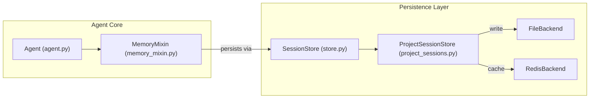

<!-- source: DeepWiki mcp.deepwiki.com · repo MervinPraison/PraisonAI · page 15 Session and Persistence · fetched 2026-10-26 -->

# Session and Persistence

<details>
<summary>Relevant source files</summary>

The following files were used as context for generating this wiki page:

- [.github/images/langfuse.png](.github/images/langfuse.png)
- [src/praisonai-agents/praisonaiagents/agent/memory_mixin.py](src/praisonai-agents/praisonaiagents/agent/memory_mixin.py)
- [src/praisonai-agents/praisonaiagents/background/task.py](src/praisonai-agents/praisonaiagents/background/task.py)
- [src/praisonai-agents/praisonaiagents/checkpoints/service.py](src/praisonai-agents/praisonaiagents/checkpoints/service.py)
- [src/praisonai-agents/praisonaiagents/checkpoints/types.py](src/praisonai-agents/praisonaiagents/checkpoints/types.py)
- [src/praisonai-agents/praisonaiagents/db/__init__.py](src/praisonai-agents/praisonaiagents/db/__init__.py)
- [src/praisonai-agents/praisonaiagents/db/protocol.py](src/praisonai-agents/praisonaiagents/db/protocol.py)
- [src/praisonai-agents/praisonaiagents/hooks/runner.py](src/praisonai-agents/praisonaiagents/hooks/runner.py)
- [src/praisonai-agents/praisonaiagents/obs/__init__.py](src/praisonai-agents/praisonaiagents/obs/__init__.py)
- [src/praisonai-agents/praisonaiagents/session/__init__.py](src/praisonai-agents/praisonaiagents/session/__init__.py)
- [src/praisonai-agents/praisonaiagents/session/hierarchy.py](src/praisonai-agents/praisonaiagents/session/hierarchy.py)
- [src/praisonai-agents/praisonaiagents/session/protocols.py](src/praisonai-agents/praisonaiagents/session/protocols.py)
- [src/praisonai-agents/praisonaiagents/session/sqlite_store.py](src/praisonai-agents/praisonaiagents/session/sqlite_store.py)
- [src/praisonai-agents/praisonaiagents/session/store.py](src/praisonai-agents/praisonaiagents/session/store.py)
- [src/praisonai-agents/praisonaiagents/session/workspace.py](src/praisonai-agents/praisonaiagents/session/workspace.py)
- [src/praisonai-agents/praisonaiagents/snapshot/snapshot.py](src/praisonai-agents/praisonaiagents/snapshot/snapshot.py)
- [src/praisonai-agents/praisonaiagents/thinking/__init__.py](src/praisonai-agents/praisonaiagents/thinking/__init__.py)
- [src/praisonai-agents/praisonaiagents/tools/delegation_tools.py](src/praisonai-agents/praisonaiagents/tools/delegation_tools.py)
- [src/praisonai-agents/praisonaiagents/tools/session_tools.py](src/praisonai-agents/praisonaiagents/tools/session_tools.py)
- [src/praisonai-agents/tests/unit/checkpoints/test_checkpoints.py](src/praisonai-agents/tests/unit/checkpoints/test_checkpoints.py)
- [src/praisonai-agents/tests/unit/session/test_hierarchy.py](src/praisonai-agents/tests/unit/session/test_hierarchy.py)
- [src/praisonai-agents/tests/unit/session/test_session_mirror.py](src/praisonai-agents/tests/unit/session/test_session_mirror.py)
- [src/praisonai-agents/tests/unit/session/test_session_store.py](src/praisonai-agents/tests/unit/session/test_session_store.py)
- [src/praisonai-agents/tests/unit/session/test_sqlite_store.py](src/praisonai-agents/tests/unit/session/test_sqlite_store.py)
- [src/praisonai-agents/tests/unit/session/test_tool_turn_persistence.py](src/praisonai-agents/tests/unit/session/test_tool_turn_persistence.py)
- [src/praisonai-agents/tests/unit/snapshot/test_snapshot.py](src/praisonai-agents/tests/unit/snapshot/test_snapshot.py)
- [src/praisonai-agents/tests/unit/test_history_parameter.py](src/praisonai-agents/tests/unit/test_history_parameter.py)
- [src/praisonai-agents/tests/unit/tools/test_delegation_tools.py](src/praisonai-agents/tests/unit/tools/test_delegation_tools.py)
- [src/praisonai-code/praisonai_code/cli/commands/checkpoint.py](src/praisonai-code/praisonai_code/cli/commands/checkpoint.py)
- [src/praisonai-code/praisonai_code/cli/commands/session.py](src/praisonai-code/praisonai_code/cli/commands/session.py)
- [src/praisonai-code/praisonai_code/cli/features/checkpoints.py](src/praisonai-code/praisonai_code/cli/features/checkpoints.py)
- [src/praisonai-code/praisonai_code/cli/state/__init__.py](src/praisonai-code/praisonai_code/cli/state/__init__.py)
- [src/praisonai-code/praisonai_code/cli/state/project_sessions.py](src/praisonai-code/praisonai_code/cli/state/project_sessions.py)
- [src/praisonai-code/praisonai_code/cli/state/redact.py](src/praisonai-code/praisonai_code/cli/state/redact.py)
- [src/praisonai-code/praisonai_code/cli/state/session_resolver.py](src/praisonai-code/praisonai_code/cli/state/session_resolver.py)
- [src/praisonai-code/praisonai_code/cli/state/sessions.py](src/praisonai-code/praisonai_code/cli/state/sessions.py)
- [src/praisonai-code/praisonai_code/cli/utils/project.py](src/praisonai-code/praisonai_code/cli/utils/project.py)
- [src/praisonai-code/tests/unit/test_project_identity.py](src/praisonai-code/tests/unit/test_project_identity.py)
- [src/praisonai-code/tests/unit/test_session_export_sanitise.py](src/praisonai-code/tests/unit/test_session_export_sanitise.py)
- [src/praisonai-code/tests/unit/test_session_identity_coherence.py](src/praisonai-code/tests/unit/test_session_identity_coherence.py)
- [src/praisonai-code/tests/unit/test_session_model_restore.py](src/praisonai-code/tests/unit/test_session_model_restore.py)
- [src/praisonai-code/tests/unit/test_session_share.py](src/praisonai-code/tests/unit/test_session_share.py)

</details>


PraisonAI provides a comprehensive persistence layer designed for long-running agentic workflows, conversational continuity, and state recovery. The system spans from simple JSON-based message stores to advanced shadow-git checkpoints and scheduled agent execution.

## Session Management

The session system ensures that conversation history, tool turns, and agent metadata are preserved across process restarts. It supports automatic restoration when a `session_id` is provided during agent initialization [src/praisonai-agents/praisonaiagents/session/__init__.py:12-23]().

### Core Components
*   **DefaultSessionStore**: A JSON-based persistence layer with atomic writes and file locking [src/praisonai-agents/praisonaiagents/session/store.py:3-6]().
*   **SqliteSessionStore**: Adds an FTS5-backed index for scalable cross-session recall and search [src/praisonai-agents/praisonaiagents/session/sqlite_store.py:2-7]().
*   **HierarchicalSessionStore**: Enables parent-child relationships, session forking, and snapshots [src/praisonai-agents/praisonaiagents/session/hierarchy.py:123-132]().
*   **SessionResolver**: A CLI-level utility that ensures coherent identity resolution across project-scoped and global stores [src/praisonai-code/praisonai_code/cli/state/session_resolver.py:2-8]().

### Session Architecture
The following diagram illustrates the relationship between the session storage entities and the CLI resolution logic.

**Session Entity Mapping**
```mermaid
graph TD
    subgraph "Natural Language Space"
        "Conversation History"
        "Project Context"
        "Session ID"
    end

    subgraph "Code Entity Space"
        SD["SessionData (store.py)"]
        SM["SessionMessage (store.py)"]
        PR["ProjectSessionStore (project_sessions.py)"]
        SR["resolve_session (session_resolver.py)"]
        DB["SqliteSessionStore (sqlite_store.py)"]
    end

    "Conversation History" --> SM
    "Project Context" --> PR
    "Session ID" --> SR
    SR --> PR
    PR --> SD
    SD --> SM
    SD -.-> DB
```
Sources: [src/praisonai-agents/praisonaiagents/session/store.py:57-172](), [src/praisonai-code/praisonai_code/cli/state/project_sessions.py:47-53](), [src/praisonai-code/praisonai_code/cli/state/session_resolver.py:88-100]()

For details, see [Session Management](#15.1).

## Checkpoints and Snapshots

Checkpoints provide point-in-time recovery for both conversation state and workspace files. The `CheckpointService` utilizes a "shadow git" repository to track file changes without interfering with the project's primary version control [src/praisonai-agents/praisonaiagents/checkpoints/service.py:53-60]().

*   **CheckpointService**: Manages the shadow git repository and handles `save`, `restore`, and `diff` operations [src/praisonai-agents/praisonaiagents/checkpoints/service.py:62-76]().
*   **SnapshotService**: Captures agent-specific state roots, enabling replay and undo support in TUIs and CLI workflows.
*   **Shadow Git**: A separate `.git` directory located in the PraisonAI storage path that tracks the workspace worktree [src/praisonai-agents/praisonaiagents/checkpoints/service.py:127-130]().

Sources: [src/praisonai-agents/praisonaiagents/checkpoints/service.py:1-21]()

For details, see [Checkpoints and Snapshots](#15.2).

## Agent Scheduler

The scheduling system allows for deferred or recurring agent execution. It supports YAML-based schedule definitions and integrates with a daemon manager to handle delivery.

*   **AgentScheduler**: The core engine for managing cron and interval-based tasks.
*   **AsyncAgentScheduler**: Provides non-blocking scheduling for high-concurrency environments.
*   **Blueprint Catalogue**: Stores reusable agent configurations that the scheduler can instantiate on-demand.

For details, see [Agent Scheduler](#15.3).

## Persistence Backends

PraisonAI supports multiple backends to accommodate different scale and latency requirements. The persistence layer is abstracted through a factory and registry system.

| Backend Type | Implementation Class | Use Case |
| :--- | :--- | :--- |
| **File** | `FileBackend` | Default local development; simple JSON files. |
| **SQLite** | `SQLiteBackend` | Local indexed storage; project-scoped sessions. |
| **Redis** | `RedisBackend` | Distributed state; gateway scaling and hot-path lookups. |
| **FTS Index** | `SqliteSessionStore` | Full-text search across thousands of sessions. |

### Data Flow Diagram
This diagram shows how data moves from the Agent core to the various persistence backends.

**Persistence Data Flow**

Sources: [src/praisonai-agents/praisonaiagents/agent/memory_mixin.py:39-41](), [src/praisonai-agents/praisonaiagents/session/store.py:172-180](), [src/praisonai-code/praisonai_code/cli/commands/session.py:39-50]()

For details, see [Persistence Backends](#15.4).

---

