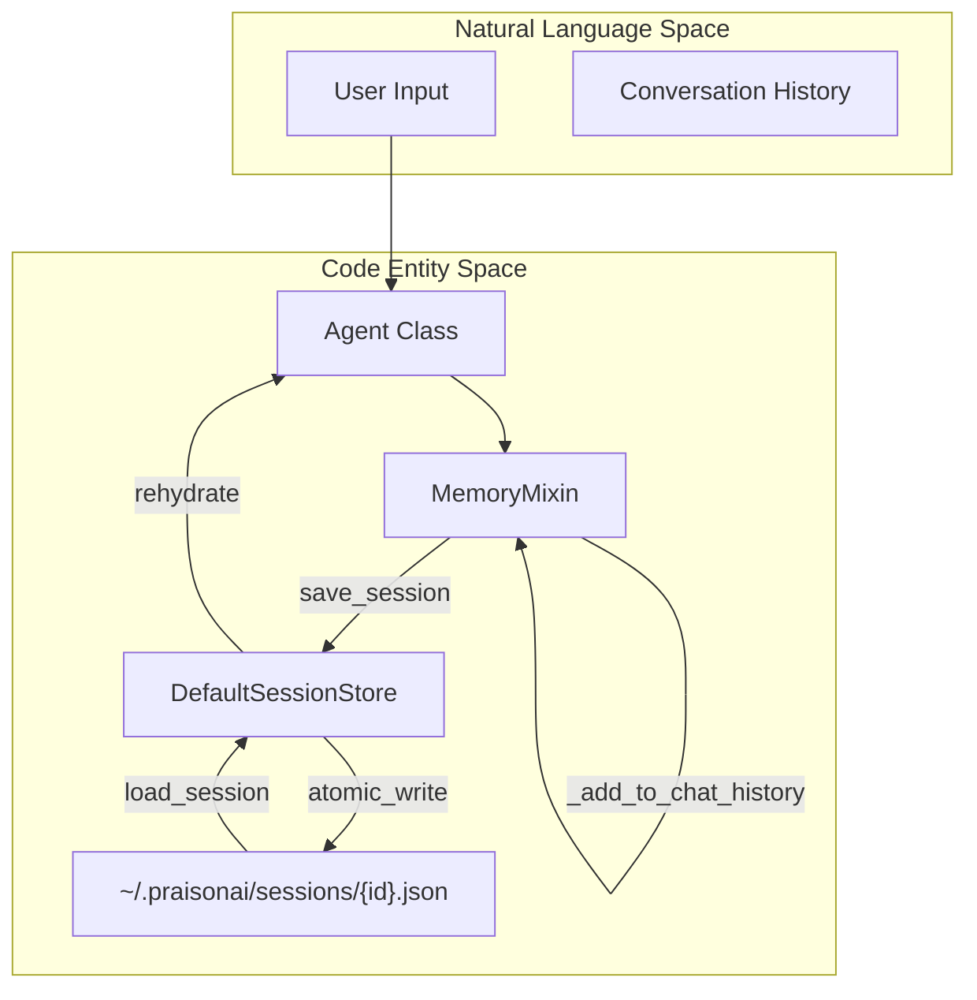
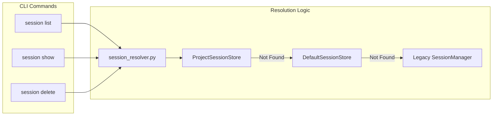

<!-- source: DeepWiki mcp.deepwiki.com · repo MervinPraison/PraisonAI · page 15.1 Session Management · fetched 2026-10-26 -->

# Session Management

Relevant source files

The following files were used as context for generating this wiki page:

- [src/praisonai-agents/praisonaiagents/agent/memory_mixin.py](src/praisonai-agents/praisonaiagents/agent/memory_mixin.py)
- [src/praisonai-agents/praisonaiagents/agent/prompt_cache.py](src/praisonai-agents/praisonaiagents/agent/prompt_cache.py)
- [src/praisonai-agents/praisonaiagents/hooks/runner.py](src/praisonai-agents/praisonaiagents/hooks/runner.py)
- [src/praisonai-agents/praisonaiagents/session/__init__.py](src/praisonai-agents/praisonaiagents/session/__init__.py)
- [src/praisonai-agents/praisonaiagents/session/context.py](src/praisonai-agents/praisonaiagents/session/context.py)
- [src/praisonai-agents/praisonaiagents/session/hierarchy.py](src/praisonai-agents/praisonaiagents/session/hierarchy.py)
- [src/praisonai-agents/praisonaiagents/session/protocols.py](src/praisonai-agents/praisonaiagents/session/protocols.py)
- [src/praisonai-agents/praisonaiagents/session/sqlite_store.py](src/praisonai-agents/praisonaiagents/session/sqlite_store.py)
- [src/praisonai-agents/praisonaiagents/session/store.py](src/praisonai-agents/praisonaiagents/session/store.py)
- [src/praisonai-agents/praisonaiagents/session/workspace.py](src/praisonai-agents/praisonaiagents/session/workspace.py)
- [src/praisonai-agents/praisonaiagents/tools/delegation_tools.py](src/praisonai-agents/praisonaiagents/tools/delegation_tools.py)
- [src/praisonai-agents/praisonaiagents/tools/session_tools.py](src/praisonai-agents/praisonaiagents/tools/session_tools.py)
- [src/praisonai-agents/tests/unit/session/test_hierarchy.py](src/praisonai-agents/tests/unit/session/test_hierarchy.py)
- [src/praisonai-agents/tests/unit/session/test_session_context.py](src/praisonai-agents/tests/unit/session/test_session_context.py)
- [src/praisonai-agents/tests/unit/session/test_session_mirror.py](src/praisonai-agents/tests/unit/session/test_session_mirror.py)
- [src/praisonai-agents/tests/unit/session/test_session_store.py](src/praisonai-agents/tests/unit/session/test_session_store.py)
- [src/praisonai-agents/tests/unit/session/test_sqlite_store.py](src/praisonai-agents/tests/unit/session/test_sqlite_store.py)
- [src/praisonai-agents/tests/unit/session/test_tool_turn_persistence.py](src/praisonai-agents/tests/unit/session/test_tool_turn_persistence.py)
- [src/praisonai-agents/tests/unit/test_history_parameter.py](src/praisonai-agents/tests/unit/test_history_parameter.py)
- [src/praisonai-agents/tests/unit/tools/test_delegation_tools.py](src/praisonai-agents/tests/unit/tools/test_delegation_tools.py)
- [src/praisonai-bot/praisonai_bot/bots/_metrics.py](src/praisonai-bot/praisonai_bot/bots/_metrics.py)
- [src/praisonai-bot/praisonai_bot/bots/_session.py](src/praisonai-bot/praisonai_bot/bots/_session.py)
- [src/praisonai-bot/praisonai_bot/bots/_stt.py](src/praisonai-bot/praisonai_bot/bots/_stt.py)
- [src/praisonai-bot/tests/unit/bots/test_group_session_scope.py](src/praisonai-bot/tests/unit/bots/test_group_session_scope.py)
- [src/praisonai-bot/tests/unit/bots/test_temporal_grounding.py](src/praisonai-bot/tests/unit/bots/test_temporal_grounding.py)
- [src/praisonai-bot/tests/unit/gateway/test_telegram_security_pipeline.py](src/praisonai-bot/tests/unit/gateway/test_telegram_security_pipeline.py)
- [src/praisonai-code/praisonai_code/cli/commands/session.py](src/praisonai-code/praisonai_code/cli/commands/session.py)
- [src/praisonai-code/praisonai_code/cli/state/__init__.py](src/praisonai-code/praisonai_code/cli/state/__init__.py)
- [src/praisonai-code/praisonai_code/cli/state/project_sessions.py](src/praisonai-code/praisonai_code/cli/state/project_sessions.py)
- [src/praisonai-code/praisonai_code/cli/state/redact.py](src/praisonai-code/praisonai_code/cli/state/redact.py)
- [src/praisonai-code/praisonai_code/cli/state/session_resolver.py](src/praisonai-code/praisonai_code/cli/state/session_resolver.py)
- [src/praisonai-code/praisonai_code/cli/state/sessions.py](src/praisonai-code/praisonai_code/cli/state/sessions.py)
- [src/praisonai-code/praisonai_code/cli/utils/project.py](src/praisonai-code/praisonai_code/cli/utils/project.py)
- [src/praisonai-code/tests/unit/test_project_identity.py](src/praisonai-code/tests/unit/test_project_identity.py)
- [src/praisonai-code/tests/unit/test_session_export_sanitise.py](src/praisonai-code/tests/unit/test_session_export_sanitise.py)
- [src/praisonai-code/tests/unit/test_session_identity_coherence.py](src/praisonai-code/tests/unit/test_session_identity_coherence.py)
- [src/praisonai-code/tests/unit/test_session_model_restore.py](src/praisonai-code/tests/unit/test_session_model_restore.py)
- [src/praisonai-code/tests/unit/test_session_share.py](src/praisonai-code/tests/unit/test_session_share.py)

PraisonAI provides a comprehensive session management system designed for persistence, hierarchy, and cross-platform identity coherence. The system ensures that agent conversations are durable across process restarts, multi-agent workflows, and different user interfaces (CLI, Web, Bots).

## Session Architecture and Stores

The session system is built on a tiered storage model, supporting both simple file-based JSON storage and structured database backends.

### Default Session Store
The `DefaultSessionStore` is the primary implementation for session persistence. It uses JSON files with atomic writes and mandatory file locking to prevent corruption during concurrent access [src/praisonai-agents/praisonaiagents/session/store.py:1-6]().

*   **File Locking**: On Unix systems, it utilizes `fcntl` for advisory locking. On Windows, it falls back to `msvcrt` or a degraded locking mode [src/praisonai-agents/praisonaiagents/session/store.py:18-23]().
*   **Retention Policies**: To manage context window limits, the store supports three policies:
    *   `compact`: Summarizes overflow into a synthetic message while archiving raw turns [src/praisonai-agents/praisonaiagents/session/store.py:47-48]().
    *   `truncate`: Slices history to the most recent messages [src/praisonai-agents/praisonaiagents/session/store.py:48]().
    *   `keep_all`: Unbounded history preservation [src/praisonai-agents/praisonaiagents/session/store.py:49]().

### SQLite and Transcript Stores
For high-concurrency or searchable environments, PraisonAI provides:
*   `SqliteSessionStore`: A relational backend for session data [src/praisonai-agents/praisonaiagents/session/__init__.py:56-59]().
*   `SqliteTranscriptStore`: Specialized storage for full execution transcripts, enabling detailed audit logs and debugging [src/praisonai-agents/praisonaiagents/session/__init__.py:61-64]().

### Data Structures
The core data models for persistence include:
*   `SessionMessage`: Captures role, content, and critical metadata, including structured tool calls and tool results to ensure identical reconstruction of the LLM prompt upon resumption [src/praisonai-agents/praisonaiagents/session/store.py:57-80]().
*   `SessionData`: The root container for a session, tracking `session_id`, `agent_name`, `user_id`, and `runtime_state` [src/praisonai-agents/praisonaiagents/session/store.py:172-185]().

### Logic Flow: Session Persistence
This diagram shows how the `Agent` interacts with the `DefaultSessionStore` via the `MemoryMixin`.

**Sources:** [src/praisonai-agents/praisonaiagents/agent/memory_mixin.py:62-75](), [src/praisonai-agents/praisonaiagents/session/store.py:1-26]()

## Session Hierarchy and Forking

The `HierarchicalSessionStore` extends basic persistence to support complex agent branching and versioning [src/praisonai-agents/praisonaiagents/session/hierarchy.py:123-147]().

*   **Parent-Child Relationships**: Sessions can track their lineage via `parent_id` and `children_ids` [src/praisonai-agents/praisonaiagents/session/hierarchy.py:60-62]().
*   **Forking**: A new session can be created from a specific message index of an existing session, allowing for "what-if" scenarios or sub-task isolation [src/praisonai-agents/praisonaiagents/session/hierarchy.py:139-140]().
*   **Snapshots**: Users can create named checkpoints (e.g., "Before refactor") and revert the session state to that exact point [src/praisonai-agents/praisonaiagents/session/hierarchy.py:25-34]().

**Sources:** [src/praisonai-agents/praisonaiagents/session/hierarchy.py:25-147]()

## Session Context and Identity Coherence

To prevent data leakage in concurrent environments (like a multi-user bot gateway), PraisonAI uses `contextvars` to maintain isolation.

### Session Context
The `SessionContext` dataclass stores platform-specific metadata such as `platform`, `chat_id`, `user_id`, and `unified_user_id` [src/praisonai-agents/praisonaiagents/session/context.py:106-117]().
*   **Task-Local Isolation**: `set_session_context` ensures that two messages handled concurrently in different tasks do not overwrite each other's identity metadata [src/praisonai-agents/praisonaiagents/session/context.py:1-6]().
*   **Security**: The `neutralize_untrusted_text` function sanitizes third-party strings (like user display names) to prevent prompt injection via embedded newlines or control characters [src/praisonai-agents/praisonaiagents/session/context.py:48-69]().

### Identity Coherence (CLI)
The `session_resolver` ensures that all CLI sub-commands (`list`, `show`, `delete`, `export`) address the same session IDs regardless of whether they are project-scoped or global [src/praisonai-code/praisonai_code/cli/state/session_resolver.py:2-15]().

**Sources:** [src/praisonai-code/praisonai_code/cli/state/session_resolver.py:61-100](), [src/praisonai-code/praisonai_code/cli/state/project_sessions.py:136-150]()

## Project Sessions

In the `praisonai-code` package, sessions are automatically scoped to the current project directory.

*   **Project Identity**: The `ProjectSessionStore` uses a git-aware identity or a path-based hash to isolate sessions by project [src/praisonai-code/praisonai_code/cli/state/project_sessions.py:62-67]().
*   **Migration**: When a project identity changes (e.g., adding a git remote), the system transparently migrates legacy path-scoped sessions to the new identity directory [src/praisonai-code/praisonai_code/cli/state/project_sessions.py:20-29]().
*   **Root Session Resolution**: When using `--continue`, the system specifically resolves the last **root** session, ignoring sub-agent or forked child sessions to ensure user continuity [src/praisonai-code/praisonai_code/cli/state/project_sessions.py:153-164]().

**Sources:** [src/praisonai-code/praisonai_code/cli/state/project_sessions.py:1-180]()

## Bot Session Management

For messaging platforms (Telegram, Slack, etc.), the `BotSessionManager` provides per-user isolation using a single shared Agent instance [src/praisonai-bot/praisonai_bot/bots/_session.py:4-6]().

*   **History Swapping**: The manager swaps the agent's `chat_history` before and after every call [src/praisonai-bot/praisonai_bot/bots/_session.py:89-94]().
*   **Concurrency Control**: It uses an `asyncio.Lock` per user (via `LockMap`) to serialize concurrent turns from the same user while allowing different users to run in parallel [src/praisonai-bot/praisonai_bot/bots/_session.py:12-14]().
*   **De-duplication**: It includes logic to strip leading arrival-time timestamps during history replay to prevent "timestamp accumulation" in the transcript [src/praisonai-bot/praisonai_bot/bots/_session.py:49-58]().

**Sources:** [src/praisonai-bot/praisonai_bot/bots/_session.py:1-166]()

## Session CLI Commands

The `praisonai session` command group provides the primary interface for managing persisted state [src/praisonai-code/praisonai_code/cli/commands/session.py:1-11]().

| Command | Description |
| :--- | :--- |
| `list` | Lists sessions, defaulting to the current project. Supports `--all` for global listing [src/praisonai-code/praisonai_code/cli/commands/session.py:55-83](). |
| `show` | Displays the full transcript and metadata for a specific session ID. |
| `resume` | Re-enters an interactive chat using the history of a previous session. |
| `delete` | Removes a session from the store. Sweeps both canonical and legacy stores [src/praisonai-code/praisonai_code/cli/state/session_resolver.py:138-162](). |
| `export` | Exports a session to JSON or Markdown, with automatic sanitization of metadata [src/praisonai-code/praisonai_code/cli/commands/session.py:8](). |
| `share` | Generates a redacted, read-only transcript for public sharing [src/praisonai-code/praisonai_code/cli/commands/session.py:9](). |

**Sources:** [src/praisonai-code/praisonai_code/cli/commands/session.py:1-180](), [src/praisonai-code/praisonai_code/cli/state/session_resolver.py:138-170]()

---

