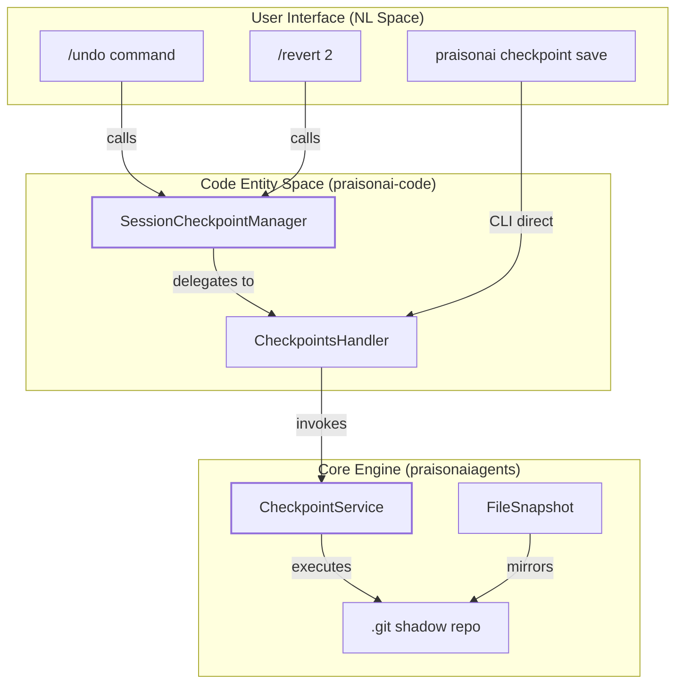
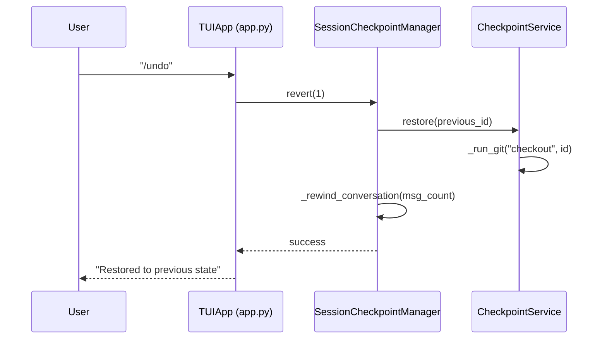

<!-- source: DeepWiki mcp.deepwiki.com · repo MervinPraison/PraisonAI · page 15.2 Checkpoints and Snapshots · fetched 2026-10-26 -->

# Checkpoints and Snapshots

Relevant source files

The following files were used as context for generating this wiki page:

- [.github/images/langfuse.png](.github/images/langfuse.png)
- [src/praisonai-agents/praisonaiagents/background/task.py](src/praisonai-agents/praisonaiagents/background/task.py)
- [src/praisonai-agents/praisonaiagents/checkpoints/service.py](src/praisonai-agents/praisonaiagents/checkpoints/service.py)
- [src/praisonai-agents/praisonaiagents/checkpoints/types.py](src/praisonai-agents/praisonaiagents/checkpoints/types.py)
- [src/praisonai-agents/praisonaiagents/db/__init__.py](src/praisonai-agents/praisonaiagents/db/__init__.py)
- [src/praisonai-agents/praisonaiagents/db/protocol.py](src/praisonai-agents/praisonaiagents/db/protocol.py)
- [src/praisonai-agents/praisonaiagents/obs/__init__.py](src/praisonai-agents/praisonaiagents/obs/__init__.py)
- [src/praisonai-agents/praisonaiagents/snapshot/snapshot.py](src/praisonai-agents/praisonaiagents/snapshot/snapshot.py)
- [src/praisonai-agents/praisonaiagents/thinking/__init__.py](src/praisonai-agents/praisonaiagents/thinking/__init__.py)
- [src/praisonai-agents/tests/unit/approval/test_default_tool_safety.py](src/praisonai-agents/tests/unit/approval/test_default_tool_safety.py)
- [src/praisonai-agents/tests/unit/checkpoints/test_checkpoints.py](src/praisonai-agents/tests/unit/checkpoints/test_checkpoints.py)
- [src/praisonai-agents/tests/unit/snapshot/test_snapshot.py](src/praisonai-agents/tests/unit/snapshot/test_snapshot.py)
- [src/praisonai-code/praisonai_code/cli/commands/checkpoint.py](src/praisonai-code/praisonai_code/cli/commands/checkpoint.py)
- [src/praisonai-code/praisonai_code/cli/features/checkpoints.py](src/praisonai-code/praisonai_code/cli/features/checkpoints.py)
- [src/praisonai-code/praisonai_code/cli/features/session_checkpoints.py](src/praisonai-code/praisonai_code/cli/features/session_checkpoints.py)
- [src/praisonai/praisonai/cli/commands/checkpoint.py](src/praisonai/praisonai/cli/commands/checkpoint.py)
- [src/praisonai/praisonai/cli/commands/code.py](src/praisonai/praisonai/cli/commands/code.py)
- [src/praisonai/praisonai/cli/execution/__init__.py](src/praisonai/praisonai/cli/execution/__init__.py)
- [src/praisonai/praisonai/cli/features/tui/app.py](src/praisonai/praisonai/cli/features/tui/app.py)
- [src/praisonai/tests/unit/code/test_session_checkpoints.py](src/praisonai/tests/unit/code/test_session_checkpoints.py)
- [src/praisonai/tests/unit/code/test_tui_diff_undo.py](src/praisonai/tests/unit/code/test_tui_diff_undo.py)
- [src/praisonai/tests/unit/test_unified_profiler.py](src/praisonai/tests/unit/test_unified_profiler.py)

PraisonAI implements a multi-layered persistence and recovery system designed to provide durable execution for agents and safety nets for workspace modifications. This system is divided into file-level **Checkpoints** (using shadow git repositories) and session-level **Snapshots**.

## Checkpoint Architecture

The checkpoint system allows the AI to track, diff, and revert file-level changes within a workspace without interfering with the user's primary `.git` repository.

### CheckpointService

The `CheckpointService` is the core engine for file-level versioning [src/praisonai-agents/praisonaiagents/checkpoints/service.py:53-76](). It manages a "Shadow Git" repository located in a dedicated storage directory, typically `~/.praisonai/checkpoints` [src/praisonai-agents/praisonaiagents/checkpoints/types.py:51-53]().

**Key Implementation Details:**
*   **Shadow Git:** Uses `git init` and `core.worktree` configuration to point the shadow repository at the actual workspace directory [src/praisonai-agents/praisonaiagents/checkpoints/service.py:188-208]().
*   **Exclusion Rules:** Automatically excludes common directories like `.git`, `__pycache__`, and `node_modules` to minimize overhead [src/praisonai-agents/praisonaiagents/checkpoints/types.py:34-42]().
*   **Protected Paths:** Prevents checkpointing of sensitive system directories such as `/etc`, `/tmp`, or the user's root home directory [src/praisonai-agents/praisonaiagents/checkpoints/service.py:42-51]().

### Data Flow: Save and Restore

1.  **Save:** When `save(message)` is called, the service adds all changes in the workspace to the shadow index and creates a commit [src/praisonai-agents/praisonaiagents/checkpoints/service.py:240-270]().
2.  **Restore:** When `restore(checkpoint_id)` is called, the service performs a `git checkout` of the specific commit to the workspace [src/praisonai-agents/praisonaiagents/checkpoints/service.py:287-320]().

#### Checkpoint Data Entities
| Entity | Description | Code Reference |
| :--- | :--- | :--- |
| `Checkpoint` | Represents a single point-in-time state (ID, message, timestamp). | [src/praisonai-agents/praisonaiagents/checkpoints/types.py:76-88]() |
| `CheckpointDiff` | Contains a list of `FileDiff` objects between two states. | [src/praisonai-agents/praisonaiagents/checkpoints/types.py:126-140]() |
| `CheckpointConfig` | Configuration for storage, retention, and exclusion. | [src/praisonai-agents/praisonaiagents/checkpoints/types.py:21-49]() |

**Sources:** [src/praisonai-agents/praisonaiagents/checkpoints/service.py:53-320](), [src/praisonai-agents/praisonaiagents/checkpoints/types.py:21-140]()

---

## Snapshot System

While checkpoints focus on workspace files, the `SnapshotService` (implemented via `FileSnapshot`) provides a grouping mechanism for file changes associated with specific agent sessions [src/praisonai-agents/praisonaiagents/snapshot/snapshot.py:91-111]().

### Snapshot Implementation
The `FileSnapshot` class uses a hash-based directory structure (SHA-256 of the project path) to isolate snapshot data for different projects [src/praisonai-agents/praisonaiagents/snapshot/snapshot.py:131-147]().

*   **Initialization:** Creates a shadow repository and an initial empty commit [src/praisonai-agents/praisonaiagents/snapshot/snapshot.py:168-182]().
*   **Syncing:** The `_sync_files` method mirrors the workspace state into the shadow repository, respecting `.gitignore` patterns [src/praisonai-agents/praisonaiagents/snapshot/snapshot.py:213-255]().

**Sources:** [src/praisonai-agents/praisonaiagents/snapshot/snapshot.py:91-255]()

---

## Integration: Code Agent Sessions

The `SessionCheckpointManager` bridges the core `CheckpointService` into the interactive coding loop [src/praisonai-code/praisonai_code/cli/features/session_checkpoints.py:44-71]().

### Coherent Replay and Undo
The system ensures that "undoing" an agent's action reverts both the **workspace files** and the **conversation history**.

1.  **Turn Tracking:** Each agent turn is recorded as a `_Turn` object containing the `checkpoint_id` and the `message_count` of the conversation at that moment [src/praisonai-code/praisonai_code/cli/features/session_checkpoints.py:29-42]().
2.  **Revert Logic:** When `revert(n)` is called:
    *   The `CheckpointService` rolls back the files [src/praisonai-code/praisonai_code/cli/features/session_checkpoints.py:210-225]().
    *   The `session_store` uses `revert_to_message` to truncate the chat history back to the recorded `message_count` [src/praisonai-code/praisonai_code/cli/features/session_checkpoints.py:178-208]().

### System Mapping: NL to Code Entities

The following diagram maps high-level user actions to the internal class methods and services.

**Sources:** [src/praisonai-code/praisonai_code/cli/features/session_checkpoints.py:44-225](), [src/praisonai-code/praisonai_code/cli/features/checkpoints.py:21-53]()

---

## CLI Commands

The `praisonai checkpoint` command group surfaces the checkpoint engine for manual use [src/praisonai-code/praisonai_code/cli/commands/checkpoint.py:23]().

| Command | Function | Implementation |
| :--- | :--- | :--- |
| `save <msg>` | Manually create a checkpoint | `handler.save(message)` [src/praisonai-code/praisonai_code/cli/commands/checkpoint.py:88-99]() |
| `list` | Show checkpoint history | `handler.list_checkpoints()` [src/praisonai-code/praisonai_code/cli/commands/checkpoint.py:101-109]() |
| `restore <id>` | Revert workspace to ID | `handler.restore(resolved_id)` [src/praisonai-code/praisonai_code/cli/commands/checkpoint.py:111-140]() |
| `rewind [n]` | Step back N checkpoints | `handler.rewind(steps)` [src/praisonai-code/praisonai_code/cli/commands/checkpoint.py:142-151]() |
| `diff [a] [b]` | Compare two checkpoints | `handler.diff(from_id, to_id)` [src/praisonai-code/praisonai_code/cli/commands/checkpoint.py:153-180]() |

### Logic for ID Resolution
The CLI uses `_resolve_checkpoint_id` to handle aliases like `last` or `latest`, as well as short-ID prefixes [src/praisonai-code/praisonai_code/cli/commands/checkpoint.py:56-85]().

**Sources:** [src/praisonai-code/praisonai_code/cli/commands/checkpoint.py:1-180]()

---

## TUI and Replay Support

In the Terminal User Interface (`TUIApp`), checkpoints enable advanced interactive features like `/undo` and `/diff` during a live agent session [src/praisonai/praisonai/cli/features/tui/app.py:187-189]().

### Execution and Revert Flow
The TUI tracks the session via `UnifiedSession` [src/praisonai/praisonai/cli/features/tui/app.py:118-119]() and allows the user to inspect changes before committing them.

**Sources:** [src/praisonai/praisonai/cli/features/tui/app.py:169-191](), [src/praisonai-code/praisonai_code/cli/features/session_checkpoints.py:178-225]()

---

