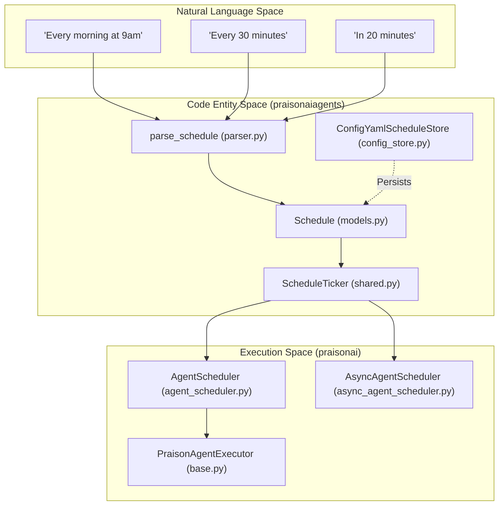
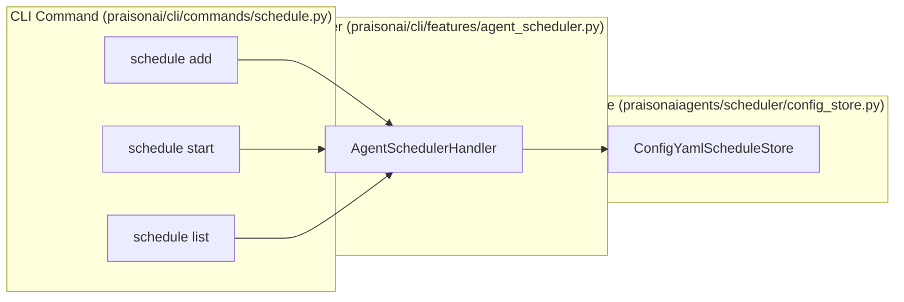

<!-- source: DeepWiki mcp.deepwiki.com · repo MervinPraison/PraisonAI · page 15.3 Agent Scheduler · fetched 2026-10-26 -->

# Agent Scheduler

Relevant source files

The following files were used as context for generating this wiki page:

- [src/praisonai-agents/praisonaiagents/scheduler/__init__.py](src/praisonai-agents/praisonaiagents/scheduler/__init__.py)
- [src/praisonai-agents/praisonaiagents/scheduler/blueprint_defs.py](src/praisonai-agents/praisonaiagents/scheduler/blueprint_defs.py)
- [src/praisonai-agents/praisonaiagents/scheduler/config_store.py](src/praisonai-agents/praisonaiagents/scheduler/config_store.py)
- [src/praisonai-agents/praisonaiagents/scheduler/due.py](src/praisonai-agents/praisonaiagents/scheduler/due.py)
- [src/praisonai-agents/praisonaiagents/scheduler/loop.py](src/praisonai-agents/praisonaiagents/scheduler/loop.py)
- [src/praisonai-agents/praisonaiagents/scheduler/models.py](src/praisonai-agents/praisonaiagents/scheduler/models.py)
- [src/praisonai-agents/praisonaiagents/scheduler/parser.py](src/praisonai-agents/praisonaiagents/scheduler/parser.py)
- [src/praisonai-agents/praisonaiagents/scheduler/protocols.py](src/praisonai-agents/praisonaiagents/scheduler/protocols.py)
- [src/praisonai-agents/praisonaiagents/scheduler/runner.py](src/praisonai-agents/praisonaiagents/scheduler/runner.py)
- [src/praisonai-agents/praisonaiagents/scheduler/store.py](src/praisonai-agents/praisonaiagents/scheduler/store.py)
- [src/praisonai-agents/praisonaiagents/scheduler/suggestion_store.py](src/praisonai-agents/praisonaiagents/scheduler/suggestion_store.py)
- [src/praisonai-agents/praisonaiagents/tools/schedule_tools.py](src/praisonai-agents/praisonaiagents/tools/schedule_tools.py)
- [src/praisonai-agents/tests/unit/test_delivery_target_preview.py](src/praisonai-agents/tests/unit/test_delivery_target_preview.py)
- [src/praisonai-agents/tests/unit/test_gateway_concurrency_policy.py](src/praisonai-agents/tests/unit/test_gateway_concurrency_policy.py)
- [src/praisonai-agents/tests/unit/test_schedule_claim.py](src/praisonai-agents/tests/unit/test_schedule_claim.py)
- [src/praisonai-agents/tests/unit/test_schedule_context_from.py](src/praisonai-agents/tests/unit/test_schedule_context_from.py)
- [src/praisonai-agents/tests/unit/test_schedule_timezone.py](src/praisonai-agents/tests/unit/test_schedule_timezone.py)
- [src/praisonai-agents/tests/unit/test_scheduler_provider.py](src/praisonai-agents/tests/unit/test_scheduler_provider.py)
- [src/praisonai-bot/praisonai_bot/bots/_admission.py](src/praisonai-bot/praisonai_bot/bots/_admission.py)
- [src/praisonai-bot/praisonai_bot/bots/botos.py](src/praisonai-bot/praisonai_bot/bots/botos.py)
- [src/praisonai-bot/praisonai_bot/scheduler/_standalone_sender.py](src/praisonai-bot/praisonai_bot/scheduler/_standalone_sender.py)
- [src/praisonai-bot/praisonai_bot/scheduler/executor.py](src/praisonai-bot/praisonai_bot/scheduler/executor.py)
- [src/praisonai-bot/tests/unit/scheduler/test_standalone_sender.py](src/praisonai-bot/tests/unit/scheduler/test_standalone_sender.py)
- [src/praisonai-bot/tests/unit/test_botos_admission.py](src/praisonai-bot/tests/unit/test_botos_admission.py)
- [src/praisonai/praisonai/__init__.py](src/praisonai/praisonai/__init__.py)
- [src/praisonai/praisonai/agent_scheduler.py](src/praisonai/praisonai/agent_scheduler.py)
- [src/praisonai/praisonai/async_agent_scheduler.py](src/praisonai/praisonai/async_agent_scheduler.py)
- [src/praisonai/praisonai/cli/commands/schedule.py](src/praisonai/praisonai/cli/commands/schedule.py)
- [src/praisonai/praisonai/cli/features/agent_scheduler.py](src/praisonai/praisonai/cli/features/agent_scheduler.py)
- [src/praisonai/praisonai/scheduler/_base_scheduler.py](src/praisonai/praisonai/scheduler/_base_scheduler.py)
- [src/praisonai/praisonai/scheduler/_delivery.py](src/praisonai/praisonai/scheduler/_delivery.py)
- [src/praisonai/praisonai/scheduler/agent_scheduler.py](src/praisonai/praisonai/scheduler/agent_scheduler.py)
- [src/praisonai/praisonai/scheduler/async_agent_scheduler.py](src/praisonai/praisonai/scheduler/async_agent_scheduler.py)
- [src/praisonai/praisonai/scheduler/blueprint_catalogue.py](src/praisonai/praisonai/scheduler/blueprint_catalogue.py)
- [src/praisonai/praisonai/scheduler/daemon_manager.py](src/praisonai/praisonai/scheduler/daemon_manager.py)
- [src/praisonai/praisonai/scheduler/executor.py](src/praisonai/praisonai/scheduler/executor.py)
- [src/praisonai/praisonai/scheduler/shared.py](src/praisonai/praisonai/scheduler/shared.py)
- [src/praisonai/praisonai/scheduler/yaml_loader.py](src/praisonai/praisonai/scheduler/yaml_loader.py)
- [src/praisonai/praisonai/templates/cache.py](src/praisonai/praisonai/templates/cache.py)
- [src/praisonai/tests/unit/scheduler/test_async_agent_scheduler.py](src/praisonai/tests/unit/scheduler/test_async_agent_scheduler.py)
- [src/praisonai/tests/unit/scheduler/test_base.py](src/praisonai/tests/unit/scheduler/test_base.py)
- [src/praisonai/tests/unit/scheduler/test_command_action.py](src/praisonai/tests/unit/scheduler/test_command_action.py)
- [src/praisonai/tests/unit/scheduler/test_delivery_origin.py](src/praisonai/tests/unit/scheduler/test_delivery_origin.py)
- [src/praisonai/tests/unit/scheduler/test_model_pin.py](src/praisonai/tests/unit/scheduler/test_model_pin.py)
- [src/praisonai/tests/unit/scheduler/test_timezone_surface.py](src/praisonai/tests/unit/scheduler/test_timezone_surface.py)

The PraisonAI Agent Scheduler provides the infrastructure for running autonomous agents periodically and reliably 24/7. It supports both high-level interval-based scheduling (sync and async) for developers and a robust, multi-tenant persistence layer for production deployments via a dedicated daemon manager.

## System Architecture and Data Flow

The scheduling system is decomposed into a core logic layer (in `praisonaiagents`) and an execution/wrapper layer (in `praisonai`). This separation allows agents to manage their own schedules via tools while the host environment handles the heavy lifting of persistence and daemonization.

### Scheduling Logic Flow
The following diagram maps the relationship between high-level scheduling concepts and their implementation entities.

**Diagram: Natural Language to Code Entity Mapping**

**Sources:** [src/praisonai/praisonai/scheduler/agent_scheduler.py:38-54](), [src/praisonai-agents/praisonaiagents/scheduler/models.py:14-28](), [src/praisonai-agents/praisonaiagents/scheduler/parser.py:1-20](), [src/praisonai/praisonai/scheduler/shared.py:33-51]()

## Core Scheduler Components

### AgentScheduler & AsyncAgentScheduler
The system provides two primary interfaces for periodic execution:
1.  **`AgentScheduler`**: A thread-based scheduler designed for standard Python environments. It uses a `ThreadPoolExecutor` to handle agent runs and retries [src/praisonai/praisonai/scheduler/agent_scheduler.py:38-125]().
2.  **`AsyncAgentScheduler`**: An async-native implementation that uses `asyncio` primitives. It is designed for integration into `async` applications and provides native cancellation support [src/praisonai/praisonai/scheduler/async_agent_scheduler.py:85-163]().

### Scheduling Mechanisms
PraisonAI supports three primary scheduling "kinds" defined in the `Schedule` dataclass:
*   **`every`**: A recurring interval in seconds [src/praisonai-agents/praisonaiagents/scheduler/models.py:18]().
*   **`cron`**: A standard 5-field cron expression (e.g., `0 9 * * *`), requiring the `croniter` library for wall-clock alignment [src/praisonai-agents/praisonaiagents/scheduler/models.py:19]().
*   **`at`**: A one-shot ISO 8601 timestamp for future execution [src/praisonai-agents/praisonaiagents/scheduler/models.py:20]().

### ScheduleTicker
The `ScheduleTicker` in `shared.py` is the wall-clock aware engine that determines when a schedule should fire next. It handles "catch-up" logic, ensuring that if a process was down during a scheduled cron slot, it fires exactly once upon resume [src/praisonai/praisonai/scheduler/shared.py:33-51]().

**Sources:** [src/praisonai/praisonai/scheduler/agent_scheduler.py:38-125](), [src/praisonai/praisonai/scheduler/async_agent_scheduler.py:85-163](), [src/praisonai-agents/praisonaiagents/scheduler/models.py:13-28](), [src/praisonai/praisonai/scheduler/shared.py:33-51]()

## Persistence and Storage

The scheduler uses a canonical default store to prevent data drift between different interfaces (CLI, Web UI, and Agent Tools).

### ConfigYamlScheduleStore
The primary production storage backend is `ConfigYamlScheduleStore`. It persists jobs to `~/.praisonai/config.yaml` under the `schedules` key [src/praisonai-agents/praisonaiagents/scheduler/config_store.py:25-32](). 

Key features include:
*   **Atomic Claims**: Uses OS-level advisory file locking (`_file_lock`) to ensure only one process executes a due job in multi-process deployments [src/praisonai-agents/praisonaiagents/scheduler/config_store.py:154-176]().
*   **Lease Management**: When a job is claimed, a lease is granted to the `owner_id` for a specified duration (default 300s) to prevent redundant executions [src/praisonai-agents/praisonaiagents/scheduler/config_store.py:158-173]().
*   **History Tracking**: Maintains a `run_history.yaml` file to log execution results, capped at 200 entries by default [src/praisonai-agents/praisonaiagents/scheduler/config_store.py:21-44]().

**Sources:** [src/praisonai-agents/praisonaiagents/scheduler/config_store.py:25-50](), [src/praisonai-agents/praisonaiagents/scheduler/config_store.py:154-176](), [src/praisonai-agents/praisonaiagents/scheduler/__init__.py:49-70]()

## Agent-Callable Tools

Agents can manage their own schedules using a set of built-in tools. These tools interact with the `_default_store` to ensure persistence.

| Tool | Purpose | Key Arguments |
| :--- | :--- | :--- |
| `schedule_add` | Creates a new job | `name`, `schedule`, `message`, `deliver` |
| `schedule_list` | Lists active jobs | `agent_id`, `principal` |
| `schedule_remove` | Deletes a job | `name` |

### Security: Principal Resolution
The `_caller_principal` function ensures multi-tenant isolation. It prioritizes the `unified_user_id` from the `SessionContext`. If an agent is prompt-injected, it cannot modify another user's schedules because the authenticated session identity is authoritative [src/praisonai-agents/praisonaiagents/tools/schedule_tools.py:26-51]().

**Sources:** [src/praisonai-agents/praisonaiagents/tools/schedule_tools.py:97-157](), [src/praisonai-agents/praisonaiagents/tools/schedule_tools.py:26-51]()

## Advanced Execution Features

### Condition Gates
The `JobConditionProtocol` allows for "cheap" pre-run checks before invoking an expensive LLM turn.
*   **`GateResult`**: The object returned by a gate, containing a `run` boolean and optional `context` to seed the agent's prompt [src/praisonai-agents/praisonaiagents/scheduler/protocols.py:14-48]().
*   **`ShellConditionGate`**: A common implementation that runs a shell script. If the script exits with code 0, the agent runs; otherwise, the tick is skipped [src/praisonai-bot/praisonai_bot/scheduler/executor.py:130-135]().

### Delivery System
The `DeliveryTarget` model defines how results are routed after execution.
*   **Symbolic Tokens**: Supports `origin` (return to sender), `all` (fan-out), or specific platform tokens like `telegram:123456` [src/praisonai-agents/praisonaiagents/scheduler/models.py:112-157]().
*   **Continuable Sessions**: If `continuable=True`, the delivery seeds a resumable session, allowing the user to reply to the agent's scheduled message and continue the conversation with full context [src/praisonai-agents/praisonaiagents/scheduler/models.py:67-73]().

**Sources:** [src/praisonai-agents/praisonaiagents/scheduler/protocols.py:14-48](), [src/praisonai-agents/praisonaiagents/scheduler/models.py:55-81](), [src/praisonai-bot/praisonai_bot/scheduler/executor.py:74-97]()

## CLI Interface

The `praisonai schedule` command group provides a management layer for the scheduler daemon and job store.

**Diagram: Schedule CLI Command Flow**

### Key CLI Options
*   `--pre-run`: Sets a shell command gate [src/praisonai/praisonai/cli/commands/schedule.py:52]().
*   `--command`: Runs a raw shell command instead of an agent turn [src/praisonai/praisonai/cli/commands/schedule.py:54]().
*   `--model` / `--pin`: Snapshots the model to prevent drift in unattended runs [src/praisonai/praisonai/cli/commands/schedule.py:56-57]().

**Sources:** [src/praisonai/praisonai/cli/commands/schedule.py:40-70](), [src/praisonai/praisonai/cli/commands/schedule.py:111-130]()

---

