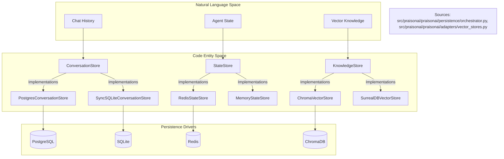

<!-- source: DeepWiki mcp.deepwiki.com · repo MervinPraison/PraisonAI · page 15.4 Persistence Backends · fetched 2026-10-26 -->

# Persistence Backends

<details>
<summary>Relevant source files</summary>

The following files were used as context for generating this wiki page:

- [examples/python/n8n_integration_example.py](examples/python/n8n_integration_example.py)
- [src/praisonai/praisonai/_registry.py](src/praisonai/praisonai/_registry.py)
- [src/praisonai/praisonai/adapters/vector_stores.py](src/praisonai/praisonai/adapters/vector_stores.py)
- [src/praisonai/praisonai/api/agent_invoke.py](src/praisonai/praisonai/api/agent_invoke.py)
- [src/praisonai/praisonai/api/call.py](src/praisonai/praisonai/api/call.py)
- [src/praisonai/praisonai/app/agentos.py](src/praisonai/praisonai/app/agentos.py)
- [src/praisonai/praisonai/db/adapter.py](src/praisonai/praisonai/db/adapter.py)
- [src/praisonai/praisonai/flow/__init__.py](src/praisonai/praisonai/flow/__init__.py)
- [src/praisonai/praisonai/observability/hooks.py](src/praisonai/praisonai/observability/hooks.py)
- [src/praisonai/praisonai/persistence/__init__.py](src/praisonai/praisonai/persistence/__init__.py)
- [src/praisonai/praisonai/persistence/conversation/__init__.py](src/praisonai/praisonai/persistence/conversation/__init__.py)
- [src/praisonai/praisonai/persistence/conversation/_ops.py](src/praisonai/praisonai/persistence/conversation/_ops.py)
- [src/praisonai/praisonai/persistence/conversation/_sql_base.py](src/praisonai/praisonai/persistence/conversation/_sql_base.py)
- [src/praisonai/praisonai/persistence/conversation/async_mysql.py](src/praisonai/praisonai/persistence/conversation/async_mysql.py)
- [src/praisonai/praisonai/persistence/conversation/async_postgres.py](src/praisonai/praisonai/persistence/conversation/async_postgres.py)
- [src/praisonai/praisonai/persistence/conversation/async_sqlite.py](src/praisonai/praisonai/persistence/conversation/async_sqlite.py)
- [src/praisonai/praisonai/persistence/conversation/base.py](src/praisonai/praisonai/persistence/conversation/base.py)
- [src/praisonai/praisonai/persistence/conversation/mysql.py](src/praisonai/praisonai/persistence/conversation/mysql.py)
- [src/praisonai/praisonai/persistence/conversation/postgres.py](src/praisonai/praisonai/persistence/conversation/postgres.py)
- [src/praisonai/praisonai/persistence/conversation/singlestore.py](src/praisonai/praisonai/persistence/conversation/singlestore.py)
- [src/praisonai/praisonai/persistence/conversation/supabase.py](src/praisonai/praisonai/persistence/conversation/supabase.py)
- [src/praisonai/praisonai/persistence/conversation/surrealdb.py](src/praisonai/praisonai/persistence/conversation/surrealdb.py)
- [src/praisonai/praisonai/persistence/conversation/turso.py](src/praisonai/praisonai/persistence/conversation/turso.py)
- [src/praisonai/praisonai/persistence/factory.py](src/praisonai/praisonai/persistence/factory.py)
- [src/praisonai/praisonai/persistence/hooks/agent_hooks.py](src/praisonai/praisonai/persistence/hooks/agent_hooks.py)
- [src/praisonai/praisonai/persistence/knowledge/surrealdb_vector.py](src/praisonai/praisonai/persistence/knowledge/surrealdb_vector.py)
- [src/praisonai/praisonai/persistence/orchestrator.py](src/praisonai/praisonai/persistence/orchestrator.py)
- [src/praisonai/praisonai/persistence/registry.py](src/praisonai/praisonai/persistence/registry.py)
- [src/praisonai/praisonai/persistence/state/async_mongodb.py](src/praisonai/praisonai/persistence/state/async_mongodb.py)
- [src/praisonai/praisonai/persistence/state/base.py](src/praisonai/praisonai/persistence/state/base.py)
- [src/praisonai/praisonai/persistence/state/memory.py](src/praisonai/praisonai/persistence/state/memory.py)
- [src/praisonai/praisonai/persistence/state/redis.py](src/praisonai/praisonai/persistence/state/redis.py)
- [src/praisonai/praisonai/persistence/state/upstash.py](src/praisonai/praisonai/persistence/state/upstash.py)
- [src/praisonai/praisonai/persistence/tests/test_registry_lazy.py](src/praisonai/praisonai/persistence/tests/test_registry_lazy.py)
- [src/praisonai/praisonai/security/injection.py](src/praisonai/praisonai/security/injection.py)
- [src/praisonai/tests/test_n8n_agent_invoke.py](src/praisonai/tests/test_n8n_agent_invoke.py)
- [src/praisonai/tests/unit/persistence/test_knowledge_identifier_safety.py](src/praisonai/tests/unit/persistence/test_knowledge_identifier_safety.py)
- [src/praisonai/tests/unit/test_agent_os_wrapper.py](src/praisonai/tests/unit/test_agent_os_wrapper.py)
- [src/praisonai/tests/unit/test_call_server_auth.py](src/praisonai/tests/unit/test_call_server_auth.py)
- [src/praisonai/tests/unit/test_security_outstanding_ghsas.py](src/praisonai/tests/unit/test_security_outstanding_ghsas.py)
- [src/praisonai/tests/unit/test_tool_source_registry.py](src/praisonai/tests/unit/test_tool_source_registry.py)

</details>


PraisoinAI provides a multi-tier persistence architecture designed to handle long-running agent sessions, large-scale knowledge retrieval (RAG), and transient state management. The system is decoupled into three primary specialized stores—**Conversation**, **State**, and **Knowledge**—coordinated by a central orchestrator.

## Architecture Overview

The persistence layer is managed by the `PersistenceOrchestrator`, which acts as a bridge between the core agent lifecycle and the underlying storage engines [src/praisonai/praisonai/persistence/orchestrator.py:1-23](). It supports both synchronous and asynchronous operations, utilizing an internal `_async_bridge` to ensure compatibility when async backends are used within sync contexts [src/praisonai/praisonai/persistence/orchestrator.py:97-115]().

### Persistence Entities Mapping
The following diagram maps high-level persistence concepts to their implementation classes and storage backends.

**Diagram: Persistence Entity Mapping**


## Persistence Orchestrator

The `PersistenceOrchestrator` is the central coordinator [src/praisonai/praisonai/persistence/orchestrator.py:31-55](). It hooks into the agent lifecycle to automate:
1.  **Session Management**: Loading or creating `ConversationSession` objects at start [src/praisonai/praisonai/persistence/orchestrator.py:161-175]().
2.  **Message Persistence**: Saving `ConversationMessage` objects during the `on_message` hook [src/praisonai/praisonai/persistence/orchestrator.py:204-219]().
3.  **Caching**: Implements a bounded LRU cache for sessions to prevent memory exhaustion in high-concurrency environments like the WebSocket gateway [src/praisonai/praisonai/persistence/orchestrator.py:85-95]().

### Data Flow: Agent Lifecycle Hooks
The following diagram illustrates how the `PersistenceOrchestrator` interacts with an `Agent` during a conversation.

**Diagram: Persistence Lifecycle Flow**
```mermaid
sequenceDiagram
    participant A as Agent
    participant O as PersistenceOrchestrator
    participant CS as ConversationStore
    participant SS as StateStore

    A->>O: on_agent_start(session_id)
    O->>CS: get_session(session_id)
    CS-->>O: ConversationSession
    O->>A: return history (List[ConversationMessage])

    Note over A, O: Agent Execution Loop

    A->>O: on_message(role, content)
    O->>CS: save_message(ConversationMessage)
    
    A->>O: on_agent_end()
    O->>SS: update_state(agent_state)
    O->>CS: update_session(metadata)

    Sources["Sources: src/praisonai/praisonai/persistence/orchestrator.py:161-230"]
```

## Backend Categories

### 1. Conversation Persistence
Handles the storage of chat histories and session metadata.

| Backend | Implementation Class | Async Support | Features |
| :--- | :--- | :--- | :--- |
| **SQLite** | `AsyncSQLiteConversationStore` | Yes | Local file storage, `aiosqlite` based [src/praisonai/praisonai/persistence/conversation/async_sqlite.py:25-34]() |
| **PostgreSQL** | `AsyncPostgresConversationStore` | Yes | High-performance, JSONB support via `asyncpg` [src/praisonai/praisonai/persistence/conversation/async_postgres.py:20-31]() |
| **MySQL** | `AsyncMySQLConversationStore` | Yes | Relational storage for enterprise scale |
| **SurrealDB** | `SurrealDBConversationStore` | Yes | Multi-model graph/document persistence |
| **Supabase** | `SupabaseConversationStore` | Yes | Managed Postgres with Realtime capabilities |

### 2. State Persistence
Manages transient agent state, tool outputs, and short-term variables.

*   **Redis**: `RedisStateStore` provides high-speed key-value storage for distributed state across multiple agent nodes [src/praisonai/praisonai/persistence/state/redis.py]().
*   **MongoDB**: `AsyncMongoDBStateStore` for document-oriented state storage.
*   **Memory**: `MemoryStateStore` for non-persistent, single-process execution [src/praisonai/praisonai/persistence/state/memory.py]().

### 3. Knowledge Persistence (Vector Stores)
Handles embedding storage and similarity search for RAG.

*   **ChromaDB**: `ChromaVectorStore` is the default local vector store, supporting cosine similarity and persistent storage in `.praison/chroma` [src/praisonai/praisonai/adapters/vector_stores.py:22-101]().
*   **SurrealDB Vector**: `SurrealDBVectorStore` implements the `VectorStoreProtocol` using SurrealDB's native vector search capabilities [src/praisonai/praisonai/persistence/knowledge/surrealdb_vector.py]().

## Universal DB Adapter

The `PraisonAIDB` class provides a unified interface for agents to interact with multiple backends simultaneously [src/praisonai/praisonai/db/adapter.py:18-39](). It detects backends based on connection URLs:

```python
db = PraisonAIDB(
    database_url="postgresql://localhost/mydb", # Conversation
    state_url="redis://localhost:6379",         # State
    knowledge_url="qdrant://localhost:6333"     # Knowledge
)
```

### Transient Error Handling
`PraisonAIDB` includes a `_is_transient_init_error` check that identifies retryable failures (e.g., `ConnectionError`, `TimeoutError`) vs. fatal misconfigurations (e.g., `PermissionError`) [src/praisonai/praisonai/db/adapter.py:134-154](). It implements a cooldown window (`_init_retry_cooldown`) to prevent hammering a down backend while allowing automatic recovery [src/praisonai/praisonai/db/adapter.py:156-170]().

## Factory and Registry

The system uses a factory pattern to instantiate stores from configuration objects.

*   **`PersistenceConfig`**: Consolidates environment variables and manual settings [src/praisonai/praisonai/persistence/config.py]().
*   **`create_stores_from_config`**: A utility function that maps config types to their respective backend classes [src/praisonai/praisonai/persistence/factory.py:23]().
*   **`PluginRegistry`**: Manages the discovery of third-party persistence plugins, allowing developers to register custom backends via entry points [src/praisonai/praisonai/_registry.py:14-17]().

Sources:
- `src/praisonai/praisonai/persistence/orchestrator.py`
- `src/praisonai/praisonai/db/adapter.py`
- `src/praisonai/praisonai/persistence/conversation/async_sqlite.py`
- `src/praisonai/praisonai/persistence/conversation/async_postgres.py`
- `src/praisonai/praisonai/adapters/vector_stores.py`
- `src/praisonai/praisonai/_registry.py`

---

