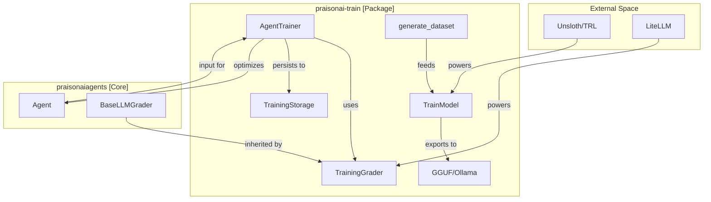
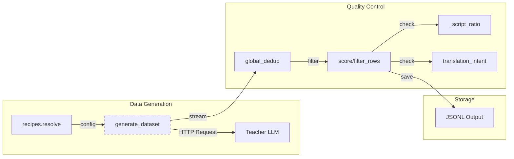

<!-- source: DeepWiki mcp.deepwiki.com · repo MervinPraison/PraisonAI · page 16 LLM Fine-Tuning and Agent Training · fetched 2026-10-26 -->

# LLM Fine-Tuning and Agent Training

Relevant source files

The following files were used as context for generating this wiki page:

- [src/praisonai-bot/tests/unit/bots/test_agentmail_parity.py](src/praisonai-bot/tests/unit/bots/test_agentmail_parity.py)
- [src/praisonai-train/README.md](src/praisonai-train/README.md)
- [src/praisonai-train/praisonai_train/_version.py](src/praisonai-train/praisonai_train/_version.py)
- [src/praisonai-train/praisonai_train/cli/app.py](src/praisonai-train/praisonai_train/cli/app.py)
- [src/praisonai-train/praisonai_train/cli/commands/data.py](src/praisonai-train/praisonai_train/cli/commands/data.py)
- [src/praisonai-train/praisonai_train/cli/commands/serve.py](src/praisonai-train/praisonai_train/cli/commands/serve.py)
- [src/praisonai-train/praisonai_train/cli/commands/train.py](src/praisonai-train/praisonai_train/cli/commands/train.py)
- [src/praisonai-train/praisonai_train/data/__init__.py](src/praisonai-train/praisonai_train/data/__init__.py)
- [src/praisonai-train/praisonai_train/data/_util.py](src/praisonai-train/praisonai_train/data/_util.py)
- [src/praisonai-train/praisonai_train/data/checks.py](src/praisonai-train/praisonai_train/data/checks.py)
- [src/praisonai-train/praisonai_train/data/dedup.py](src/praisonai-train/praisonai_train/data/dedup.py)
- [src/praisonai-train/praisonai_train/data/export_trials.py](src/praisonai-train/praisonai_train/data/export_trials.py)
- [src/praisonai-train/praisonai_train/data/generate.py](src/praisonai-train/praisonai_train/data/generate.py)
- [src/praisonai-train/praisonai_train/data/intent.py](src/praisonai-train/praisonai_train/data/intent.py)
- [src/praisonai-train/praisonai_train/data/protocols.py](src/praisonai-train/praisonai_train/data/protocols.py)
- [src/praisonai-train/praisonai_train/data/qc.py](src/praisonai-train/praisonai_train/data/qc.py)
- [src/praisonai-train/praisonai_train/data/recipes.py](src/praisonai-train/praisonai_train/data/recipes.py)
- [src/praisonai-train/praisonai_train/data/registry.py](src/praisonai-train/praisonai_train/data/registry.py)
- [src/praisonai-train/praisonai_train/setup/config.yaml](src/praisonai-train/praisonai_train/setup/config.yaml)
- [src/praisonai-train/praisonai_train/setup/setup_conda_env.sh](src/praisonai-train/praisonai_train/setup/setup_conda_env.sh)
- [src/praisonai-train/praisonai_train/train/_llamacpp.py](src/praisonai-train/praisonai_train/train/_llamacpp.py)
- [src/praisonai-train/praisonai_train/train/_mtp.py](src/praisonai-train/praisonai_train/train/_mtp.py)
- [src/praisonai-train/praisonai_train/train/_ollama.py](src/praisonai-train/praisonai_train/train/_ollama.py)
- [src/praisonai-train/praisonai_train/train/agents/hook.py](src/praisonai-train/praisonai_train/train/agents/hook.py)
- [src/praisonai-train/praisonai_train/train/agents/models.py](src/praisonai-train/praisonai_train/train/agents/models.py)
- [src/praisonai-train/praisonai_train/train/agents/orchestrator.py](src/praisonai-train/praisonai_train/train/agents/orchestrator.py)
- [src/praisonai-train/praisonai_train/train/agents/storage.py](src/praisonai-train/praisonai_train/train/agents/storage.py)
- [src/praisonai-train/praisonai_train/train/llm/trainer.py](src/praisonai-train/praisonai_train/train/llm/trainer.py)
- [src/praisonai-train/pyproject.toml](src/praisonai-train/pyproject.toml)
- [src/praisonai-train/tests/unit/data/test_data.py](src/praisonai-train/tests/unit/data/test_data.py)
- [src/praisonai-train/tests/unit/data/test_dedup.py](src/praisonai-train/tests/unit/data/test_dedup.py)
- [src/praisonai-train/tests/unit/data/test_export_trials.py](src/praisonai-train/tests/unit/data/test_export_trials.py)
- [src/praisonai-train/tests/unit/data/test_generate_guard.py](src/praisonai-train/tests/unit/data/test_generate_guard.py)
- [src/praisonai-train/tests/unit/data/test_generate_progress.py](src/praisonai-train/tests/unit/data/test_generate_progress.py)
- [src/praisonai-train/tests/unit/data/test_task_aware_qc.py](src/praisonai-train/tests/unit/data/test_task_aware_qc.py)
- [src/praisonai-train/tests/unit/train/test_models.py](src/praisonai-train/tests/unit/train/test_models.py)
- [src/praisonai-train/tests/unit/train/test_mtp.py](src/praisonai-train/tests/unit/train/test_mtp.py)
- [src/praisonai-train/tests/unit/train/test_orchestrator.py](src/praisonai-train/tests/unit/train/test_orchestrator.py)
- [src/praisonai-train/tests/unit/train/test_robustness.py](src/praisonai-train/tests/unit/train/test_robustness.py)
- [src/praisonai-train/tests/unit/train/test_storage.py](src/praisonai-train/tests/unit/train/test_storage.py)
- [src/praisonai-train/uv.lock](src/praisonai-train/uv.lock)

The `praisonai-train` package provides a specialized infrastructure for improving both base model intelligence and high-level agent behavior. It bridges the gap between static model weights and dynamic agentic performance through two primary avenues: traditional LLM fine-tuning (using the Unsloth framework) and iterative agent training loops that optimize prompts based on performance feedback.

### Core Training Architecture

The training system is divided into three functional domains: low-level model optimization, high-level agent behavioral loops, and synthetic data engineering.

| Domain | Key Components | Purpose |
| :--- | :--- | :--- |
| **LLM Fine-Tuning** | `TrainModel`, `FastLanguageModel` | Low-level parameter updates, LoRA, and quantization. |
| **Agent Training** | `AgentTrainer`, `TrainingGrader` | Iterative prompt/behavior optimization via LLM-as-judge or Human feedback. |
| **Data Engineering** | `generate_dataset`, `MinHashLSH` | Synthetic dataset generation, deduplication, and quality control. |

#### Training System Relationship
The following diagram illustrates how the training package interacts with the core agent system and external model providers.

Sources: [src/praisonai-train/praisonai_train/train/agents/orchestrator.py:37-66](), [src/praisonai-train/praisonai_train/train/llm/trainer.py:146-161](), [src/praisonai-train/pyproject.toml:11-20]()

---

### LLM Fine-Tuning

The LLM fine-tuning module, encapsulated in the `TrainModel` class [src/praisonai-train/praisonai_train/train/llm/trainer.py:146](), leverages the **Unsloth** framework for memory-efficient and fast training. It supports both ShareGPT and Alpaca-style dataset formats [src/praisonai-train/praisonai_train/train/llm/trainer.py:62-117]().

Key features include:
- **LoRA/QLoRA Support**: Efficient parameter updates using `FastLanguageModel`.
- **Quantization**: Built-in support for GGUF and Ollama export formats including `q4_k_m`, `q8_0`, and `f16` [src/praisonai-train/praisonai_train/train/llm/trainer.py:22-25]().
- **Hardware Optimization**: Automated checks for bfloat16 support and GPU memory management [src/praisonai-train/praisonai_train/train/llm/trainer.py:33-49]().

For implementation details, hardware requirements, and CLI usage, see [LLM Fine-Tuning](#16.1).

---

### Agent Training Loop

Unlike model fine-tuning which changes weights, the **Agent Training Loop** optimizes the "Agentic Layer." The `AgentTrainer` [src/praisonai-train/praisonai_train/train/agents/orchestrator.py:37]() manages an iterative cycle where an agent's performance is evaluated against specific `TrainingScenario` objects [src/praisonai-train/praisonai_train/train/agents/models.py:102]().

The loop operates in two modes:
1.  **LLM-as-Judge**: Uses a `TrainingGrader` (powered by `litellm`) to automatically score outputs and provide improvement suggestions [src/praisonai-train/praisonai_train/train/agents/orchestrator.py:43-45]().
2.  **Human-in-the-Loop**: Allows manual scoring (1-10) and qualitative feedback during the iteration [src/praisonai-train/praisonai_train/train/agents/orchestrator.py:167-210]().

Training can stop early if a quality score of **9.5** is achieved [src/praisonai-train/praisonai_train/cli/commands/train.py:94](). Results are persisted via `TrainingStorage` [src/praisonai-train/praisonai_train/train/agents/storage.py]().

For details on evaluation metrics and iteration management, see [Agent Training Loop](#16.2).

---

### Dataset Generation and Quality Control

High-quality training requires diverse and clean data. The `praisonai_train.data` module provides tools for creating synthetic datasets and ensuring their integrity.

#### Data Pipeline Flow
The diagram below maps the data flow from generation to the final training-ready state.

Sources: [src/praisonai-train/praisonai_train/data/generate.py:160-165](), [src/praisonai-train/praisonai_train/data/qc.py:24-30](), [src/praisonai-train/praisonai_train/data/dedup.py:10]()

Key capabilities:
- **Synthetic Generation**: Uses a "Teacher LLM" to synthesize `{instruction, input, output}` rows based on specific `recipes` [src/praisonai-train/praisonai_train/data/generate.py:1-10]().
- **Quality Control (QC)**: A pipeline that filters for exact and near-duplicates (MinHashLSH), removes boilerplate/refusals, and checks for script purity [src/praisonai-train/praisonai_train/data/qc.py:36-58]().
- **Diversity Metrics**: Calculates `distinct_2` (n-gram diversity) and output length coefficient of variation (CV) to prevent dataset collapse [src/praisonai-train/praisonai_train/data/qc.py:107-112]().

For details on recipe creation and the QC pipeline, see [Dataset Generation and Quality Control](#16.3).

---

### CLI Interface

The training features are exposed through the `praisonai-train` CLI, organized into three main command groups:

- `praisonai-train llm`: Triggers the Unsloth-based model fine-tuning [src/praisonai-train/praisonai_train/cli/commands/train.py:33]().
- `praisonai-train agents`: Starts the iterative agent improvement loop [src/praisonai-train/praisonai_train/cli/commands/train.py:84]().
- `praisonai-train generate`: Executes synthetic data generation [src/praisonai-train/praisonai_train/cli/commands/data.py:64]().

Sources: [src/praisonai-train/praisonai_train/cli/commands/train.py:1-15](), [src/praisonai-train/praisonai_train/cli/commands/data.py:1-6]()

---

