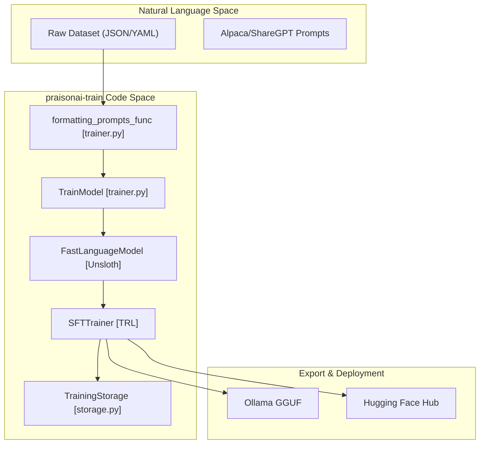
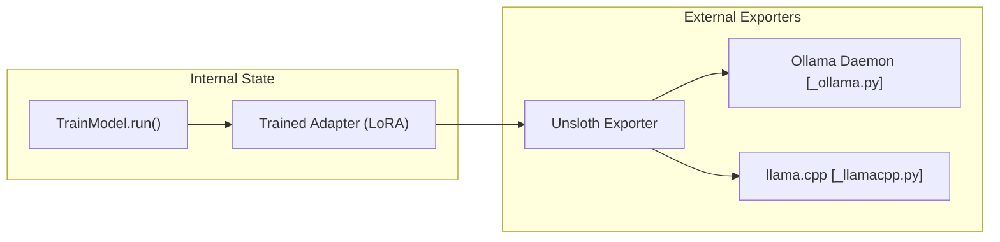

<!-- source: DeepWiki mcp.deepwiki.com · repo MervinPraison/PraisonAI · page 16.1 LLM Fine-Tuning · fetched 2026-10-26 -->

# LLM Fine-Tuning

<details>
<summary>Relevant source files</summary>

The following files were used as context for generating this wiki page:

- [src/praisonai-bot/tests/unit/bots/test_agentmail_parity.py](src/praisonai-bot/tests/unit/bots/test_agentmail_parity.py)
- [src/praisonai-train/praisonai_train/_version.py](src/praisonai-train/praisonai_train/_version.py)
- [src/praisonai-train/praisonai_train/cli/app.py](src/praisonai-train/praisonai_train/cli/app.py)
- [src/praisonai-train/praisonai_train/cli/commands/serve.py](src/praisonai-train/praisonai_train/cli/commands/serve.py)
- [src/praisonai-train/praisonai_train/cli/commands/train.py](src/praisonai-train/praisonai_train/cli/commands/train.py)
- [src/praisonai-train/praisonai_train/setup/config.yaml](src/praisonai-train/praisonai_train/setup/config.yaml)
- [src/praisonai-train/praisonai_train/setup/setup_conda_env.sh](src/praisonai-train/praisonai_train/setup/setup_conda_env.sh)
- [src/praisonai-train/praisonai_train/train/_llamacpp.py](src/praisonai-train/praisonai_train/train/_llamacpp.py)
- [src/praisonai-train/praisonai_train/train/_mtp.py](src/praisonai-train/praisonai_train/train/_mtp.py)
- [src/praisonai-train/praisonai_train/train/_ollama.py](src/praisonai-train/praisonai_train/train/_ollama.py)
- [src/praisonai-train/praisonai_train/train/agents/hook.py](src/praisonai-train/praisonai_train/train/agents/hook.py)
- [src/praisonai-train/praisonai_train/train/agents/storage.py](src/praisonai-train/praisonai_train/train/agents/storage.py)
- [src/praisonai-train/praisonai_train/train/llm/trainer.py](src/praisonai-train/praisonai_train/train/llm/trainer.py)
- [src/praisonai-train/pyproject.toml](src/praisonai-train/pyproject.toml)
- [src/praisonai-train/tests/unit/train/test_mtp.py](src/praisonai-train/tests/unit/train/test_mtp.py)
- [src/praisonai-train/tests/unit/train/test_robustness.py](src/praisonai-train/tests/unit/train/test_robustness.py)
- [src/praisonai-train/tests/unit/train/test_storage.py](src/praisonai-train/tests/unit/train/test_storage.py)
- [src/praisonai-train/uv.lock](src/praisonai-train/uv.lock)

</details>


The `praisonai-train` package provides a high-performance LLM fine-tuning suite built on the **Unsloth** framework. It supports parameter-efficient fine-tuning (PEFT) via **LoRA**, automated quantization for edge deployment, and seamless integration with **Ollama** and **Hugging Face**. The system is designed for a technical workflow: from raw dataset formatting to exporting quantized GGUF models.

## Training Architecture and Data Flow

The training pipeline follows a structured path from configuration loading to model export. The `TrainModel` class serves as the central orchestrator, managing the lifecycle of the training process, including dataset tokenization, model loading with 4-bit quantization, and final serialization.

### Data Flow Diagram

The following diagram illustrates the transition from Natural Language Space (datasets and prompts) into the Code Entity Space (trainers and exporters).

"LLM Fine-Tuning Pipeline"

**Sources:** [src/praisonai-train/praisonai_train/train/llm/trainer.py:62-117](), [src/praisonai-train/praisonai_train/train/llm/trainer.py:146-160](), [src/praisonai-train/praisonai_train/train/agents/storage.py:60-81]()

## GPU and Environment Setup

Fine-tuning requires a CUDA-compatible GPU. The package includes a dedicated setup script `setup_conda_env.sh` to handle the complex ML dependency stack, including `xformers`, `bitsandbytes`, and `unsloth`.

### Hardware Requirements
*   **GPU:** NVIDIA GPU with CUDA support (e.g., A100, H100, RTX 3090/4090).
*   **Memory:** Minimum 16GB VRAM for 8B models; 24GB+ recommended.
*   **Disk:** The trainer performs a preflight check for at least 5GB of free space before starting [src/praisonai-train/praisonai_train/train/llm/trainer.py:348-355]().

### Conda Environment Configuration
The system automates environment creation via `setup-conda-env` [src/praisonai-train/pyproject.toml:58]().
1.  Installs `Miniconda` if not present.
2.  Creates `praison_env` with Python 3.11 and `pytorch-cuda=12.4` [src/praisonai-train/praisonai_train/setup/setup_conda_env.sh:75-82]().
3.  Installs `unsloth`, `trl`, `peft`, and `bitsandbytes` [src/praisonai-train/praisonai_train/setup/setup_conda_env.sh:100-102]().

**Sources:** [src/praisonai-train/praisonai_train/setup/setup_conda_env.sh:1-104](), [src/praisonai-train/pyproject.toml:22-44]()

## Training Configuration (config.yaml)

Training behavior is governed by a `config.yaml` file. This file defines model parameters, LoRA settings, and dataset processing rules.

| Parameter | Description | Default/Example |
| :--- | :--- | :--- |
| `model_name` | Base model from Hugging Face | `unsloth/Meta-Llama-3.1-8B-Instruct-bnb-4bit` |
| `load_in_4bit` | Enable 4-bit quantization for loading | `true` |
| `lora_r` | Rank of the LoRA update matrices | `16` |
| `lora_target_modules` | Layers to apply LoRA (q_proj, v_proj, etc.) | All linear layers [src/praisonai-train/praisonai_train/setup/config.yaml:13-20]() |
| `dataset` | List of datasets with mapping functions | `yahma/alpaca-cleaned` |
| `quantization_method` | List of formats for GGUF export | `q4_k_m`, `q8_0` |

**Sources:** [src/praisonai-train/praisonai_train/setup/config.yaml:1-61]()

## Implementation Details

### The Trainer Class
The `TrainModel` class [src/praisonai-train/praisonai_train/train/llm/trainer.py:146]() handles the core logic. It uses lazy imports for heavy dependencies like `torch` and `unsloth` to keep the CLI responsive [src/praisonai-train/praisonai_train/train/llm/trainer.py:28-57]().

Key functions include:
*   `formatting_prompts_func`: Converts ShareGPT or Alpaca-style raw data into plain-text prompts using the model's chat template [src/praisonai-train/praisonai_train/train/llm/trainer.py:62-117]().
*   `validate_config`: Performs preflight checks, including GPU availability, disk space, and Hugging Face credentials [src/praisonai-train/praisonai_train/train/llm/trainer.py:329-370]().
*   `run`: The main execution loop that loads the model via `FastLanguageModel.from_pretrained`, initializes `SFTTrainer`, and starts the training process [src/praisonai-train/praisonai_train/train/llm/trainer.py:488-580]().

### Exporting and Quantization
After training, the system can export the model to GGUF format for use in Ollama or llama.cpp. Supported methods include `q4_k_m`, `q5_k_m`, and `q8_0` [src/praisonai-train/praisonai_train/train/llm/trainer.py:22-25](). The `ensure_ollama_running` utility manages the Ollama daemon during the export process [src/praisonai-train/praisonai_train/train/_ollama.py:80-131]().

"Export Logic and External Integrations"

**Sources:** [src/praisonai-train/praisonai_train/train/llm/trainer.py:590-640](), [src/praisonai-train/praisonai_train/train/_ollama.py:80-94]()

## CLI Usage

The `praisonai-train` CLI (also available as `praisonai train llm`) provides a streamlined interface for starting fine-tuning runs.

### Command Structure
```bash
# Basic fine-tuning
praisonai train llm dataset.json

# Specify a custom model
praisonai train llm --model llama-3.1 dataset.json

# Setup the environment (run once)
setup-conda-env
```

The CLI uses a bridge pattern to call the underlying training logic, ensuring that heavy ML imports only occur within the training process itself [src/praisonai-train/praisonai_train/cli/commands/train.py:49-77]().

**Sources:** [src/praisonai-train/praisonai_train/cli/commands/train.py:33-82](), [src/praisonai-train/praisonai_train/cli/app.py:1-18]()

---

