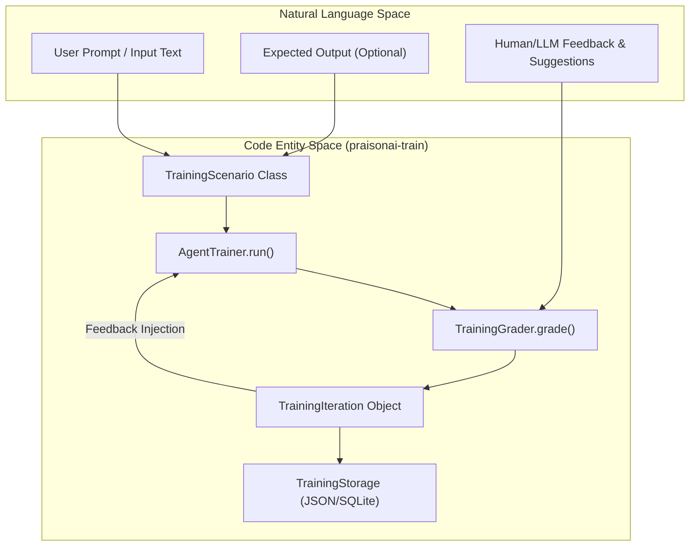
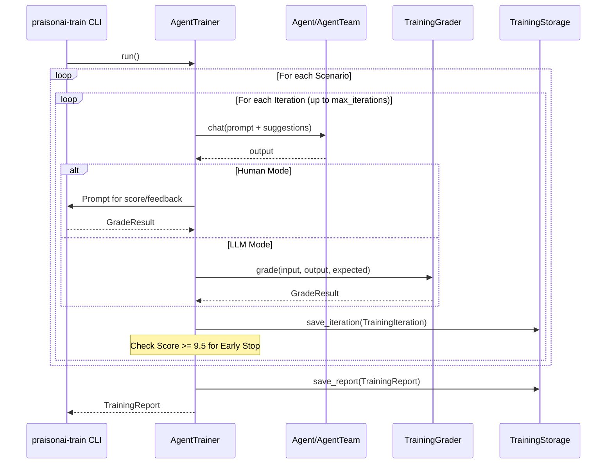

<!-- source: DeepWiki mcp.deepwiki.com · repo MervinPraison/PraisonAI · page 16.2 Agent Training Loop · fetched 2026-10-26 -->

# Agent Training Loop

Relevant source files

The following files were used as context for generating this wiki page:

- [src/praisonai-bot/tests/unit/bots/test_agentmail_parity.py](src/praisonai-bot/tests/unit/bots/test_agentmail_parity.py)
- [src/praisonai-train/README.md](src/praisonai-train/README.md)
- [src/praisonai-train/praisonai_train/_version.py](src/praisonai-train/praisonai_train/_version.py)
- [src/praisonai-train/praisonai_train/cli/app.py](src/praisonai-train/praisonai_train/cli/app.py)
- [src/praisonai-train/praisonai_train/cli/commands/data.py](src/praisonai-train/praisonai_train/cli/commands/data.py)
- [src/praisonai-train/praisonai_train/cli/commands/serve.py](src/praisonai-train/praisonai_train/cli/commands/serve.py)
- [src/praisonai-train/praisonai_train/cli/commands/train.py](src/praisonai-train/praisonai_train/cli/commands/train.py)
- [src/praisonai-train/praisonai_train/data/__init__.py](src/praisonai-train/praisonai_train/data/__init__.py)
- [src/praisonai-train/praisonai_train/data/_util.py](src/praisonai-train/praisonai_train/data/_util.py)
- [src/praisonai-train/praisonai_train/data/checks.py](src/praisonai-train/praisonai_train/data/checks.py)
- [src/praisonai-train/praisonai_train/data/dedup.py](src/praisonai-train/praisonai_train/data/dedup.py)
- [src/praisonai-train/praisonai_train/data/export_trials.py](src/praisonai-train/praisonai_train/data/export_trials.py)
- [src/praisonai-train/praisonai_train/data/generate.py](src/praisonai-train/praisonai_train/data/generate.py)
- [src/praisonai-train/praisonai_train/data/intent.py](src/praisonai-train/praisonai_train/data/intent.py)
- [src/praisonai-train/praisonai_train/data/protocols.py](src/praisonai-train/praisonai_train/data/protocols.py)
- [src/praisonai-train/praisonai_train/data/qc.py](src/praisonai-train/praisonai_train/data/qc.py)
- [src/praisonai-train/praisonai_train/data/recipes.py](src/praisonai-train/praisonai_train/data/recipes.py)
- [src/praisonai-train/praisonai_train/data/registry.py](src/praisonai-train/praisonai_train/data/registry.py)
- [src/praisonai-train/praisonai_train/setup/config.yaml](src/praisonai-train/praisonai_train/setup/config.yaml)
- [src/praisonai-train/praisonai_train/setup/setup_conda_env.sh](src/praisonai-train/praisonai_train/setup/setup_conda_env.sh)
- [src/praisonai-train/praisonai_train/train/_llamacpp.py](src/praisonai-train/praisonai_train/train/_llamacpp.py)
- [src/praisonai-train/praisonai_train/train/_mtp.py](src/praisonai-train/praisonai_train/train/_mtp.py)
- [src/praisonai-train/praisonai_train/train/_ollama.py](src/praisonai-train/praisonai_train/train/_ollama.py)
- [src/praisonai-train/praisonai_train/train/agents/hook.py](src/praisonai-train/praisonai_train/train/agents/hook.py)
- [src/praisonai-train/praisonai_train/train/agents/models.py](src/praisonai-train/praisonai_train/train/agents/models.py)
- [src/praisonai-train/praisonai_train/train/agents/orchestrator.py](src/praisonai-train/praisonai_train/train/agents/orchestrator.py)
- [src/praisonai-train/praisonai_train/train/agents/storage.py](src/praisonai-train/praisonai_train/train/agents/storage.py)
- [src/praisonai-train/praisonai_train/train/llm/trainer.py](src/praisonai-train/praisonai_train/train/llm/trainer.py)
- [src/praisonai-train/pyproject.toml](src/praisonai-train/pyproject.toml)
- [src/praisonai-train/tests/unit/data/test_data.py](src/praisonai-train/tests/unit/data/test_data.py)
- [src/praisonai-train/tests/unit/data/test_dedup.py](src/praisonai-train/tests/unit/data/test_dedup.py)
- [src/praisonai-train/tests/unit/data/test_export_trials.py](src/praisonai-train/tests/unit/data/test_export_trials.py)
- [src/praisonai-train/tests/unit/data/test_generate_guard.py](src/praisonai-train/tests/unit/data/test_generate_guard.py)
- [src/praisonai-train/tests/unit/data/test_generate_progress.py](src/praisonai-train/tests/unit/data/test_generate_progress.py)
- [src/praisonai-train/tests/unit/data/test_task_aware_qc.py](src/praisonai-train/tests/unit/data/test_task_aware_qc.py)
- [src/praisonai-train/tests/unit/train/test_models.py](src/praisonai-train/tests/unit/train/test_models.py)
- [src/praisonai-train/tests/unit/train/test_mtp.py](src/praisonai-train/tests/unit/train/test_mtp.py)
- [src/praisonai-train/tests/unit/train/test_orchestrator.py](src/praisonai-train/tests/unit/train/test_orchestrator.py)
- [src/praisonai-train/tests/unit/train/test_robustness.py](src/praisonai-train/tests/unit/train/test_robustness.py)
- [src/praisonai-train/tests/unit/train/test_storage.py](src/praisonai-train/tests/unit/train/test_storage.py)
- [src/praisonai-train/uv.lock](src/praisonai-train/uv.lock)

The Agent Training Loop is a core component of the `praisonai-train` package designed to iteratively improve agent performance through feedback cycles [src/praisonai-train/pyproject.toml:4-4](). It supports two primary modes: **LLM-as-Judge**, which automates the evaluation and suggestion process using a teacher model, and **Human-in-the-Loop**, which allows users to manually score and guide agent behavior [src/praisonai-train/praisonai_train/train/agents/orchestrator.py:5-7]().

## Training Orchestration

The `AgentTrainer` class manages the lifecycle of a training session, including scenario execution, feedback collection, and iteration management [src/praisonai-train/praisonai_train/train/agents/orchestrator.py:37-66]().

### Core Components
- **AgentTrainer**: The central orchestrator that runs the training loop [src/praisonai-train/praisonai_train/train/agents/orchestrator.py:37-37]().
- **TrainingScenario**: Defines the input prompt and optional `expected_output` for the agent to process [src/praisonai-train/praisonai_train/train/agents/models.py:102-124]().
- **TrainingGrader**: Evaluates agent output using a teacher LLM to produce a `GradeResult` containing a score (1-10), feedback, and improvement suggestions [src/praisonai-train/praisonai_train/train/agents/grader.py:27-27]().
- **TrainingStorage**: Persists iterations, scenarios, and final reports to disk (File, SQLite, or Redis) [src/praisonai-train/praisonai_train/train/agents/storage.py:17-29]().

### Agent Training Data Flow
The following diagram illustrates how natural language inputs are transformed into code entities and processed through the training loop.

Sources: [src/praisonai-train/praisonai_train/train/agents/models.py:102-124](), [src/praisonai-train/praisonai_train/train/agents/orchestrator.py:108-134](), [src/praisonai-train/praisonai_train/train/agents/storage.py:36-56]()

## Iteration Management and Early Stopping

The training loop executes for a configurable number of `iterations` (default: 3) [src/praisonai-train/praisonai_train/cli/commands/train.py:90-95](). 

### Early Stopping Logic
In LLM-as-Judge mode, the system implements an early stopping mechanism. If the `TrainingGrader` returns a quality score $\ge 9.5$, the trainer concludes the session for that scenario before reaching the maximum iteration count, unless `no_early_stop` is explicitly enabled [src/praisonai-train/praisonai_train/train/agents/orchestrator.py:84-92]().

### Feedback Injection
Suggestions from previous iterations are injected into the agent's context in subsequent runs. This is handled by the `TrainingProfile`, which consolidates actionable feedback from `TrainingIteration` objects [src/praisonai-train/praisonai_train/train/agents/models.py:22-47]().

## Evaluation Modes

| Mode | Evaluator | Data Source | Usage |
| :--- | :--- | :--- | :--- |
| **LLM-as-Judge** | `TrainingGrader` | Teacher LLM (e.g., GPT-4o) | Automated scaling and optimization [src/praisonai-train/praisonai_train/cli/commands/train.py:157-159]() |
| **Human-in-the-Loop** | User | Console Input | High-precision steering and edge-case handling [src/praisonai-train/praisonai_train/cli/commands/train.py:161-163]() |

### LLM-as-Judge Implementation
The `TrainingGrader` uses `litellm` to call a teacher model that analyzes the agent's output against the `TrainingScenario`. It generates structured feedback that includes:
1. A numerical score (1.0 to 10.0) [src/praisonai-train/praisonai_train/train/agents/models.py:153-153]().
2. Qualitative feedback text [src/praisonai-train/praisonai_train/train/agents/models.py:154-154]().
3. Specific improvement suggestions [src/praisonai-train/praisonai_train/train/agents/models.py:155-155]().

Sources: [src/praisonai-train/praisonai_train/train/agents/orchestrator.py:41-49](), [src/praisonai-train/praisonai_train/train/agents/grader.py:27-27]()

## Training Loop Architecture

The diagram below maps the internal method calls and state transitions during the training loop.

Sources: [src/praisonai-train/praisonai_train/train/agents/orchestrator.py:135-165](), [src/praisonai-train/praisonai_train/train/agents/orchestrator.py:167-209](), [src/praisonai-train/praisonai_train/train/agents/storage.py:36-89]()

## CLI Interface

The `praisonai-train agents` command provides the entry point for starting the training loop [src/praisonai-train/praisonai_train/cli/commands/train.py:84-85]().

### Key Arguments
- `--iterations`, `-n`: Maximum training iterations [src/praisonai-train/praisonai_train/cli/commands/train.py:90-95]().
- `--human`, `-h`: Enable Human-in-the-Loop mode [src/praisonai-train/praisonai_train/cli/commands/train.py:101-105]().
- `--scenarios`, `-s`: Path to a JSON file containing multiple `TrainingScenario` objects [src/praisonai-train/praisonai_train/cli/commands/train.py:106-110]().
- `--input`, `-i`: Single input text for quick training sessions [src/praisonai-train/praisonai_train/cli/commands/train.py:111-115]().
- `--model`, `-m`: Specifies the LLM used for grading (defaults to `gpt-4o-mini`) [src/praisonai-train/praisonai_train/cli/commands/train.py:126-130]().

### Storage Configuration
Training data is stored by default in `~/.praison/train/` [src/praisonai-train/praisonai_train/cli/commands/train.py:202-202](). Users can customize this via:
- `--storage-backend`: Supports `file`, `sqlite`, or `redis://url` [src/praisonai-train/praisonai_train/cli/commands/train.py:141-145]().
- `--storage-path`: Path for the chosen backend (e.g., directory for files or DB path for SQLite) [src/praisonai-train/praisonai_train/cli/commands/train.py:146-150]().

Sources: [src/praisonai-train/praisonai_train/cli/commands/train.py:84-182](), [src/praisonai-train/praisonai_train/train/agents/storage.py:17-34]()

---

