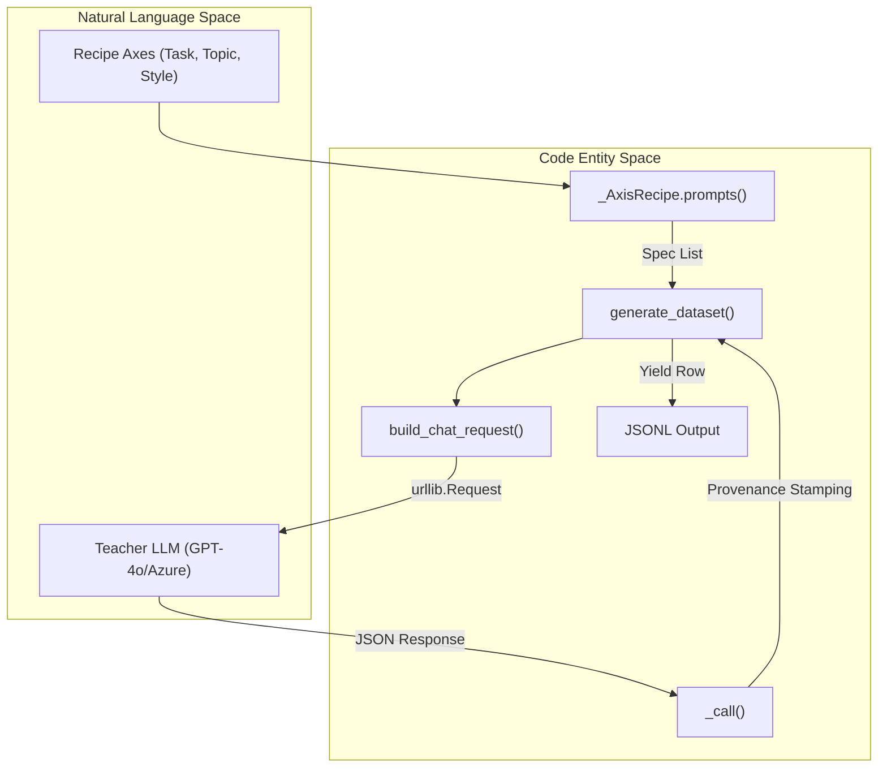
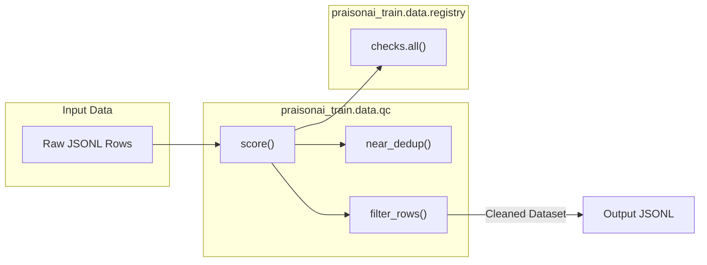

<!-- source: DeepWiki mcp.deepwiki.com · repo MervinPraison/PraisonAI · page 16.3 Dataset Generation and Quality Control · fetched 2026-10-26 -->

# Dataset Generation and Quality Control

Relevant source files

The following files were used as context for generating this wiki page:

- [src/praisonai-train/README.md](src/praisonai-train/README.md)
- [src/praisonai-train/praisonai_train/cli/commands/data.py](src/praisonai-train/praisonai_train/cli/commands/data.py)
- [src/praisonai-train/praisonai_train/data/__init__.py](src/praisonai-train/praisonai_train/data/__init__.py)
- [src/praisonai-train/praisonai_train/data/_util.py](src/praisonai-train/praisonai_train/data/_util.py)
- [src/praisonai-train/praisonai_train/data/checks.py](src/praisonai-train/praisonai_train/data/checks.py)
- [src/praisonai-train/praisonai_train/data/dedup.py](src/praisonai-train/praisonai_train/data/dedup.py)
- [src/praisonai-train/praisonai_train/data/export_trials.py](src/praisonai-train/praisonai_train/data/export_trials.py)
- [src/praisonai-train/praisonai_train/data/generate.py](src/praisonai-train/praisonai_train/data/generate.py)
- [src/praisonai-train/praisonai_train/data/intent.py](src/praisonai-train/praisonai_train/data/intent.py)
- [src/praisonai-train/praisonai_train/data/protocols.py](src/praisonai-train/praisonai_train/data/protocols.py)
- [src/praisonai-train/praisonai_train/data/qc.py](src/praisonai-train/praisonai_train/data/qc.py)
- [src/praisonai-train/praisonai_train/data/recipes.py](src/praisonai-train/praisonai_train/data/recipes.py)
- [src/praisonai-train/praisonai_train/data/registry.py](src/praisonai-train/praisonai_train/data/registry.py)
- [src/praisonai-train/praisonai_train/train/agents/models.py](src/praisonai-train/praisonai_train/train/agents/models.py)
- [src/praisonai-train/praisonai_train/train/agents/orchestrator.py](src/praisonai-train/praisonai_train/train/agents/orchestrator.py)
- [src/praisonai-train/tests/unit/data/test_data.py](src/praisonai-train/tests/unit/data/test_data.py)
- [src/praisonai-train/tests/unit/data/test_dedup.py](src/praisonai-train/tests/unit/data/test_dedup.py)
- [src/praisonai-train/tests/unit/data/test_export_trials.py](src/praisonai-train/tests/unit/data/test_export_trials.py)
- [src/praisonai-train/tests/unit/data/test_generate_guard.py](src/praisonai-train/tests/unit/data/test_generate_guard.py)
- [src/praisonai-train/tests/unit/data/test_generate_progress.py](src/praisonai-train/tests/unit/data/test_generate_progress.py)
- [src/praisonai-train/tests/unit/data/test_task_aware_qc.py](src/praisonai-train/tests/unit/data/test_task_aware_qc.py)
- [src/praisonai-train/tests/unit/train/test_models.py](src/praisonai-train/tests/unit/train/test_models.py)
- [src/praisonai-train/tests/unit/train/test_orchestrator.py](src/praisonai-train/tests/unit/train/test_orchestrator.py)

The `praisonai-train` package provides a robust subsystem for synthetic dataset generation and automated quality control (QC). It is designed to facilitate the creation of high-quality instruction-tuning datasets from teacher LLMs and the refinement of existing data through research-backed filters and deduplication strategies [src/praisonai-train/praisonai_train/data/__init__.py:1-6]().

## Synthetic Dataset Generation

Synthetic generation uses a teacher LLM to synthesize `{instruction, input, output}` rows based on a **Recipe**. The system is built for scale, safety, and diversity, employing thread-safe concurrent requests and circuit-breakers to manage costs [src/praisonai-train/praisonai_train/data/generate.py:1-10]().

### Data Flow: Generation Pipeline

The following diagram illustrates the flow from a defined recipe to a stamped, deduplicated dataset row.

**Diagram: Synthetic Generation Data Flow**

Sources: [src/praisonai-train/praisonai_train/data/generate.py:160-165](), [src/praisonai-train/praisonai_train/data/recipes.py:21-44](), [src/praisonai-train/praisonai_train/data/generate.py:44-52]()

### Key Generation Features
*   **Recipes and Diversity Axes**: A `Recipe` (e.g., `Tamil` class) defines axes like `task`, `topic`, `style`, and `audience`. The `_AxisRecipe.prompts` method generates a grid of these axes to ensure the teacher LLM produces a diverse range of examples rather than repetitive content [src/praisonai-train/praisonai_train/data/recipes.py:13-44]().
*   **JSON Mode**: The generator enforces `response_format: {"type": "json_object"}` to ensure high parse yields [src/praisonai-train/praisonai_train/data/generate.py:62-63]().
*   **Resumable Offsets**: The `start_offset` parameter allows disjoint parallel runs or resuming a failed run by skipping a specific number of items in the recipe grid [src/praisonai-train/praisonai_train/data/generate.py:5-6]().
*   **Provenance Stamping**: Every generated row is stamped with metadata including the `model`, `task_type`, and `topic`. This makes the dataset self-describing for downstream QC filters [src/praisonai-train/praisonai_train/data/generate.py:104-113]().
*   **Sponsorship Guard**: A circuit-breaker `azure_sponsorship_guard` can halt generation if an Azure subscription quota is exceeded, preventing runaway costs [src/praisonai-train/praisonai_train/data/generate.py:116-139]().

## Quality Control (QC) Pipeline

The QC pipeline processes datasets through pluggable checks and structural deduplication. It calculates diversity metrics and filters rows based on research-backed thresholds [src/praisonai-train/praisonai_train/data/qc.py:1-8]().

### The `score()` Function
The `score()` function is the primary entry point for validation. It performs the following steps:
1.  **Exact Deduplication**: Uses SHA-1 hashes of normalized text to drop identical rows [src/praisonai-train/praisonai_train/data/qc.py:38-42]().
2.  **Pluggable Row Checks**: Executes registered `drop` and `flag` checks.
    *   **Boilerplate/Refusal Filter**: Identifies and removes LLM refusals (e.g., "I cannot fulfill this request").
    *   **Script Purity**: The `LowScriptPurity` check ensures the output contains the expected script (e.g., Tamil) using `_script_ratio` [src/praisonai-train/praisonai_train/data/qc.py:89-98]().
3.  **Near-Duplicate Removal**: Employs `MinHashLSH` or sliding window Jaccard similarity to remove rows that are semantically too similar [src/praisonai-train/praisonai_train/data/qc.py:60-66]().
4.  **Diversity Metrics**: Calculates `distinct_2` (bigram diversity), `length_cv` (coefficient of variation for length), and `top_prefix_share` [src/praisonai-train/praisonai_train/data/qc.py:68-74]().

**Diagram: QC Validation Logic**

Sources: [src/praisonai-train/praisonai_train/data/qc.py:24-59](), [src/praisonai-train/praisonai_train/data/qc.py:130-131](), [src/praisonai-train/praisonai_train/data/registry.py:1-10]()

## Export from Trials (Rejection Sampling)

The `export_trials` utility closes the loop between agent verification and data generation. It extracts successful trajectories from agent trials to create Supervised Fine-Tuning (SFT) datasets [src/praisonai-train/praisonai_train/data/export_trials.py:1-8]().

### Selection Strategies
*   **only_passed (Rejection Sampling)**: Only attempts that passed the verifier (score >= threshold) are kept. This reinforces verified wins [src/praisonai-train/praisonai_train/data/export_trials.py:112-133]().
*   **frontier_only**: Excludes "saturated" cases where the agent always passes (to avoid over-fitting on mastered tasks) and zero-pass cases [src/praisonai-train/praisonai_train/data/export_trials.py:21-23]().
*   **Tool-Use Exclusion**: By default, runs involving tool calls are excluded (`skipped_tool_runs`) to prevent training models to answer without the tools they actually needed [src/praisonai-train/praisonai_train/data/export_trials.py:135-142]().

### Output Formats
*   **ShareGPT**: Default format using a `conversations` list [src/praisonai-train/praisonai_train/data/export_trials.py:28-30]().
*   **Alpaca**: Optional format using `instruction`, `input`, and `output` fields [src/praisonai-train/praisonai_train/data/export_trials.py:188-196]().

## Data CLI Reference

The `praisonai-train` command provides subcommands for managing the data lifecycle [src/praisonai-train/praisonai_train/cli/commands/data.py:1-6]().

| Command | Purpose | Key Arguments |
| :--- | :--- | :--- |
| `generate` | Synthesize data from teacher LLM | `--recipe`, `--num`, `--output`, `--concurrency` |
| `validate` | Run QC filters and metrics | `--input`, `--out`, `--config` |
| `dedup` | Global deduplication across files | `--method` (minhash/sliding), `--threshold` |
| `from-trials` | Convert trials report to SFT data | `--input`, `--output`, `--format` |

Sources: [src/praisonai-train/praisonai_train/cli/commands/data.py:64-74](), [src/praisonai-train/praisonai_train/cli/commands/data.py:131-139](), [src/praisonai-train/README.md:105-120]()

---

