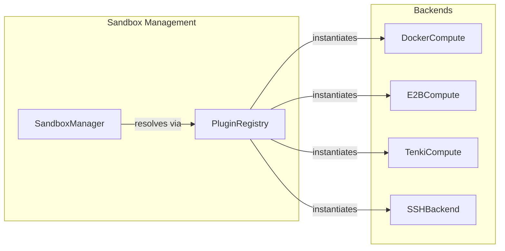

<!-- source: DeepWiki mcp.deepwiki.com · repo MervinPraison/PraisonAI · page 17 Managed Agents and Sandbox · fetched 2026-10-26 -->

# Managed Agents and Sandbox

<details>
<summary>Relevant source files</summary>

The following files were used as context for generating this wiki page:

- [.agent/mer-vin-praisonai-mcp.html](.agent/mer-vin-praisonai-mcp.html)
- [.agent/mer-vin-praisonai-wrapper.html](.agent/mer-vin-praisonai-wrapper.html)
- [src/praisonai-agents/praisonaiagents/managed/__init__.py](src/praisonai-agents/praisonaiagents/managed/__init__.py)
- [src/praisonai-agents/praisonaiagents/managed/_compute_bridge.py](src/praisonai-agents/praisonaiagents/managed/_compute_bridge.py)
- [src/praisonai-agents/praisonaiagents/managed/protocols.py](src/praisonai-agents/praisonaiagents/managed/protocols.py)
- [src/praisonai-agents/praisonaiagents/managed/shared_compute.py](src/praisonai-agents/praisonaiagents/managed/shared_compute.py)
- [src/praisonai-agents/tests/managed/test_cloud_compute.py](src/praisonai-agents/tests/managed/test_cloud_compute.py)
- [src/praisonai-agents/tests/managed/test_environment_definition.py](src/praisonai-agents/tests/managed/test_environment_definition.py)
- [src/praisonai-agents/tests/managed/test_managed_runtime_protocol.py](src/praisonai-agents/tests/managed/test_managed_runtime_protocol.py)
- [src/praisonai-agents/tests/managed/test_shared_compute.py](src/praisonai-agents/tests/managed/test_shared_compute.py)
- [src/praisonai-sandbox/README.md](src/praisonai-sandbox/README.md)
- [src/praisonai-sandbox/e2e-validation/MANUAL-E2E-GUIDE.md](src/praisonai-sandbox/e2e-validation/MANUAL-E2E-GUIDE.md)
- [src/praisonai-sandbox/e2e-validation/README.md](src/praisonai-sandbox/e2e-validation/README.md)
- [src/praisonai-sandbox/e2e-validation/run_e2e.py](src/praisonai-sandbox/e2e-validation/run_e2e.py)
- [src/praisonai-sandbox/praisonai_sandbox/__init__.py](src/praisonai-sandbox/praisonai_sandbox/__init__.py)
- [src/praisonai-sandbox/praisonai_sandbox/_registry.py](src/praisonai-sandbox/praisonai_sandbox/_registry.py)
- [src/praisonai-sandbox/praisonai_sandbox/_version.py](src/praisonai-sandbox/praisonai_sandbox/_version.py)
- [src/praisonai-sandbox/praisonai_sandbox/novita.py](src/praisonai-sandbox/praisonai_sandbox/novita.py)
- [src/praisonai-sandbox/pyproject.toml](src/praisonai-sandbox/pyproject.toml)
- [src/praisonai-sandbox/tests/test_novita.py](src/praisonai-sandbox/tests/test_novita.py)
- [src/praisonai-sandbox/uv.lock](src/praisonai-sandbox/uv.lock)
- [src/praisonai/praisonai/cli/commands/managed.py](src/praisonai/praisonai/cli/commands/managed.py)
- [src/praisonai/praisonai/integrations/compute/__init__.py](src/praisonai/praisonai/integrations/compute/__init__.py)
- [src/praisonai/praisonai/integrations/compute/docker.py](src/praisonai/praisonai/integrations/compute/docker.py)
- [src/praisonai/praisonai/integrations/compute/local.py](src/praisonai/praisonai/integrations/compute/local.py)
- [src/praisonai/praisonai/integrations/compute/tenki.py](src/praisonai/praisonai/integrations/compute/tenki.py)
- [src/praisonai/praisonai/integrations/hosted_agent.py](src/praisonai/praisonai/integrations/hosted_agent.py)
- [src/praisonai/praisonai/integrations/managed_agents.py](src/praisonai/praisonai/integrations/managed_agents.py)
- [src/praisonai/praisonai/integrations/managed_local.py](src/praisonai/praisonai/integrations/managed_local.py)
- [src/praisonai/praisonai/integrations/sandboxed_agent.py](src/praisonai/praisonai/integrations/sandboxed_agent.py)
- [src/praisonai/tests/test_sandboxed_agent_compatibility.py](src/praisonai/tests/test_sandboxed_agent_compatibility.py)
- [src/praisonai/tests/unit/cli/test_managed_cli_destructive.py](src/praisonai/tests/unit/cli/test_managed_cli_destructive.py)
- [src/praisonai/tests/unit/compute/test_docker_capture.py](src/praisonai/tests/unit/compute/test_docker_capture.py)
- [src/praisonai/tests/unit/test_managed_ps.py](src/praisonai/tests/unit/test_managed_ps.py)

</details>


Managed Agents and Sandbox systems in PraisonAI provide isolated, secure, and remote execution environments for agents. This infrastructure allows agents to execute code, interact with filesystems, and perform tool-based tasks without risking the host system. The system distinguishes between **Hosted Agents** (where the entire agent loop runs remotely) and **Local Agents with Sandboxed Tools** (where the agent loop is local, but tool execution is offloaded to a secure container or VM).

## Architecture Overview

The system bridges the gap between high-level agent definitions and low-level compute resources using a provider-agnostic protocol.

### Managed Execution Bridge
The following diagram illustrates how the `Agent` class interacts with various backends and compute providers.

```mermaid
graph TD
    subgraph "Natural Language Space"
        A["Agent (praisonaiagents)"]
    end

    subgraph "Code Entity Space"
        B["ManagedBackendProtocol"]
        C["HostedAgent"]
        D["LocalManagedAgent"]
        E["ComputeProviderProtocol"]
        
        subgraph "Compute Backends"
            F["DockerCompute"]
            G["E2BCompute"]
            H["TenkiCompute"]
            I["ModalCompute"]
        end
    end

    A -- "uses" --> B
    B <|-- C
    B <|-- D
    D -- "delegates to" --> E
    E <|-- F
    E <|-- G
    E <|-- H
    E <|-- I
```
**Sources:** [src/praisonaiagents/managed/protocols.py:10-32](), [src/praisonai/praisonai/integrations/hosted_agent.py:45-71](), [src/praisonai/praisonai/integrations/managed_local.py:201-210]()

## Managed Agents

Managed Agents represent a paradigm where the execution environment is decoupled from the user's local machine. PraisonAI supports two primary modes:

1.  **Hosted Agents:** The entire agent lifecycle (reasoning loop + tool execution) runs on a managed cloud runtime, such as Anthropic's Managed Agents API [src/praisonai/praisonai/integrations/hosted_agent.py:16-29]().
2.  **Local Managed Agents:** The reasoning loop runs locally via `praisonaiagents`, but tools are executed within a `ComputeProvider` (e.g., Docker, E2B) [src/praisonai/praisonai/integrations/managed_local.py:201-210]().

### Key Components
| Class | Role | Source |
| :--- | :--- | :--- |
| `HostedAgent` | Canonical class for cloud-based agent runtimes. | [src/praisonai/praisonai/integrations/hosted_agent.py:45-71]() |
| `LocalManagedAgent` | Provider-agnostic local loop with sandboxed tool execution. | [src/praisonai/praisonai/integrations/managed_local.py:201-210]() |
| `ManagedConfig` | Configuration for environment, packages, and networking. | [src/praisonai/praisonai/integrations/managed_agents.py:199-215]() |
| `ComputeConfig` | Hardware and software specs for the sandbox (CPU, Mem, GPU). | [src/praisonaiagents/managed/protocols.py:46-78]() |

For details on remote loop execution and environment snapshots, see [Managed Agents](#17.1).

**Sources:** [src/praisonai/praisonai/integrations/hosted_agent.py:1-34](), [src/praisonai/praisonai/integrations/managed_agents.py:199-215](), [src/praisonaiagents/managed/protocols.py:46-78]()

## Sandbox Backends

The `praisonai-sandbox` package provides the low-level implementations for isolated execution. It defines the `ComputeProviderProtocol`, which ensures that different backends (Docker, VMs, Cloud Functions) provide a consistent interface for provisioning, executing commands, and file I/O.

### Sandbox Lifecycle
The `ComputeProviderProtocol` enforces a standard lifecycle for all sandboxes:
1.  **Provision:** Creating the instance based on a `ComputeConfig` [src/praisonaiagents/managed/protocols.py:100-110]().
2.  **Execute:** Running shell commands or scripts within the isolated environment [src/praisonai/praisonai/integrations/compute/docker.py:228-245]().
3.  **Shutdown:** Terminating the instance to release resources [src/praisonai/praisonai/integrations/compute/docker.py:250-265]().

### Supported Providers
- **Docker:** Local container-based isolation [src/praisonai/praisonai/integrations/compute/docker.py:105-125]().
- **E2B:** Cloud-based code interpreter sandboxes [src/praisonai-sandbox/pyproject.toml:22-24]().
- **Tenki:** Cloud sandbox-based compute using Linux microVMs [src/praisonai/praisonai/integrations/compute/tenki.py:22-41]().
- **Modal/Daytona/Novita:** Specialized serverless and workspace-based runtimes [src/praisonai-sandbox/pyproject.toml:31-39]().


**Sources:** [src/praisonai-sandbox/pyproject.toml:18-42](), [src/praisonai-agents/praisonaiagents/managed/_compute_bridge.py:9-13]()

For details on security policies, plugin registry, and specific backend configurations, see [Sandbox Backends](#17.2).

**Sources:** [src/praisonai-sandbox/pyproject.toml:1-42](), [src/praisonaiagents/managed/protocols.py:1-32](), [src/praisonai/praisonai/integrations/compute/docker.py:1-125]()

## Environment Definitions

PraisonAI supports declarative environment setup via `environment.yaml` files located in the `.praisonai/` directory. This allows developers to commit infrastructure requirements (OS packages, Python libraries, setup scripts) alongside their agent code [src/praisonaiagents/managed/protocols.py:89-110]().

### Example `environment.yaml`
```yaml
image: "python:3.12-slim"
packages:
  pip: ["pandas", "scikit-learn"]
  apt: ["curl", "git"]
setup:
  - "pip install -e ."
resources:
  cpu: 2
  memory_mb: 4096
```
**Sources:** [src/praisonaiagents/managed/protocols.py:159-215]()

## Managed CLI

The `praisonai managed` command group provides tools for interacting with these remote environments directly from the terminal. It supports running prompts, managing multi-turn sessions, and inspecting remote agent/environment states [src/praisonai/praisonai/cli/commands/managed.py:1-13]().

Key commands include:
- `praisonai managed run "prompt"`: Execute a single task [src/praisonai/praisonai/cli/commands/managed.py:109-132]().
- `praisonai managed sessions list`: View active remote sessions [src/praisonai/praisonai/cli/commands/managed.py:39]().
- `praisonai managed ids save`: Snapshot environment IDs for persistence [src/praisonai/praisonai/cli/commands/managed.py:27]().

**Sources:** [src/praisonai/praisonai/cli/commands/managed.py:1-43]()

---

