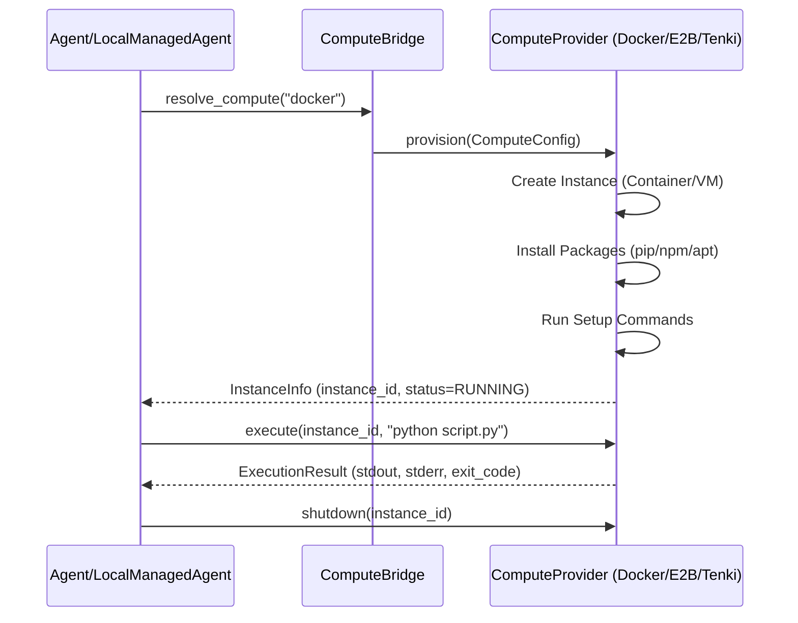
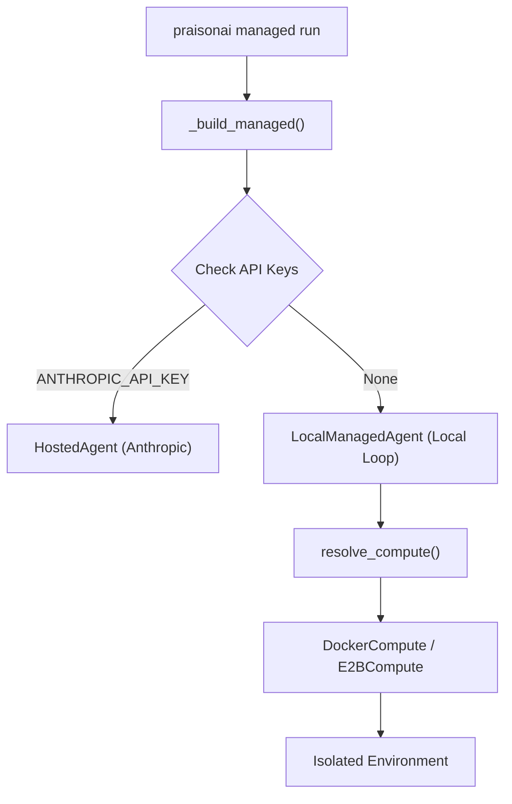

<!-- source: DeepWiki mcp.deepwiki.com · repo MervinPraison/PraisonAI · page 17.1 Managed Agents · fetched 2026-10-26 -->

# Managed Agents

Relevant source files

The following files were used as context for generating this wiki page:

- [src/praisonai-agents/praisonaiagents/managed/__init__.py](src/praisonai-agents/praisonaiagents/managed/__init__.py)
- [src/praisonai-agents/praisonaiagents/managed/_compute_bridge.py](src/praisonai-agents/praisonaiagents/managed/_compute_bridge.py)
- [src/praisonai-agents/praisonaiagents/managed/protocols.py](src/praisonai-agents/praisonaiagents/managed/protocols.py)
- [src/praisonai-agents/praisonaiagents/managed/shared_compute.py](src/praisonai-agents/praisonaiagents/managed/shared_compute.py)
- [src/praisonai-agents/tests/managed/test_cloud_compute.py](src/praisonai-agents/tests/managed/test_cloud_compute.py)
- [src/praisonai-agents/tests/managed/test_environment_definition.py](src/praisonai-agents/tests/managed/test_environment_definition.py)
- [src/praisonai-agents/tests/managed/test_managed_runtime_protocol.py](src/praisonai-agents/tests/managed/test_managed_runtime_protocol.py)
- [src/praisonai-agents/tests/managed/test_shared_compute.py](src/praisonai-agents/tests/managed/test_shared_compute.py)
- [src/praisonai/praisonai/cli/commands/managed.py](src/praisonai/praisonai/cli/commands/managed.py)
- [src/praisonai/praisonai/integrations/compute/__init__.py](src/praisonai/praisonai/integrations/compute/__init__.py)
- [src/praisonai/praisonai/integrations/compute/docker.py](src/praisonai/praisonai/integrations/compute/docker.py)
- [src/praisonai/praisonai/integrations/compute/local.py](src/praisonai/praisonai/integrations/compute/local.py)
- [src/praisonai/praisonai/integrations/compute/tenki.py](src/praisonai/praisonai/integrations/compute/tenki.py)
- [src/praisonai/praisonai/integrations/hosted_agent.py](src/praisonai/praisonai/integrations/hosted_agent.py)
- [src/praisonai/praisonai/integrations/managed_agents.py](src/praisonai/praisonai/integrations/managed_agents.py)
- [src/praisonai/praisonai/integrations/managed_local.py](src/praisonai/praisonai/integrations/managed_local.py)
- [src/praisonai/praisonai/integrations/sandboxed_agent.py](src/praisonai/praisonai/integrations/sandboxed_agent.py)
- [src/praisonai/tests/test_sandboxed_agent_compatibility.py](src/praisonai/tests/test_sandboxed_agent_compatibility.py)
- [src/praisonai/tests/unit/cli/test_managed_cli_destructive.py](src/praisonai/tests/unit/cli/test_managed_cli_destructive.py)
- [src/praisonai/tests/unit/compute/test_docker_capture.py](src/praisonai/tests/unit/compute/test_docker_capture.py)
- [src/praisonai/tests/unit/test_managed_ps.py](src/praisonai/tests/unit/test_managed_ps.py)

Managed Agents provide a secure, isolated execution environment for agents to perform tasks, specifically those involving arbitrary code execution or complex tool usage. The system distinguishes between **Hosted Agents** (where the entire agent loop runs on a remote provider) and **Local Agents** (where the loop is local, but tool execution is sandboxed).

## Core Architectures

PraisonAI implements managed agents through two primary classes, both satisfying the `ManagedBackendProtocol` [src/praisonai-agents/praisonaiagents/managed/__init__.py:51-51]().

### 1. HostedAgent
The `HostedAgent` represents a "remote loop" execution model. The entire agent lifecycle—reasoning, tool selection, and tool execution—occurs within a cloud provider's infrastructure [src/praisonai/praisonai/integrations/hosted_agent.py:4-7](). 
- **Primary Provider**: Anthropic Managed Agents API [src/praisonai/praisonai/integrations/hosted_agent.py:37-37]().
- **Data Flow**: The local SDK sends a prompt to the provider; the provider manages the multi-turn conversation and sandboxed execution internally, returning final results or streams [src/praisonai/praisonai/integrations/hosted_agent.py:45-53]().

### 2. LocalAgent / LocalManagedAgent
The `LocalManagedAgent` represents a "remote tool" or "sandboxed tool" model. The agent loop (LLM calls and orchestration) runs on the user's machine, but dangerous tools (like shell commands) are dispatched to a controlled environment [src/praisonai/praisonai/integrations/managed_local.py:4-5]().
- **LLM Agnostic**: Works with OpenAI, Gemini, Ollama, or local models via LiteLLM [src/praisonai/praisonai/integrations/managed_local.py:65-68]().
- **Compute Isolation**: Uses the `ComputeProviderProtocol` to provision sandboxes [src/praisonai-agents/praisonaiagents/managed/protocols.py:2-6]().

### Entity Mapping: Natural Language to Code

| System Concept | Code Entity | File Path |
| :--- | :--- | :--- |
| **Managed Backend** | `ManagedBackendProtocol` | [src/praisonai-agents/praisonaiagents/managed/__init__.py:62-64]() |
| **Hosted Runtime** | `HostedAgent` | [src/praisonai/praisonai/integrations/hosted_agent.py:45-45]() |
| **Local Managed Loop** | `LocalManagedAgent` | [src/praisonai/praisonai/integrations/managed_local.py:201-201]() |
| **Sandbox Definition** | `ComputeConfig` | [src/praisonai-agents/praisonaiagents/managed/protocols.py:46-46]() |
| **Environment File** | `environment.yaml` | [src/praisonai-agents/praisonaiagents/managed/protocols.py:80-80]() |

**Sources:** [src/praisonai/praisonai/integrations/hosted_agent.py](), [src/praisonai/praisonai/integrations/managed_local.py](), [src/praisonai-agents/praisonaiagents/managed/protocols.py]()

---

## Compute Providers (`run_on`)

Managed agents use various backends for execution. These are resolved via the `run_on` parameter or `ComputeConfig` [src/praisonai-agents/praisonaiagents/managed/protocols.py:46-78]().

### Supported Backends
1.  **Docker**: Local container isolation. Supports `docker commit` snapshots for fast environment restoration [src/praisonai/praisonai/integrations/compute/docker.py:21-22]().
2.  **E2B**: Cloud-based sandboxes optimized for AI agents [src/praisonai/praisonai/integrations/compute/e2b.py]().
3.  **Modal**: Serverless GPU and CPU compute [src/praisonai/praisonai/integrations/compute/modal_compute.py]().
4.  **Daytona**: Development environment orchestration [src/praisonai/praisonai/integrations/compute/daytona.py]().
5.  **Tenki**: Disposable Linux microVMs [src/praisonai/praisonai/integrations/compute/tenki.py:4-7]().
6.  **Fly.io**: Firecracker microVMs [src/praisonai/praisonai/integrations/compute/flyio.py]().

### Compute Provisioning Flow
The `ComputeProviderProtocol` defines the lifecycle of a sandbox:

**Sources:** [src/praisonai-agents/praisonaiagents/managed/protocols.py:35-43](), [src/praisonai/praisonai/integrations/compute/docker.py:157-160](), [src/praisonai/praisonai/integrations/compute/tenki.py:100-110]()

---

## Environment Configuration

Environments are defined declaratively in a `.praisonai/environment.yaml` file [src/praisonai-agents/praisonaiagents/managed/protocols.py:80-81]().

### environment.yaml Structure
The system walks up the directory tree to find this file [src/praisonai-agents/praisonaiagents/managed/protocols.py:89-108]().

| Key | Type | Description |
| :--- | :--- | :--- |
| `image` | `str` | Base Docker/VM image (e.g., `python:3.12-slim`) |
| `packages` | `dict` | Mappings for `pip`, `npm`, `apt`, `cargo`, `gem`, `go` |
| `setup` | `list` | Commands run during initial provisioning |
| `refresh` | `list` | Commands run on every session start (post-snapshot) |
| `env` | `dict` | Environment variables injected into the sandbox |
| `resources` | `dict` | `cpu` and `memory_mb` limits |

**Sources:** [src/praisonai-agents/praisonaiagents/managed/protocols.py:111-215]()

### Post-Setup Snapshots
To optimize startup times, providers like `DockerCompute` use a `definition_hash` to identify unique environment configurations [src/praisonai-agents/praisonaiagents/managed/protocols.py:115-120]().
1.  **Hash Generation**: A stable 12-character hex hash is generated from the `image`, `packages`, and `setup` fields [src/praisonai-agents/tests/managed/test_environment_definition.py:142-145]().
2.  **Capture**: After `setup` commands finish, the provider takes a snapshot (e.g., `docker commit`) [src/praisonai/praisonai/integrations/compute/docker.py:190-195]().
3.  **Reuse**: Subsequent agents with the same configuration start directly from the captured image, skipping installation steps [src/praisonai/praisonai/integrations/compute/docker.py:180-184]().

---

## Managed CLI

The `praisonai managed` command group provides utilities for interacting with managed agents and their sandboxes [src/praisonai/praisonai/cli/commands/managed.py:1-13]().

### Command Reference
- `praisonai managed run "prompt"`: Execute a single task using the auto-detected provider [src/praisonai/praisonai/cli/commands/managed.py:109-132]().
- `praisonai managed multi`: Start an interactive multi-turn chat session [src/praisonai/praisonai/cli/commands/managed.py:160-176]().
- `praisonai managed ps`: List all currently running sandboxes across all providers [src/praisonai/tests/unit/test_managed_ps.py:86-91]().
- `praisonai managed stop --all`: Terminate all active sandbox instances [src/praisonai/tests/unit/test_managed_ps.py:175-180]().

### Data Flow: CLI to Backend

**Sources:** [src/praisonai/praisonai/cli/commands/managed.py:46-106](), [src/praisonai/tests/unit/test_managed_ps.py:56-69]()

---

## Shared Compute and Security

### SharedCompute
The `SharedCompute` class allows multiple agents within a team or workflow to share a single sandbox instance [src/praisonai-agents/tests/managed/test_shared_compute.py:1-5]().
- **Lazy Provisioning**: The sandbox is only created when the first tool is called [src/praisonai-agents/tests/managed/test_shared_compute.py:90-98]().
- **State Persistence**: Files written by one agent are visible to others in the same session [src/praisonai-agents/tests/managed/test_shared_compute.py:124-130]().

### Security Guardrails
- **ManagedSandboxRequired**: Exception raised if `LocalManagedAgent` is configured with packages but no compute provider is specified, preventing accidental host contamination [src/praisonai/praisonai/integrations/managed_agents.py:45-56]().
- **Networking Control**: Networking can be set to `unrestricted` or `limited` (via allowlists) in the `NetworkingConfig` [src/praisonai/praisonai/integrations/managed_agents.py:69-90]().
- **Vault Integration**: Secure storage for OAuth credentials (GitHub, Slack, etc.) used by managed agents [src/praisonai/praisonai/integrations/managed_agents.py:130-160]().

**Sources:** [src/praisonai/praisonai/integrations/managed_agents.py](), [src/praisonai-agents/praisonaiagents/managed/shared_compute.py]()

---

