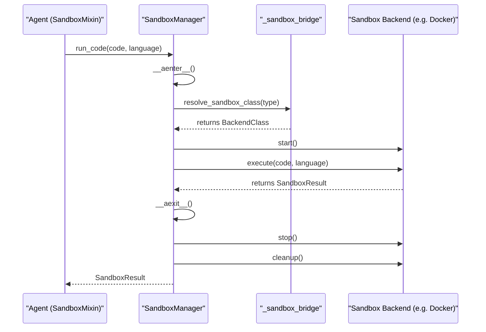
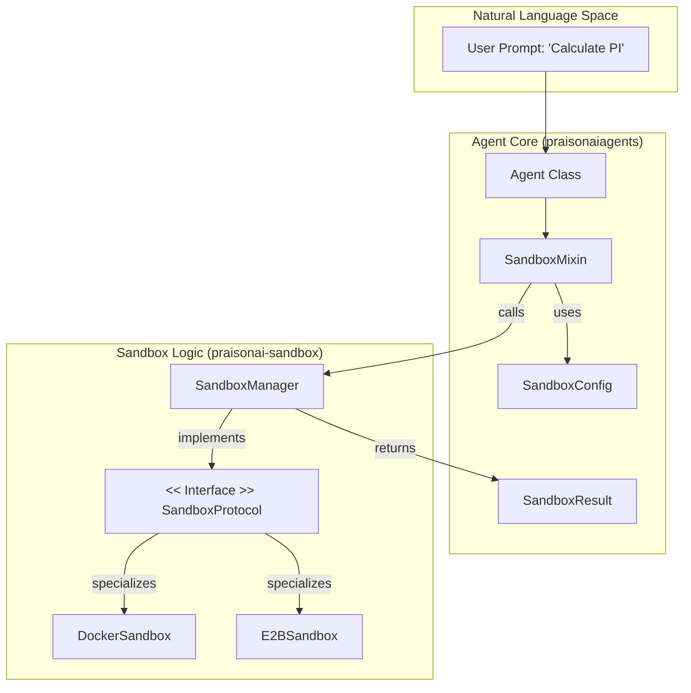

<!-- source: DeepWiki mcp.deepwiki.com · repo MervinPraison/PraisonAI · page 17.2 Sandbox Backends · fetched 2026-10-26 -->

# Sandbox Backends

Relevant source files

The following files were used as context for generating this wiki page:

- [.agent/mer-vin-praisonai-mcp.html](.agent/mer-vin-praisonai-mcp.html)
- [.agent/mer-vin-praisonai-wrapper.html](.agent/mer-vin-praisonai-wrapper.html)
- [examples/python/sandbox_remote.py](examples/python/sandbox_remote.py)
- [src/praisonai-agents/praisonaiagents/agent/sandbox_mixin.py](src/praisonai-agents/praisonaiagents/agent/sandbox_mixin.py)
- [src/praisonai-agents/praisonaiagents/sandbox/__init__.py](src/praisonai-agents/praisonaiagents/sandbox/__init__.py)
- [src/praisonai-agents/praisonaiagents/sandbox/config.py](src/praisonai-agents/praisonaiagents/sandbox/config.py)
- [src/praisonai-agents/praisonaiagents/sandbox/manager.py](src/praisonai-agents/praisonaiagents/sandbox/manager.py)
- [src/praisonai-agents/praisonaiagents/sandbox/protocols.py](src/praisonai-agents/praisonaiagents/sandbox/protocols.py)
- [src/praisonai-agents/praisonaiagents/sandbox/security.py](src/praisonai-agents/praisonaiagents/sandbox/security.py)
- [src/praisonai-agents/praisonaiagents/tools/resolver.py](src/praisonai-agents/praisonaiagents/tools/resolver.py)
- [src/praisonai-agents/tests/unit/plugins/test_plugins_enable.py](src/praisonai-agents/tests/unit/plugins/test_plugins_enable.py)
- [src/praisonai-agents/tests/unit/sandbox/__init__.py](src/praisonai-agents/tests/unit/sandbox/__init__.py)
- [src/praisonai-agents/tests/unit/sandbox/test_sandbox_manager.py](src/praisonai-agents/tests/unit/sandbox/test_sandbox_manager.py)
- [src/praisonai-agents/tests/unit/sandbox/test_sandbox_mixin.py](src/praisonai-agents/tests/unit/sandbox/test_sandbox_mixin.py)
- [src/praisonai-agents/tests/unit/sandbox/test_sandbox_wiring.py](src/praisonai-agents/tests/unit/sandbox/test_sandbox_wiring.py)
- [src/praisonai-agents/tests/unit/sandbox/test_security.py](src/praisonai-agents/tests/unit/sandbox/test_security.py)
- [src/praisonai-agents/tests/unit/tools/test_tool_resolver.py](src/praisonai-agents/tests/unit/tools/test_tool_resolver.py)
- [src/praisonai-sandbox/README.md](src/praisonai-sandbox/README.md)
- [src/praisonai-sandbox/e2e-validation/MANUAL-E2E-GUIDE.md](src/praisonai-sandbox/e2e-validation/MANUAL-E2E-GUIDE.md)
- [src/praisonai-sandbox/e2e-validation/README.md](src/praisonai-sandbox/e2e-validation/README.md)
- [src/praisonai-sandbox/e2e-validation/run_e2e.py](src/praisonai-sandbox/e2e-validation/run_e2e.py)
- [src/praisonai-sandbox/praisonai_sandbox/__init__.py](src/praisonai-sandbox/praisonai_sandbox/__init__.py)
- [src/praisonai-sandbox/praisonai_sandbox/_plugin_registry.py](src/praisonai-sandbox/praisonai_sandbox/_plugin_registry.py)
- [src/praisonai-sandbox/praisonai_sandbox/_registry.py](src/praisonai-sandbox/praisonai_sandbox/_registry.py)
- [src/praisonai-sandbox/praisonai_sandbox/_version.py](src/praisonai-sandbox/praisonai_sandbox/_version.py)
- [src/praisonai-sandbox/praisonai_sandbox/e2b.py](src/praisonai-sandbox/praisonai_sandbox/e2b.py)
- [src/praisonai-sandbox/praisonai_sandbox/novita.py](src/praisonai-sandbox/praisonai_sandbox/novita.py)
- [src/praisonai-sandbox/praisonai_sandbox/sandlock.py](src/praisonai-sandbox/praisonai_sandbox/sandlock.py)
- [src/praisonai-sandbox/praisonai_sandbox/subprocess.py](src/praisonai-sandbox/praisonai_sandbox/subprocess.py)
- [src/praisonai-sandbox/pyproject.toml](src/praisonai-sandbox/pyproject.toml)
- [src/praisonai-sandbox/tests/test_daytona.py](src/praisonai-sandbox/tests/test_daytona.py)
- [src/praisonai-sandbox/tests/test_e2b_sandbox.py](src/praisonai-sandbox/tests/test_e2b_sandbox.py)
- [src/praisonai-sandbox/tests/test_novita.py](src/praisonai-sandbox/tests/test_novita.py)
- [src/praisonai-sandbox/uv.lock](src/praisonai-sandbox/uv.lock)
- [src/praisonai/praisonai/sandbox/__init__.py](src/praisonai/praisonai/sandbox/__init__.py)

The `praisonai-sandbox` package provides a unified interface for isolated agent code execution across multiple backends, ranging from local subprocesses to remote cloud environments like E2B and Modal [src/praisonai-sandbox/pyproject.toml:1-4](). It ensures that agents can execute Python code or shell commands without compromising the host system's security [src/praisonai-agents/praisonaiagents/agent/sandbox_mixin.py:1-5]().

## Architecture Overview

The sandbox system follows a tiered architecture where a lightweight `SandboxManager` in the core `praisonai-agents` package routes requests to heavy implementations in `praisonai-sandbox` via a bridge module [src/praisonai-agents/praisonaiagents/sandbox/manager.py:1-7]().

### Sandbox Management Flow

The `SandboxManager` acts as a factory and context manager, handling the lifecycle of specific sandbox instances [src/praisonai-agents/praisonaiagents/sandbox/manager.py:23-35]().

**Sandbox Lifecycle Diagram**

Sources: [src/praisonai-agents/praisonaiagents/sandbox/manager.py:41-62](), [src/praisonai-agents/praisonaiagents/sandbox/manager.py:64-98]()

## Supported Backends

PraisonAI supports nine distinct backend types, configured via `SandboxConfig` [src/praisonai-agents/praisonaiagents/sandbox/config.py:92-108]().

| Backend Type | Implementation Class | Description | Requirements |
| :--- | :--- | :--- | :--- |
| `subprocess` | `SubprocessSandbox` | Local process execution (minimal isolation) | None |
| `docker` | `DockerSandbox` | Containerized execution using Docker Engine | `docker` package |
| `e2b` | `E2BSandbox` | Remote cloud sandbox via E2B SDK | `e2b-code-interpreter` |
| `modal` | `ModalSandbox` | Serverless execution on Modal | `modal` |
| `daytona` | `DaytonaSandbox` | Development environment sandboxing | `daytona-sdk` |
| `novita` | `NovitaSandbox` | GPU-accelerated remote sandboxes | `novita-sandbox` |
| `sandlock` | `SandlockSandbox` | OS-native sandboxing (Landlock/Seatbelt) | `sandlock` |
| `ssh` | `SSHSandbox` | Execution on remote hosts via SSH | `asyncssh` |
| `capsule` | Plugin-defined | Extensible plugin-based sandboxes | `praisonai-plugins` |

Sources: [src/praisonai-sandbox/pyproject.toml:18-42](), [src/praisonai-agents/praisonaiagents/sandbox/config.py:135-181]()

## Core Entities and Data Flow

The system bridges natural language instructions to code execution through the `SandboxMixin` and `SandboxProtocol`.

**Code Entity Mapping Diagram**

Sources: [src/praisonai-agents/praisonaiagents/agent/sandbox_mixin.py:16-38](), [src/praisonai-agents/praisonaiagents/sandbox/protocols.py:1-20](), [src/praisonai-agents/praisonaiagents/sandbox/manager.py:23-35]()

## Security and Validation

Before execution, code is passed through a security pre-check layer [src/praisonai-agents/praisonaiagents/agent/sandbox_mixin.py:82-90]().

### Security Policy
The `SecurityPolicy` dataclass defines constraints for the execution environment [src/praisonai-agents/praisonaiagents/sandbox/config.py:14-28]():
- `allow_network`: Boolean toggle for internet access [src/praisonai-agents/praisonaiagents/sandbox/config.py:30]().
- `blocked_paths`: List of sensitive paths (e.g., `/etc/shadow`, `~/.ssh`) [src/praisonai-agents/praisonaiagents/sandbox/config.py:34-36]().
- `blocked_commands`: Prohibited shell commands (e.g., `rm -rf`, `mkfs`) [src/praisonai-agents/praisonaiagents/sandbox/config.py:38-40]().
- `blocked_imports`: Prohibited Python modules (e.g., `subprocess`, `os.system`) [src/praisonai-agents/praisonaiagents/sandbox/config.py:42-44]().

### The "No-Injection" Contract
A critical security design choice is that enabling `sandbox=True` on an `Agent` **does not** automatically inject code-execution tools into the agent's toolset [src/praisonai-agents/tests/unit/sandbox/test_sandbox_wiring.py:28-32](). It only configures the `agent.execute_code()` method for explicit use by the developer or specialized tools [src/praisonai-agents/tests/unit/sandbox/test_sandbox_wiring.py:46-52]().

Sources: [src/praisonai-agents/praisonaiagents/sandbox/config.py:14-88](), [src/praisonai-agents/tests/unit/sandbox/test_sandbox_wiring.py:28-43]()

## Plugin Registry and Compute Bridge

The `praisonai-sandbox` package utilizes a plugin registry to allow third-party developers to register new sandbox types [src/praisonai-agents/praisonaiagents/sandbox/manager.py:100-110]().

### Sandbox Discovery
The `resolve_sandbox_class` function in the bridge module dynamically loads backend implementations only when needed, minimizing the memory footprint of the core `praisonai-agents` package [src/praisonai-agents/praisonaiagents/sandbox/manager.py:64-80]().

### Compute Bridge Implementation
When a remote backend like Novita is used, the `NovitaSandbox` class manages the remote session via the `novita-sandbox` SDK [src/praisonai-sandbox/tests/test_novita.py:47-62]().

**Remote Execution Flow**
1. **Availability Check**: Verifies API keys (e.g., `NOVITA_API_KEY`) and SDK presence [src/praisonai-sandbox/tests/test_novita.py:33-37]().
2. **Session Creation**: Calls `AsyncSandbox.create()` to provision a remote instance [src/praisonai-sandbox/tests/test_novita.py:47-58]().
3. **Command Routing**: Maps `execute()` calls to `sandbox.commands.run()` [src/praisonai-sandbox/tests/test_novita.py:72-80]().
4. **Cleanup**: Ensures the remote sandbox is killed via `sandbox.kill()` on exit [src/praisonai-sandbox/tests/test_novita.py:86-95]().

Sources: [src/praisonai-agents/praisonaiagents/sandbox/manager.py:64-134](), [src/praisonai-sandbox/tests/test_novita.py:22-103]()

---

