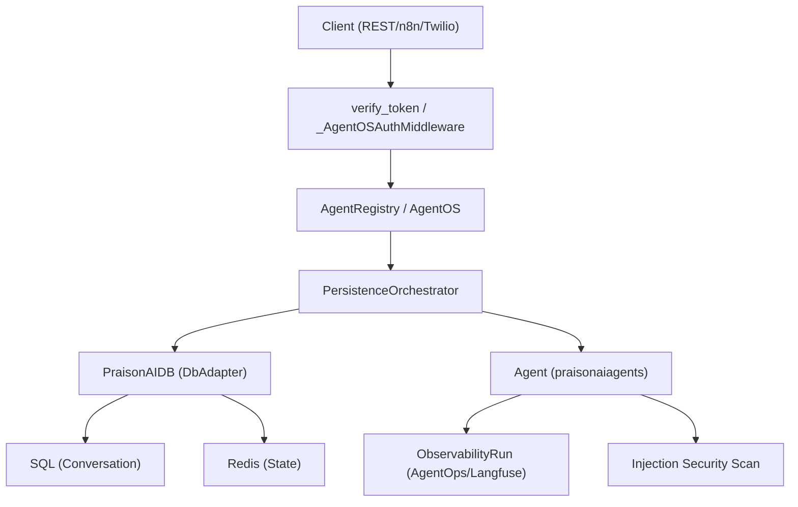

<!-- source: DeepWiki mcp.deepwiki.com · repo MervinPraison/PraisonAI · page 18.1 PraisonAI Platform · fetched 2026-10-26 -->

# PraisonAI Platform

Relevant source files

The following files were used as context for generating this wiki page:

- [examples/python/n8n_integration_example.py](examples/python/n8n_integration_example.py)
- [src/praisonai/praisonai/api/agent_invoke.py](src/praisonai/praisonai/api/agent_invoke.py)
- [src/praisonai/praisonai/api/call.py](src/praisonai/praisonai/api/call.py)
- [src/praisonai/praisonai/app/agentos.py](src/praisonai/praisonai/app/agentos.py)
- [src/praisonai/praisonai/db/adapter.py](src/praisonai/praisonai/db/adapter.py)
- [src/praisonai/praisonai/flow/__init__.py](src/praisonai/praisonai/flow/__init__.py)
- [src/praisonai/praisonai/observability/hooks.py](src/praisonai/praisonai/observability/hooks.py)
- [src/praisonai/praisonai/persistence/conversation/_ops.py](src/praisonai/praisonai/persistence/conversation/_ops.py)
- [src/praisonai/praisonai/persistence/orchestrator.py](src/praisonai/praisonai/persistence/orchestrator.py)
- [src/praisonai/praisonai/persistence/state/base.py](src/praisonai/praisonai/persistence/state/base.py)
- [src/praisonai/praisonai/persistence/state/redis.py](src/praisonai/praisonai/persistence/state/redis.py)
- [src/praisonai/praisonai/persistence/state/upstash.py](src/praisonai/praisonai/persistence/state/upstash.py)
- [src/praisonai/praisonai/security/injection.py](src/praisonai/praisonai/security/injection.py)
- [src/praisonai/tests/test_n8n_agent_invoke.py](src/praisonai/tests/test_n8n_agent_invoke.py)
- [src/praisonai/tests/unit/test_agent_os_wrapper.py](src/praisonai/tests/unit/test_agent_os_wrapper.py)
- [src/praisonai/tests/unit/test_call_server_auth.py](src/praisonai/tests/unit/test_call_server_auth.py)
- [src/praisonai/tests/unit/test_security_outstanding_ghsas.py](src/praisonai/tests/unit/test_security_outstanding_ghsas.py)

The PraisonAI Platform, primarily implemented within the `praisonai-platform` and `praisonai` wrapper packages, provides a production-grade infrastructure for deploying, managing, and observing AI agents. It extends the core `praisonaiagents` library with multi-tenant capabilities, persistent storage adapters, a FastAPI-based web service layer (`AgentOS`), and specialized integration endpoints for external tools like n8n and Twilio.

## 1. Architecture and Data Flow

The platform serves as the bridge between raw agent logic and production infrastructure. It handles the lifecycle of agent requests, ensuring that each interaction is authenticated, logged, and persisted to the configured backends.

### 1.1 Platform Request Pipeline
The following diagram illustrates the flow of a request from an external client through the Platform's authentication and orchestration layers to the underlying agents.

**Diagram: Platform Request Lifecycle**

**Sources:** [src/praisonai/praisonai/api/agent_invoke.py:46-101](), [src/praisonai/praisonai/app/agentos.py:119-136](), [src/praisonai/praisonai/persistence/orchestrator.py:161-200](), [src/praisonai/praisonai/security/injection.py:153-165]()

## 2. Multi-Tenant Workspace Management

The platform supports multi-tenant environments through the `AgentRegistry` and scoped `PersistenceOrchestrator` instances.

### 2.1 Agent Registry
The `AgentRegistry` [src/praisonai/praisonai/api/agent_invoke.py:148-183]() provides a thread-safe mechanism to register and retrieve agents by unique identifiers. This allows a single running instance of the platform to serve multiple isolated agent configurations.
*   **Registration**: `register_agent(agent_id, agent)` adds an agent to the internal map [src/praisonai/praisonai/api/agent_invoke.py:188-191]().
*   **Invocation**: `invoke_agent_standalone` handles the logic of finding the agent and executing its `start` or `astart` methods [src/praisonai/tests/test_n8n_agent_invoke.py:80-84]().

### 2.2 Authentication and RBAC
Security is enforced through several layers:
*   **Token Verification**: The `verify_token` function [src/praisonai/praisonai/api/agent_invoke.py:46-100]() uses constant-time comparison (`hmac.compare_digest`) to validate API tokens provided via Bearer headers, Basic auth, or query parameters.
*   **AgentOS Middleware**: The `_AgentOSAuthMiddleware` [src/praisonai/praisonai/app/agentos.py:126-136]() intercepts all non-health requests to validate the `X-API-Key` or `Authorization` header against the `PRAISONAI_AGENTOS_API_KEY` environment variable.

**Sources:** [src/praisonai/praisonai/api/agent_invoke.py:148-183](), [src/praisonai/praisonai/app/agentos.py:119-136](), [src/praisonai/tests/test_n8n_agent_invoke.py:80-84]()

## 3. AgentOS: The Web Backend

`AgentOS` [src/praisonai/praisonai/app/agentos.py:16-50]() is the primary FastAPI-based application class used to deploy agents as production web services.

### 3.1 Key Features
*   **Unified Application**: Wraps `agents`, `teams`, and `flows` into a single API [src/praisonai/praisonai/app/agentos.py:51-78]().
*   **Session Isolation**: In the `/chat` endpoint, the platform clones the agent template per request to ensure that `chat_history` and state do not leak between different sessions [src/praisonai/tests/unit/test_agent_os_wrapper.py:76-95]().
*   **Automatic Routes**: Generates endpoints for `/health`, `/agents` (listing), and `/chat` (execution) [src/praisonai/praisonai/app/agentos.py:155-184]().

### 3.2 Deployment Configuration
Configuration is handled via `AgentOSConfig`, which manages CORS origins, API prefixes, and documentation URLs [src/praisonai/praisonai/app/agentos.py:88-114]().

**Sources:** [src/praisonai/praisonai/app/agentos.py:16-50](), [src/praisonai/praisonai/app/agentos.py:155-184](), [src/praisonai/tests/unit/test_agent_os_wrapper.py:76-95]()

## 4. Persistence and Database Adapters

The platform uses a layered persistence architecture to decouple agent logic from specific database implementations.

### 4.1 PraisonAIDB Adapter
`PraisonAIDB` [src/praisonai/praisonai/db/adapter.py:18-39]() implements the `DbAdapter` protocol. It acts as a universal bridge that detects backends based on connection URLs:
*   **Conversation Storage**: SQL-based (Postgres, MySQL, SQLite) [src/praisonai/praisonai/db/adapter.py:97-101]().
*   **State Storage**: Key-value stores (Redis, Upstash) [src/praisonai/praisonai/db/adapter.py:104-108]().
*   **Knowledge Storage**: Vector databases (Qdrant, etc.) [src/praisonai/praisonai/db/adapter.py:111-115]().

### 4.2 Persistence Orchestrator
The `PersistenceOrchestrator` [src/praisonai/praisonai/persistence/orchestrator.py:31-55]() coordinates operations across these stores. It manages a bounded LRU cache for sessions to prevent memory exhaustion in high-traffic environments [src/praisonai/praisonai/persistence/orchestrator.py:85-94]().

**Diagram: Persistence Entity Mapping**
| Code Entity | Role | Source |
| :--- | :--- | :--- |
| `PraisonAIDB` | Protocol implementation for agents | [src/praisonai/praisonai/db/adapter.py:18]() |
| `PersistenceOrchestrator` | Central coordinator for stores | [src/praisonai/praisonai/persistence/orchestrator.py:31]() |
| `ConversationStore` | Interface for message history | [src/praisonai/praisonai/persistence/conversation/base.py:19]() |
| `resume_or_create_session` | Logic for session recovery | [src/praisonai/praisonai/persistence/conversation/_ops.py:20]() |

**Sources:** [src/praisonai/praisonai/db/adapter.py:18-115](), [src/praisonai/praisonai/persistence/orchestrator.py:31-94](), [src/praisonai/praisonai/persistence/conversation/_ops.py:20-55]()

## 5. Security and Activity Logging

### 5.1 Injection Defense
The platform includes a 6-check detection pipeline to defend against prompt injection [src/praisonai/praisonai/security/injection.py:4-9]().
*   **Threat Levels**: Categorizes threats from `LOW` to `CRITICAL` [src/praisonai/praisonai/security/injection.py:21-26]().
*   **Normalization**: Strips zero-width characters and resolves homoglyphs (e.g., Cyrillic 'a' to Latin 'a') before scanning [src/praisonai/praisonai/security/injection.py:153-165]().
*   **Pattern Matching**: Detects instruction overrides, authority claims, and destructive shell commands like `rm -rf` [src/praisonai/praisonai/security/injection.py:34-118]().

### 5.2 Observability Hooks
The `init_observability` function [src/praisonai/praisonai/observability/hooks.py:150-165]() manages per-run telemetry sessions.
*   **Fanout Sinks**: Uses `_FanoutSink` [src/praisonai/praisonai/observability/hooks.py:81-112]() to broadcast trace events to multiple providers (e.g., AgentOps and Langfuse) simultaneously.
*   **Thread Safety**: Uses a thread-local stack (`_run_stack`) to ensure that concurrent agent runs do not interfere with each other's telemetry streams [src/praisonai/praisonai/observability/hooks.py:51-59]().

**Sources:** [src/praisonai/praisonai/security/injection.py:4-118](), [src/praisonai/praisonai/observability/hooks.py:51-112](), [src/praisonai/praisonai/observability/hooks.py:150-165]()

## 6. Platform SDK and Integrations

### 6.1 n8n Integration
The platform provides a dedicated `AgentInvokeRequest` model [src/praisonai/praisonai/api/agent_invoke.py:104-109]() and `invoke_agent_standalone` function to allow n8n workflows to trigger agents and receive structured responses [src/praisonai/praisonai/api/agent_invoke.py:201-240]().

### 6.2 Voice and Realtime API
The `praisonai/api/call.py` module enables voice interactions via Twilio and OpenAI Realtime API.
*   **Token Minting**: `_mint_stream_session_token` creates single-use, TTL-bound tokens for media-stream handshakes to prevent credential leakage in URLs [src/praisonai/praisonai/api/call.py:113-121]().
*   **Realtime Resolution**: `_resolve_realtime_endpoint` dynamically configures WebSocket URLs and auth headers for OpenAI or self-hosted gateways [src/praisonai/praisonai/api/call.py:46-73]().

**Sources:** [src/praisonai/praisonai/api/agent_invoke.py:104-240](), [src/praisonai/praisonai/api/call.py:46-121]()

---

