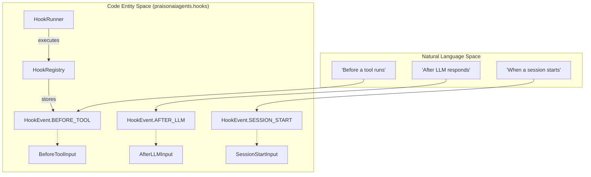
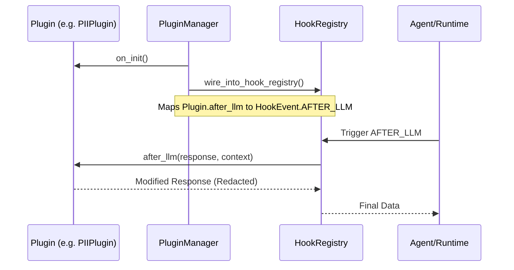
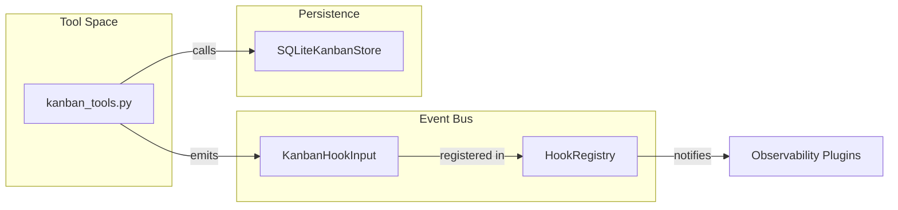

<!-- source: DeepWiki mcp.deepwiki.com · repo MervinPraison/PraisonAI · page 18.2 Event Bus and Hooks · fetched 2026-10-26 -->

# Event Bus and Hooks

Relevant source files

The following files were used as context for generating this wiki page:

- [src/praisonai-agents/praisonaiagents/cli_backend/__init__.py](src/praisonai-agents/praisonaiagents/cli_backend/__init__.py)
- [src/praisonai-agents/praisonaiagents/cli_backend/debug.py](src/praisonai-agents/praisonaiagents/cli_backend/debug.py)
- [src/praisonai-agents/praisonaiagents/config/loader.py](src/praisonai-agents/praisonaiagents/config/loader.py)
- [src/praisonai-agents/praisonaiagents/hooks/__init__.py](src/praisonai-agents/praisonaiagents/hooks/__init__.py)
- [src/praisonai-agents/praisonaiagents/hooks/events.py](src/praisonai-agents/praisonaiagents/hooks/events.py)
- [src/praisonai-agents/praisonaiagents/hooks/types.py](src/praisonai-agents/praisonaiagents/hooks/types.py)
- [src/praisonai-agents/praisonaiagents/kanban/__init__.py](src/praisonai-agents/praisonaiagents/kanban/__init__.py)
- [src/praisonai-agents/praisonaiagents/kanban/protocols.py](src/praisonai-agents/praisonaiagents/kanban/protocols.py)
- [src/praisonai-agents/praisonaiagents/plugins/__init__.py](src/praisonai-agents/praisonaiagents/plugins/__init__.py)
- [src/praisonai-agents/praisonaiagents/plugins/discovery.py](src/praisonai-agents/praisonaiagents/plugins/discovery.py)
- [src/praisonai-agents/praisonaiagents/plugins/manager.py](src/praisonai-agents/praisonaiagents/plugins/manager.py)
- [src/praisonai-agents/praisonaiagents/plugins/plugin.py](src/praisonai-agents/praisonaiagents/plugins/plugin.py)
- [src/praisonai-agents/praisonaiagents/session/title.py](src/praisonai-agents/praisonaiagents/session/title.py)
- [src/praisonai-agents/praisonaiagents/tools/subagent_tool.py](src/praisonai-agents/praisonaiagents/tools/subagent_tool.py)
- [src/praisonai-agents/tests/test_plugin_registry_and_gate.py](src/praisonai-agents/tests/test_plugin_registry_and_gate.py)
- [src/praisonai-agents/tests/unit/hooks/test_model_fallback.py](src/praisonai-agents/tests/unit/hooks/test_model_fallback.py)
- [src/praisonai-agents/tests/unit/plugins/test_hook_bridge.py](src/praisonai-agents/tests/unit/plugins/test_hook_bridge.py)
- [src/praisonai-agents/tests/unit/plugins/test_plugin_options.py](src/praisonai-agents/tests/unit/plugins/test_plugin_options.py)
- [src/praisonai-agents/tests/unit/plugins/test_plugins.py](src/praisonai-agents/tests/unit/plugins/test_plugins.py)
- [src/praisonai-agents/tests/unit/session/test_title_gen.py](src/praisonai-agents/tests/unit/session/test_title_gen.py)
- [src/praisonai-agents/tests/unit/test_cli_backend_hook.py](src/praisonai-agents/tests/unit/test_cli_backend_hook.py)
- [src/praisonai-agents/tests/unit/test_kanban_protocol.py](src/praisonai-agents/tests/unit/test_kanban_protocol.py)
- [src/praisonai-agents/tests/unit/tools/test_subagent_tool.py](src/praisonai-agents/tests/unit/tools/test_subagent_tool.py)
- [src/praisonai-code/praisonai_code/cli/commands/plugins.py](src/praisonai-code/praisonai_code/cli/commands/plugins.py)
- [src/praisonai-code/praisonai_code/cli/commands/tools.py](src/praisonai-code/praisonai_code/cli/commands/tools.py)
- [src/praisonai-code/tests/unit/test_tools_list_mcp.py](src/praisonai-code/tests/unit/test_tools_list_mcp.py)
- [src/praisonai/praisonai/cli/commands/kanban.py](src/praisonai/praisonai/cli/commands/kanban.py)
- [src/praisonai/praisonai/cli/configuration/config.schema.json](src/praisonai/praisonai/cli/configuration/config.schema.json)
- [src/praisonai/praisonai/integration/bridges/kanban_bridge.py](src/praisonai/praisonai/integration/bridges/kanban_bridge.py)
- [src/praisonai/praisonai/kanban/__init__.py](src/praisonai/praisonai/kanban/__init__.py)
- [src/praisonai/praisonai/tools/__init__.py](src/praisonai/praisonai/tools/__init__.py)
- [src/praisonai/praisonai/tools/kanban_tools.py](src/praisonai/praisonai/tools/kanban_tools.py)
- [src/praisonai/tests/unit/test_kanban_sqlite_store.py](src/praisonai/tests/unit/test_kanban_sqlite_store.py)

The PraisonAI hook and plugin system provides a powerful mechanism for intercepting, modifying, and observing agent behavior at various lifecycle points. Unlike standard UI callbacks, hooks are deeply integrated into the execution pipeline, allowing for the modification of tool arguments, redaction of LLM responses, and enforcement of safety guardrails.

## Overview of the Hook System

The system is built on a decoupled architecture where events are defined as data structures, managed by a registry, and executed by a runner.

### Core Architecture
The hook system consists of four primary components:
1.  **`HookEvent`**: An enumeration of all supported interception points [src/praisonai-agents/praisonaiagents/hooks/types.py:13-108]().
2.  **`HookRegistry`**: A central store for registering Python functions or shell commands to specific events [src/praisonai-agents/praisonaiagents/hooks/registry.py]().
3.  **`HookRunner`**: The execution engine that triggers registered hooks, handling both synchronous and asynchronous execution [src/praisonai-agents/praisonaiagents/hooks/runner.py]().
4.  **`HookInput/Output`**: Structured data classes that carry context to and from hooks [src/praisonai-agents/praisonaiagents/hooks/types.py:114-185]().

### Data Flow and Entity Mapping
The following diagram illustrates how natural language events map to specific code entities within the `praisonaiagents` package.

**Diagram: Hook System Entity Mapping**

**Sources:** [src/praisonai-agents/praisonaiagents/hooks/types.py:13-108](), [src/praisonai-agents/praisonaiagents/hooks/events.py:13-212](), [src/praisonai-agents/praisonaiagents/hooks/__init__.py:49-112]().

---

## Plugin System and Hook Bridge

The `PluginManager` acts as a higher-level orchestrator that discovers and loads external plugins, then "wires" them into the core `HookRegistry` [src/praisonai-agents/praisonaiagents/plugins/manager.py:39-60]().

### Plugin Types and Decisions
Plugins are categorized by `PluginType` (TOOL, HOOK, SKILL, POLICY, GUARDRAIL, INTEGRATION) [src/praisonai-agents/praisonaiagents/plugins/plugin.py:74-84](). They can influence execution through a `PluginDecision`:
*   **`allow`**: Proceed with the action.
*   **`deny` / `block`**: Stop the action and provide a reason [src/praisonai-agents/praisonaiagents/plugins/plugin.py:53-72]().

### The Hook Bridge
The `PluginManager` uses `wire_into_hook_registry()` to bridge plugin methods (like `before_tool`) to the underlying `HookEvent` system [src/praisonai-agents/tests/unit/plugins/test_hook_bridge.py:153-159]().

**Diagram: Plugin to Hook Bridge Flow**

**Sources:** [src/praisonai-agents/praisonaiagents/plugins/manager.py:159-186](), [src/praisonai-agents/praisonaiagents/plugins/plugin.py:107-190](), [src/praisonai-agents/tests/unit/plugins/test_hook_bridge.py:32-40]().

---

## Lifecycle Hooks

PraisonAI provides specific hooks for various stages of the agent and system lifecycle.

| Category | Hook Event | Purpose |
| :--- | :--- | :--- |
| **Tool** | `BEFORE_TOOL` | Intercept tool arguments before execution [src/praisonai-agents/praisonaiagents/hooks/types.py:24](). |
| **Tool** | `AFTER_TOOL` | Modify or redact tool results [src/praisonai-agents/praisonaiagents/hooks/types.py:25](). |
| **LLM** | `BEFORE_LLM` | Modify messages or parameters before sending to provider [src/praisonai-agents/praisonaiagents/hooks/types.py:41](). |
| **LLM** | `MODEL_FALLBACK` | Fired when primary model fails and system swaps to fallback [src/praisonai-agents/praisonaiagents/hooks/types.py:47](). |
| **Session** | `SESSION_START` | Observe session initialization [src/praisonai-agents/praisonaiagents/hooks/types.py:33](). |
| **Session** | `SESSION_PERSIST_FAILED` | Alerting when SQLite/Disk writes fail; turn is spilled to fallback [src/praisonai-agents/praisonaiagents/hooks/types.py:38](). |

### Model Fallback Hooks
The `MODEL_FALLBACK` event (Issue #3820) is triggered by the LLM recovery loop. It allows observability tools to track when quality or cost degradation occurs due to primary model unavailability [src/praisonai-agents/praisonaiagents/hooks/events.py:216-235]().

---

## Kanban Protocol and Events

The Kanban system uses a specialized set of hooks and protocols to manage task state transitions across different components (CLI, Web UI, and Agents).

### Protocol Contracts
The `KanbanStoreProtocol` defines the interface for task persistence [src/praisonai-agents/praisonaiagents/kanban/protocols.py:80-197]().
*   `get_board()`: Retrieves tasks grouped by status columns [src/praisonai-agents/praisonaiagents/kanban/protocols.py:90-107]().
*   `move_task()`: Transitions a task between statuses like `todo`, `running`, or `done` [src/praisonai-agents/praisonaiagents/kanban/protocols.py:143-152]().

### Kanban Events
When tasks are manipulated via tools (e.g., `kanban_tools.py`), the system emits `KanbanHookInput` events [src/praisonai-agents/praisonaiagents/hooks/types.py:136-161]():
*   `KANBAN_TASK_CREATED`
*   `KANBAN_TASK_CLAIMED`
*   `KANBAN_TASK_MOVED`
*   `KANBAN_TASK_DONE`

**Diagram: Kanban Event Dispatch**

**Sources:** [src/praisonai/praisonai/tools/kanban_tools.py](), [src/praisonai-agents/praisonaiagents/kanban/protocols.py:17-26](), [src/praisonai/praisonai/kanban/sqlite_store.py](), [src/praisonai-agents/praisonaiagents/hooks/types.py:94-101]().

---

## Verification and Middleware

The system supports advanced interception patterns through verification hooks and middleware.

### Verification Hooks
The `VerificationHook` protocol is used for formal validation of actions, returning a `VerificationResult` [src/praisonai-agents/praisonaiagents/hooks/__init__.py:105-106]().

### Middleware System
The `MiddlewareManager` allows wrapping LLM and tool calls in a chain of processors [src/praisonai-agents/praisonaiagents/hooks/__init__.py:101-103]().
*   **`wrap_model_call`**: Intercepts the entire request/response cycle for an LLM [src/praisonai-agents/praisonaiagents/hooks/__init__.py:96]().
*   **`InvocationContext`**: Provides metadata about the current execution context to the middleware [src/praisonai-agents/praisonaiagents/hooks/__init__.py:88]().

### Configuration and Discovery
Plugins and hooks can be enabled via `praisonaiagents.config.loader`. The `PluginsConfig` class manages the `enabled` list, `auto_discover` flags, and per-plugin options [src/praisonai-agents/praisonaiagents/config/loader.py:110-139](). Discovery looks in project-local `.praisonai/plugins` and global user directories [src/praisonai-agents/praisonaiagents/config/loader.py:91-101]().

**Sources:** [src/praisonai-agents/praisonaiagents/plugins/__init__.py:124-204](), [src/praisonai-agents/praisonaiagents/config/loader.py:40-45]().

---

