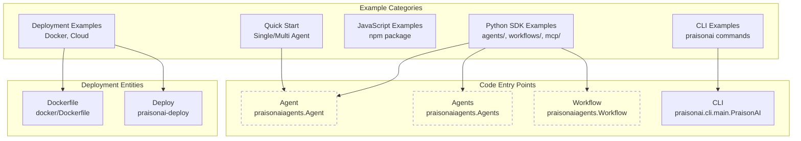
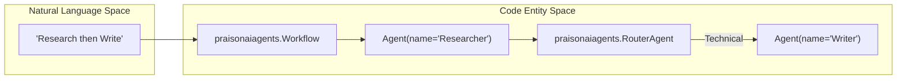

<!-- source: DeepWiki mcp.deepwiki.com · repo MervinPraison/PraisonAI · page 19 Examples and Tutorials · fetched 2026-10-26 -->

# Examples and Tutorials

<details>
<summary>Relevant source files</summary>

The following files were used as context for generating this wiki page:

- [README.md](README.md)
- [api.md](api.md)
- [src/praisonai/README.md](src/praisonai/README.md)

</details>


This page provides a high-level overview of practical examples and tutorials for building AI agent systems with PraisonAI. It covers quick start patterns, SDK usage, CLI commands, and deployment scenarios.

For detailed guides, please refer to the specific child pages:
- **[Python Examples](#19.1)**: Deep dive into multi-agent orchestration, workflows, and specialized agents.
- **[TypeScript Examples](#19.2)**: Patterns for Node.js and browser-based agent integrations.
- **[CLI Examples](#19.3)**: Command-line patterns for rapid prototyping and management.
- **[Deployment Examples](#19.4)**: Production-ready Docker and Cloud deployment configurations.

---

## Example Organization

The following diagram maps high-level example categories to the specific code entities and files that power them.



**Sources:** [README.md:99-134](), [api.md:26-27](), [api.md:120-121]()

---

## Quick Start Patterns

The fastest way to get started is by initializing a single `Agent` or an `AgentTeam`.

### Single Agent (Python)
A minimal agent setup requires defining instructions and calling the `start()` method.

```python
from praisonaiagents import Agent

agent = Agent(instructions="You are a senior data analyst.")
agent.start("Analyze tech trends for 2026.")
```
The `Agent` class in [praisonaiagents/agent/agent.py:41-50]() handles the full execution lifecycle, including LLM communication and tool invocation.

### Multi-Agent Team (CLI)
Using the CLI, you can generate a team of agents automatically based on a natural language prompt.

```bash
praisonai auto "Create a research team for market analysis"
praisonai run
```
This leverages the `AutoAgents` capability defined in [praisonaiagents/agent/auto.py]() to generate a structured `agents.yaml` configuration.

**Sources:** [README.md:80-95](), [api.md:26-27]()

---

## Specialized Agent Tutorials

PraisonAI provides specialized agent classes designed for specific high-level tasks. For full details on these, see [Python Examples](#19.1).

| Agent Type | Purpose | Code Entity |
| :--- | :--- | :--- |
| **Deep Research** | Iterative web research and report generation | `DeepResearchAgent` |
| **Query Rewriter** | Optimizing user queries for RAG systems | `QueryRewriterAgent` |
| **Code Agent** | Writing and executing code in sandboxed environments | `CodeAgent` |
| **Vision Agent** | Analyzing images and video frames | `VisionAgent` |

These specialized types inherit from the base `Agent` class but include pre-configured tools and prompts optimized for their domain.

**Sources:** [api.md:26-27](), [README.md:581-652]()

---

## Workflow and Orchestration

Workflows allow for complex logic beyond simple sequential agent execution. These are managed by the `Workflow` class and specific control patterns.



**Key Workflow Patterns:**
*   **Routing**: Dynamically choosing the next agent based on LLM output using `RouterAgent`.
*   **Parallel**: Executing multiple agents concurrently to save time.
*   **Loops**: Repeating tasks until a specific condition (e.g., human approval or quality score) is met.

For implementation details, see [Python Examples](#19.1) and [TypeScript Examples](#19.2).

**Sources:** [api.md:120-121](), [README.md:775-877]()

---

## Deployment and Infrastructure

PraisonAI supports deployment across various environments, from local Docker containers to managed cloud services.

*   **Docker**: Pre-built images for the Web UI, API, and CLI tools.
*   **Cloud**: Automated deployment to AWS, GCP, and Azure using the `praisonai-deploy` package.
*   **Gateway**: Multi-channel support for deploying agents as bots on Telegram, Slack, or Discord via `praisonai-bot`.

For detailed setup instructions, see [Deployment Examples](#19.4).

**Sources:** [README.md:106-124](), [src/praisonai/praisonai/deploy.py:6-186]()

---

