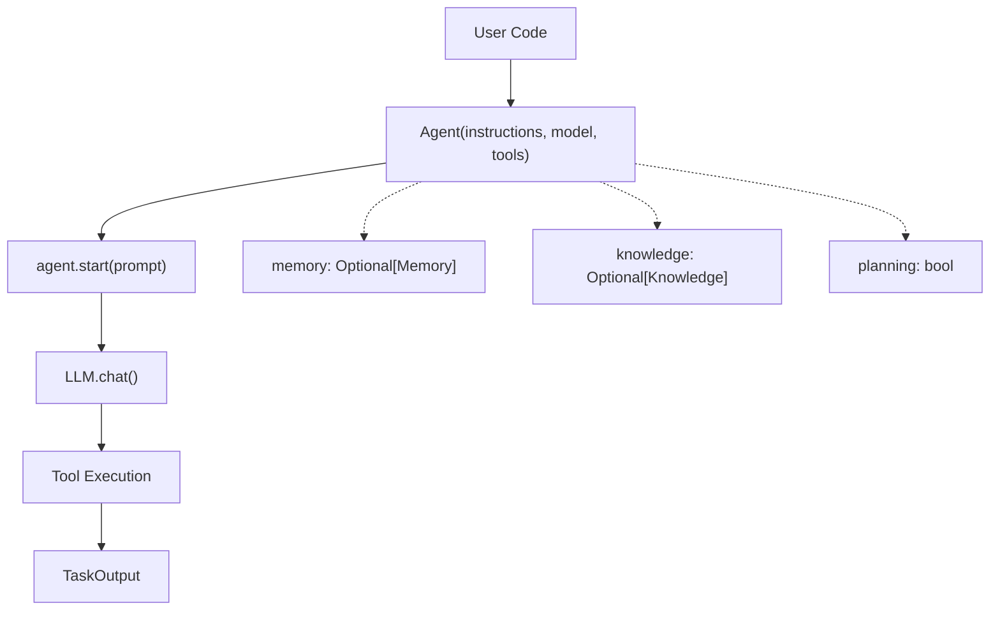
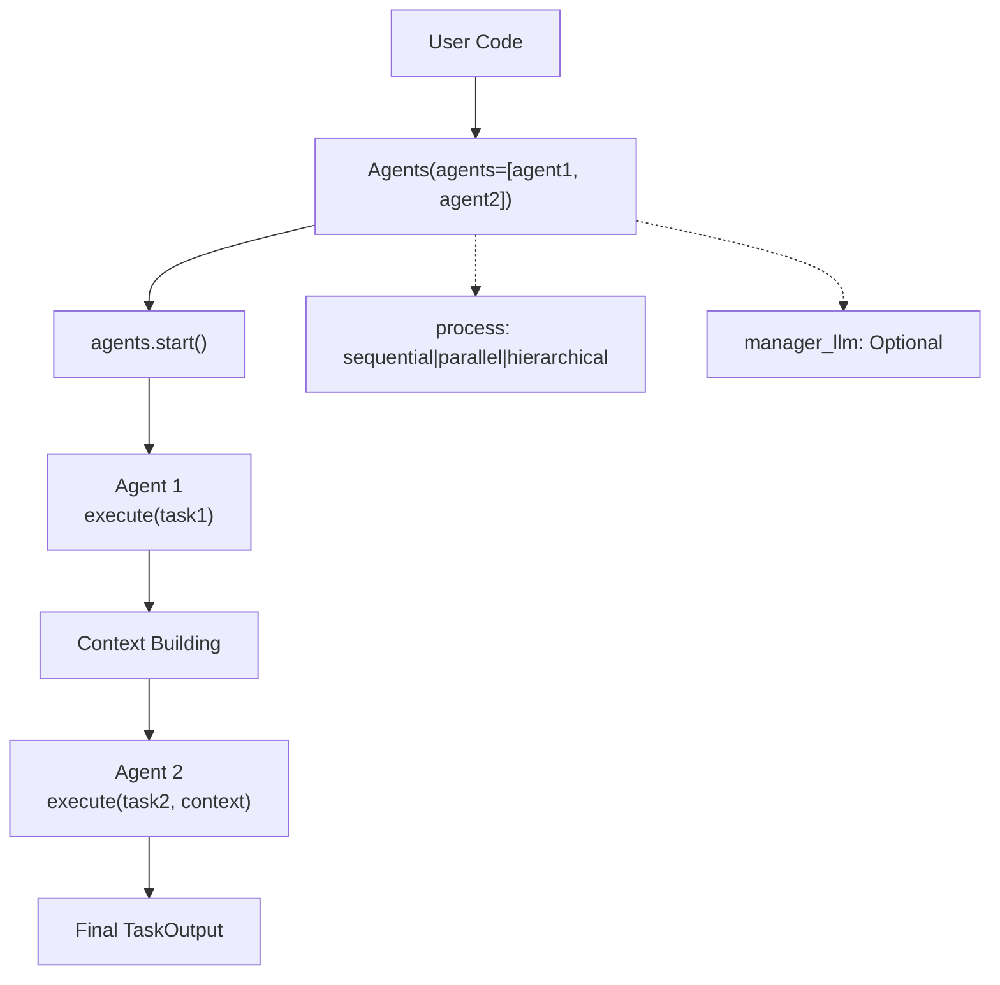
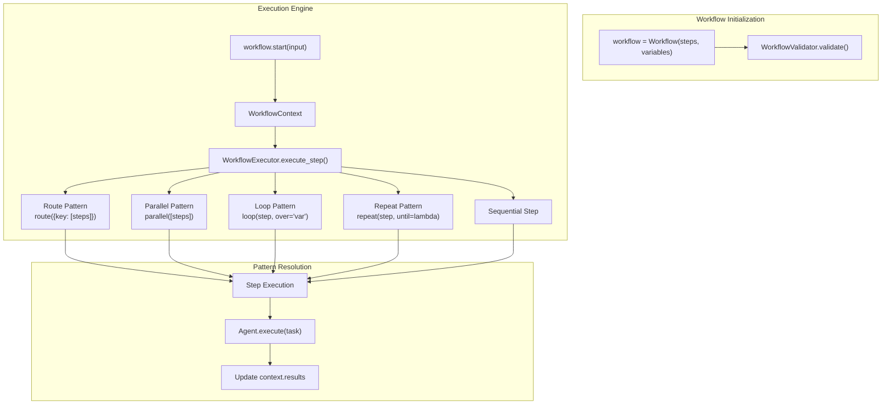
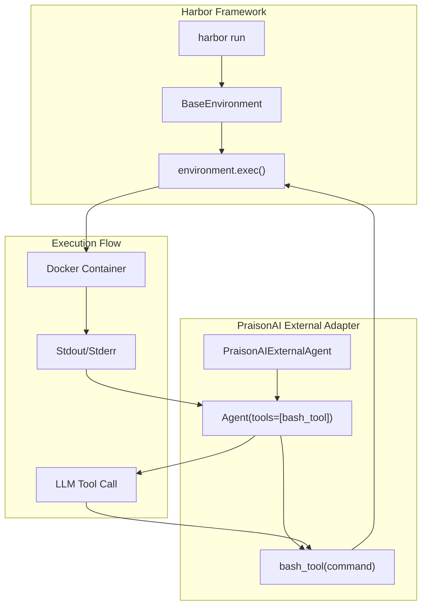

<!-- source: DeepWiki mcp.deepwiki.com · repo MervinPraison/PraisonAI · page 19.1 Python Examples · fetched 2026-10-26 -->

# Python Examples

<details>
<summary>Relevant source files</summary>

The following files were used as context for generating this wiki page:

- [.github/workflows/terminal-bench-smoke.yml](.github/workflows/terminal-bench-smoke.yml)
- [README.md](README.md)
- [examples/__init__.py](examples/__init__.py)
- [examples/terminal_bench/README.md](examples/terminal_bench/README.md)
- [examples/terminal_bench/RESULTS.md](examples/terminal_bench/RESULTS.md)
- [examples/terminal_bench/__init__.py](examples/terminal_bench/__init__.py)
- [examples/terminal_bench/job.yaml](examples/terminal_bench/job.yaml)
- [examples/terminal_bench/job_code_smoke.yaml](examples/terminal_bench/job_code_smoke.yaml)
- [examples/terminal_bench/job_test_5.yaml](examples/terminal_bench/job_test_5.yaml)
- [examples/terminal_bench/job_test_5_wrapper.yaml](examples/terminal_bench/job_test_5_wrapper.yaml)
- [examples/terminal_bench/multi_agent_example.py](examples/terminal_bench/multi_agent_example.py)
- [examples/terminal_bench/praisonai_external_agent.py](examples/terminal_bench/praisonai_external_agent.py)
- [examples/terminal_bench/praisonai_installed_agent.py](examples/terminal_bench/praisonai_installed_agent.py)
- [examples/terminal_bench/praisonai_wrapper_agent.py](examples/terminal_bench/praisonai_wrapper_agent.py)
- [examples/terminal_bench/test_adapter_config.py](examples/terminal_bench/test_adapter_config.py)
- [examples/terminal_bench/test_basic.py](examples/terminal_bench/test_basic.py)
- [examples/terminal_bench/test_integration.py](examples/terminal_bench/test_integration.py)
- [src/praisonai-agents/.agent/workflows/create-docs-issue.md](src/praisonai-agents/.agent/workflows/create-docs-issue.md)
- [src/praisonai/README.md](src/praisonai/README.md)

</details>


## Purpose and Scope

This document provides practical Python code examples for using the PraisonAI framework programmatically. It covers core API usage patterns including single agents, multi-agent systems, workflow orchestration, custom tools, memory integration, and advanced features like planning mode, autonomous execution, and external framework benchmarking.

For command-line usage examples, see [CLI Examples](#19.3). For deployment-specific examples, see [Deployment Examples](#19.4). For TypeScript/JavaScript examples, see [TypeScript Examples](#19.2). For comprehensive API documentation, see [Python API Reference](#12.1).

---

## Basic Agent Usage

### Single Agent Pattern

The most fundamental pattern in PraisonAI is the single `Agent` class instantiation and execution.



**Core Components:**

| Class | File Location | Purpose |
|-------|---------------|---------|
| `Agent` | [src/praisonaiagents/agent/agent.py]() | Main agent class with LLM interaction and tool execution |
| `TaskOutput` | [src/praisonaiagents/main.py]() | Structured output from agent execution |
| `Memory` | [src/praisonaiagents/memory/memory.py]() | Persistent memory across conversations |

**Basic Example Pattern:**

The agent initialization follows this signature: `Agent(name=None, role=None, goal=None, instructions=None, tools=None, llm=None, memory=False)`. The `instructions` parameter defines the agent's behavior, while `start(prompt)` executes a task.

**Sources:** [README.md:89-95](), [src/praisonaiagents/agent/agent.py:1-100]()

---

### Multi-Agent Coordination

Multi-agent systems use the `Agents` (or `AgentTeam`) class to coordinate multiple agents with task dependencies.



**Multi-Agent Architecture:**

| Class | File Location | Purpose |
|-------|---------------|---------|
| `Agents` | [src/praisonaiagents/agent/agents.py]() | Sequential multi-agent orchestrator |
| `AgentTeam` | [src/praisonaiagents/agent/agent_team.py]() | Advanced multi-agent with state management |
| `Task` | [src/praisonaiagents/task/task.py]() | Unit of work with context and callbacks |

**Task Context Flow:**

When multiple agents execute sequentially, each agent receives the previous agent's output via the `context` parameter. The `Task.depends_on` property enables dependency management.

**Sources:** [README.md:167-184](), [src/praisonaiagents/agent/agents.py:1-200](), [src/praisonaiagents/agent/agent_team.py:1-300]()

---

## Workflow Orchestration

### Workflow Class Architecture

The `Workflow` class provides deterministic pipeline execution with advanced control flow patterns.



**Workflow Components:**

| Component | File Location | Purpose |
|-----------|---------------|---------|
| `Workflow` | [src/praisonaiagents/workflows/workflow.py]() | Main workflow orchestrator |
| `WorkflowContext` | [src/praisonaiagents/workflows/context.py]() | Execution state and variable management |
| `route()` | [src/praisonaiagents/workflows/workflows.py:100-150]() | Conditional branching helper |
| `parallel()` | [src/praisonaiagents/workflows/workflows.py:50-100]() | Concurrent execution helper |
| `loop()` | [src/praisonaiagents/workflows/workflows.py:150-200]() | Iteration helper |
| `repeat()` | [src/praisonaiagents/workflows/workflows.py:200-250]() | Conditional retry helper |

**Sources:** [README.md:213-264](), [src/praisonaiagents/workflows/workflow.py:1-400]()

---

## Benchmarking and External Integration

### Harbor Integration (Terminal-Bench)

PraisonAI provides specialized adapters for benchmarking on **Terminal-Bench 2.1** using the **Harbor framework**. This allows evaluating agents in real, sandboxed terminal environments.



**Integration Patterns:**

| Type | Implementation | Purpose |
|------|----------------|---------|
| **External Agent** | [examples/terminal_bench/praisonai_external_agent.py]() | Bridges `Agent()` class with Harbor's `exec()` via a custom bash tool. |
| **Code Agent** | [examples/terminal_bench/praisonai_code_agent.py]() | Drives the `praisonai code` assistant headlessly inside a container. |
| **Wrapper Agent** | [examples/terminal_bench/praisonai_wrapper_agent.py]() | Uses the `praisonai "TASK"` CLI pattern via subprocess. |
| **Installed Agent** | [examples/terminal_bench/praisonai_installed_agent.py]() | Production-ready script that installs the SDK inside the container. |

**Key Implementation Details:**
- **Auto-Approval**: To avoid manual gates in headless benchmarks, the registry is configured with `AutoApproveBackend()` [examples/terminal_bench/praisonai_external_agent.py:97-99]().
- **Execution Budget**: Benchmarks often require higher limits, configured via `ExecutionConfig(max_tool_calls_per_turn=80, max_iter=40)` [examples/terminal_bench/praisonai_external_agent.py:45-49]().
- **Metrics Tracking**: Usage data is extracted from `agent.cost_summary` and populated into Harbor's `AgentContext` [examples/terminal_bench/praisonai_external_agent.py:163-164]().

**Sources:** [examples/terminal_bench/README.md:1-120](), [examples/terminal_bench/praisonai_external_agent.py:45-164]()

---

### Multi-Agent Benchmark Example

Complex terminal tasks can be decomposed into a specialized team within the Harbor environment.

```python
# Create specialized agents for Terminal-Bench
planner = Agent(
    name="planner",
    instructions="Analyze task and create a detailed action list.",
    llm="openai/gpt-4o-mini"
)

executor = Agent(
    name="executor",
    instructions="Follow plan using bash_tool.",
    tools=[bash_tool], # Bridges to Harbor environment.exec()
    llm="openai/gpt-4o-mini"
)

verifier = Agent(
    name="verifier",
    instructions="Run tests to confirm solution works.",
    tools=[bash_tool],
    llm="openai/gpt-4o-mini"
)
```

This pattern allows the **Planner** to handle decomposition while the **Executor** focuses on shell syntax, and the **Verifier** ensures the reward criteria are met [examples/terminal_bench/multi_agent_example.py:96-132]().

**Sources:** [examples/terminal_bench/multi_agent_example.py:61-163]()

---

## Specialized Agents

### DeepResearchAgent

The `DeepResearchAgent` provides automated research with real-time streaming and structured citations.

**Key Methods:**

| Method | File Location | Purpose |
|--------|---------------|---------|
| `research()` | [src/praisonaiagents/agent/deep_research_agent.py:100-200]() | Synchronous research with streaming |
| `aresearch()` | [src/praisonaiagents/agent/deep_research_agent.py:200-300]() | Async research execution |

The agent automatically detects the provider from the model name. OpenAI models starting with `o` use OpenAI's client, while models containing "deep-research" use Gemini [src/praisonaiagents/agent/deep_research_agent.py:50-100]().

**Sources:** [README.md:135-149](), [src/praisonaiagents/agent/deep_research_agent.py:1-500]()

---

## Tools and Integration

### Custom Tool Creation

Custom tools can be created using the `@tool` decorator, which automatically generates JSON schemas from type hints and docstrings.

```python
from praisonaiagents import tool

@tool
def calculate(expression: str) -> dict:
    """Evaluate a mathematical expression.
    
    Args:
        expression: Mathematical expression to evaluate
        
    Returns:
        Result of calculation
    """
    return {"result": eval(expression)}
```

**Sources:** [README.md:1170](), [src/praisonaiagents/tools/decorator.py:1-100]()

---

### MCP Integration

Model Context Protocol (MCP) allows agents to consume external tools from MCP servers using `stdio`, `HTTP`, or `WebSocket` transports.

```python
from praisonaiagents import Agent, MCP

# stdio transport (local process)
agent = Agent(tools=MCP("npx @modelcontextprotocol/server-memory"))

# HTTP transport
agent = Agent(tools=MCP("https://api.example.com/mcp"))
```

The MCP client automatically detects the transport type from the command/URL format [src/praisonaiagents/mcp/mcp.py:50-150]().

**Sources:** [README.md:1170](), [src/praisonaiagents/mcp/mcp.py:1-300]()

---

## Summary of Patterns

| Feature | Code Entity | Implementation Detail |
|---------|-------------|-----------------------|
| **Planning** | `PlanningAgent` | Generates a `Plan` with `PlanStep` dependencies [src/praisonaiagents/planning/planner.py](). |
| **Handoff** | `handoff()` | Creates a tool that transfers `ContextPolicy` to a target agent [src/praisonaiagents/agent/handoff.py](). |
| **Refinement** | `run_until()` | Iterative execution until a quality `threshold` is met [src/praisonaiagents/agent/agent.py](). |
| **Persistence** | `Session` | Saves state to `.praison/sessions/` for resumable execution [src/praisonaiagents/session/api.py](). |
| **Sandboxing** | `bash_tool` | Bridging `Agent` to `BaseEnvironment.exec()` in Harbor [examples/terminal_bench/praisonai_external_agent.py](). |

**Sources:** [src/praisonaiagents/agent/agent.py:800-1400](), [examples/terminal_bench/README.md:1-165]()

---

