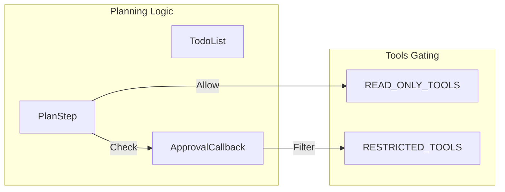

<!-- source: DeepWiki mcp.deepwiki.com · repo MervinPraison/PraisonAI · page 19.2 TypeScript Examples · fetched 2026-10-26 -->

# TypeScript Examples

<details>
<summary>Relevant source files</summary>

The following files were used as context for generating this wiki page:

- [src/praisonai-ts/README.md](src/praisonai-ts/README.md)
- [src/praisonai-ts/examples/commonjs/movie-script.js](src/praisonai-ts/examples/commonjs/movie-script.js)
- [src/praisonai-ts/examples/commonjs/single-agent.js](src/praisonai-ts/examples/commonjs/single-agent.js)
- [src/praisonai-ts/examples/simple/multi-tool-call.ts](src/praisonai-ts/examples/simple/multi-tool-call.ts)
- [src/praisonai-ts/examples/simple/single-agent-tool-call.ts](src/praisonai-ts/examples/simple/single-agent-tool-call.ts)
- [src/praisonai-ts/package.json](src/praisonai-ts/package.json)
- [src/praisonai-ts/src/agent/index.ts](src/praisonai-ts/src/agent/index.ts)
- [src/praisonai-ts/src/agent/proxy.ts](src/praisonai-ts/src/agent/proxy.ts)
- [src/praisonai-ts/src/agent/router.ts](src/praisonai-ts/src/agent/router.ts)
- [src/praisonai-ts/src/agent/simple.ts](src/praisonai-ts/src/agent/simple.ts)
- [src/praisonai-ts/src/agent/types.ts](src/praisonai-ts/src/agent/types.ts)
- [src/praisonai-ts/src/db/index.ts](src/praisonai-ts/src/db/index.ts)
- [src/praisonai-ts/src/db/postgres.ts](src/praisonai-ts/src/db/postgres.ts)
- [src/praisonai-ts/src/llm/openai.ts](src/praisonai-ts/src/llm/openai.ts)
- [src/praisonai-ts/src/planning/index.ts](src/praisonai-ts/src/planning/index.ts)
- [src/praisonai-ts/src/telemetry/index.ts](src/praisonai-ts/src/telemetry/index.ts)
- [src/praisonai-ts/src/utils/logger.ts](src/praisonai-ts/src/utils/logger.ts)
- [src/praisonai-ts/src/utils/pretty-logger.ts](src/praisonai-ts/src/utils/pretty-logger.ts)
- [src/praisonai-ts/tests/development/simple/multi-tool-call.ts](src/praisonai-ts/tests/development/simple/multi-tool-call.ts)
- [src/praisonai-ts/tests/development/simple/single-agent-tool-call.ts](src/praisonai-ts/tests/development/simple/single-agent-tool-call.ts)
- [src/praisonai-ts/tests/unit/agent/structured-output-and-tools.test.ts](src/praisonai-ts/tests/unit/agent/structured-output-and-tools.test.ts)

</details>


This document provides practical TypeScript/JavaScript code examples demonstrating how to use the PraisonAI framework with the JavaScript SDK. The examples cover installation, basic agent creation, tool integration, multi-agent coordination, task execution patterns, and advanced features including CommonJS compatibility and persistence.

## Installation and Setup

### Installation

Install the PraisonAI JavaScript SDK via npm:

```bash
npm install praisonai
```

### Environment Configuration

Set your API key as an environment variable:

```bash
export OPENAI_API_KEY=your_key_here
```

The JavaScript SDK supports multiple LLM providers, including OpenAI, Anthropic, and Google Gemini, primarily through an internal `OpenAIService` or the AI SDK backend resolver.

**Sources:** [src/praisonai-ts/package.json:70-77](), [src/praisonai-ts/src/llm/openai.ts:102-113](), [src/praisonai-ts/src/agent/simple.ts:156-156]()

## Basic Agent Creation

### Single Agent Example

The `Agent` class in `src/praisonai-ts/src/agent/simple.ts` is the primary entry point. It supports a simplified instruction-based configuration.

```typescript
import { Agent } from 'praisonai';

const agent = new Agent({ 
  instructions: "You are a helpful assistant",
  name: "HelperAgent",
  verbose: true 
});

const response = await agent.chat("Hello!");
console.log(response);
```

### CommonJS Compatibility

For legacy Node.js projects, the SDK supports `require` syntax:

```javascript
const { Agent } = require('praisonai');

const agent = new Agent({ 
  instructions: "You are a friendly math tutor.",
  name: "MathTutor"
});

agent.start("What is 15% of 80?")
  .then(console.log)
  .catch(console.error);
```

**Sources:** [src/praisonai-ts/src/agent/simple.ts:15-20](), [src/praisonai-ts/examples/commonjs/single-agent.js:1-19]()

## Tool Integration

Agents can be configured with tools by passing plain JavaScript functions to the `tools` property. The framework automatically generates the JSON schema for these functions.

### Agent with Tools

```typescript
const getWeather = (city: string) => `Weather in ${city}: 20°C`;

const agent = new Agent({
  instructions: "You provide weather info",
  tools: [getWeather]
});

await agent.chat("Weather in Paris?");
```

### Internal Data Flow for Tools

When an agent is initialized with tools, the `Agent` constructor processes them to ensure they are formatted for the LLM.

```mermaid
graph TD
    subgraph "Code Entity Space"
        UserFunc["getWeather(city: string)"]
        AgentClass["class Agent"]
        ToolRegistry["this.toolFunctions"]
        OpenAIService["OpenAIService.generateChat()"]
    end

    subgraph "Natural Language Space"
        UserPrompt["'What is the weather in Paris?'"]
        LLMDecision["LLM Tool Call Request"]
    end

    UserFunc -->|Passed in config| AgentClass
    AgentClass -->|Registers| ToolRegistry
    UserPrompt -->|agent.chat()| OpenAIService
    OpenAIService -->|LLM Response| LLMDecision
    LLMDecision -->|Invoke| ToolRegistry
    ToolRegistry -->|Execute| UserFunc
    UserFunc -->|Return Result| AgentClass
```

**Sources:** [src/praisonai-ts/src/agent/simple.ts:22-30](), [src/praisonai-ts/src/agent/simple.ts:118-118](), [src/praisonai-ts/tests/unit/agent/structured-output-and-tools.test.ts:120-131]()

## Multi-Agent Coordination

The SDK provides `AgentTeam` (also aliased as `PraisonAIAgents` and `Agents`) for orchestrating multiple agents.

### Task-Based Multi-Agent Example

This pattern uses the `Task` class to define dependencies between agents.

```typescript
import { Agent, Task, AgentTeam } from 'praisonai';

const researchAgent = new Agent({ name: "Researcher", instructions: "Research AI" });
const writerAgent = new Agent({ name: "Writer", instructions: "Write a summary" });

const task1 = new Task({ name: "Research", description: "Research AI trends", agent: researchAgent });
const task2 = new Task({ name: "Write", description: "Summarize research", agent: writerAgent, dependencies: [task1] });

const team = new AgentTeam({
    tasks: [task1, task2],
    verbose: true
});

await team.start();
```

**Sources:** [src/praisonai-ts/src/agent/proxy.ts:124-191](), [src/praisonai-ts/README.md:113-179]()

## Persistence and Memory

PraisonAI supports persistent conversation history through a database adapter.

### SQLite Persistence

```typescript
import { Agent, db } from 'praisonai';

const agent = new Agent({
  instructions: "You are helpful",
  db: db("sqlite:./data.db"),
  sessionId: "user-session-123"
});

await agent.chat("Remember that I like TypeScript.");
```

### Database Adapter Mapping

The `db()` factory function parses URL-style strings to create appropriate adapters.

| Protocol | Adapter Type | File Reference |
| :--- | :--- | :--- |
| `memory:` | `MemoryDbAdapter` | [src/praisonai-ts/src/db/memory-adapter.ts]() |
| `sqlite:` | `SQLiteAdapter` (Low-level) | [src/praisonai-ts/src/db/sqlite.ts]() |
| `postgres:` | `NeonPostgresAdapter` | [src/praisonai-ts/src/db/postgres.ts]() |

**Sources:** [src/praisonai-ts/src/agent/simple.ts:32-41](), [src/praisonai-ts/src/db/index.ts:146-152](), [src/praisonai-ts/src/db/postgres.ts:28-39]()

## Telemetry and Observability

The framework includes an opt-in telemetry system for tracking agent performance and tool usage.

```typescript
import { Agent } from 'praisonai';

const agent = new Agent({ 
  instructions: 'You are helpful',
  telemetry: true // Opt-in
});

await agent.chat('Hello!'); // Automatically tracked
```

**Tracked Metrics:**
*   `trackAgentExecution`: Duration and success status of agent runs.
*   `trackToolCall`: Duration and success of individual tool invocations.
*   `trackLLMCall`: Provider, model, tokens used, and latency.

**Sources:** [src/praisonai-ts/src/telemetry/index.ts:83-99](), [src/praisonai-ts/src/telemetry/index.ts:232-242]()

## Planning System

The planning system allows agents to define a sequence of steps before execution, using restricted and read-only tool sets.



**Sources:** [src/praisonai-ts/src/planning/index.ts:17-57](), [src/praisonai-ts/src/planning/index.ts:251-270]()

## Advanced Configuration Table

| Parameter | Type | Default | Description |
| :--- | :--- | :--- | :--- |
| `llm` | `string` | `gpt-4o-mini` | Model name or `provider/model` string. |
| `outputSchema` | `Record` | `undefined` | JSON Schema for structured output. |
| `historyLimit` | `number` | `100` | Max messages to restore from database. |
| `stream` | `boolean` | `true` | Enable streaming responses. |
| `cache` | `boolean` | `false` | Enable response caching. |

**Sources:** [src/praisonai-ts/src/agent/simple.ts:43-104]()

---

