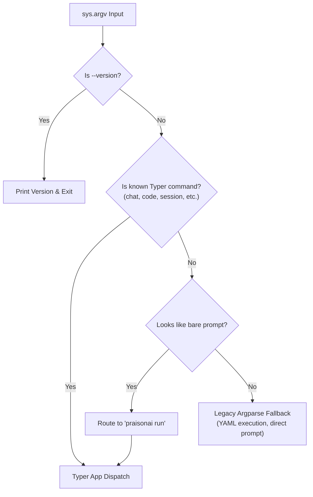
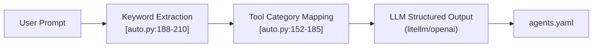

<!-- source: DeepWiki mcp.deepwiki.com · repo MervinPraison/PraisonAI · page 19.3 CLI Examples · fetched 2026-10-26 -->

# CLI Examples

<details>
<summary>Relevant source files</summary>

The following files were used as context for generating this wiki page:

- [src/praisonai-code/praisonai_code/cli/commands/command.py](src/praisonai-code/praisonai_code/cli/commands/command.py)
- [src/praisonai-code/praisonai_code/cli/commands/init.py](src/praisonai-code/praisonai_code/cli/commands/init.py)
- [src/praisonai-code/praisonai_code/cli/commands/init_team.py](src/praisonai-code/praisonai_code/cli/commands/init_team.py)
- [src/praisonai-code/praisonai_code/cli/commands/run.py](src/praisonai-code/praisonai_code/cli/commands/run.py)
- [src/praisonai-code/praisonai_code/cli/features/custom_definitions.py](src/praisonai-code/praisonai_code/cli/features/custom_definitions.py)
- [src/praisonai-code/praisonai_code/cli/interactive/command_registry.py](src/praisonai-code/praisonai_code/cli/interactive/command_registry.py)
- [src/praisonai-code/praisonai_code/cli/interactive/repl.py](src/praisonai-code/praisonai_code/cli/interactive/repl.py)
- [src/praisonai-code/praisonai_code/cli/interactive/split_tui.py](src/praisonai-code/praisonai_code/cli/interactive/split_tui.py)
- [src/praisonai-code/praisonai_code/cli/interactive/tui_app.py](src/praisonai-code/praisonai_code/cli/interactive/tui_app.py)
- [src/praisonai-code/tests/unit/test_btw_side_question.py](src/praisonai-code/tests/unit/test_btw_side_question.py)
- [src/praisonai-code/tests/unit/test_command_frontmatter_positional.py](src/praisonai-code/tests/unit/test_command_frontmatter_positional.py)
- [src/praisonai-code/tests/unit/test_command_registry.py](src/praisonai-code/tests/unit/test_command_registry.py)
- [src/praisonai-code/tests/unit/test_init_generate_agents_md.py](src/praisonai-code/tests/unit/test_init_generate_agents_md.py)
- [src/praisonai-code/tests/unit/test_init_team.py](src/praisonai-code/tests/unit/test_init_team.py)
- [src/praisonai-code/tests/unit/test_project_tool_discovery.py](src/praisonai-code/tests/unit/test_project_tool_discovery.py)
- [src/praisonai-code/tests/unit/test_shell_escape.py](src/praisonai-code/tests/unit/test_shell_escape.py)
- [src/praisonai-code/tests/unit/test_subagent_delegation.py](src/praisonai-code/tests/unit/test_subagent_delegation.py)
- [src/praisonai/praisonai/__main__.py](src/praisonai/praisonai/__main__.py)
- [src/praisonai/praisonai/_async_bridge.py](src/praisonai/praisonai/_async_bridge.py)
- [src/praisonai/praisonai/agents_generator.py](src/praisonai/praisonai/agents_generator.py)
- [src/praisonai/praisonai/auto.py](src/praisonai/praisonai/auto.py)
- [src/praisonai/praisonai/framework_adapters/__init__.py](src/praisonai/praisonai/framework_adapters/__init__.py)
- [src/praisonai/praisonai/framework_adapters/autogen_adapter.py](src/praisonai/praisonai/framework_adapters/autogen_adapter.py)
- [src/praisonai/praisonai/framework_adapters/base.py](src/praisonai/praisonai/framework_adapters/base.py)
- [src/praisonai/praisonai/framework_adapters/crewai_adapter.py](src/praisonai/praisonai/framework_adapters/crewai_adapter.py)
- [src/praisonai/praisonai/framework_adapters/praisonai_adapter.py](src/praisonai/praisonai/framework_adapters/praisonai_adapter.py)
- [src/praisonai/praisonai/framework_adapters/validators.py](src/praisonai/praisonai/framework_adapters/validators.py)
- [src/praisonai/praisonai/tool_resolver.py](src/praisonai/praisonai/tool_resolver.py)
- [src/praisonai/tests/unit/cli/test_main_dispatcher.py](src/praisonai/tests/unit/cli/test_main_dispatcher.py)
- [src/praisonai/tests/unit/cli/test_typer_cli.py](src/praisonai/tests/unit/cli/test_typer_cli.py)
- [src/praisonai/tests/unit/code/test_default_path_undo.py](src/praisonai/tests/unit/code/test_default_path_undo.py)
- [src/praisonai/tests/unit/test_aiui_datastore.py](src/praisonai/tests/unit/test_aiui_datastore.py)
- [src/praisonai/tests/unit/test_async_bridge.py](src/praisonai/tests/unit/test_async_bridge.py)
- [src/praisonai/tests/unit/test_auto_lazy_loading.py](src/praisonai/tests/unit/test_auto_lazy_loading.py)
- [src/praisonai/tests/unit/test_framework_validators.py](src/praisonai/tests/unit/test_framework_validators.py)
- [src/praisonai/tests/unit/test_tool_timeout_enforcement.py](src/praisonai/tests/unit/test_tool_timeout_enforcement.py)
- [src/praisonai/tests/unit/test_wrapper_layer_regression.py](src/praisonai/tests/unit/test_wrapper_layer_regression.py)

</details>


This document provides technical command-line usage examples for the PraisonAI ecosystem. It covers the unified `praisonai` wrapper, the `praisonai-code` specialized CLI, and the automated agent generation system.

## Overview

The PraisonAI CLI architecture uses a tiered dispatch system. The primary entry point routes commands to either a modern **Typer-based engine** (for subcommands like `chat`, `code`, `session`) or a **Legacy fallback engine** (for bare prompts and YAML files).

- **Unified Entry Point:** `praisonai` [src/praisonai/praisonai/__main__.py:5-13]()
- **Modern CLI App:** `praisonai.cli.app` [src/praisonai-code/praisonai_code/cli/app.py:1-120]()
- **Agent Generator:** `AgentsGenerator` [src/praisonai/praisonai/agents_generator.py:1-200]()

---

## Command Routing and Dispatch

The CLI implements a "Typer-first" dispatch logic. It introspects registered subcommands and routes accordingly to maintain backward compatibility with legacy positional arguments.

### Dispatch Logic Flow

**Diagram: CLI Dispatch Architecture**

Sources: [src/praisonai/praisonai/__main__.py:44-122](), [src/praisonai/tests/unit/cli/test_main_dispatcher.py:34-175]()

---

## Agent Execution (`praisonai run`)

The `run` command is the primary way to execute agent workflows. It supports direct prompts, YAML definitions, and framework selection.

### Basic Usage
```bash
# Direct prompt (Modern Engine)
praisonai run "Create a research report on AI agents"

# YAML execution (Legacy Fallback)
praisonai agents.yaml

# Specific Framework Selection
praisonai run "Analyze data" --framework crewai
praisonai run "Solve math" --framework autogen
```

### Advanced Run Options
The `run` command handles structured output and permission gates:
- `--output json`: Emits machine-readable results [src/praisonai-code/praisonai_code/cli/commands/run.py:42-64]().
- `--allow` / `--deny`: Sets execution permissions [src/praisonai-code/praisonai_code/cli/commands/run.py:139-185]().
- `--plan`: Executes in a read-only planning mode [src/praisonai-code/praisonai_code/cli/commands/run.py:188-208]().

Sources: [src/praisonai-code/praisonai_code/cli/commands/run.py:1-210](), [src/praisonai/praisonai/framework_adapters/praisonai_adapter.py:20-62]()

---

## Automated Agent Generation (`praisonai auto`)

The `auto` command leverages LLMs to generate agent configurations (YAML) from natural language descriptions.

### Generation Flow

**Diagram: Auto-Generation Pipeline**

### Usage Examples
```bash
# Generate agents for a specific task
praisonai auto "Create a team to write and review Python code"

# Generate and immediately run
praisonai auto "Research quantum computing" --run
```

The system uses `litellm` or `openai` (lazily loaded) to produce structured Pydantic models which are then converted to YAML [src/praisonai/praisonai/auto.py:3-12]().

Sources: [src/praisonai/praisonai/auto.py:139-210](), [src/praisonai/praisonai/agents_generator.py:68-124]()

---

## Framework Adapters

PraisonAI acts as a wrapper for multiple agent frameworks. The CLI resolves which adapter to use based on the `--framework` flag or YAML `framework` key.

### Adapter Capabilities
| Adapter | Name | Async Support | Runtime Features |
| :--- | :--- | :--- | :--- |
| `PraisonAIAdapter` | `praisonai` | Yes [praisonai_adapter.py:33]() | Full (Session, Stream, Runtime) |
| `CrewAIAdapter` | `crewai` | No | Limited |
| `AutoGenAdapter` | `autogen_v2`| No [autogen_adapter.py:22]() | Limited |

### Version Resolution (AutoGen)
The CLI automatically detects the installed AutoGen version (v0.2 vs v0.4) or allows explicit override via `AUTOGEN_VERSION` environment variable [src/praisonai/praisonai/framework_adapters/autogen_adapter.py:29-69]().

Sources: [src/praisonai/praisonai/framework_adapters/praisonai_adapter.py:20-57](), [src/praisonai/praisonai/framework_adapters/autogen_adapter.py:15-69]()

---

## Interactive Interfaces

### TUI and REPL
The CLI provides a Terminal User Interface (TUI) for interactive sessions.
```bash
# Launch interactive REPL
praisonai chat

# Launch TUI with project context
praisonai code
```

The TUI uses `Textual` for the interface and `praisonai_code.cli.interactive.repl` for command processing [src/praisonai-code/praisonai_code/cli/interactive/repl.py]().

### Gateway and Bots
```bash
# Start WebSocket Gateway
praisonai gateway

# Start a specific bot channel (e.g., Telegram)
praisonai bot telegram
```

Sources: [src/praisonai-code/praisonai_code/cli/interactive/tui_app.py](), [src/praisonai/praisonai/cli/app.py:10]()

---

## Configuration and State Management

### Configuration Commands
```bash
# List all configurations
praisonai config list

# Get specific config value
praisonai config get model

# Show config file path
praisonai config path
```

### Session Management
The CLI tracks execution state across runs using sessions.
```bash
# List all sessions
praisonai session list

# Resume a specific session
praisonai run "continue" --session <session-id>
```

Sources: [src/praisonai-code/praisonai_code/cli/commands/config.py:68-88](), [src/praisonai-code/praisonai_code/cli/commands/session.py:137-147]()

---

## Technical Implementation Details

### Async Bridge
Since many frameworks are synchronous, PraisonAI uses an `AsyncBridge` to safely run coroutines from the sync CLI context without blocking the main thread [src/praisonai/praisonai/_async_bridge.py:22-97]().

### Tool Resolution
Tools are resolved dynamically at runtime using the `ToolResolver`. This allows the CLI to use project-local tools, built-in tools, or MCP-hosted tools interchangeably [src/praisonai/praisonai/tool_resolver.py:1-14]().

Sources: [src/praisonai/praisonai/_async_bridge.py:8-125](), [src/praisonai/tests/unit/test_wrapper_layer_regression.py:28-87]()

---

