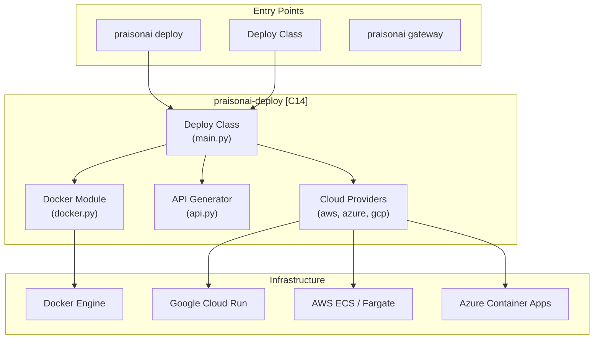
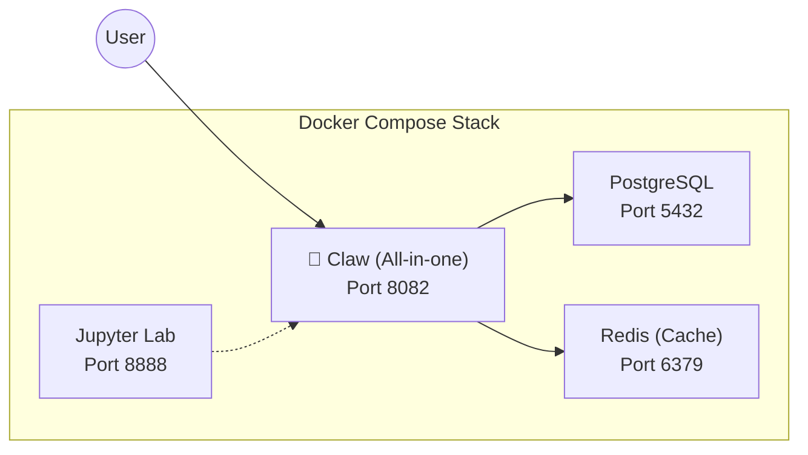

<!-- source: DeepWiki mcp.deepwiki.com · repo MervinPraison/PraisonAI · page 19.4 Deployment Examples · fetched 2026-10-26 -->

# Deployment Examples

Relevant source files

The following files were used as context for generating this wiki page:

- [.github/workflows/terminal-bench-smoke.yml](.github/workflows/terminal-bench-smoke.yml)
- [docker/.env.template](docker/.env.template)
- [docker/Dockerfile.claw](docker/Dockerfile.claw)
- [docker/Dockerfile.praisonaiagents](docker/Dockerfile.praisonaiagents)
- [docker/bots/.env.template](docker/bots/.env.template)
- [docker/bots/Dockerfile](docker/bots/Dockerfile)
- [docker/bots/README.md](docker/bots/README.md)
- [docker/bots/docker-compose.yml](docker/bots/docker-compose.yml)
- [docker/docker-compose.dev.yml](docker/docker-compose.dev.yml)
- [docker/docker-compose.yml](docker/docker-compose.yml)
- [docker/quick-start.sh](docker/quick-start.sh)
- [examples/__init__.py](examples/__init__.py)
- [examples/terminal_bench/README.md](examples/terminal_bench/README.md)
- [examples/terminal_bench/RESULTS.md](examples/terminal_bench/RESULTS.md)
- [examples/terminal_bench/__init__.py](examples/terminal_bench/__init__.py)
- [examples/terminal_bench/job.yaml](examples/terminal_bench/job.yaml)
- [examples/terminal_bench/job_code_smoke.yaml](examples/terminal_bench/job_code_smoke.yaml)
- [examples/terminal_bench/job_test_5.yaml](examples/terminal_bench/job_test_5.yaml)
- [examples/terminal_bench/job_test_5_wrapper.yaml](examples/terminal_bench/job_test_5_wrapper.yaml)
- [examples/terminal_bench/multi_agent_example.py](examples/terminal_bench/multi_agent_example.py)
- [examples/terminal_bench/praisonai_external_agent.py](examples/terminal_bench/praisonai_external_agent.py)
- [examples/terminal_bench/praisonai_installed_agent.py](examples/terminal_bench/praisonai_installed_agent.py)
- [examples/terminal_bench/praisonai_wrapper_agent.py](examples/terminal_bench/praisonai_wrapper_agent.py)
- [examples/terminal_bench/test_adapter_config.py](examples/terminal_bench/test_adapter_config.py)
- [examples/terminal_bench/test_basic.py](examples/terminal_bench/test_basic.py)
- [examples/terminal_bench/test_integration.py](examples/terminal_bench/test_integration.py)
- [src/praisonai-agents/.agent/workflows/create-docs-issue.md](src/praisonai-agents/.agent/workflows/create-docs-issue.md)
- [src/praisonai-deploy/examples/deploy/agents-docker.yaml](src/praisonai-deploy/examples/deploy/agents-docker.yaml)
- [src/praisonai-deploy/praisonai_deploy/_wrapper_bridge.py](src/praisonai-deploy/praisonai_deploy/_wrapper_bridge.py)
- [src/praisonai-deploy/praisonai_deploy/api.py](src/praisonai-deploy/praisonai_deploy/api.py)
- [src/praisonai-deploy/praisonai_deploy/cli/commands/deploy.py](src/praisonai-deploy/praisonai_deploy/cli/commands/deploy.py)
- [src/praisonai-deploy/praisonai_deploy/docker.py](src/praisonai-deploy/praisonai_deploy/docker.py)
- [src/praisonai-deploy/praisonai_deploy/main.py](src/praisonai-deploy/praisonai_deploy/main.py)
- [src/praisonai-deploy/praisonai_deploy/models.py](src/praisonai-deploy/praisonai_deploy/models.py)
- [src/praisonai-deploy/praisonai_deploy/providers/_registry.py](src/praisonai-deploy/praisonai_deploy/providers/_registry.py)
- [src/praisonai-deploy/praisonai_deploy/providers/aws.py](src/praisonai-deploy/praisonai_deploy/providers/aws.py)
- [src/praisonai-deploy/praisonai_deploy/providers/azure.py](src/praisonai-deploy/praisonai_deploy/providers/azure.py)
- [src/praisonai-deploy/praisonai_deploy/providers/gcp.py](src/praisonai-deploy/praisonai_deploy/providers/gcp.py)
- [src/praisonai-deploy/praisonai_deploy/scheduler/deployment.py](src/praisonai-deploy/praisonai_deploy/scheduler/deployment.py)
- [src/praisonai-deploy/praisonai_deploy/schema.py](src/praisonai-deploy/praisonai_deploy/schema.py)
- [src/praisonai-deploy/tests/test_api.py](src/praisonai-deploy/tests/test_api.py)
- [src/praisonai-deploy/tests/test_destroy_api.py](src/praisonai-deploy/tests/test_destroy_api.py)
- [src/praisonai-deploy/tests/test_docker.py](src/praisonai-deploy/tests/test_docker.py)
- [src/praisonai-deploy/tests/test_schema.py](src/praisonai-deploy/tests/test_schema.py)
- [src/praisonai/praisonai/claw/__init__.py](src/praisonai/praisonai/claw/__init__.py)
- [src/praisonai/tests/PRAISONAI_DEPLOY_MANIFEST.md](src/praisonai/tests/PRAISONAI_DEPLOY_MANIFEST.md)
- [src/praisonai/tests/README.md](src/praisonai/tests/README.md)

This page provides technical documentation for deploying PraisonAI applications, covering Docker containerization, cloud deployment via the `praisonai-deploy` package, multi-channel gateway setups, and specialized benchmarking environments like Terminal-Bench.

## Deployment Architecture Overview

The PraisonAI deployment ecosystem spans from simple local Docker containers to automated multi-cloud provisioning. The architecture relies on `praisonai-deploy` for infrastructure automation and `praisonai-bot` for multi-channel messaging gateway management.

Sources: [src/praisonai-deploy/praisonai_deploy/main.py:16-36](), [src/praisonai-deploy/praisonai_deploy/docker.py:116-178](), [src/praisonai-deploy/praisonai_deploy/api.py:13-118]()

## Unified Deployment Interface (`praisonai-deploy`)

The `Deploy` class provides a unified interface for containerizing and shipping agents. It supports three primary deployment types: `API`, `DOCKER`, and `CLOUD` [src/praisonai-deploy/praisonai_deploy/main.py:80-86]().

### API Server Generation
When deploying as an API, the system generates a Flask-based server that wraps the agent execution logic. The generated code includes:
- **CORS Support**: Configurable via `APIConfig` [src/praisonai-deploy/praisonai_deploy/api.py:44]().
- **Authentication**: Token-based authentication using `secrets.compare_digest` for constant-time comparison [src/praisonai-deploy/praisonai_deploy/api.py:60-67]().
- **Endpoints**: `/health` for status, `/chat` for agent interaction, and `/agents` for discovery [src/praisonai-deploy/praisonai_deploy/api.py:69-108]().

### Docker Deployment Workflow
The Docker deployment process follows a specific sequence:
1. **Dockerfile Generation**: Creates a optimized image based on `python:3.11-slim` (default) [src/praisonai-deploy/praisonai_deploy/docker.py:72-95]().
2. **Context Preparation**: Resolves paths to ensure absolute host paths work within the build context [src/praisonai-deploy/praisonai_deploy/docker.py:28-31]().
3. **Runtime Environment Collection**: Automatically pulls keys like `OPENAI_API_KEY` and `ANTHROPIC_API_KEY` from the host environment to inject into the container [src/praisonai-deploy/praisonai_deploy/docker.py:17-25](), [src/praisonai-deploy/praisonai_deploy/docker.py:45-50]().
4. **Production Server**: Uses `gunicorn` with an explicit `--timeout` (default 120s) to prevent SIGKILL during long-running LLM calls [src/praisonai-deploy/praisonai_deploy/docker.py:12-15](), [src/praisonai-deploy/praisonai_deploy/docker.py:90-92]().

| Deployment Step | Function/Class | File |
| :--- | :--- | :--- |
| Config Validation | `validate_agents_yaml` | [src/praisonai-deploy/praisonai_deploy/main.py:63]() |
| Image Building | `build_docker_image` | [src/praisonai-deploy/praisonai_deploy/docker.py:116]() |
| Container Naming | `docker_container_name` | [src/praisonai-deploy/praisonai_deploy/docker.py:34-42]() |
| Health Checks | `HEALTHCHECK` in Dockerfile | [src/praisonai-deploy/praisonai_deploy/docker.py:87-88]() |

Sources: [src/praisonai-deploy/praisonai_deploy/main.py:16-136](), [src/praisonai-deploy/praisonai_deploy/docker.py:1-95](), [src/praisonai-deploy/praisonai_deploy/api.py:1-118]()

## Multi-Service Docker Compose

For local development and complex production stacks, PraisonAI provides multi-service `docker-compose` configurations.

Sources: [docker/docker-compose.yml:5-23](), [docker/docker-compose.dev.yml:90-109](), [docker/docker-compose.dev.yml:131-162]()

### Development Environment Features
The `docker-compose.dev.yml` enables a full development cycle:
- **Hot Reload**: The `ui-dev` and `api-dev` services mount local `src` and `examples` volumes with `--reload` enabled [docker/docker-compose.dev.yml:8-35](), [docker/docker-compose.dev.yml:66-87]().
- **Integrated Testing**: A `test` profile runs `pytest` within the container environment [docker/docker-compose.dev.yml:111-128]().
- **Documentation**: A `docs` profile serves `mkdocs` for local documentation development [docker/docker-compose.dev.yml:165-178]().

Sources: [docker/docker-compose.dev.yml:1-190](), [docker/docker-compose.yml:1-125]()

## Terminal-Bench Benchmarking Deployment

PraisonAI includes specialized adapters for **Terminal-Bench 2.1** using the **Harbor framework**. These adapters demonstrate how to bridge the PraisonAI `Agent` class with external evaluation environments.

### External Agent Adapter (`PraisonAIExternalAgent`)
This adapter bridges Harbor's `BaseEnvironment.exec()` to a PraisonAI `bash_tool` [examples/terminal_bench/praisonai_external_agent.py:103-124]().

**Implementation Highlights:**
- **Auto-Approval**: Uses `AutoApproveBackend` to bypass human intervention in isolated container environments [examples/terminal_bench/praisonai_external_agent.py:97-99]().
- **Instruction Engineering**: Injects critical terminal rules (exploring files, running tests immediately, iterating on errors) into the agent's instructions [examples/terminal_bench/praisonai_external_agent.py:133-150]().
- **Metric Tracking**: Populates Harbor's `AgentContext` with token usage and costs derived from `Agent.cost_summary` [examples/terminal_bench/praisonai_external_agent.py:163](), [examples/terminal_bench/test_integration.py:86-100]().

### Headless Installed Agent
For production-grade benchmarking, the `PraisonAIInstalledAgent` installs the SDK directly inside the target container [examples/terminal_bench/praisonai_installed_agent.py:59-92]().
- **Runner Script**: Generates a standalone `/tmp/praisonai_runner.py` inside the container to handle headless execution and JSON metric reporting [examples/terminal_bench/praisonai_installed_agent.py:94-178]().
- **Isolation**: Ensures the agent only uses the `execute_command` tool within the container boundaries [examples/terminal_bench/praisonai_installed_agent.py:130-140]().

Sources: [examples/terminal_bench/praisonai_external_agent.py:52-168](), [examples/terminal_bench/praisonai_installed_agent.py:34-203](), [examples/terminal_bench/README.md:1-165]()

## Production Configuration Patterns

### Cloud Provider Support
The `praisonai-deploy` package utilizes a provider registry to support multiple cloud targets.

| Provider | Implementation Class | Path |
| :--- | :--- | :--- |
| AWS | `AWSProvider` | [src/praisonai-deploy/praisonai_deploy/providers/aws.py]() |
| Azure | `AzureProvider` | [src/praisonai-deploy/praisonai_deploy/providers/azure.py]() |
| GCP | `GCPProvider` | [src/praisonai-deploy/praisonai_deploy/providers/gcp.py]() |

### Deployment Planning
Before execution, the `deploy.plan()` method generates a structured dictionary describing the intended state [src/praisonai-deploy/praisonai_deploy/main.py:143-170](). This allows for pre-flight validation of image tags, registries, and port mappings.

### Health and Diagnostics
The `deploy.doctor()` method performs health checks specific to the deployment type:
- **API**: Verifies port availability and `agents.yaml` validity [src/praisonai-deploy/praisonai_deploy/main.py:181-185]().
- **Docker**: Checks if the Docker daemon is accessible [src/praisonai-deploy/praisonai_deploy/main.py:186-190]().

Sources: [src/praisonai-deploy/praisonai_deploy/main.py:138-195](), [src/praisonai-deploy/praisonai_deploy/models.py:1-20]()

---

