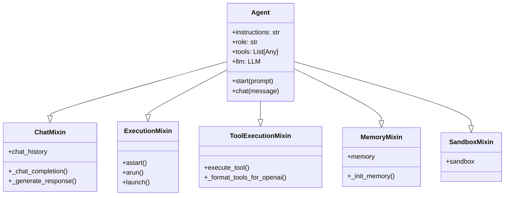
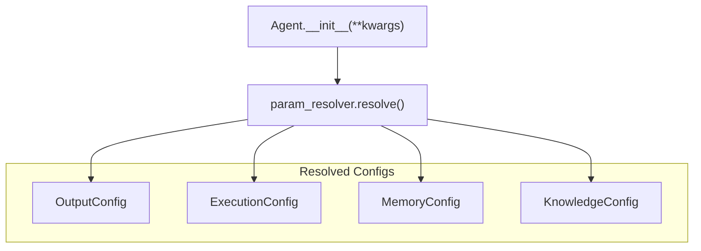
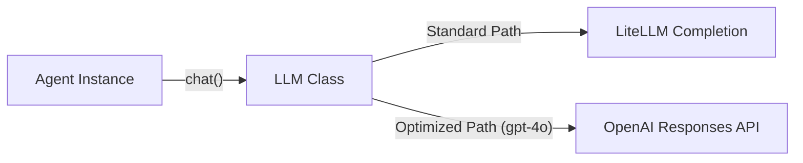

<!-- source: DeepWiki mcp.deepwiki.com · repo MervinPraison/PraisonAI · page 2 Core Agent System · fetched 2026-10-26 -->

# Core Agent System

Relevant source files

The following files were used as context for generating this wiki page:

- [api.md](api.md)
- [src/praisonai-agents/praisonaiagents/agent/agent.py](src/praisonai-agents/praisonaiagents/agent/agent.py)
- [src/praisonai-agents/praisonaiagents/agent/chat_mixin.py](src/praisonai-agents/praisonaiagents/agent/chat_mixin.py)
- [src/praisonai-agents/praisonaiagents/agent/durable.py](src/praisonai-agents/praisonaiagents/agent/durable.py)
- [src/praisonai-agents/praisonaiagents/agent/execution_mixin.py](src/praisonai-agents/praisonaiagents/agent/execution_mixin.py)
- [src/praisonai-agents/praisonaiagents/agent/interrupt.py](src/praisonai-agents/praisonaiagents/agent/interrupt.py)
- [src/praisonai-agents/praisonaiagents/agent/loop_detection.py](src/praisonai-agents/praisonaiagents/agent/loop_detection.py)
- [src/praisonai-agents/praisonaiagents/agent/tool_execution.py](src/praisonai-agents/praisonaiagents/agent/tool_execution.py)
- [src/praisonai-agents/praisonaiagents/agents/agents.py](src/praisonai-agents/praisonaiagents/agents/agents.py)
- [src/praisonai-agents/praisonaiagents/config/feature_configs.py](src/praisonai-agents/praisonaiagents/config/feature_configs.py)
- [src/praisonai-agents/praisonaiagents/escalation/doom_loop.py](src/praisonai-agents/praisonaiagents/escalation/doom_loop.py)
- [src/praisonai-agents/praisonaiagents/llm/llm.py](src/praisonai-agents/praisonaiagents/llm/llm.py)
- [src/praisonai-agents/praisonaiagents/llm/openai_client.py](src/praisonai-agents/praisonaiagents/llm/openai_client.py)
- [src/praisonai-agents/praisonaiagents/llm/sanitize.py](src/praisonai-agents/praisonaiagents/llm/sanitize.py)
- [src/praisonai-agents/praisonaiagents/plugins/loop_detection_plugin.py](src/praisonai-agents/praisonaiagents/plugins/loop_detection_plugin.py)
- [src/praisonai-agents/praisonaiagents/tools/call_executor.py](src/praisonai-agents/praisonaiagents/tools/call_executor.py)
- [src/praisonai-agents/praisonaiagents/tools/path_overlap.py](src/praisonai-agents/praisonaiagents/tools/path_overlap.py)
- [src/praisonai-agents/tests/integration/test_responses_api.py](src/praisonai-agents/tests/integration/test_responses_api.py)
- [src/praisonai-agents/tests/test_deferred_progress_tools.py](src/praisonai-agents/tests/test_deferred_progress_tools.py)
- [src/praisonai-agents/tests/test_native_deferred_parity.py](src/praisonai-agents/tests/test_native_deferred_parity.py)
- [src/praisonai-agents/tests/test_parallel_tools.py](src/praisonai-agents/tests/test_parallel_tools.py)
- [src/praisonai-agents/tests/test_tool_timeout.py](src/praisonai-agents/tests/test_tool_timeout.py)
- [src/praisonai-agents/tests/unit/agent/test_durable_run.py](src/praisonai-agents/tests/unit/agent/test_durable_run.py)
- [src/praisonai-agents/tests/unit/agent/test_loop_detector_wiring.py](src/praisonai-agents/tests/unit/agent/test_loop_detector_wiring.py)
- [src/praisonai-agents/tests/unit/llm/test_durable_tool_dispatch.py](src/praisonai-agents/tests/unit/llm/test_durable_tool_dispatch.py)
- [src/praisonai-agents/tests/unit/test_compaction_wiring.py](src/praisonai-agents/tests/unit/test_compaction_wiring.py)
- [src/praisonai-agents/tests/unit/test_doom_loop_no_progress_boundary.py](src/praisonai-agents/tests/unit/test_doom_loop_no_progress_boundary.py)
- [src/praisonai-agents/tests/unit/test_loop_detection.py](src/praisonai-agents/tests/unit/test_loop_detection.py)

This document provides a technical overview of the fundamental agent architecture in PraisonAI, centered around the `Agent` class. It details the lifecycle, configuration resolution, and core execution loops that power individual agents.

For specialized agent types (e.g., `DeepResearchAgent`, `CodeAgent`), see [Specialized Agent Types](#2.2). For orchestration, see [Multi-Agent Orchestration](#2.5).

## Core Architecture

The core system is built on a mixin-based architecture to maintain a lean `Agent` class while providing rich functionality. The `Agent` class ([agent/agent.py:141-1695]()) serves as the primary entry point, orchestrating capabilities through specialized mixins.

### Decomposed Agent Structure

**Lazy Loading:** The system utilizes lazy imports and property-based initialization to minimize startup overhead. Heavy modules like `rich` for display or specific LLM clients are only loaded when required ([agent/agent.py:37-92]()).

Sources: [src/praisonai-agents/praisonaiagents/agent/agent.py:16-32](), [src/praisonai-agents/praisonaiagents/agent/agent.py:37-92]()

## Initialization and Configuration

The `Agent` class supports both **instruction-based** (Natural Language first) and **role-based** (structured) initialization. It employs a unified parameter resolution system that converts simple inputs into typed configuration objects.

### Parameter Resolution Flow

- **Consolidated Parameters:** Parameters like `memory`, `knowledge`, and `execution` are resolved from primitives (bool, str, dict) into specialized dataclasses defined in `feature_configs.py` ([agent/agent.py:123-134](), [config/feature_configs.py:1-400]()).
- **Identity Setup:** If `instructions` are provided, the agent can automatically derive its `role` and `goal` ([agent/agent.py:1108-1136]()).

Sources: [src/praisonai-agents/praisonaiagents/agent/agent.py:591-1100](), [src/praisonai-agents/praisonaiagents/config/param_resolver.py:123-386](), [src/praisonai-agents/praisonaiagents/config/feature_configs.py:104-200]()

## Execution Lifecycle

Agents provide multiple entry points for execution, ranging from simple chat interactions to autonomous task completion.

### Execution Methods

| Method | Type | Description |
| :--- | :--- | :--- |
| `start()` / `astart()` | Interactive | Main entry point; streams by default in TTY ([agent/execution_mixin.py:159-209]()). |
| `run()` / `arun()` | Structured | Production-friendly; silent and non-streaming ([agent/execution_mixin.py:143-157]()). |
| `chat()` / `achat()` | Conversational | Maintains conversation history across turns ([agent/chat_mixin.py:73-200]()). |
| `execute()` | Task-based | Executes a specific `Task` object ([agent/agent.py:2437-2625]()). |

### Durable Execution (RunJournal)
When `ExecutionConfig.durable=True`, the agent tracks its lifecycle via a `RunJournal`. This enables resuming interrupted runs by replaying previous model decisions and tool results ([tests/unit/agent/test_durable_run.py:56-81]()).

Sources: [src/praisonai-agents/praisonaiagents/agent/execution_mixin.py:143-209](), [src/praisonai-agents/praisonaiagents/runtime/journal.py:1-100](), [src/praisonai-agents/tests/unit/agent/test_durable_run.py:29-42]()

## LLM Integration

The `LLM` class acts as a provider-agnostic bridge, primarily leveraging **LiteLLM** for broad model support and a native **OpenAIClient** for the high-performance Responses API ([llm/llm.py:176-188]()).

### LLM Interaction Path

- **Model Capabilities:** The system auto-detects support for features like **tool calling**, **vision**, and **prompt caching** ([llm/llm.py:684-722]()).
- **Responses API:** For supported OpenAI models, the system uses the `OpenAIClient` to handle multimodal inputs and tool calls via the Responses API ([llm/openai_client.py:4-100](), [tests/integration/test_responses_api.py:37-72]()).

Sources: [src/praisonai-agents/praisonaiagents/llm/llm.py:176-207](), [src/praisonai-agents/praisonaiagents/llm/openai_client.py:146-194](), [src/praisonai-agents/tests/integration/test_responses_api.py:40-54]()

## Tool Execution System

Tools are integrated via automatic schema generation and a unified execution loop.

- **Schema Generation:** Python functions are automatically converted to OpenAI-compatible JSON schemas by inspecting signatures and docstrings ([agent/agent.py:269-398]()).
- **Parallel Execution:** When enabled, multiple tool calls from a single LLM turn are executed concurrently using a `ParallelToolCallExecutor` ([tools/call_executor.py:4-12]()).
- **Deferred Results:** Tools can return a `DeferredToolResult` to signal long-running background work, allowing the agent to continue the turn while the result resolves ([tools/call_executor.py:104-118]()).

Sources: [src/praisonai-agents/praisonaiagents/agent/tool_execution.py:1-100](), [src/praisonai-agents/praisonaiagents/tools/call_executor.py:129-170](), [src/praisonai-agents/praisonaiagents/agent/agent.py:1556-1653]()

## Child Pages
- [Agent Class](#2.1) — Detailed mixin decomposition and lifecycle.
- [Specialized Agent Types](#2.2) — Purpose-built agents (Vision, Code, Research).
- [LLM Integration](#2.3) — Multi-provider support and Responses API.
- [Task System](#2.4) — Definition and execution of discrete tasks.
- [Multi-Agent Orchestration](#2.5) — Coordinating teams and workflows.
- [Autonomy and Handoff](#2.6) — Autonomous modes and agent delegation.
- [AutoAgents](#2.7) — AI-generated agent teams.

---

