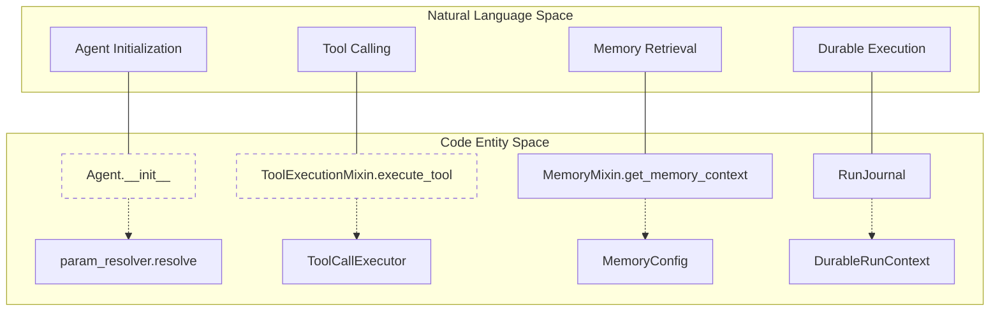
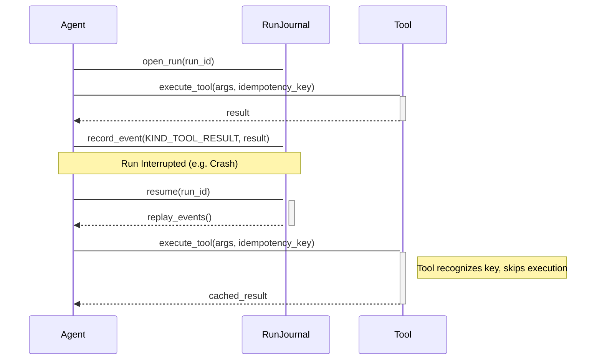

<!-- source: DeepWiki mcp.deepwiki.com · repo MervinPraison/PraisonAI · page 2.1 Agent Class · fetched 2026-10-26 -->

# Agent Class

Relevant source files

The following files were used as context for generating this wiki page:

- [src/praisonai-agents/praisonaiagents/agent/agent.py](src/praisonai-agents/praisonaiagents/agent/agent.py)
- [src/praisonai-agents/praisonaiagents/agent/chat_mixin.py](src/praisonai-agents/praisonaiagents/agent/chat_mixin.py)
- [src/praisonai-agents/praisonaiagents/agent/durable.py](src/praisonai-agents/praisonaiagents/agent/durable.py)
- [src/praisonai-agents/praisonaiagents/agent/execution_mixin.py](src/praisonai-agents/praisonaiagents/agent/execution_mixin.py)
- [src/praisonai-agents/praisonaiagents/agent/interrupt.py](src/praisonai-agents/praisonaiagents/agent/interrupt.py)
- [src/praisonai-agents/praisonaiagents/agent/loop_detection.py](src/praisonai-agents/praisonaiagents/agent/loop_detection.py)
- [src/praisonai-agents/praisonaiagents/agent/tool_execution.py](src/praisonai-agents/praisonaiagents/agent/tool_execution.py)
- [src/praisonai-agents/praisonaiagents/agents/agents.py](src/praisonai-agents/praisonaiagents/agents/agents.py)
- [src/praisonai-agents/praisonaiagents/agents/autoagents.py](src/praisonai-agents/praisonaiagents/agents/autoagents.py)
- [src/praisonai-agents/praisonaiagents/config/feature_configs.py](src/praisonai-agents/praisonaiagents/config/feature_configs.py)
- [src/praisonai-agents/praisonaiagents/escalation/doom_loop.py](src/praisonai-agents/praisonaiagents/escalation/doom_loop.py)
- [src/praisonai-agents/praisonaiagents/llm/_cost.py](src/praisonai-agents/praisonaiagents/llm/_cost.py)
- [src/praisonai-agents/praisonaiagents/llm/_litellm_loader.py](src/praisonai-agents/praisonaiagents/llm/_litellm_loader.py)
- [src/praisonai-agents/praisonaiagents/llm/llm.py](src/praisonai-agents/praisonaiagents/llm/llm.py)
- [src/praisonai-agents/praisonaiagents/llm/model_capabilities.py](src/praisonai-agents/praisonaiagents/llm/model_capabilities.py)
- [src/praisonai-agents/praisonaiagents/llm/openai_client.py](src/praisonai-agents/praisonaiagents/llm/openai_client.py)
- [src/praisonai-agents/praisonaiagents/llm/sanitize.py](src/praisonai-agents/praisonaiagents/llm/sanitize.py)
- [src/praisonai-agents/praisonaiagents/plugins/loop_detection_plugin.py](src/praisonai-agents/praisonaiagents/plugins/loop_detection_plugin.py)
- [src/praisonai-agents/praisonaiagents/tools/call_executor.py](src/praisonai-agents/praisonaiagents/tools/call_executor.py)
- [src/praisonai-agents/praisonaiagents/tools/path_overlap.py](src/praisonai-agents/praisonaiagents/tools/path_overlap.py)
- [src/praisonai-agents/tests/integration/test_responses_api.py](src/praisonai-agents/tests/integration/test_responses_api.py)
- [src/praisonai-agents/tests/test_deferred_progress_tools.py](src/praisonai-agents/tests/test_deferred_progress_tools.py)
- [src/praisonai-agents/tests/test_model_capabilities_fallback.py](src/praisonai-agents/tests/test_model_capabilities_fallback.py)
- [src/praisonai-agents/tests/test_native_deferred_parity.py](src/praisonai-agents/tests/test_native_deferred_parity.py)
- [src/praisonai-agents/tests/test_parallel_tools.py](src/praisonai-agents/tests/test_parallel_tools.py)
- [src/praisonai-agents/tests/test_tool_timeout.py](src/praisonai-agents/tests/test_tool_timeout.py)
- [src/praisonai-agents/tests/unit/agent/test_durable_run.py](src/praisonai-agents/tests/unit/agent/test_durable_run.py)
- [src/praisonai-agents/tests/unit/agent/test_loop_detector_wiring.py](src/praisonai-agents/tests/unit/agent/test_loop_detector_wiring.py)
- [src/praisonai-agents/tests/unit/llm/test_cost.py](src/praisonai-agents/tests/unit/llm/test_cost.py)
- [src/praisonai-agents/tests/unit/llm/test_durable_tool_dispatch.py](src/praisonai-agents/tests/unit/llm/test_durable_tool_dispatch.py)
- [src/praisonai-agents/tests/unit/test_compaction_wiring.py](src/praisonai-agents/tests/unit/test_compaction_wiring.py)
- [src/praisonai-agents/tests/unit/test_doom_loop_no_progress_boundary.py](src/praisonai-agents/tests/unit/test_doom_loop_no_progress_boundary.py)
- [src/praisonai-agents/tests/unit/test_loop_detection.py](src/praisonai-agents/tests/unit/test_loop_detection.py)

The `Agent` class is the foundational building block of the PraisonAI framework. It provides a unified interface for creating AI agents with LLM capabilities, tool access, memory, knowledge retrieval, and safety controls. The class is designed with a mixin-based architecture to decompose functionality into manageable units while maintaining a high-performance, lazy-loaded core.

## Agent Class Structure

The `Agent` class is implemented in [src/praisonai-agents/praisonaiagents/agent/agent.py:141-2453](). It inherits from several specialized mixins to provide a rich feature set without monolithic code complexity.

### Mixin-Based Decomposition

The `Agent` class leverages multiple mixins to handle different aspects of agent behavior:
- **`ChatMixin`**: Handles chat completion, streaming, message building, and response processing [src/praisonai-agents/praisonaiagents/agent/chat_mixin.py:73]().
- **`ToolExecutionMixin`**: Manages tool resolution, execution, approval, and cost tracking [src/praisonai-agents/praisonaiagents/agent/tool_execution.py:1]().
- **`ExecutionMixin`**: Provides run/start/launch lifecycle methods, planning integration, and server endpoints [src/praisonai-agents/praisonaiagents/agent/execution_mixin.py:73]().
- **`MemoryMixin` / `AsyncMemoryMixin`**: Manages short-term and long-term memory storage and retrieval [src/praisonai-agents/praisonaiagents/agent/agent.py:18-19]().
- **`ChatHandlerMixin`**: Processes chat requests and maintains conversation flow [src/praisonai-agents/praisonaiagents/agent/agent.py:21]().
- **`SessionManagerMixin`**: Handles session persistence and history management [src/praisonai-agents/praisonaiagents/agent/agent.py:22]().

### Performance-Optimized Architecture

The Agent class employs **lazy loading** to minimize initialization overhead. Startup time is reduced from ~420ms to ~20ms by deferring the import of heavy dependencies like `rich` and LLM clients until they are actually required [src/praisonai-agents/praisonaiagents/agent/agent.py:37-40]().

**Optimization Techniques:**
- **Lazy Imports**: Display functions and LLM modules are loaded only when `output=verbose` or during first execution [src/praisonai-agents/praisonaiagents/agent/agent.py:57-92]().
- **Class-level Caching**: Environment variables and model defaults are cached once per class to avoid redundant checks [src/praisonai-agents/praisonaiagents/agent/agent.py:158-201]().
- **Thread-Safe State**: Uses `AsyncSafeState` and `DualLock` to ensure reliability in multi-threaded environments [src/praisonai-agents/praisonaiagents/agent/agent.py:23]().

### Code-to-Entity Mapping

The following diagram bridges the natural language concepts to the specific code entities within the `Agent` implementation.

Sources: [src/praisonai-agents/praisonaiagents/agent/agent.py:399-1103](), [src/praisonai-agents/praisonaiagents/agent/tool_execution.py:1-100](), [src/praisonai-agents/praisonaiagents/agent/chat_mixin.py:81-129](), [src/praisonai-agents/tests/unit/agent/test_durable_run.py:15-27]()

## Initialization and Configuration

The `Agent` class uses a consolidated parameter system. Every feature (Memory, Knowledge, Execution, etc.) follows a resolution logic where `Instance > Config > Dict > Preset > Default` [src/praisonai-agents/praisonaiagents/config/param_resolver.py:123]().

### Consolidated Parameters

| Parameter | Config Class | Purpose |
|-----------|--------------|---------|
| `execution` | `ExecutionConfig` | Controls `max_iter`, `max_rpm`, and durable execution [src/praisonai-agents/praisonaiagents/config/feature_configs.py:129-134]() |
| `memory` | `MemoryConfig` | Configures backends like SQLite, Redis, or Mem0 [src/praisonai-agents/praisonaiagents/config/feature_configs.py:186-200]() |
| `knowledge` | `KnowledgeConfig` | Sets up RAG sources and retrieval policies [src/praisonai-agents/praisonaiagents/config/feature_configs.py:130]() |
| `output` | `OutputConfig` | Manages verbosity, markdown, and file logging [src/praisonai-agents/praisonaiagents/config/feature_configs.py:130]() |

Sources: [src/praisonai-agents/praisonaiagents/agent/agent.py:426-440](), [src/praisonai-agents/praisonaiagents/config/feature_configs.py:1-200]()

## Durable Execution via RunJournal

PraisonAI supports durable execution, allowing agents to resume from failures or interruptions. This is managed via the `RunJournal` and `DurableRunContext` [src/praisonai-agents/tests/unit/agent/test_durable_run.py:15-20]().

### Durable Run Lifecycle

1. **Activation**: Enabled via `ExecutionConfig(durable=True)` [src/praisonai-agents/tests/unit/agent/test_durable_run.py:32-36]().
2. **Journaling**: Every model decision, tool call, and tool result is recorded as a `JournalEvent` [src/praisonai-agents/tests/unit/agent/test_durable_run.py:21-26]().
3. **Idempotency**: Tools can receive an `idempotency_key` to ensure they are not executed twice during a resume [src/praisonai-agents/tests/unit/agent/test_durable_run.py:178-195]().
4. **Resume**: If a run fails, the agent can be restarted using `resume_run_id`, which replays events from the `RunJournal` until the last successful state [src/praisonai-agents/tests/unit/agent/test_durable_run.py:35-41]().

Sources: [src/praisonai-agents/tests/unit/agent/test_durable_run.py:56-100](), [src/praisonai-agents/praisonaiagents/agent/chat_mixin.py:81-116]()

## Core Methods

The `Agent` class provides both synchronous and asynchronous methods for interaction.

### Execution Methods

| Sync Method | Async Method | Description |
|-------------|--------------|-------------|
| `start()` | `astart()` | Interactive, streaming-aware execution. Beginner-friendly [src/praisonai-agents/praisonaiagents/agent/execution_mixin.py:159-180](). |
| `run()` | `arun()` | Silent, non-streaming execution. Production-friendly [src/praisonai-agents/praisonaiagents/agent/execution_mixin.py:143-157](). |
| `chat()` | `achat()` | Conversational interface that maintains history [src/praisonai-agents/praisonaiagents/agent/agent.py:2828-2872](). |

### Tool Execution Logic

Tool execution is handled by `ToolExecutionMixin`. It supports:
- **Sequential Execution**: Default behavior where tools are called one by one.
- **Parallel Execution**: Opt-in behavior using `ParallelToolCallExecutor` [src/praisonai-agents/praisonaiagents/tools/call_executor.py:8-12]().
- **Deferred Results**: Tools can return a `DeferredToolResult` to signal long-running background work, allowing the agent to continue the turn without blocking [src/praisonai-agents/praisonaiagents/tools/call_executor.py:104-117]().

Sources: [src/praisonai-agents/praisonaiagents/agent/agent.py:3078-3312](), [src/praisonai-agents/praisonaiagents/tools/call_executor.py:119-170]()

## AutoAgents

The `AutoAgents` class extends `AgentManager` to automatically generate agent teams and task assignments from high-level instructions [src/praisonai-agents/praisonaiagents/agents/autoagents.py:59-106](). It uses structured output from an LLM to define `AgentConfig` and `TaskConfig` objects before initializing the full team [src/praisonai-agents/praisonaiagents/agents/autoagents.py:38-57]().

Sources: [src/praisonai-agents/praisonaiagents/agents/autoagents.py:1-163]()

---

