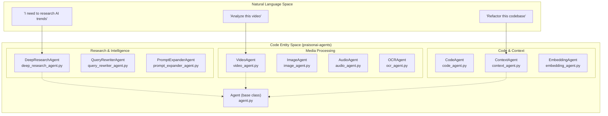
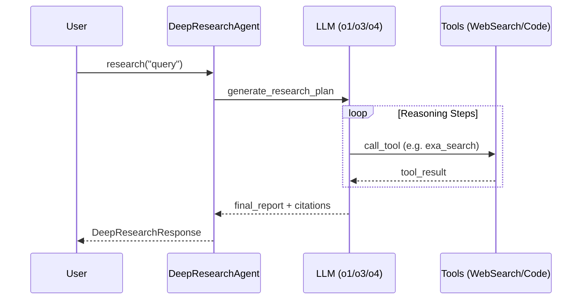

<!-- source: DeepWiki mcp.deepwiki.com · repo MervinPraison/PraisonAI · page 2.2 Specialized Agent Types · fetched 2026-10-26 -->

# Specialized Agent Types

Relevant source files

The following files were used as context for generating this wiki page:

- [src/praisonai-agents/praisonaiagents/agent/agent.py](src/praisonai-agents/praisonaiagents/agent/agent.py)
- [src/praisonai-agents/praisonaiagents/agent/chat_mixin.py](src/praisonai-agents/praisonaiagents/agent/chat_mixin.py)
- [src/praisonai-agents/praisonaiagents/agent/deep_research_agent.py](src/praisonai-agents/praisonaiagents/agent/deep_research_agent.py)
- [src/praisonai-agents/praisonaiagents/agent/durable.py](src/praisonai-agents/praisonaiagents/agent/durable.py)
- [src/praisonai-agents/praisonaiagents/agent/execution_mixin.py](src/praisonai-agents/praisonaiagents/agent/execution_mixin.py)
- [src/praisonai-agents/praisonaiagents/agent/interrupt.py](src/praisonai-agents/praisonaiagents/agent/interrupt.py)
- [src/praisonai-agents/praisonaiagents/agent/loop_detection.py](src/praisonai-agents/praisonaiagents/agent/loop_detection.py)
- [src/praisonai-agents/praisonaiagents/agent/realtime_agent.py](src/praisonai-agents/praisonaiagents/agent/realtime_agent.py)
- [src/praisonai-agents/praisonaiagents/agent/tool_execution.py](src/praisonai-agents/praisonaiagents/agent/tool_execution.py)
- [src/praisonai-agents/praisonaiagents/agents/agents.py](src/praisonai-agents/praisonaiagents/agents/agents.py)
- [src/praisonai-agents/praisonaiagents/approval/__init__.py](src/praisonai-agents/praisonaiagents/approval/__init__.py)
- [src/praisonai-agents/praisonaiagents/approval/backends.py](src/praisonai-agents/praisonaiagents/approval/backends.py)
- [src/praisonai-agents/praisonaiagents/approval/protocols.py](src/praisonai-agents/praisonaiagents/approval/protocols.py)
- [src/praisonai-agents/praisonaiagents/approval/registry.py](src/praisonai-agents/praisonaiagents/approval/registry.py)
- [src/praisonai-agents/praisonaiagents/approval/utils.py](src/praisonai-agents/praisonaiagents/approval/utils.py)
- [src/praisonai-agents/praisonaiagents/config/feature_configs.py](src/praisonai-agents/praisonaiagents/config/feature_configs.py)
- [src/praisonai-agents/praisonaiagents/context/aggregator.py](src/praisonai-agents/praisonaiagents/context/aggregator.py)
- [src/praisonai-agents/praisonaiagents/context/fast/parallel_executor.py](src/praisonai-agents/praisonaiagents/context/fast/parallel_executor.py)
- [src/praisonai-agents/praisonaiagents/escalation/doom_loop.py](src/praisonai-agents/praisonaiagents/escalation/doom_loop.py)
- [src/praisonai-agents/praisonaiagents/llm/llm.py](src/praisonai-agents/praisonaiagents/llm/llm.py)
- [src/praisonai-agents/praisonaiagents/llm/openai_client.py](src/praisonai-agents/praisonaiagents/llm/openai_client.py)
- [src/praisonai-agents/praisonaiagents/llm/sanitize.py](src/praisonai-agents/praisonaiagents/llm/sanitize.py)
- [src/praisonai-agents/praisonaiagents/permissions/doom_loop.py](src/praisonai-agents/praisonaiagents/permissions/doom_loop.py)
- [src/praisonai-agents/praisonaiagents/plugins/loop_detection_plugin.py](src/praisonai-agents/praisonaiagents/plugins/loop_detection_plugin.py)
- [src/praisonai-agents/praisonaiagents/tools/call_executor.py](src/praisonai-agents/praisonaiagents/tools/call_executor.py)
- [src/praisonai-agents/praisonaiagents/tools/exa_tools.py](src/praisonai-agents/praisonaiagents/tools/exa_tools.py)
- [src/praisonai-agents/praisonaiagents/tools/path_overlap.py](src/praisonai-agents/praisonaiagents/tools/path_overlap.py)
- [src/praisonai-agents/tests/integration/test_responses_api.py](src/praisonai-agents/tests/integration/test_responses_api.py)
- [src/praisonai-agents/tests/test_deferred_progress_tools.py](src/praisonai-agents/tests/test_deferred_progress_tools.py)
- [src/praisonai-agents/tests/test_native_deferred_parity.py](src/praisonai-agents/tests/test_native_deferred_parity.py)
- [src/praisonai-agents/tests/test_parallel_tools.py](src/praisonai-agents/tests/test_parallel_tools.py)
- [src/praisonai-agents/tests/test_tool_timeout.py](src/praisonai-agents/tests/test_tool_timeout.py)
- [src/praisonai-agents/tests/unit/agent/test_durable_run.py](src/praisonai-agents/tests/unit/agent/test_durable_run.py)
- [src/praisonai-agents/tests/unit/agent/test_loop_detector_wiring.py](src/praisonai-agents/tests/unit/agent/test_loop_detector_wiring.py)
- [src/praisonai-agents/tests/unit/approval/test_scoped_approval.py](src/praisonai-agents/tests/unit/approval/test_scoped_approval.py)
- [src/praisonai-agents/tests/unit/context/test_aggregator.py](src/praisonai-agents/tests/unit/context/test_aggregator.py)
- [src/praisonai-agents/tests/unit/llm/test_durable_tool_dispatch.py](src/praisonai-agents/tests/unit/llm/test_durable_tool_dispatch.py)
- [src/praisonai-agents/tests/unit/test_approval_protocol.py](src/praisonai-agents/tests/unit/test_approval_protocol.py)
- [src/praisonai-agents/tests/unit/test_compaction_wiring.py](src/praisonai-agents/tests/unit/test_compaction_wiring.py)
- [src/praisonai-agents/tests/unit/test_doom_loop_no_progress_boundary.py](src/praisonai-agents/tests/unit/test_doom_loop_no_progress_boundary.py)
- [src/praisonai-agents/tests/unit/test_loop_detection.py](src/praisonai-agents/tests/unit/test_loop_detection.py)
- [src/praisonai/praisonai/cli/approval_backend.py](src/praisonai/praisonai/cli/approval_backend.py)
- [src/praisonai/praisonai/cli/features/approval.py](src/praisonai/praisonai/cli/features/approval.py)

This document covers specialized agent classes that extend the base `Agent` for domain-specific tasks. These agents provide pre-configured capabilities for media processing, research automation, code analysis, and interactive interfaces.

For general agent functionality and the base `Agent` class, see [Agent Class](src/praisonai-agents/praisonaiagents/agent/agent.py:141-180). For multi-agent coordination patterns, see [Multi-Agent Orchestration](src/praisonai-agents/praisonaiagents/agents/agents.py:61-159).

## Agent Type Hierarchy

PraisonAI provides specialized agent types that extend or complement the base `Agent` class with domain-specific capabilities. All specialized agents inherit core agent features via mixins like `ChatMixin`, `ExecutionMixin`, and `ToolExecutionMixin` [src/praisonai-agents/praisonaiagents/agent/agent.py:16-31]().

### Code Entity Space to Natural Language Space

The following diagram maps the high-level agent concepts to their specific implementation classes and file locations within the codebase.

**Sources:** [src/praisonai-agents/praisonaiagents/agent/agent.py:16-31](), [src/praisonai-agents/praisonaiagents/agent/deep_research_agent.py:1-50]()

## Media Processing Agents

Media processing agents provide specialized capabilities for working with images, video, audio, and visual content. 

### VideoAgent and Vision Processing
`VideoAgent` handles video frame extraction and multi-modal analysis. It utilizes `process_video` to split files into base64-encoded frames for LLM consumption [src/praisonai-agents/praisonaiagents/agents/agents.py:167-186]().

**Key Functions:**
- `process_video(video_path, seconds_per_frame)`: Uses OpenCV to extract frames [src/praisonai-agents/praisonaiagents/agents/agents.py:167-186]().
- `get_multimodal_message(text_prompt, images)`: Constructs the structured message payload for vision-capable models [src/praisonai-agents/praisonaiagents/agents/agents.py:188-215]().

### Vision and OCR
- **VisionAgent**: Specialized for object detection and scene understanding.
- **OCRAgent**: Uses `OCRConfig` to manage language support and layout preservation during text extraction from images.

**Sources:** [src/praisonai-agents/praisonaiagents/agents/agents.py:167-215](), [src/praisonai-agents/praisonaiagents/config/feature_configs.py:42-45]()

## Research and Intelligence Agents

### DeepResearchAgent
Performs automated research using specialized deep reasoning models (e.g., `o4-mini-deep-research`). It returns a `DeepResearchResponse` containing a report, citations, and reasoning steps.

**Execution Flow:**

**Sources:** [src/praisonai-agents/praisonaiagents/agent/deep_research_agent.py:1-100](), [src/praisonai-agents/praisonaiagents/llm/llm.py:191-205]()

### QueryRewriterAgent and PromptExpanderAgent
- **QueryRewriterAgent**: Implements `RewriteStrategy` (e.g., `HYDE`, `STEP_BACK`) to optimize queries for RAG [src/praisonai-agents/praisonaiagents/config/feature_configs.py:7-10]().
- **PromptExpanderAgent**: Uses `ExpandStrategy` to turn short instructions into detailed system prompts.

## Code and Context Agents

### CodeAgent
Executes code within a sandboxed environment defined by `CodeConfig`. It leverages `ToolExecutionMixin` to handle execution logic and safety gates [src/praisonai-agents/praisonaiagents/agent/tool_execution.py:1-20]().

### ContextAgent
Utilizes `FastContext` and `parallel_executor.py` to analyze large codebases. It is designed to be 10-20x faster than sequential analysis by searching repository structures in parallel.

**Sources:** [src/praisonai-agents/praisonaiagents/context/fast/parallel_executor.py:1-30](), [src/praisonai-agents/praisonaiagents/agent/tool_execution.py:1-20]()

## Interactive and Realtime Agents

### RealtimeAgent
Supports streaming audio and voice interaction. It uses `RealtimeConfig` to manage sample rates and Voice Activity Detection (VAD).

### RouterAgent
Directs incoming tasks to the most appropriate specialized agent based on the task description and agent capabilities.

## RAG Optimization: AutoRagAgent
`AutoRagAgent` wraps a standard agent to provide intelligent retrieval logic. It uses `RetrievalPolicy` (auto, always, never) to decide if a query requires context from the `Knowledge` base [src/praisonai-agents/praisonaiagents/config/feature_configs.py:29-30]().

| Policy | Logic |
| :--- | :--- |
| `auto` | Uses heuristics (e.g., `QuestionDetection`) to determine if retrieval is needed. |
| `always` | Forces a RAG lookup for every `chat()` call. |
| `never` | Bypasses the knowledge base entirely. |

**Sources:** [src/praisonai-agents/praisonaiagents/config/feature_configs.py:29-30](), [src/praisonai-agents/praisonaiagents/agent/chat_mixin.py:168-196]()

## Implementation Details: Lazy Loading
To maintain a fast startup time, specialized agents are loaded via a `_LAZY_IMPORTS` map in the package root. This prevents heavy dependencies like `opencv-python` (for `VideoAgent`) or `openai` (for `DeepResearchAgent`) from being loaded unless explicitly requested.

**Sources:** [src/praisonai-agents/praisonaiagents/agent/agent.py:37-46](), [src/praisonai-agents/praisonaiagents/llm/llm.py:58-68]()

---

