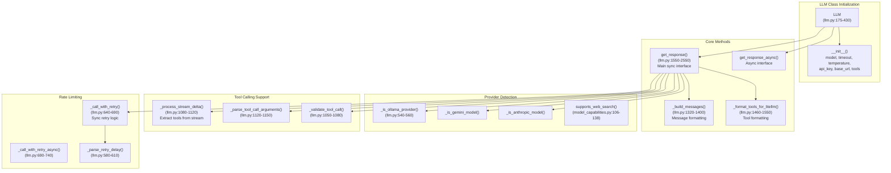
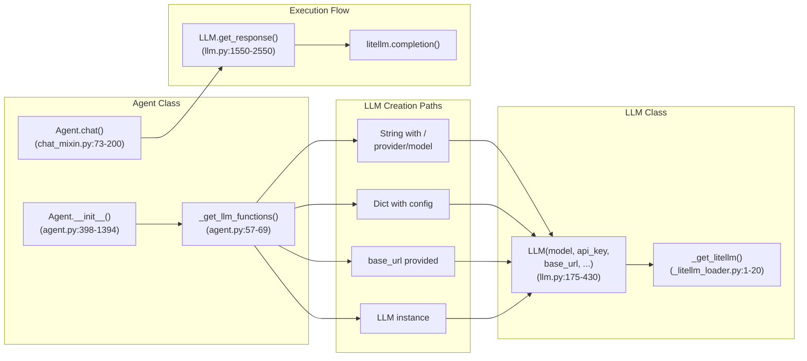
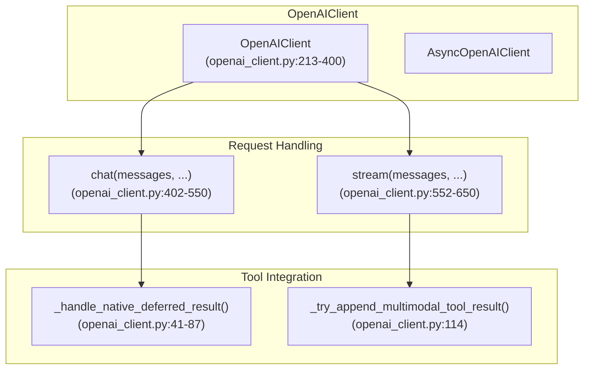

<!-- source: DeepWiki mcp.deepwiki.com · repo MervinPraison/PraisonAI · page 2.3 LLM Integration · fetched 2026-10-26 -->

# LLM Integration

Relevant source files

The following files were used as context for generating this wiki page:

- [src/praisonai-agents/praisonaiagents/agent/agent.py](src/praisonai-agents/praisonaiagents/agent/agent.py)
- [src/praisonai-agents/praisonaiagents/agent/chat_mixin.py](src/praisonai-agents/praisonaiagents/agent/chat_mixin.py)
- [src/praisonai-agents/praisonaiagents/agent/durable.py](src/praisonai-agents/praisonaiagents/agent/durable.py)
- [src/praisonai-agents/praisonaiagents/agent/execution_mixin.py](src/praisonai-agents/praisonaiagents/agent/execution_mixin.py)
- [src/praisonai-agents/praisonaiagents/agent/interrupt.py](src/praisonai-agents/praisonaiagents/agent/interrupt.py)
- [src/praisonai-agents/praisonaiagents/agent/loop_detection.py](src/praisonai-agents/praisonaiagents/agent/loop_detection.py)
- [src/praisonai-agents/praisonaiagents/agent/tool_execution.py](src/praisonai-agents/praisonaiagents/agent/tool_execution.py)
- [src/praisonai-agents/praisonaiagents/agents/agents.py](src/praisonai-agents/praisonaiagents/agents/agents.py)
- [src/praisonai-agents/praisonaiagents/agents/autoagents.py](src/praisonai-agents/praisonaiagents/agents/autoagents.py)
- [src/praisonai-agents/praisonaiagents/config/feature_configs.py](src/praisonai-agents/praisonaiagents/config/feature_configs.py)
- [src/praisonai-agents/praisonaiagents/escalation/doom_loop.py](src/praisonai-agents/praisonaiagents/escalation/doom_loop.py)
- [src/praisonai-agents/praisonaiagents/knowledge/adapters/__init__.py](src/praisonai-agents/praisonaiagents/knowledge/adapters/__init__.py)
- [src/praisonai-agents/praisonaiagents/knowledge/adapters/registry.py](src/praisonai-agents/praisonaiagents/knowledge/adapters/registry.py)
- [src/praisonai-agents/praisonaiagents/knowledge/index.py](src/praisonai-agents/praisonaiagents/knowledge/index.py)
- [src/praisonai-agents/praisonaiagents/knowledge/models.py](src/praisonai-agents/praisonaiagents/knowledge/models.py)
- [src/praisonai-agents/praisonaiagents/llm/__init__.py](src/praisonai-agents/praisonaiagents/llm/__init__.py)
- [src/praisonai-agents/praisonaiagents/llm/_cost.py](src/praisonai-agents/praisonaiagents/llm/_cost.py)
- [src/praisonai-agents/praisonaiagents/llm/_litellm_loader.py](src/praisonai-agents/praisonaiagents/llm/_litellm_loader.py)
- [src/praisonai-agents/praisonaiagents/llm/adapters/__init__.py](src/praisonai-agents/praisonaiagents/llm/adapters/__init__.py)
- [src/praisonai-agents/praisonaiagents/llm/error_classifier.py](src/praisonai-agents/praisonaiagents/llm/error_classifier.py)
- [src/praisonai-agents/praisonaiagents/llm/llm.py](src/praisonai-agents/praisonaiagents/llm/llm.py)
- [src/praisonai-agents/praisonaiagents/llm/model_capabilities.py](src/praisonai-agents/praisonaiagents/llm/model_capabilities.py)
- [src/praisonai-agents/praisonaiagents/llm/openai_client.py](src/praisonai-agents/praisonaiagents/llm/openai_client.py)
- [src/praisonai-agents/praisonaiagents/llm/panel.py](src/praisonai-agents/praisonaiagents/llm/panel.py)
- [src/praisonai-agents/praisonaiagents/llm/protocols.py](src/praisonai-agents/praisonaiagents/llm/protocols.py)
- [src/praisonai-agents/praisonaiagents/llm/retry_utils.py](src/praisonai-agents/praisonaiagents/llm/retry_utils.py)
- [src/praisonai-agents/praisonaiagents/llm/sanitize.py](src/praisonai-agents/praisonaiagents/llm/sanitize.py)
- [src/praisonai-agents/praisonaiagents/memory/adapters/__init__.py](src/praisonai-agents/praisonaiagents/memory/adapters/__init__.py)
- [src/praisonai-agents/praisonaiagents/memory/adapters/factories.py](src/praisonai-agents/praisonaiagents/memory/adapters/factories.py)
- [src/praisonai-agents/praisonaiagents/memory/adapters/in_memory_adapter.py](src/praisonai-agents/praisonaiagents/memory/adapters/in_memory_adapter.py)
- [src/praisonai-agents/praisonaiagents/memory/adapters/registry.py](src/praisonai-agents/praisonaiagents/memory/adapters/registry.py)
- [src/praisonai-agents/praisonaiagents/memory/adapters/sqlite_adapter.py](src/praisonai-agents/praisonaiagents/memory/adapters/sqlite_adapter.py)
- [src/praisonai-agents/praisonaiagents/plugins/loop_detection_plugin.py](src/praisonai-agents/praisonaiagents/plugins/loop_detection_plugin.py)
- [src/praisonai-agents/praisonaiagents/rag/pipeline.py](src/praisonai-agents/praisonaiagents/rag/pipeline.py)
- [src/praisonai-agents/praisonaiagents/rag/protocols.py](src/praisonai-agents/praisonaiagents/rag/protocols.py)
- [src/praisonai-agents/praisonaiagents/tools/call_executor.py](src/praisonai-agents/praisonaiagents/tools/call_executor.py)
- [src/praisonai-agents/praisonaiagents/tools/path_overlap.py](src/praisonai-agents/praisonaiagents/tools/path_overlap.py)
- [src/praisonai-agents/praisonaiagents/utils/adapter_registry.py](src/praisonai-agents/praisonaiagents/utils/adapter_registry.py)
- [src/praisonai-agents/tests/integration/test_responses_api.py](src/praisonai-agents/tests/integration/test_responses_api.py)
- [src/praisonai-agents/tests/test_deferred_progress_tools.py](src/praisonai-agents/tests/test_deferred_progress_tools.py)
- [src/praisonai-agents/tests/test_model_capabilities_fallback.py](src/praisonai-agents/tests/test_model_capabilities_fallback.py)
- [src/praisonai-agents/tests/test_native_deferred_parity.py](src/praisonai-agents/tests/test_native_deferred_parity.py)
- [src/praisonai-agents/tests/test_parallel_tools.py](src/praisonai-agents/tests/test_parallel_tools.py)
- [src/praisonai-agents/tests/test_tool_timeout.py](src/praisonai-agents/tests/test_tool_timeout.py)
- [src/praisonai-agents/tests/unit/agent/test_durable_run.py](src/praisonai-agents/tests/unit/agent/test_durable_run.py)
- [src/praisonai-agents/tests/unit/agent/test_loop_detector_wiring.py](src/praisonai-agents/tests/unit/agent/test_loop_detector_wiring.py)
- [src/praisonai-agents/tests/unit/agent/test_native_retry_parity.py](src/praisonai-agents/tests/unit/agent/test_native_retry_parity.py)
- [src/praisonai-agents/tests/unit/agent/test_retry_depth_policy.py](src/praisonai-agents/tests/unit/agent/test_retry_depth_policy.py)
- [src/praisonai-agents/tests/unit/llm/test_cost.py](src/praisonai-agents/tests/unit/llm/test_cost.py)
- [src/praisonai-agents/tests/unit/llm/test_durable_tool_dispatch.py](src/praisonai-agents/tests/unit/llm/test_durable_tool_dispatch.py)
- [src/praisonai-agents/tests/unit/llm/test_error_classifier.py](src/praisonai-agents/tests/unit/llm/test_error_classifier.py)
- [src/praisonai-agents/tests/unit/llm/test_panel.py](src/praisonai-agents/tests/unit/llm/test_panel.py)
- [src/praisonai-agents/tests/unit/memory/test_dakera_adapter.py](src/praisonai-agents/tests/unit/memory/test_dakera_adapter.py)
- [src/praisonai-agents/tests/unit/test_adapter_registry.py](src/praisonai-agents/tests/unit/test_adapter_registry.py)
- [src/praisonai-agents/tests/unit/test_compaction_wiring.py](src/praisonai-agents/tests/unit/test_compaction_wiring.py)
- [src/praisonai-agents/tests/unit/test_doom_loop_no_progress_boundary.py](src/praisonai-agents/tests/unit/test_doom_loop_no_progress_boundary.py)
- [src/praisonai-agents/tests/unit/test_error_classifier_jitter.py](src/praisonai-agents/tests/unit/test_error_classifier_jitter.py)
- [src/praisonai-agents/tests/unit/test_loop_detection.py](src/praisonai-agents/tests/unit/test_loop_detection.py)
- [src/praisonai-agents/tests/unit/test_process_timeout.py](src/praisonai-agents/tests/unit/test_process_timeout.py)
- [src/praisonai-agents/tests/unit/test_task_failure_policies.py](src/praisonai-agents/tests/unit/test_task_failure_policies.py)

## Purpose and Scope

This document explains the LLM integration layer in PraisonAI, which provides a unified interface for interacting with 100+ language model providers through LiteLLM. The `LLM` class handles model configuration, streaming responses, tool calling, rate limiting, and provider-specific optimizations.

For agent-level configuration and execution patterns, see [Agent Class](#2.1). For tool integration details, see [Tool Integration](#5.1). For environment variable configuration, see [Environment Variables](#8.3).

---

## LLM Class Architecture

The `LLM` class serves as a wrapper around LiteLLM, providing a consistent interface for all language model interactions. It handles initialization, response generation, streaming, tool calling, and provider-specific quirks.

### Core Class Structure

**Sources:** [src/praisonai-agents/praisonaiagents/llm/llm.py:175-2550](), [src/praisonai-agents/praisonaiagents/llm/model_capabilities.py:106-138]()

### Agent-LLM Integration

The `Agent` class uses `ChatMixin` to delegate LLM calls to the `LLM` instance. It handles lazy loading of the LLM module to minimize startup overhead.

**Sources:** [src/praisonai-agents/praisonaiagents/agent/agent.py:57-69, 398-1394](), [src/praisonai-agents/praisonaiagents/agent/chat_mixin.py:73-200](), [src/praisonai-agents/praisonaiagents/llm/llm.py:175-430]()

---

## Provider Support via LiteLLM

PraisonAI supports 100+ language model providers through LiteLLM integration. The `LLM` class uses a cached module reference to avoid repeated import overhead.

### LiteLLM Configuration

| Configuration | Location | Purpose |
|--------------|----------|---------|
| Module caching | `LLM._litellm_module` [llm.py:185]() | Avoid repeated imports |
| Global settings | `LLM._litellm_configured` [llm.py:188]() | One-time setup flag |
| Telemetry Disable | `os.environ["LITELLM_TELEMETRY"] = "False"` [llm/__init__.py:10]() | Privacy and performance |
| Drop params | `litellm.drop_params = True` [llm.py:188]() | Auto-remove unsupported params |

**Sources:** [src/praisonai-agents/praisonaiagents/llm/llm.py:185-188](), [src/praisonai-agents/praisonaiagents/llm/__init__.py:1-15]()

### Provider Detection and Capabilities

The `model_capabilities.py` module provides robust detection of model features, falling back to static heuristics if LiteLLM is not present.

| Capability | Logic | Line Reference |
|------------|-------|----------------|
| Structured Outputs | `supports_structured_outputs()` | [model_capabilities.py:106-138]() |
| Function Calling | `supports_function_calling()` | [model_capabilities.py:141-170]() |
| Parallel Tools | `supports_parallel_function_calling()` | [model_capabilities.py:173-203]() |
| Prompt Caching | `_fallback_supports_prompt_caching()` | [model_capabilities.py:99-103]() |

**Sources:** [src/praisonai-agents/praisonaiagents/llm/model_capabilities.py:99-203]()

---

## OpenAIClient for Responses API

For users requiring native OpenAI SDK support without LiteLLM overhead, the `OpenAIClient` provides a unified interface for OpenAI-compatible endpoints.

### Native OpenAI Pipeline

**Sources:** [src/praisonai-agents/praisonaiagents/llm/openai_client.py:41-650]()

---

## Tool Calling Pipeline

The tool calling system supports serial and parallel execution, with special handling for deferred results and multimodal outputs.

### Execution Flow

1. **Tool Definition**: Built via `build_tool_definition` [llm.py:28]() and `_format_tools_for_litellm` [llm.py:1460]().
2. **Dispatch**: Handled by `_dispatch_async_tool` [llm.py:37-57]().
3. **Multimodal Normalization**: `_normalize_multimodal_result` converts structured content (images, files) into OpenAI-style parts [tool_execution.py:133-160]().
4. **Deferred Results**: `DeferredToolResult` allows tools to signal background processing, registered via `get_deferred_resolver()` [openai_client.py:68-87]().

**Sources:** [src/praisonai-agents/praisonaiagents/llm/llm.py:28-57](), [src/praisonai-agents/praisonaiagents/agent/tool_execution.py:133-160](), [src/praisonai-agents/praisonaiagents/llm/openai_client.py:68-87]()

---

## Rate Limiting and Error Handling

### Error Classification
The `error_classifier.py` and `retry_utils.py` modules categorize LLM errors to determine retry strategy.

| Error Type | Handling |
|------------|----------|
| `RateLimitError` | Exponential backoff via `BackoffPolicy` [tool_execution.py:36-57]() |
| `ContextLengthExceededError` | Immediate failure or context compaction [llm.py:131-145]() |
| `ToolExecutionError` | Classified as fatal or retryable [test_durable_run.py:101-142]() |

### Retry Logic
The `_call_with_retry` method implements the primary retry loop, respecting `max_retries` and parsing `Retry-After` headers where available [llm.py:580-690]().

**Sources:** [src/praisonai-agents/praisonaiagents/llm/llm.py:131-690](), [src/praisonai-agents/praisonaiagents/agent/tool_execution.py:36-57]()

---

## Cost Tracking and Model Routing

### Cost Tracking
Token usage is tracked using the `TokenUsage` dataclass [llm.py:148-173]() and aggregated by the `TokenMetrics` collector [llm.py:108]().

### Model Routing
The `ModelRouter` allows for dynamic selection of models based on task complexity or cost constraints.
- **Complexity-based**: Routes simple tasks to `gpt-4o-mini` and complex tasks to `o1` or `claude-3-5-sonnet`.
- **Failover**: `FailoverManagerProtocol` defines how the system switches to backup models when the primary fails [llm.py:16-20]().

**Sources:** [src/praisonai-agents/praisonaiagents/llm/llm.py:16-173](), [src/praisonai-agents/praisonaiagents/llm/__init__.py:90-105]()

---

