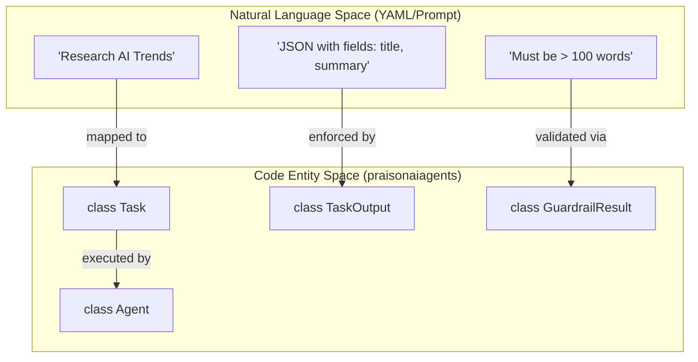
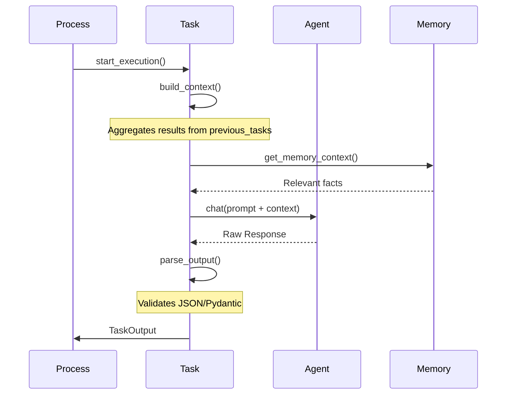
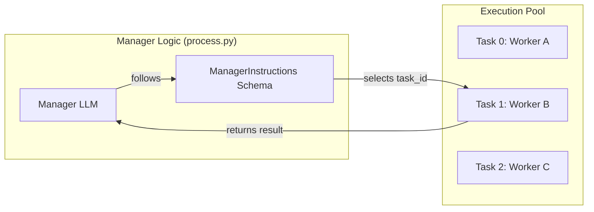

<!-- source: DeepWiki mcp.deepwiki.com · repo MervinPraison/PraisonAI · page 2.4 Task System · fetched 2026-10-26 -->

# Task System

Relevant source files

The following files were used as context for generating this wiki page:

- [api.md](api.md)
- [examples/guardrail_example_fixed.py](examples/guardrail_example_fixed.py)
- [src/praisonai-agents/praisonaiagents/bus/bus.py](src/praisonai-agents/praisonaiagents/bus/bus.py)
- [src/praisonai-agents/praisonaiagents/memory/core.py](src/praisonai-agents/praisonaiagents/memory/core.py)
- [src/praisonai-agents/praisonaiagents/memory/memory.py](src/praisonai-agents/praisonaiagents/memory/memory.py)
- [src/praisonai-agents/praisonaiagents/process/manager_schema.py](src/praisonai-agents/praisonaiagents/process/manager_schema.py)
- [src/praisonai-agents/praisonaiagents/process/process.py](src/praisonai-agents/praisonaiagents/process/process.py)
- [src/praisonai-agents/praisonaiagents/task/task.py](src/praisonai-agents/praisonaiagents/task/task.py)
- [src/praisonai-agents/praisonaiagents/utils/async_bridge.py](src/praisonai-agents/praisonaiagents/utils/async_bridge.py)
- [src/praisonai-agents/test_guardrail_return_types.py](src/praisonai-agents/test_guardrail_return_types.py)
- [src/praisonai-agents/tests/test_memory_convenience_api.py](src/praisonai-agents/tests/test_memory_convenience_api.py)
- [src/praisonai-agents/tests/unit/bus/test_event_bus.py](src/praisonai-agents/tests/unit/bus/test_event_bus.py)
- [src/praisonai-agents/tests/unit/config/test_small_model_routing.py](src/praisonai-agents/tests/unit/config/test_small_model_routing.py)
- [src/praisonai-agents/tests/unit/process/test_hierarchical_selection.py](src/praisonai-agents/tests/unit/process/test_hierarchical_selection.py)
- [src/praisonai-agents/tests/unit/process/test_manager_schema.py](src/praisonai-agents/tests/unit/process/test_manager_schema.py)

The PraisonAI Task System is a unified abstraction for defining, executing, and coordinating units of work. It bridges the gap between high-level natural language instructions and structured code execution, supporting features such as context injection, multi-format output parsing, and robust error handling.

## Task Definition and Structure

Tasks are represented by the `Task` class [src/praisonai-agents/praisonaiagents/task/task.py:20-151](). A task encapsulates the "what" (description), the "who" (agent), and the "how" (tools, configurations).

### Core Task Attributes

| Attribute | Source | Purpose |
| :--- | :--- | :--- |
| `description` | [src/praisonai-agents/praisonaiagents/task/task.py:49]() | The natural language instruction for the task. |
| `action` | [src/praisonai-agents/praisonaiagents/task/task.py:94]() | User-friendly alias for `description`. |
| `handler` | [src/praisonai-agents/praisonaiagents/task/task.py:96]() | Optional Python callable for custom logic instead of an LLM agent. |
| `expected_output` | [src/praisonai-agents/praisonaiagents/task/task.py:50]() | Defines the success criteria for the LLM. |
| `context` | [src/praisonai-agents/praisonaiagents/task/task.py:54]() | List of tasks or strings providing input data. |
| `output_pydantic` | [src/praisonai-agents/praisonaiagents/task/task.py:60]() | Schema for structured data extraction. |
| `guardrails` | [src/praisonai-agents/praisonaiagents/task/task.py:79]() | Validation functions or LLM-based checks. |

### Natural Language to Code Entity Mapping
This diagram shows how natural language definitions in the user space map to internal class structures.

Sources: [src/praisonai-agents/praisonaiagents/task/task.py:20-151](), [src/praisonai-agents/praisonaiagents/output/models.py:6-6]()

## Task Execution Lifecycle

Task execution is orchestrated by the `Process` class [src/praisonai-agents/praisonaiagents/process/process.py:20-35](). The system supports different execution strategies, including sequential, parallel, and hierarchical.

### Execution Flow and Context Building
When a task starts, the system resolves its context by gathering results from `depends_on` or `context` tasks [src/praisonai-agents/praisonaiagents/task/task.py:54-55]().

Sources: [src/praisonai-agents/praisonaiagents/task/task.py:20-151](), [src/praisonai-agents/praisonaiagents/process/process.py:20-35](), [src/praisonai-agents/praisonaiagents/memory/memory.py:39-101]()

## Error Handling and Non-Fatal Policies

The task system includes sophisticated mechanisms for handling failures without necessarily stopping the entire workflow.

### Robustness Parameters
*   **`max_retries`**: Number of times to re-attempt a task if it fails validation or LLM execution [src/praisonai-agents/praisonaiagents/task/task.py:80]().
*   **`skip_on_failure`**: If `True`, the workflow continues even if the task fails [src/praisonai-agents/praisonaiagents/task/task.py:87]().
*   **`on_error`**: Flow control policy: `"stop"`, `"continue"`, or `"retry"` [src/praisonai-agents/praisonaiagents/task/task.py:89]().

### Validation and Guardrails
Tasks can return a `GuardrailResult` [api.md:15]() or a `Tuple[bool, Any]` [examples/guardrail_example_fixed.py:33](). If a guardrail returns `success=False`, the task is retried with the error message injected back into the LLM prompt as feedback [examples/guardrail_example_fixed.py:142-143]().

Sources: [src/praisonai-agents/praisonaiagents/task/task.py:78-90](), [examples/guardrail_example_fixed.py:12-42]()

## Hierarchical Task Management

In complex scenarios, a `manager_llm` [src/praisonai-agents/praisonaiagents/process/process.py:29]() is used to decide the next task. This uses a structured `ManagerInstructions` schema to ensure the manager only selects valid, 0-based task IDs [src/praisonai-agents/praisonaiagents/process/manager_schema.py:6-24]().

### Manager Instruction Schema
The `ManagerInstructions` class enforces strict output formatting for OpenAI-compatible models:
*   `task_id`: The integer ID of the next task [src/praisonai-agents/praisonaiagents/process/manager_schema.py:15]().
*   `agent_name`: The agent assigned to the task [src/praisonai-agents/praisonaiagents/process/manager_schema.py:23]().
*   `action`: Either `"execute"` or `"stop"` [src/praisonai-agents/praisonaiagents/process/manager_schema.py:24]().

Sources: [src/praisonai-agents/praisonaiagents/process/process.py:77-81](), [src/praisonai-agents/praisonaiagents/process/manager_schema.py:6-24](), [src/praisonai-agents/tests/unit/process/test_manager_schema.py:14-23]()

## Memory Integration

Tasks interact with the `Memory` system to store and retrieve context.
*   **Short-term memory (STM)**: Ephemeral context stored during the run [src/praisonai-agents/praisonaiagents/memory/memory.py:42]().
*   **Long-term memory (LTM)**: Persistent facts. Content is auto-promoted to LTM if its `quality_score` exceeds 7.5 [src/praisonai-agents/praisonaiagents/memory/core.py:78-81]().

Sources: [src/praisonai-agents/praisonaiagents/memory/memory.py:39-49](), [src/praisonai-agents/praisonaiagents/memory/core.py:20-88]()

---

