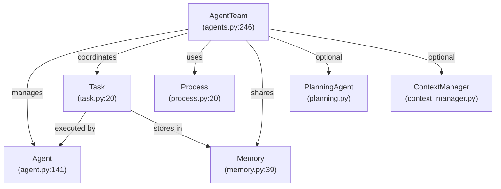
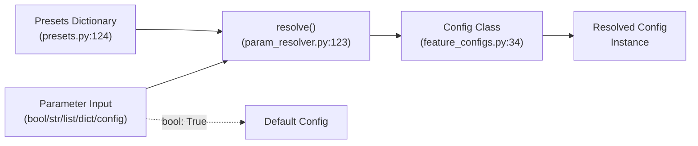
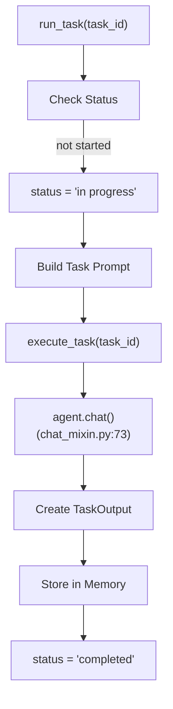
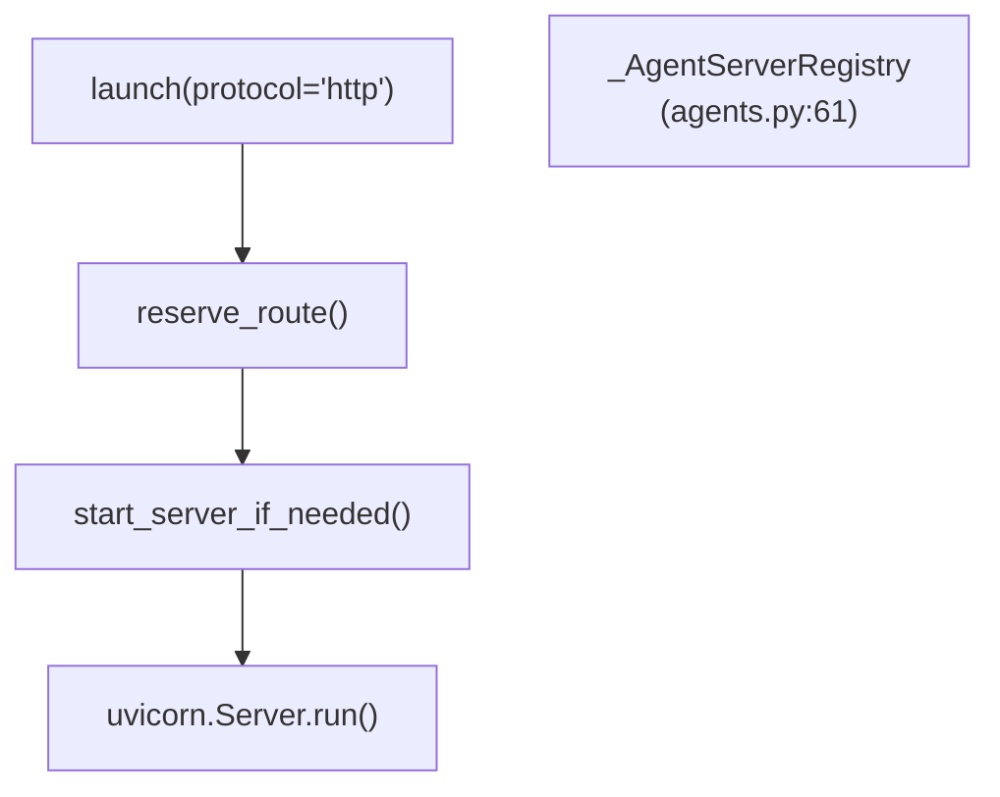

<!-- source: DeepWiki mcp.deepwiki.com · repo MervinPraison/PraisonAI · page 2.5 Multi-Agent Orchestration · fetched 2026-10-26 -->

# Multi-Agent Orchestration

Relevant source files

The following files were used as context for generating this wiki page:

- [examples/guardrail_example_fixed.py](examples/guardrail_example_fixed.py)
- [src/praisonai-agents/praisonaiagents/agent/agent.py](src/praisonai-agents/praisonaiagents/agent/agent.py)
- [src/praisonai-agents/praisonaiagents/agent/chat_mixin.py](src/praisonai-agents/praisonaiagents/agent/chat_mixin.py)
- [src/praisonai-agents/praisonaiagents/agent/durable.py](src/praisonai-agents/praisonaiagents/agent/durable.py)
- [src/praisonai-agents/praisonaiagents/agent/execution_mixin.py](src/praisonai-agents/praisonaiagents/agent/execution_mixin.py)
- [src/praisonai-agents/praisonaiagents/agent/interrupt.py](src/praisonai-agents/praisonaiagents/agent/interrupt.py)
- [src/praisonai-agents/praisonaiagents/agent/loop_detection.py](src/praisonai-agents/praisonaiagents/agent/loop_detection.py)
- [src/praisonai-agents/praisonaiagents/agent/tool_execution.py](src/praisonai-agents/praisonaiagents/agent/tool_execution.py)
- [src/praisonai-agents/praisonaiagents/agents/agents.py](src/praisonai-agents/praisonaiagents/agents/agents.py)
- [src/praisonai-agents/praisonaiagents/bus/bus.py](src/praisonai-agents/praisonaiagents/bus/bus.py)
- [src/praisonai-agents/praisonaiagents/config/feature_configs.py](src/praisonai-agents/praisonaiagents/config/feature_configs.py)
- [src/praisonai-agents/praisonaiagents/escalation/doom_loop.py](src/praisonai-agents/praisonaiagents/escalation/doom_loop.py)
- [src/praisonai-agents/praisonaiagents/llm/llm.py](src/praisonai-agents/praisonaiagents/llm/llm.py)
- [src/praisonai-agents/praisonaiagents/llm/openai_client.py](src/praisonai-agents/praisonaiagents/llm/openai_client.py)
- [src/praisonai-agents/praisonaiagents/llm/sanitize.py](src/praisonai-agents/praisonaiagents/llm/sanitize.py)
- [src/praisonai-agents/praisonaiagents/memory/core.py](src/praisonai-agents/praisonaiagents/memory/core.py)
- [src/praisonai-agents/praisonaiagents/memory/memory.py](src/praisonai-agents/praisonaiagents/memory/memory.py)
- [src/praisonai-agents/praisonaiagents/plugins/loop_detection_plugin.py](src/praisonai-agents/praisonaiagents/plugins/loop_detection_plugin.py)
- [src/praisonai-agents/praisonaiagents/process/manager_schema.py](src/praisonai-agents/praisonaiagents/process/manager_schema.py)
- [src/praisonai-agents/praisonaiagents/process/process.py](src/praisonai-agents/praisonaiagents/process/process.py)
- [src/praisonai-agents/praisonaiagents/task/task.py](src/praisonai-agents/praisonaiagents/task/task.py)
- [src/praisonai-agents/praisonaiagents/tools/call_executor.py](src/praisonai-agents/praisonaiagents/tools/call_executor.py)
- [src/praisonai-agents/praisonaiagents/tools/path_overlap.py](src/praisonai-agents/praisonaiagents/tools/path_overlap.py)
- [src/praisonai-agents/praisonaiagents/utils/async_bridge.py](src/praisonai-agents/praisonaiagents/utils/async_bridge.py)
- [src/praisonai-agents/test_guardrail_return_types.py](src/praisonai-agents/test_guardrail_return_types.py)
- [src/praisonai-agents/tests/integration/test_responses_api.py](src/praisonai-agents/tests/integration/test_responses_api.py)
- [src/praisonai-agents/tests/test_deferred_progress_tools.py](src/praisonai-agents/tests/test_deferred_progress_tools.py)
- [src/praisonai-agents/tests/test_memory_convenience_api.py](src/praisonai-agents/tests/test_memory_convenience_api.py)
- [src/praisonai-agents/tests/test_native_deferred_parity.py](src/praisonai-agents/tests/test_native_deferred_parity.py)
- [src/praisonai-agents/tests/test_parallel_tools.py](src/praisonai-agents/tests/test_parallel_tools.py)
- [src/praisonai-agents/tests/test_tool_timeout.py](src/praisonai-agents/tests/test_tool_timeout.py)
- [src/praisonai-agents/tests/unit/agent/test_durable_run.py](src/praisonai-agents/tests/unit/agent/test_durable_run.py)
- [src/praisonai-agents/tests/unit/agent/test_loop_detector_wiring.py](src/praisonai-agents/tests/unit/agent/test_loop_detector_wiring.py)
- [src/praisonai-agents/tests/unit/bus/test_event_bus.py](src/praisonai-agents/tests/unit/bus/test_event_bus.py)
- [src/praisonai-agents/tests/unit/config/test_small_model_routing.py](src/praisonai-agents/tests/unit/config/test_small_model_routing.py)
- [src/praisonai-agents/tests/unit/llm/test_durable_tool_dispatch.py](src/praisonai-agents/tests/unit/llm/test_durable_tool_dispatch.py)
- [src/praisonai-agents/tests/unit/process/test_hierarchical_selection.py](src/praisonai-agents/tests/unit/process/test_hierarchical_selection.py)
- [src/praisonai-agents/tests/unit/process/test_manager_schema.py](src/praisonai-agents/tests/unit/process/test_manager_schema.py)
- [src/praisonai-agents/tests/unit/test_compaction_wiring.py](src/praisonai-agents/tests/unit/test_compaction_wiring.py)
- [src/praisonai-agents/tests/unit/test_doom_loop_no_progress_boundary.py](src/praisonai-agents/tests/unit/test_doom_loop_no_progress_boundary.py)
- [src/praisonai-agents/tests/unit/test_loop_detection.py](src/praisonai-agents/tests/unit/test_loop_detection.py)
- [src/praisonai/praisonai/__main__.py](src/praisonai/praisonai/__main__.py)
- [src/praisonai/praisonai/_async_bridge.py](src/praisonai/praisonai/_async_bridge.py)
- [src/praisonai/praisonai/agents_generator.py](src/praisonai/praisonai/agents_generator.py)
- [src/praisonai/praisonai/auto.py](src/praisonai/praisonai/auto.py)
- [src/praisonai/praisonai/framework_adapters/__init__.py](src/praisonai/praisonai/framework_adapters/__init__.py)
- [src/praisonai/praisonai/framework_adapters/autogen_adapter.py](src/praisonai/praisonai/framework_adapters/autogen_adapter.py)
- [src/praisonai/praisonai/framework_adapters/base.py](src/praisonai/praisonai/framework_adapters/base.py)
- [src/praisonai/praisonai/framework_adapters/crewai_adapter.py](src/praisonai/praisonai/framework_adapters/crewai_adapter.py)
- [src/praisonai/praisonai/framework_adapters/praisonai_adapter.py](src/praisonai/praisonai/framework_adapters/praisonai_adapter.py)
- [src/praisonai/praisonai/framework_adapters/validators.py](src/praisonai/praisonai/framework_adapters/validators.py)
- [src/praisonai/praisonai/tool_resolver.py](src/praisonai/praisonai/tool_resolver.py)
- [src/praisonai/tests/unit/cli/test_main_dispatcher.py](src/praisonai/tests/unit/cli/test_main_dispatcher.py)
- [src/praisonai/tests/unit/cli/test_typer_cli.py](src/praisonai/tests/unit/cli/test_typer_cli.py)
- [src/praisonai/tests/unit/test_aiui_datastore.py](src/praisonai/tests/unit/test_aiui_datastore.py)
- [src/praisonai/tests/unit/test_async_bridge.py](src/praisonai/tests/unit/test_async_bridge.py)
- [src/praisonai/tests/unit/test_auto_lazy_loading.py](src/praisonai/tests/unit/test_auto_lazy_loading.py)
- [src/praisonai/tests/unit/test_framework_validators.py](src/praisonai/tests/unit/test_framework_validators.py)
- [src/praisonai/tests/unit/test_tool_timeout_enforcement.py](src/praisonai/tests/unit/test_tool_timeout_enforcement.py)
- [src/praisonai/tests/unit/test_wrapper_layer_regression.py](src/praisonai/tests/unit/test_wrapper_layer_regression.py)

## Purpose and Scope

This document describes the multi-agent orchestration system in PraisonAI, which coordinates the execution of tasks across multiple Agent instances. The orchestration layer manages task delegation, execution flow, state management, and result aggregation for multi-agent workflows.

**Related Pages:**
- For single agent execution and lifecycle, see [Agent Class](2.1)
- For task definition and execution details, see [Task System](2.4)
- For workflow control structures, see [Workflow System](3.1)
- For process strategy patterns, see [Process Strategies](3.2)
- For planning-based orchestration, see [Planning System](3.3)

---

## Core Class: AgentTeam

The `AgentTeam` class (formerly `AgentManager`) is the primary orchestrator for multi-agent workflows. It manages multiple `Agent` instances, coordinates task execution, and provides shared infrastructure like memory, state management, and context handling.

**Key Responsibilities:**
- Delegate tasks to appropriate agents [src/praisonai-agents/praisonaiagents/agents/agents.py:1097-1105]()
- Manage execution flow (sequential, parallel, hierarchical, workflow) [src/praisonai-agents/praisonaiagents/agents/agents.py:1177-1197]()
- Maintain shared state across agents [src/praisonai-agents/praisonaiagents/agents/agents.py:1405-1473]()
- Provide session persistence [src/praisonai-agents/praisonaiagents/agents/agents.py:1475-1518]()
- Integrate planning mode [src/praisonai-agents/praisonaiagents/agents/agents.py:2068-2149]()
- Expose agents via HTTP and MCP APIs [src/praisonai-agents/praisonaiagents/agents/agents.py:1591-2026]()

**Class Hierarchy:**

**Sources:** [src/praisonai-agents/praisonaiagents/agents/agents.py:246-394](), [src/praisonai-agents/praisonaiagents/agent/agent.py:141-180](), [src/praisonai-agents/praisonaiagents/process/process.py:20-68]()

---

## Initialization and Configuration

The `AgentTeam.__init__()` method uses a consolidated parameter system with canonical resolution for all features. Parameters support multiple input formats: booleans, strings (presets), lists, config objects, or dict configurations.

**Consolidated Parameters:**

| Parameter | Type | Purpose |
|-----------|------|---------|
| `agents` | `List[Agent]` | List of Agent instances to coordinate [src/praisonai-agents/praisonaiagents/agents/agents.py:257]() |
| `tasks` | `Optional[List[Task]]` | Tasks to execute [src/praisonai-agents/praisonaiagents/agents/agents.py:258]() |
| `process` | `str` | Execution pattern: "sequential", "parallel", "hierarchical", "workflow" [src/praisonai-agents/praisonaiagents/agents/agents.py:259]() |
| `llm` | `Optional[str]` | Default LLM for all agents [src/praisonai-agents/praisonaiagents/agents/agents.py:261]() |
| `memory` | `Union[bool, MultiAgentMemoryConfig]` | Shared memory configuration [src/praisonai-agents/praisonaiagents/agents/agents.py:265]() |
| `planning` | `Union[bool, MultiAgentPlanningConfig]` | Planning mode configuration [src/praisonai-agents/praisonaiagents/agents/agents.py:268]() |

**Parameter Resolution Flow:**

**Sources:** [src/praisonai-agents/praisonaiagents/agent/agent.py:123-134](), [src/praisonai-agents/praisonaiagents/agents/agents.py:341-368](), [src/praisonai-agents/praisonaiagents/config/feature_configs.py:34-186]()

---

## Process Strategies

AgentTeam supports four execution patterns, managed by the `Process` class in `process.py`.

### Sequential Process
Tasks execute one after another, with each task's output automatically passed as context to the next task [src/praisonai-agents/praisonaiagents/agents/agents.py:1190-1192]().

### Parallel Process
Tasks execute concurrently using `asyncio.gather` for maximum throughput [src/praisonai-agents/praisonaiagents/agents/agents.py:809-863]().

### Hierarchical Process
A manager agent delegates tasks to worker agents based on their capabilities. The manager is created via `_create_llm_instance` [src/praisonai-agents/praisonaiagents/process/process.py:77-80]().

### Workflow Process
Tasks execute with advanced control flow using `AgentFlow` constructs (route, parallel, loop, repeat) [src/praisonai-agents/praisonaiagents/agents/agents.py:1187-1189]().

**Sources:** [src/praisonai-agents/praisonaiagents/process/process.py:20-68](), [src/praisonai-agents/praisonaiagents/agents/agents.py:1177-1197]()

---

## Task Execution Pipeline

The task execution pipeline processes each task through multiple stages, from context assembly to result storage.

### Execution Flow

**Sources:** [src/praisonai-agents/praisonaiagents/agents/agents.py:930-1095](), [src/praisonai-agents/praisonaiagents/agent/chat_mixin.py:73-167]()

### Multimodal Support
The system handles multimodal inputs (images/videos) by encoding files to base64 [src/praisonai-agents/praisonaiagents/agents/agents.py:161-165]() or processing video frames [src/praisonai-agents/praisonaiagents/agents/agents.py:167-186]().

---

## State Management

AgentTeam provides a flexible state management system via the `_state` dictionary with convenience methods for common operations [src/praisonai-agents/praisonaiagents/agents/agents.py:1405-1473]().

### Session Persistence
State can be persisted to shared memory for session recovery using `save_session_state` and `restore_session_state` [src/praisonai-agents/praisonaiagents/agents/agents.py:1475-1518]().

---

## API Deployment

### HTTP API Mode
AgentTeam uses a `ServerRegistry` to manage FastAPI instances per-port [src/praisonai-agents/praisonaiagents/agent/agent.py:141-179](). The `_AgentServerRegistry` in `agents.py` handles route reservation and server startup [src/praisonai-agents/praisonaiagents/agents/agents.py:61-159]().

**Sources:** [src/praisonai-agents/praisonaiagents/agents/agents.py:61-159](), [src/praisonai-agents/praisonaiagents/agents/agents.py:1591-1882]()

---

## Token Tracking

AgentTeam integrates with `TokenMetrics` to track token usage across all agents [src/praisonai-agents/praisonaiagents/llm/llm.py:148-173](). Usage is collected via `get_token_collector()` [src/praisonai-agents/praisonaiagents/agents/agents.py:20-23]().

**Sources:** [src/praisonai-agents/praisonaiagents/llm/llm.py:148-173](), [src/praisonai-agents/praisonaiagents/agents/agents.py:1520-1589]()

---

## Summary

The `AgentTeam` class provides a comprehensive multi-agent orchestration layer with:
- **Flexible Execution**: Managed via the `Process` class [src/praisonai-agents/praisonaiagents/process/process.py:20]().
- **Shared Infrastructure**: Memory integration via `Memory` [src/praisonai-agents/praisonaiagents/memory/memory.py:39]().
- **API Deployment**: Managed via `_AgentServerRegistry` [src/praisonai-agents/praisonaiagents/agents/agents.py:61]().
- **Token Tracking**: Structured via `TokenUsage` [src/praisonai-agents/praisonaiagents/llm/llm.py:148]().

---

