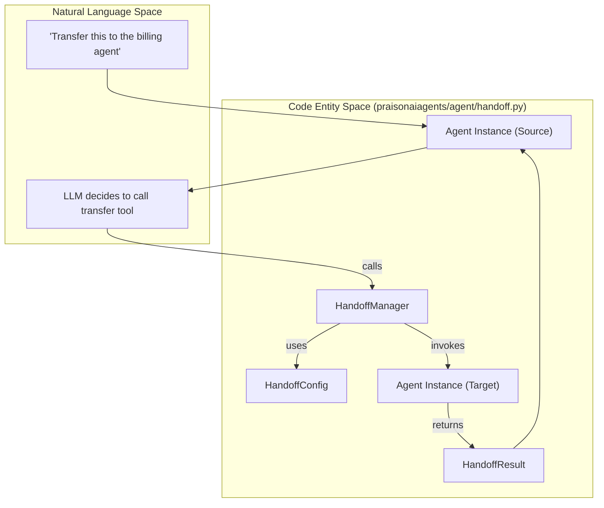
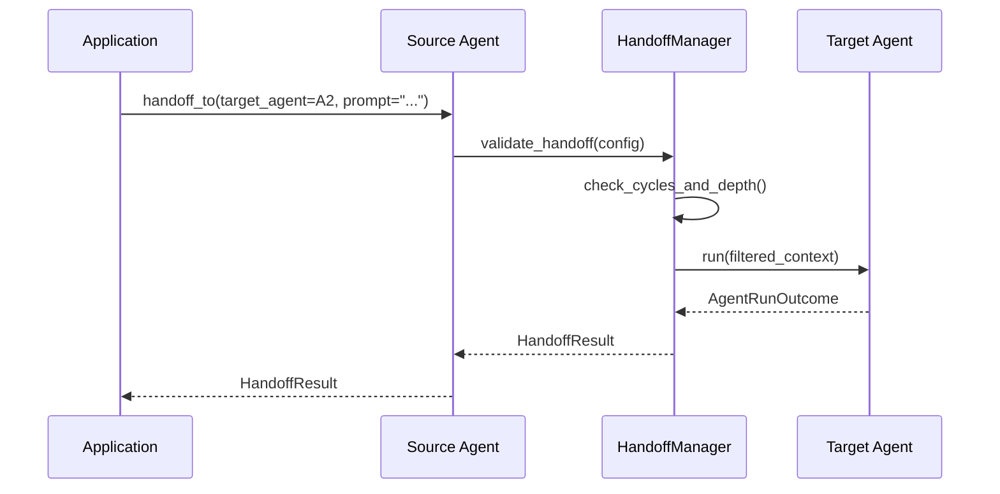

<!-- source: DeepWiki mcp.deepwiki.com · repo MervinPraison/PraisonAI · page 2.6 Autonomy and Handoff · fetched 2026-10-26 -->

# Autonomy and Handoff

<details>
<summary>Relevant source files</summary>

The following files were used as context for generating this wiki page:

- [api.md](api.md)
- [examples/python/agents/MULTI_PROVIDER_README.md](examples/python/agents/MULTI_PROVIDER_README.md)
- [examples/python/agents/multi-provider-agent.py](examples/python/agents/multi-provider-agent.py)
- [examples/python/handoff/handoffs.md](examples/python/handoff/handoffs.md)
- [src/praisonai-agents/praisonaiagents/agent/__init__.py](src/praisonai-agents/praisonaiagents/agent/__init__.py)
- [src/praisonai-agents/praisonaiagents/agent/handoff.py](src/praisonai-agents/praisonaiagents/agent/handoff.py)
- [src/praisonai-agents/praisonaiagents/agent/router_agent.py](src/praisonai-agents/praisonaiagents/agent/router_agent.py)
- [src/praisonai-agents/praisonaiagents/errors.py](src/praisonai-agents/praisonaiagents/errors.py)
- [src/praisonai-agents/praisonaiagents/llm/model_router.py](src/praisonai-agents/praisonaiagents/llm/model_router.py)
- [src/praisonai-agents/test_multi_provider.py](src/praisonai-agents/test_multi_provider.py)
- [src/praisonai-agents/tests/test_handoff_compatibility.py](src/praisonai-agents/tests/test_handoff_compatibility.py)
- [src/praisonai/praisonai/cli/commands/setup.py](src/praisonai/praisonai/cli/commands/setup.py)
- [src/praisonai/scripts/install.ps1](src/praisonai/scripts/install.ps1)

</details>


This document covers two interrelated agent control systems in PraisonAI: **autonomy** for managing autonomous agent execution and preventing infinite loops, and **handoff** for enabling agent-to-agent delegation. Both systems provide essential controls for multi-agent coordination and safe autonomous operation.

For information about multi-agent orchestration patterns, see [Multi-Agent Orchestration](./2.5). For planning and execution strategies, see [Planning System](./3.3).

## Overview

The autonomy system prevents agents from entering infinite execution loops (doom loops) while allowing configurable levels of autonomous operation. The handoff system, implemented primarily in `src/praisonai-agents/praisonaiagents/agent/handoff.py`, enables agents to delegate tasks to other specialized agents, creating dynamic collaboration patterns similar to the OpenAI Agents SDK.

**Key Concepts:**

- **Autonomy**: Controls how freely an agent can execute without human intervention.
- **Doom Loop Prevention**: Detects and breaks repetitive execution patterns using the `detect_cycles` configuration [src/praisonai-agents/praisonaiagents/agent/handoff.py:107]().
- **Handoff**: Structured mechanism for agent-to-agent task delegation using `HandoffConfig` [src/praisonai-agents/praisonaiagents/agent/handoff.py:70-118]().
- **Context Policy**: Rules for transcript isolation or sharing during transfers [src/praisonai-agents/praisonaiagents/agent/handoff.py:44-49]().

## Handoff System Architecture

The handoff system provides a unified way to transfer execution control between agents. It replaces legacy delegation patterns with a tool-based or programmatic transfer mechanism.

### Data Flow and Code Entities


**Sources:** [src/praisonai-agents/praisonaiagents/agent/handoff.py:7-11](), [src/praisonai-agents/praisonaiagents/agent/agent.py:55-56]()

### HandoffConfig
The `HandoffConfig` class consolidates all settings for delegation, including security boundaries and execution limits [src/praisonai-agents/praisonaiagents/agent/handoff.py:70-118]().

| Attribute | Type | Description |
|-----------|------|-------------|
| `context_policy` | `ContextPolicy` | How to share history (FULL, SUMMARY, NONE, LAST_N) [src/praisonai-agents/praisonaiagents/agent/handoff.py:44-49](). |
| `tool_policy` | `HandoffToolPolicy` | Security boundary: `intersect` (default) or `passthrough` [src/praisonai-agents/praisonaiagents/agent/handoff.py:52-67](). |
| `detect_cycles` | `bool` | Enables cycle detection to prevent infinite loops [src/praisonai-agents/praisonaiagents/agent/handoff.py:107](). |
| `max_depth` | `int` | Maximum allowed handoff chain depth (default: 10) [src/praisonai-agents/praisonaiagents/agent/handoff.py:108](). |
| `timeout_seconds` | `float` | Timeout for the delegated execution [src/praisonai-agents/praisonaiagents/agent/handoff.py:103](). |

**Sources:** [src/praisonai-agents/praisonaiagents/agent/handoff.py:70-118]()

### Context Isolation and Sharing
The `ContextPolicy` enum defines how the conversation transcript is isolated or shared during a handoff [src/praisonai-agents/praisonaiagents/agent/handoff.py:44-49]():
- **FULL**: Shares the entire conversation history.
- **SUMMARY**: Shares a summarized context (default for safety).
- **NONE**: No context sharing (transcript isolation).
- **LAST_N**: Shares only the last N messages, configured via `max_context_messages` [src/praisonai-agents/praisonaiagents/agent/handoff.py:96]().

## Autonomy and Safety Controls

PraisonAI implements safety controls to prevent autonomous agents from runaway execution or infinite delegation loops.

### Cycle and Depth Detection
The system uses a `_handoff_chain_var` (a `contextvars.ContextVar`) to track the chain of agents involved in a task across asynchronous boundaries [src/praisonai-agents/praisonaiagents/agent/handoff.py:176-178]().

- **Cycle Detection**: If `detect_cycles` is enabled, the system checks if an agent appears twice in the current chain, raising a `HandoffCycleError` if a loop is detected [src/praisonai-agents/praisonaiagents/agent/handoff.py:107](), [src/praisonai-agents/praisonaiagents/agent/handoff.py:160]().
- **Depth Limits**: If the chain length exceeds `max_depth`, a `HandoffDepthError` is raised [src/praisonai-agents/praisonaiagents/agent/handoff.py:108](), [src/praisonai-agents/praisonaiagents/agent/handoff.py:161]().

### Error Handling
The SDK provides a structured hierarchy for handoff-related failures in `src/praisonai-agents/praisonaiagents/errors.py`:
- `HandoffError`: Base class for handoff failures [src/praisonai-agents/praisonaiagents/errors.py:228]().
- `HandoffTimeoutError`: Triggered when `timeout_seconds` is exceeded [src/praisonai-agents/praisonaiagents/errors.py:246]().
- `HandoffValidationError`: Triggered when handoff parameters fail validation [src/praisonai-agents/praisonaiagents/errors.py:252]().

**Sources:** [src/praisonai-agents/praisonaiagents/agent/handoff.py:158-164](), [src/praisonai-agents/praisonaiagents/errors.py:228-255]()

## Implementation Patterns

### Agent-to-Agent Delegation
Agents can be configured with a list of other agents they are allowed to hand off to. These are automatically converted into tools the LLM can invoke [src/praisonai-agents/tests/test_handoff_compatibility.py:58-61]().

```python
from praisonaiagents import Agent

billing_agent = Agent(name="BillingAgent", role="Billing")
triage_agent = Agent(
    name="TriageAgent",
    handoffs=[billing_agent] # Automatically creates 'transfer_to_billing_agent' tool
)
```
**Sources:** [src/praisonai-agents/tests/test_handoff_compatibility.py:45-63](), [examples/python/handoff/handoffs.md:10-20]()

### Programmatic Handoff
Developers can manually trigger a handoff using the `handoff_to` or `handoff_to_async` methods on the `Agent` class [src/praisonai-agents/praisonaiagents/agent/agent.py:55-56]().


**Sources:** [src/praisonai-agents/praisonaiagents/agent/agent.py:55-56](), [src/praisonai-agents/praisonaiagents/agent/handoff.py:18](), [src/praisonai-agents/praisonaiagents/agent/handoff.py:37]()

### Tool Boundary Enforcement
The `HandoffToolPolicy` defines security boundaries for tools during delegation [src/praisonai-agents/praisonaiagents/agent/handoff.py:52-67]().

- **Intersect (Default)**: The target agent only receives tools that exist in both the source and target agent's toolsets. This prevents "privilege escalation" where a low-privilege agent hands off to a high-privilege agent to execute unauthorized actions [src/praisonai-agents/praisonaiagents/agent/handoff.py:62]().
- **Passthrough**: The target agent retains its original toolset regardless of the source agent's capabilities [src/praisonai-agents/praisonaiagents/agent/handoff.py:63]().

**Sources:** [src/praisonai-agents/praisonaiagents/agent/handoff.py:52-67]()

## Summary of Handoff Components

| Component | Role | File Reference |
|-----------|------|----------------|
| `HandoffConfig` | Configuration for context, safety, and timeouts | [src/praisonai-agents/praisonaiagents/agent/handoff.py:70]() |
| `HandoffResult` | Encapsulates the outcome of a delegation | [src/praisonai-agents/praisonaiagents/agent/handoff.py:18]() |
| `ContextPolicy` | Enum defining transcript sharing strategies | [src/praisonai-agents/praisonaiagents/agent/handoff.py:44]() |
| `handoff_filters` | Utility functions for cleaning context (e.g., `remove_all_tools`) | [src/praisonai-agents/tests/test_handoff_compatibility.py:126]() |
| `HandoffCycleError` | Exception raised when an infinite loop is detected | [src/praisonai-agents/praisonaiagents/errors.py:234]() |

**Sources:** [src/praisonai-agents/praisonaiagents/agent/handoff.py:1-180](), [src/praisonai-agents/praisonaiagents/errors.py:228-255]()

---

