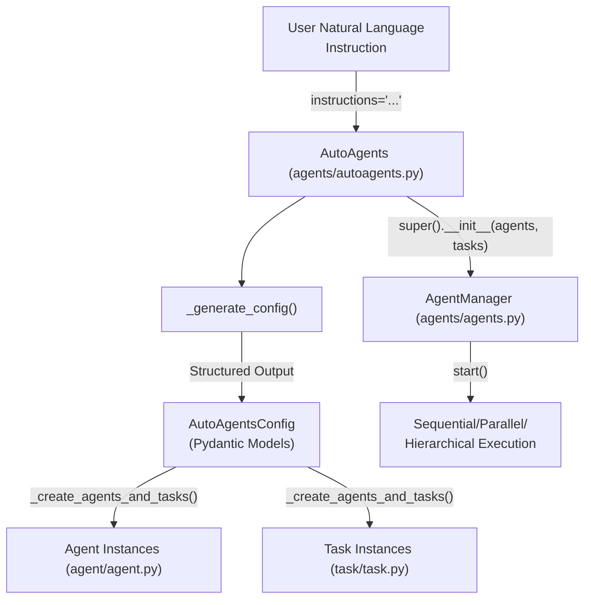
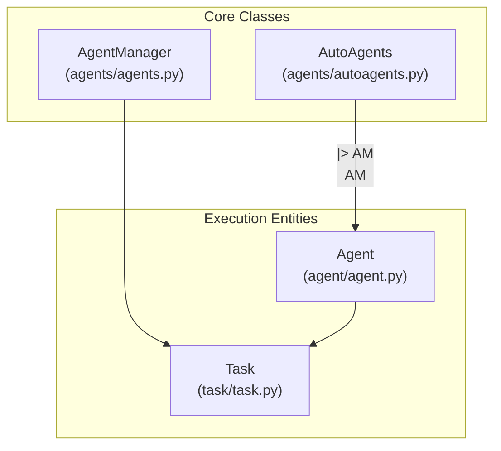
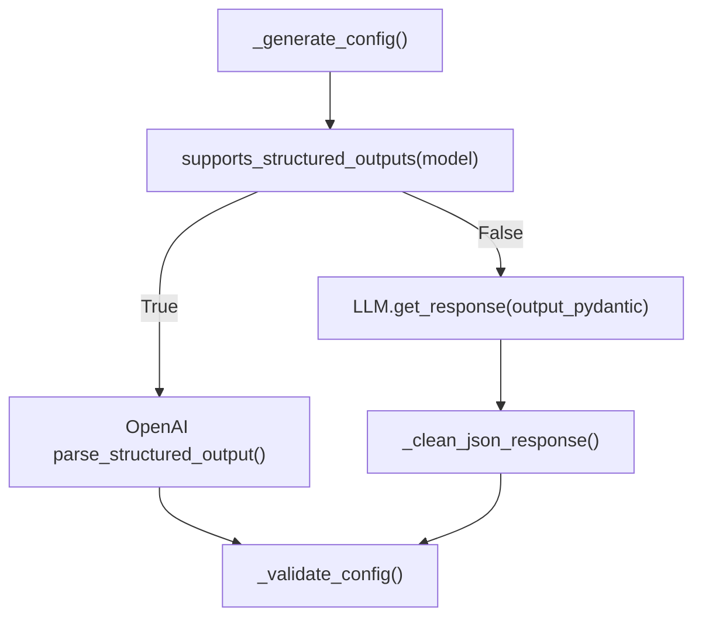

<!-- source: DeepWiki mcp.deepwiki.com · repo MervinPraison/PraisonAI · page 2.7 AutoAgents · fetched 2026-10-26 -->

# AutoAgents

<details>
<summary>Relevant source files</summary>

The following files were used as context for generating this wiki page:

- [src/praisonai-agents/praisonaiagents/agents/autoagents.py](src/praisonai-agents/praisonaiagents/agents/autoagents.py)
- [src/praisonai-agents/praisonaiagents/llm/_cost.py](src/praisonai-agents/praisonaiagents/llm/_cost.py)
- [src/praisonai-agents/praisonaiagents/llm/_litellm_loader.py](src/praisonai-agents/praisonaiagents/llm/_litellm_loader.py)
- [src/praisonai-agents/praisonaiagents/llm/model_capabilities.py](src/praisonai-agents/praisonaiagents/llm/model_capabilities.py)
- [src/praisonai-agents/tests/test_model_capabilities_fallback.py](src/praisonai-agents/tests/test_model_capabilities_fallback.py)
- [src/praisonai-agents/tests/unit/llm/test_cost.py](src/praisonai-agents/tests/unit/llm/test_cost.py)

</details>


This document describes the AutoAgents system, which provides automatic AI-powered generation of multi-agent teams. AutoAgents uses an LLM to analyze a natural language instruction and automatically generate appropriate agent configurations, task definitions, and execution workflows.

For information about manually defining agent teams, see [Multi-Agent Orchestration](#2.5). For information about specialized single-purpose agent types, see [Specialized Agent Types](#2.2).

---

## Purpose and Scope

AutoAgents is a high-level abstraction that enables users to create complete multi-agent systems using only a natural language instruction. Instead of manually defining each agent's role, goal, backstory, and tasks, AutoAgents delegates this configuration generation to an LLM, which analyzes the user's requirements and produces a structured configuration automatically.

**Key capabilities:**
- AI-powered agent team generation from natural language instructions [src/praisonai-agents/praisonaiagents/agents/autoagents.py:1-6]()
- Automatic task decomposition and assignment [src/praisonai-agents/praisonaiagents/agents/autoagents.py:161-162]()
- Intelligent tool distribution among agents [src/praisonai-agents/praisonaiagents/agents/autoagents.py:214-242]()
- Support for multiple LLM providers with capability detection [src/praisonai-agents/praisonaiagents/llm/model_capabilities.py:1-26]()
- Configurable agent count constraints (1-10 agents) [src/praisonai-agents/praisonaiagents/agents/autoagents.py:107-110]()
- Validation and retry logic for configuration generation [src/praisonai-agents/praisonaiagents/agents/autoagents.py:325-353]()

**Scope:** This document covers the `AutoAgents` class implementation, configuration generation workflow, validation mechanisms, and integration with the broader agent orchestration system.

**Sources:** [src/praisonai-agents/praisonaiagents/agents/autoagents.py:1-110](), [src/praisonai-agents/praisonaiagents/llm/model_capabilities.py:1-26]()

---

## System Architecture

AutoAgents operates as a specialized wrapper around the `AgentManager` class, adding an AI-powered configuration generation layer before agent instantiation.

### AutoAgents Position in the Agent Hierarchy



**Sources:** [src/praisonai-agents/praisonaiagents/agents/autoagents.py:8-10](), [src/praisonai-agents/praisonaiagents/agents/autoagents.py:59-60](), [src/praisonai-agents/praisonaiagents/agents/autoagents.py:161-175]()

### Class Hierarchy



**Sources:** [src/praisonai-agents/praisonaiagents/agents/autoagents.py:8-10](), [src/praisonai-agents/praisonaiagents/agents/autoagents.py:59]()

---

## Configuration Data Models

AutoAgents uses Pydantic models to enforce a strict schema for the generated team structure.

### Model Definitions

| Model | Fields | Purpose |
|-------|--------|---------|
| `TaskConfig` | `name`, `description`, `expected_output`, `tools` | Defines a single task [src/praisonai-agents/praisonaiagents/agents/autoagents.py:38-42]() |
| `AgentConfig` | `name`, `role`, `goal`, `backstory`, `tools`, `tasks` | Defines an agent and its tasks [src/praisonai-agents/praisonaiagents/agents/autoagents.py:44-51]() |
| `AutoAgentsConfig` | `main_instruction`, `process_type`, `agents` | Root configuration [src/praisonai-agents/praisonaiagents/agents/autoagents.py:53-57]() |

**Sources:** [src/praisonai-agents/praisonaiagents/agents/autoagents.py:38-57]()

---

## Configuration Generation Workflow

The generation process selects a strategy based on the model's capabilities (detected via `litellm` or fallbacks).

### Generation Pipeline



### Model Capabilities Detection
The system uses `praisonaiagents.llm.model_capabilities` to determine if a model supports `structured_outputs` [src/praisonai-agents/praisonaiagents/llm/model_capabilities.py:106-138](). If `litellm` is unavailable, it uses a conservative static heuristic [src/praisonai-agents/praisonaiagents/llm/model_capabilities.py:41-52]().

**Sources:** [src/praisonai-agents/praisonaiagents/agents/autoagents.py:357-363](), [src/praisonai-agents/praisonaiagents/llm/model_capabilities.py:106-138]()

---

## Tool Assignment Strategy

Tools are assigned to agents by matching the generated tool names against the provided tool objects.

1. **Extraction:** Tool names are extracted from both `AgentConfig.tools` and `TaskConfig.tools` [src/praisonai-agents/praisonaiagents/agents/autoagents.py:224-230]().
2. **Matching:** The `_get_tool_by_name` helper matches these strings against the `__name__` attribute of provided tools [src/praisonai-agents/praisonaiagents/agents/autoagents.py:232-236]().
3. **Fallback:** If no matches are found for an agent, all available tools in `self.tools` are assigned as a safety measure [src/praisonai-agents/praisonaiagents/agents/autoagents.py:238-242]().

**Sources:** [src/praisonai-agents/praisonaiagents/agents/autoagents.py:214-242]()

---

## Validation and Retry Logic

The system validates the generated Pydantic models and retries up to 5 times (configurable via `max_retries`) if the LLM produces invalid structures [src/praisonai-agents/praisonaiagents/agents/autoagents.py:67]().

### Validation Checks
The `_validate_config` method ensures:
- The configuration is an instance of `AutoAgentsConfig` [src/praisonai-agents/praisonaiagents/agents/autoagents.py:246-249]().
- Every agent has at least one task [src/praisonai-agents/praisonaiagents/agents/autoagents.py:252-255]().
- Every task is a valid `TaskConfig` with name, description, and expected output [src/praisonai-agents/praisonaiagents/agents/autoagents.py:257-268]().

**Sources:** [src/praisonai-agents/praisonaiagents/agents/autoagents.py:244-271](), [src/praisonai-agents/praisonaiagents/agents/autoagents.py:325-330]()

---

## Initialization Parameters

`AutoAgents` supports both legacy and consolidated parameters. Consolidated parameters (the new SDK contract) take precedence [src/praisonai-agents/praisonaiagents/agents/autoagents.py:94-105]().

### Parameter Precedence

| Category | Legacy Parameter | Consolidated Parameter (Precedence) |
|----------|------------------|------------------------------------|
| **Output** | `verbose`, `markdown` | `output` [src/praisonai-agents/praisonaiagents/agents/autoagents.py:143]() |
| **Reflection** | `self_reflect`, `max_reflect`, `reflect_llm` | `reflection` [src/praisonai-agents/praisonaiagents/agents/autoagents.py:144]() |
| **Caching** | `cache` | `caching` [src/praisonai-agents/praisonaiagents/agents/autoagents.py:145]() |
| **Knowledge** | `knowledge_sources`, `embedder_config` | `knowledge` [src/praisonai-agents/praisonaiagents/agents/autoagents.py:146]() |
| **Execution** | `max_iter` | `execution` [src/praisonai-agents/praisonaiagents/agents/autoagents.py:147]() |

**Sources:** [src/praisonai-agents/praisonaiagents/agents/autoagents.py:94-150]()

---

## Cost Tracking Integration

AutoAgents leverages the centralized cost calculation module to track LLM usage if enabled.

### Cost Calculation Logic
Cost tracking is enabled via environment variables `PRAISONAI_TRACK_COST` or `PRAISONAI_SAVE_OUTPUT` [src/praisonai-agents/praisonaiagents/llm/_cost.py:35-51](). The `calculate_cost` function lazily loads `litellm` to perform calculations without impacting the hot path for users who don't need tracking [src/praisonai-agents/praisonaiagents/llm/_cost.py:54-72]().

**Sources:** [src/praisonai-agents/praisonaiagents/llm/_cost.py:35-72](), [src/praisonai-agents/praisonaiagents/llm/_litellm_loader.py:16-45]()

---

## JSON Response Cleaning

When models do not support native structured outputs, AutoAgents manually parses the response. It includes a robust `_clean_json_response` utility to handle markdown code blocks commonly returned by LLMs.

**Cleaning Steps:**
1. Strip leading/trailing whitespace [src/praisonai-agents/praisonaiagents/agents/autoagents.py:406]().
2. Remove ` ```json ` or ` ``` ` markers [src/praisonai-agents/praisonaiagents/agents/autoagents.py:407-412]().
3. Final strip and `json.loads` attempt [src/praisonai-agents/praisonaiagents/agents/autoagents.py:413-416]().

**Sources:** [src/praisonai-agents/praisonaiagents/agents/autoagents.py:399-416]()

---

