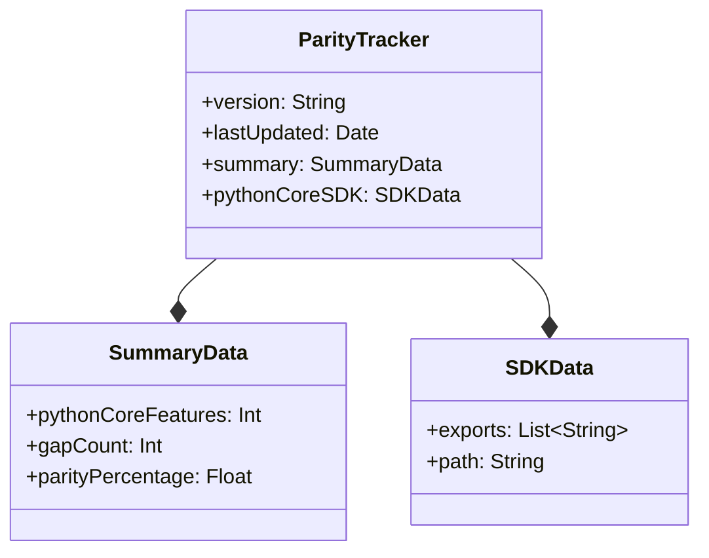

<!-- source: DeepWiki mcp.deepwiki.com · repo MervinPraison/PraisonAI · page 20 Parity Tracking and Documentation · fetched 2026-10-26 -->

# Parity Tracking and Documentation

<details>
<summary>Relevant source files</summary>

The following files were used as context for generating this wiki page:

- [src/praisonai-agents/DOCS_PARITY.md](src/praisonai-agents/DOCS_PARITY.md)
- [src/praisonai-rust/DOCS_PARITY.md](src/praisonai-rust/DOCS_PARITY.md)
- [src/praisonai-rust/FEATURE_PARITY_TRACKER.json](src/praisonai-rust/FEATURE_PARITY_TRACKER.json)
- [src/praisonai-rust/PARITY.md](src/praisonai-rust/PARITY.md)
- [src/praisonai-ts/DOCS_PARITY.md](src/praisonai-ts/DOCS_PARITY.md)
- [src/praisonai-ts/FEATURE_PARITY_TRACKER.json](src/praisonai-ts/FEATURE_PARITY_TRACKER.json)
- [src/praisonai-ts/PARITY.md](src/praisonai-ts/PARITY.md)
- [src/praisonai-ts/src/tools/registry/index.ts](src/praisonai-ts/src/tools/registry/index.ts)
- [src/praisonai-ts/src/tools/registry/registry.ts](src/praisonai-ts/src/tools/registry/registry.ts)
- [src/praisonai-ts/src/tools/registry/types.ts](src/praisonai-ts/src/tools/registry/types.ts)
- [src/praisonai-ts/tests/tools/registry.test.ts](src/praisonai-ts/tests/tools/registry.test.ts)
- [src/praisonai/praisonai/_dev/parity/__init__.py](src/praisonai/praisonai/_dev/parity/__init__.py)
- [src/praisonai/praisonai/_dev/parity/docs_extractor.py](src/praisonai/praisonai/_dev/parity/docs_extractor.py)
- [src/praisonai/praisonai/_dev/parity/docs_generator.py](src/praisonai/praisonai/_dev/parity/docs_generator.py)
- [src/praisonai/praisonai/_dev/parity/generator.py](src/praisonai/praisonai/_dev/parity/generator.py)
- [src/praisonai/praisonai/_dev/parity/python_docs_extractor.py](src/praisonai/praisonai/_dev/parity/python_docs_extractor.py)
- [src/praisonai/praisonai/_dev/parity/rust_extractor.py](src/praisonai/praisonai/_dev/parity/rust_extractor.py)
- [src/praisonai/praisonai/_dev/parity/typescript_extractor.py](src/praisonai/praisonai/_dev/parity/typescript_extractor.py)

</details>


This page provides an overview of the systems used to maintain feature and documentation alignment across the PraisonAI ecosystem. As a multi-language framework (Python, TypeScript, Rust), maintaining consistency in exported classes, configuration parameters, and conceptual documentation is managed through automated parity tracking tools located in the `praisonai._dev.parity` module.

### System Purpose
The parity system serves two primary functions:
1.  **Feature Parity**: Ensuring that the TypeScript and Rust SDKs implement the core capabilities defined in the Python SDK (the source of truth) [src/praisonai/praisonai/_dev/parity/generator.py:5-10]().
2.  **Documentation Parity**: Ensuring every implemented feature in a specific SDK has corresponding conceptual and guide documentation, avoiding "orphan" features or documentation stubs [src/praisonai/praisonai/_dev/parity/docs_generator.py:5-11]().

### Core Components and Entities

The following diagram illustrates how the parity tracking code entities bridge the gap between the implemented codebase and the natural language documentation.

**Parity Tracking Architecture**
```mermaid
graph TD
    subgraph "Code Entity Space"
        [PythonFeatureExtractor] --> |"Exports"| [ParityTrackerGenerator]
        [TypeScriptFeatureExtractor] --> |"Exports"| [ParityTrackerGenerator]
        [RustFeatureExtractor] --> |"Exports"| [ParityTrackerGenerator]
        
        [ParityTrackerGenerator] --> |"Generates"| [FEATURE_PARITY_TRACKER_json]
    end

    subgraph "Natural Language Space"
        [PythonDocsExtractor] --> |"Topics"| [DocsParityGenerator]
        [TypeScriptDocsExtractor] --> |"Topics"| [DocsParityGenerator]
        
        [DocsParityGenerator] --> |"Audit Report"| [DOCS_PARITY_md]
    end

    [FEATURE_PARITY_TRACKER_json] -.-> |"Input for Audit"| [DocsParityGenerator]
    [DOCS_PARITY_md] -.-> |"Refers to"| [DocsTopic]
```
**Sources:** [src/praisonai/praisonai/_dev/parity/generator.py:15-30](), [src/praisonai/praisonai/_dev/parity/docs_generator.py:19-29](), [src/praisonai/praisonai/_dev/parity/docs_extractor.py:15-23]().

---

## Feature Parity Tracker
The `ParityTrackerGenerator` automates the comparison between SDKs. It uses the Python `praisonaiagents` package as the "Source of Truth" [src/praisonai-ts/FEATURE_PARITY_TRACKER.json:5](). The system extracts exported symbols (Classes, Functions, Constants) from each language and performs a gap analysis.

### Priority Tiers
Gaps are categorized into priority tiers to guide development:
*   **P0 (Critical)**: Core entities like `Agent`, `Task`, and `BaseTool` [src/praisonai-ts/PARITY.md:21-27]().
*   **P1 (High)**: Workflow and Persistence features such as `AgentFlow`, `Knowledge`, and `Memory` [src/praisonai-ts/PARITY.md:80-94]().
*   **P2 (Medium)**: Supporting systems like `Guardrails`, `PlanningAgent`, and `SkillManager` [src/praisonai-ts/PARITY.md:110-150]().
*   **P3 (Low)**: Advanced or experimental features and internal protocols [src/praisonai-ts/PARITY.md:162-170]().

For details, see [Feature Parity Tracker](#20.1).

**Sources:** [src/praisonai-ts/FEATURE_PARITY_TRACKER.json:1-15](), [src/praisonai-ts/PARITY.md:7-17]().

---

## Documentation Parity
The `DocsParityGenerator` ensures that implementation does not outpace documentation. It scans MDX files in the documentation repository and maps them to implementation categories using the `FEATURE_CATEGORIES` registry [src/praisonai/praisonai/_dev/parity/docs_generator.py:32-185]().

### Audit Metrics
The system generates a `DOCS_PARITY.md` report for each SDK, tracking:
*   **Documented Categories**: Percentage of feature groups with at least one documentation page [src/praisonai-agents/DOCS_PARITY.md:3-14]().
*   **Stub Detection**: Documentation files with fewer than 50 lines are flagged as stubs (`MIN_DOC_LINES`) [src/praisonai/praisonai/_dev/parity/docs_generator.py:222]().
*   **Orphan Reporting**: Identifies documentation pages that exist but do not correspond to any implemented features in the SDK [src/praisonai-agents/DOCS_PARITY.md:86-92]().

For details, see [Documentation Parity](#20.2).

**Sources:** [src/praisonai-agents/DOCS_PARITY.md:1-20](), [src/praisonai/praisonai/_dev/parity/docs_generator.py:194-205]().

---

## Cross-SDK Status Overview

The system maintains a real-time summary of implementation status across the three primary SDKs.

| SDK | Total Features | Gaps | Parity % | Status |
| :--- | :--- | :--- | :--- | :--- |
| **Python** | 411 | 0 | 100% | Source of Truth |
| **TypeScript** | 1190* | 117 | ~90% | Active Development |
| **Rust** | 667 | 129 | 162.3%** | PARITY_ACHIEVED |

*\*TypeScript feature count includes granular internal exports.*
*\*\*Rust parity exceeds 100% due to language-specific utility implementations (e.g., Builders) being tracked as features.*

**Feature Status Visualization**

**Sources:** [src/praisonai-rust/FEATURE_PARITY_TRACKER.json:1-12](), [src/praisonai-ts/FEATURE_PARITY_TRACKER.json:1-15](), [src/praisonai-rust/PARITY.md:3-13]().

---

