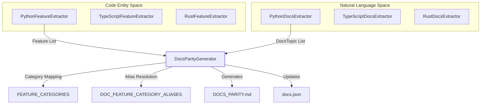

<!-- source: DeepWiki mcp.deepwiki.com · repo MervinPraison/PraisonAI · page 20.2 Documentation Parity · fetched 2026-10-26 -->

# Documentation Parity

<details>
<summary>Relevant source files</summary>

The following files were used as context for generating this wiki page:

- [src/praisonai-agents/DOCS_PARITY.md](src/praisonai-agents/DOCS_PARITY.md)
- [src/praisonai-rust/DOCS_PARITY.md](src/praisonai-rust/DOCS_PARITY.md)
- [src/praisonai-ts/DOCS_PARITY.md](src/praisonai-ts/DOCS_PARITY.md)
- [src/praisonai/praisonai/_dev/parity/docs_extractor.py](src/praisonai/praisonai/_dev/parity/docs_extractor.py)
- [src/praisonai/praisonai/_dev/parity/docs_generator.py](src/praisonai/praisonai/_dev/parity/docs_generator.py)
- [src/praisonai/praisonai/_dev/parity/python_docs_extractor.py](src/praisonai/praisonai/_dev/parity/python_docs_extractor.py)

</details>


Documentation Parity is a specialized subsystem within the PraisonAI framework designed to ensure that the rapidly evolving codebase across Python, TypeScript, and Rust SDKs remains synchronized with its conceptual and technical documentation. It utilizes automated extraction and reporting to identify undocumented features, documentation stubs, and orphaned pages.

## DocsParityGenerator

The `DocsParityGenerator` is the central orchestration class for auditing documentation status. It coordinates between SDK-specific feature extractors and documentation extractors to produce a unified view of documentation coverage [src/praisonai/praisonai/_dev/parity/docs_generator.py:1-11]().

### Feature Categorization
To manage the complexity of hundreds of individual features, the system groups them into logical categories. The `FEATURE_CATEGORIES` mapping translates feature prefixes into human-readable categories such as "Agent", "Workflows", "Memory", and "Vector Store" [src/praisonai/praisonai/_dev/parity/docs_generator.py:32-185]().

### Key Components and Data Flow

The generator operates by comparing "Feature Space" (actual code entities) against "Doc Space" (MDX files).

1.  **Feature Extraction**: SDK-specific extractors (e.g., `PythonFeatureExtractor`) scan the codebase for exported classes, functions, and modules [src/praisonai/praisonai/_dev/parity/docs_generator.py:25-29]().
2.  **Doc Extraction**: Documentation extractors (e.g., `PythonDocsExtractor`) scan MDX directories, parsing YAML frontmatter and counting line lengths [src/praisonai/praisonai/_dev/parity/docs_extractor.py:66-79]().
3.  **Normalization**: The `topic_normalizer` ensures that variations in naming (e.g., underscores vs. hyphens) do not result in false mismatches [src/praisonai/praisonai/_dev/parity/docs_extractor.py:106-115]().
4.  **Parity Calculation**: The system calculates a percentage based on the number of feature categories that have corresponding documentation [src/praisonai-agents/DOCS_PARITY.md:3-14]().

### Documentation Audit Workflow
The following diagram illustrates how the `DocsParityGenerator` bridges the gap between the implemented code and the user documentation.

**Documentation Parity Audit Flow**

**Sources:** [src/praisonai/praisonai/_dev/parity/docs_generator.py:1-30](), [src/praisonai/praisonai/_dev/parity/docs_extractor.py:15-30](), [src/praisonai/praisonai/_dev/parity/docs_generator.py:195-205]().

## Parity Reporting (DOCS_PARITY.md)

The system generates a `DOCS_PARITY.md` report for each major SDK. These reports provide a high-level summary and a detailed breakdown of every documented category, including the number of features, the number of documents, and total line counts [src/praisonai-agents/DOCS_PARITY.md:1-20]().

### Report Metrics
- **Feature Categories**: Total number of logical groupings identified in the SDK [src/praisonai-agents/DOCS_PARITY.md:11]().
- **Documented Categories**: Categories that have at least one associated MDX file [src/praisonai-agents/DOCS_PARITY.md:12]().
- **Stub Detection**: Any document with fewer than 50 lines is flagged as a "stub," indicating insufficient detail [src/praisonai/praisonai/_dev/parity/docs_generator.py:222-235]().
- **Orphan Docs**: Documentation files that exist but do not correspond to any implemented feature category (e.g., "Database" docs when no DB features are exported in that specific SDK) [src/praisonai-agents/DOCS_PARITY.md:86-92]().

### Cross-SDK Status
| SDK | Categories | Parity % | Source File |
| :--- | :--- | :--- | :--- |
| Python | 65 | 100.0% | `src/praisonai-agents/DOCS_PARITY.md` |
| TypeScript | 75 | 100.0% | `src/praisonai-ts/DOCS_PARITY.md` |
| Rust | 68 | 100.0% | `src/praisonai-rust/DOCS_PARITY.md` |

**Sources:** [src/praisonai-agents/DOCS_PARITY.md:1-15](), [src/praisonai-ts/DOCS_PARITY.md:1-15](), [src/praisonai-rust/DOCS_PARITY.md:1-15]().

## Implementation Details

### Extraction Logic
The `BaseDocsExtractor` provides the foundation for parsing MDX files. It uses regex to extract YAML frontmatter, which contains metadata like `title`, `sidebarTitle`, and `description` [src/praisonai/praisonai/_dev/parity/docs_extractor.py:80-104]().

**Entity Mapping: Code to Documentation**
```mermaid
classDiagram
    class DocsTopic {
        +String name
        +String title
        +String path
        +String category
        +int line_count
    }
    class PythonDocsExtractor {
        +extract() DocsFeatures
        +PYTHON_DOC_DIRECTORIES
    }
    class BaseDocsExtractor {
        +_parse_frontmatter(Path)
        +_normalize_topic_name(String)
    }
    
    PythonDocsExtractor --|> BaseDocsExtractor
    BaseDocsExtractor ..> DocsTopic : Creates
    
    DocsTopic --> "MDX File" : Represents
    PythonDocsExtractor --> "docs/concepts/" : Scans
    PythonDocsExtractor --> "docs/features/" : Scans
```
**Sources:** [src/praisonai/praisonai/_dev/parity/docs_extractor.py:15-23](), [src/praisonai/praisonai/_dev/parity/python_docs_extractor.py:24-60](), [src/praisonai/praisonai/_dev/parity/docs_extractor.py:80-104]().

### Scaffolding and Maintenance
- **Scaffolding Mechanism**: When new features are detected without documentation, the system can generate scaffold MDX files to be filled in by developers.
- **docs.json Nav Updater**: The generator ensures that the documentation navigation (sidebar) is automatically updated when new pages are added, preventing broken links or hidden content.
- **CLI Integration**: The `docs_generator` is typically invoked via the `praisonai` CLI to refresh parity reports during CI/CD or local development [src/praisonai-agents/DOCS_PARITY.md:95]().

### Exclusions and Aliases
To avoid false negatives, the system supports:
- **Orphan Exclusions**: Categories like "Deployment" or "AI SDK" are excluded from Python orphan reports because they represent infrastructure or other SDKs [src/praisonai/praisonai/_dev/parity/docs_generator.py:189-192]().
- **Category Aliases**: Maps different naming conventions across SDKs to a single category (e.g., "Callbacks" and "Middleware" both map to "Hooks") [src/praisonai/praisonai/_dev/parity/docs_generator.py:195-205]().

**Sources:** [src/praisonai/praisonai/_dev/parity/docs_generator.py:187-205](), [src/praisonai/praisonai/_dev/parity/docs_extractor.py:106-115]().

---

