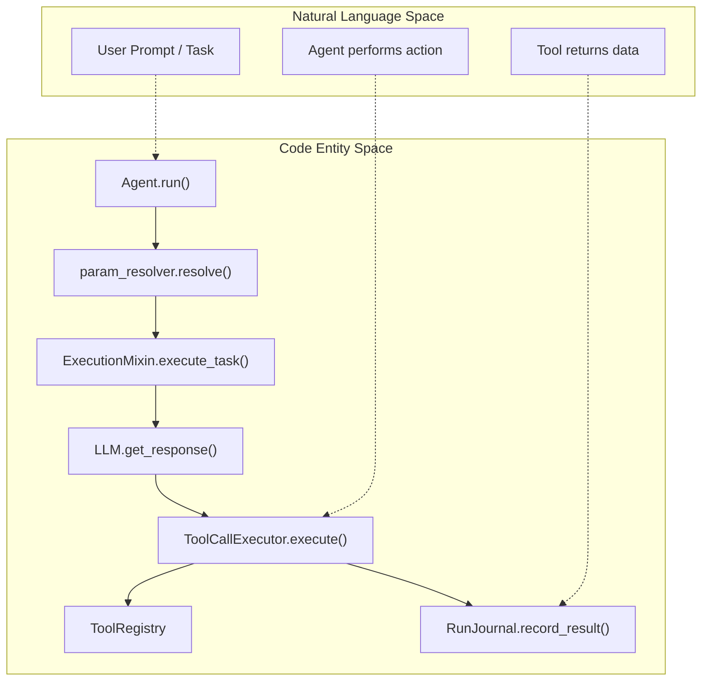
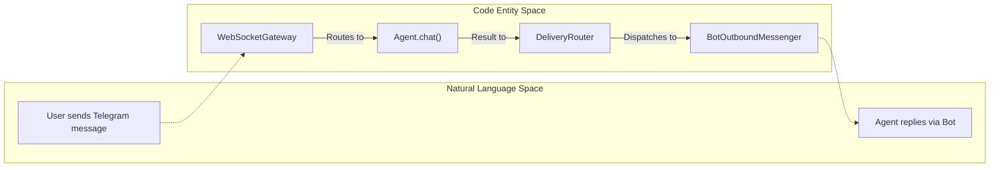

<!-- source: DeepWiki mcp.deepwiki.com · repo MervinPraison/PraisonAI · page 21 Glossary · fetched 2026-10-26 -->

# Glossary

Relevant source files

The following files were used as context for generating this wiki page:

- [README.md](README.md)
- [api.md](api.md)
- [docker/Dockerfile](docker/Dockerfile)
- [docker/Dockerfile.chat](docker/Dockerfile.chat)
- [docker/Dockerfile.dev](docker/Dockerfile.dev)
- [docker/Dockerfile.ui](docker/Dockerfile.ui)
- [docker/README.md](docker/README.md)
- [src/praisonai-agents/praisonaiagents/agent/agent.py](src/praisonai-agents/praisonaiagents/agent/agent.py)
- [src/praisonai-agents/praisonaiagents/agent/chat_mixin.py](src/praisonai-agents/praisonaiagents/agent/chat_mixin.py)
- [src/praisonai-agents/praisonaiagents/agent/durable.py](src/praisonai-agents/praisonaiagents/agent/durable.py)
- [src/praisonai-agents/praisonaiagents/agent/execution_mixin.py](src/praisonai-agents/praisonaiagents/agent/execution_mixin.py)
- [src/praisonai-agents/praisonaiagents/agent/interrupt.py](src/praisonai-agents/praisonaiagents/agent/interrupt.py)
- [src/praisonai-agents/praisonaiagents/agent/loop_detection.py](src/praisonai-agents/praisonaiagents/agent/loop_detection.py)
- [src/praisonai-agents/praisonaiagents/agent/tool_execution.py](src/praisonai-agents/praisonaiagents/agent/tool_execution.py)
- [src/praisonai-agents/praisonaiagents/agents/agents.py](src/praisonai-agents/praisonaiagents/agents/agents.py)
- [src/praisonai-agents/praisonaiagents/config/feature_configs.py](src/praisonai-agents/praisonaiagents/config/feature_configs.py)
- [src/praisonai-agents/praisonaiagents/escalation/doom_loop.py](src/praisonai-agents/praisonaiagents/escalation/doom_loop.py)
- [src/praisonai-agents/praisonaiagents/gateway/__init__.py](src/praisonai-agents/praisonaiagents/gateway/__init__.py)
- [src/praisonai-agents/praisonaiagents/gateway/config.py](src/praisonai-agents/praisonaiagents/gateway/config.py)
- [src/praisonai-agents/praisonaiagents/gateway/degraded_state.py](src/praisonai-agents/praisonaiagents/gateway/degraded_state.py)
- [src/praisonai-agents/praisonaiagents/gateway/protocols.py](src/praisonai-agents/praisonaiagents/gateway/protocols.py)
- [src/praisonai-agents/praisonaiagents/llm/llm.py](src/praisonai-agents/praisonaiagents/llm/llm.py)
- [src/praisonai-agents/praisonaiagents/llm/openai_client.py](src/praisonai-agents/praisonaiagents/llm/openai_client.py)
- [src/praisonai-agents/praisonaiagents/llm/sanitize.py](src/praisonai-agents/praisonaiagents/llm/sanitize.py)
- [src/praisonai-agents/praisonaiagents/plugins/loop_detection_plugin.py](src/praisonai-agents/praisonaiagents/plugins/loop_detection_plugin.py)
- [src/praisonai-agents/praisonaiagents/tools/call_executor.py](src/praisonai-agents/praisonaiagents/tools/call_executor.py)
- [src/praisonai-agents/praisonaiagents/tools/messaging_tools.py](src/praisonai-agents/praisonaiagents/tools/messaging_tools.py)
- [src/praisonai-agents/praisonaiagents/tools/path_overlap.py](src/praisonai-agents/praisonaiagents/tools/path_overlap.py)
- [src/praisonai-agents/pyproject.toml](src/praisonai-agents/pyproject.toml)
- [src/praisonai-agents/tests/integration/test_responses_api.py](src/praisonai-agents/tests/integration/test_responses_api.py)
- [src/praisonai-agents/tests/test_deferred_progress_tools.py](src/praisonai-agents/tests/test_deferred_progress_tools.py)
- [src/praisonai-agents/tests/test_native_deferred_parity.py](src/praisonai-agents/tests/test_native_deferred_parity.py)
- [src/praisonai-agents/tests/test_parallel_tools.py](src/praisonai-agents/tests/test_parallel_tools.py)
- [src/praisonai-agents/tests/test_tool_timeout.py](src/praisonai-agents/tests/test_tool_timeout.py)
- [src/praisonai-agents/tests/unit/agent/test_durable_run.py](src/praisonai-agents/tests/unit/agent/test_durable_run.py)
- [src/praisonai-agents/tests/unit/agent/test_loop_detector_wiring.py](src/praisonai-agents/tests/unit/agent/test_loop_detector_wiring.py)
- [src/praisonai-agents/tests/unit/llm/test_durable_tool_dispatch.py](src/praisonai-agents/tests/unit/llm/test_durable_tool_dispatch.py)
- [src/praisonai-agents/tests/unit/test_compaction_wiring.py](src/praisonai-agents/tests/unit/test_compaction_wiring.py)
- [src/praisonai-agents/tests/unit/test_doom_loop_no_progress_boundary.py](src/praisonai-agents/tests/unit/test_doom_loop_no_progress_boundary.py)
- [src/praisonai-agents/tests/unit/test_gateway.py](src/praisonai-agents/tests/unit/test_gateway.py)
- [src/praisonai-agents/tests/unit/test_gateway_code_skew.py](src/praisonai-agents/tests/unit/test_gateway_code_skew.py)
- [src/praisonai-agents/tests/unit/test_gateway_config.py](src/praisonai-agents/tests/unit/test_gateway_config.py)
- [src/praisonai-agents/tests/unit/test_gateway_degraded_state.py](src/praisonai-agents/tests/unit/test_gateway_degraded_state.py)
- [src/praisonai-agents/tests/unit/test_gateway_liveness_policy.py](src/praisonai-agents/tests/unit/test_gateway_liveness_policy.py)
- [src/praisonai-agents/tests/unit/test_gateway_routing.py](src/praisonai-agents/tests/unit/test_gateway_routing.py)
- [src/praisonai-agents/tests/unit/test_gateway_turn_lock.py](src/praisonai-agents/tests/unit/test_gateway_turn_lock.py)
- [src/praisonai-agents/tests/unit/test_loop_detection.py](src/praisonai-agents/tests/unit/test_loop_detection.py)
- [src/praisonai-agents/tests/unit/test_route_bindings.py](src/praisonai-agents/tests/unit/test_route_bindings.py)
- [src/praisonai-agents/tests/unit/tools/test_ask_conversation_tool.py](src/praisonai-agents/tests/unit/tools/test_ask_conversation_tool.py)
- [src/praisonai-agents/tests/unit/tools/test_send_message_tool.py](src/praisonai-agents/tests/unit/tools/test_send_message_tool.py)
- [src/praisonai-agents/uv.lock](src/praisonai-agents/uv.lock)
- [src/praisonai-bot/praisonai_bot/bots/_outbound_media.py](src/praisonai-bot/praisonai_bot/bots/_outbound_media.py)
- [src/praisonai-bot/praisonai_bot/bots/_outbound_messenger.py](src/praisonai-bot/praisonai_bot/bots/_outbound_messenger.py)
- [src/praisonai-bot/praisonai_bot/bots/delivery.py](src/praisonai-bot/praisonai_bot/bots/delivery.py)
- [src/praisonai-bot/praisonai_bot/gateway/redis_pubsub.py](src/praisonai-bot/praisonai_bot/gateway/redis_pubsub.py)
- [src/praisonai-bot/praisonai_bot/gateway/server.py](src/praisonai-bot/praisonai_bot/gateway/server.py)
- [src/praisonai-bot/tests/unit/bots/test_outbound_media.py](src/praisonai-bot/tests/unit/bots/test_outbound_media.py)
- [src/praisonai-bot/tests/unit/bots/test_outbound_messenger.py](src/praisonai-bot/tests/unit/bots/test_outbound_messenger.py)
- [src/praisonai-bot/tests/unit/gateway/test_redis_pubsub_reconnect.py](src/praisonai-bot/tests/unit/gateway/test_redis_pubsub_reconnect.py)
- [src/praisonai-bot/tests/unit/gateway/test_reload_observability.py](src/praisonai-bot/tests/unit/gateway/test_reload_observability.py)
- [src/praisonai-rust/FEATURE_PARITY_TRACKER.json](src/praisonai-rust/FEATURE_PARITY_TRACKER.json)
- [src/praisonai-rust/PARITY.md](src/praisonai-rust/PARITY.md)
- [src/praisonai-ts/FEATURE_PARITY_TRACKER.json](src/praisonai-ts/FEATURE_PARITY_TRACKER.json)
- [src/praisonai-ts/PARITY.md](src/praisonai-ts/PARITY.md)
- [src/praisonai-ts/src/tools/registry/index.ts](src/praisonai-ts/src/tools/registry/index.ts)
- [src/praisonai-ts/src/tools/registry/registry.ts](src/praisonai-ts/src/tools/registry/registry.ts)
- [src/praisonai-ts/src/tools/registry/types.ts](src/praisonai-ts/src/tools/registry/types.ts)
- [src/praisonai-ts/tests/tools/registry.test.ts](src/praisonai-ts/tests/tools/registry.test.ts)
- [src/praisonai/README.md](src/praisonai/README.md)
- [src/praisonai/praisonai.rb](src/praisonai/praisonai.rb)
- [src/praisonai/praisonai/_dev/parity/__init__.py](src/praisonai/praisonai/_dev/parity/__init__.py)
- [src/praisonai/praisonai/_dev/parity/generator.py](src/praisonai/praisonai/_dev/parity/generator.py)
- [src/praisonai/praisonai/_dev/parity/rust_extractor.py](src/praisonai/praisonai/_dev/parity/rust_extractor.py)
- [src/praisonai/praisonai/_dev/parity/typescript_extractor.py](src/praisonai/praisonai/_dev/parity/typescript_extractor.py)
- [src/praisonai/praisonai/cli/main.py](src/praisonai/praisonai/cli/main.py)
- [src/praisonai/praisonai/version.py](src/praisonai/praisonai/version.py)
- [src/praisonai/pyproject.toml](src/praisonai/pyproject.toml)
- [src/praisonai/uv.lock](src/praisonai/uv.lock)

This page provides technical definitions for codebase-specific terms, jargon, and domain concepts used within the PraisonAI ecosystem. It serves as a reference for onboarding engineers to understand implementation details, data flow, and the relationship between natural language concepts and code entities.

## Core Concepts

### Agent
The fundamental unit of execution. In PraisonAI, an `Agent` is a high-level entity that wraps an LLM and manages its own state, memory, tools, and execution loop.
*   **Implementation**: Defined in `Agent` class [src/praisonai-agents/praisonaiagents/agent/agent.py:141](). It uses a mixin-based architecture to decompose functionality like `ChatMixin`, `ExecutionMixin`, and `MemoryMixin` [src/praisonai-agents/praisonaiagents/agent/agent.py:16-31]().
*   **Data Flow**: The `Agent.run()` or `Agent.chat()` methods initiate the execution cycle, resolving configuration through `param_resolver` [src/praisonai-agents/praisonaiagents/agent/agent.py:123]() and interacting with the `LLM` class.

### Doom Loop
A safety mechanism that detects when an agent is stuck in an unproductive cycle, such as repeated identical actions, repeated failures, or a lack of progress.
*   **Implementation**: Managed by the `DoomLoopDetector` [src/praisonai-agents/praisonaiagents/escalation/doom_loop.py]().
*   **Logic**: It monitors for `REPEATED_ACTION`, `REPEATED_FAILURE`, and `NO_PROGRESS` states. If detected, it triggers an escalation or interrupt via the `InterruptController` [src/praisonai-agents/praisonaiagents/agent/interrupt.py]().

### Handoff
 the process of one agent delegating a task or transferring conversation control to another agent.
*   **Implementation**: Governed by `HandoffConfig` and `HandoffManager` [src/praisonai-agents/praisonaiagents/agent/handoff.py:16-18]().
*   **Mechanism**: Triggered via `Agent.handoff_to()` [src/praisonai-agents/praisonaiagents/agent/agent.py:55](). It returns a `HandoffResult` which the orchestrator uses to switch the active agent context.

## Architectural Components

### Nine-Package Tiered Model
PraisonAI is organized into nine distinct packages to maintain boundaries and manage dependencies.
*   **praisonaiagents**: The core agentic engine. [src/praisonai-agents/pyproject.toml:6]()
*   **praisonai-code**: Code-specific tools and logic. [src/praisonai/pyproject.toml:16]()
*   **praisonai-bot**: Messaging bot integrations (Telegram, Slack, etc.). [src/praisonai/pyproject.toml:17]()
*   **praisonai-train**: LLM fine-tuning and agent training. [src/praisonai/pyproject.toml:18]()
*   **praisonai-browser**: Browser automation and CDP/Playwright agents. [src/praisonai/pyproject.toml:19]()
*   **praisonai-mcp**: Model Context Protocol implementation. [src/praisonai/pyproject.toml:20]()
*   **praisonai-sandbox**: Secure execution environments (Docker, E2B). [src/praisonai/pyproject.toml:21]()
*   **praisonai-deploy**: Cloud deployment tools. [src/praisonai/pyproject.toml:22]()
*   **praisonai**: The top-level wrapper and CLI. [src/praisonai/pyproject.toml:2]()

### Bridge Modules
Internal modules that allow the core `praisonaiagents` to interact with other packages in the tiered architecture without creating circular dependencies.
*   **Implementation**: Located in `praisonaiagents` with names like `_bot_bridge`, `_code_bridge`, and `_mcp_bridge` [src/praisonai-agents/praisonaiagents/agent/agent.py:10-31]().

## Technical Terms & Jargon

| Term | Definition | Code Pointer |
| :--- | :--- | :--- |
| **A2UI** | Agent-to-User Interface; a declarative SDK for building agent UIs. | [src/praisonai-agents/pyproject.toml:110]() |
| **ACP** | Agent Client Protocol; a standardized protocol for agent communication. | [src/praisonai/pyproject.toml:157]() |
| **Durable Execution** | The ability to resume an agent's state after a crash or interruption using a journal. | `RunJournal` in [src/praisonai-agents/praisonaiagents/agent/durable.py]() |
| **LiteLLM** | The underlying library used for multi-provider LLM support. | [src/praisonai-agents/praisonaiagents/llm/llm.py:185]() |
| **MCP** | Model Context Protocol; allows agents to access external data/tools via a standard protocol. | `praisonai-mcp` package and `add_mcp_server` [src/praisonai-agents/praisonaiagents/agent/agent.py:32]() |
| **RunJournal** | A persistence mechanism that records agent actions and tool results for recovery. | [src/praisonai-agents/tests/unit/agent/test_durable_run.py]() |
| **ToolRegistry** | A central registry where tools are discovered and stored for agent access. | `ToolRegistry` in `praisonaiagents.tools` |

## Mapping: Natural Language to Code Entities

### Agent Lifecycle and Execution
The following diagram bridges the conceptual "Agent Run" to the specific code entities that handle the data flow.

**Agent Execution Flow Diagram**

**Sources:** [src/praisonai-agents/praisonaiagents/agent/agent.py:123](), [src/praisonai-agents/praisonaiagents/llm/llm.py:175](), [src/praisonai-agents/praisonaiagents/tools/call_executor.py:27]()

### Communication and Gateway
The following diagram maps the messaging bot interaction to the gateway and delivery components.

**Messaging Gateway Mapping**

**Sources:** [src/praisonai-bot/praisonai_bot/gateway/server.py](), [src/praisonai-bot/praisonai_bot/bots/delivery.py](), [src/praisonai-bot/praisonai_bot/bots/_outbound_messenger.py]()

## Domain Concepts

### Context Management
The process of managing the token budget and relevance of information passed to the LLM.
*   **Compaction**: The `Compactor` and `MemoryFlush` mechanisms reduce context size when limits are approached [src/praisonai-agents/praisonaiagents/agent/agent.py:43-44]().
*   **ContextPack**: A structured container for RAG results, memory, and task context passed to the agent [src/praisonai-agents/praisonaiagents/agent/agent.py:39]().

### Memory Tiers
*   **Short-term**: Immediate conversation history stored in `chat_history` [src/praisonai-agents/praisonaiagents/agent/agent.py:37]().
*   **Long-term**: Persistent storage of past interactions, often using vector databases like `ChromaDB` [src/praisonai-agents/pyproject.toml:32]().
*   **Dakera**: A specialized decay-weighted memory server for temporal relevance [src/praisonai-agents/pyproject.toml:80]().

### RAG (Retrieval-Augmented Generation)
The system for ingesting documents and retrieving relevant snippets to ground LLM responses.
*   **Implementation**: Managed via the `Knowledge` and `RAG` classes [src/praisonai-agents/praisonaiagents/agent/agent.py:68-69]().
*   **Components**: Includes chunking (Recursive, Semantic), vector stores, and rerankers [src/praisonai-agents/pyproject.toml:36-41]().

**Sources:**
* `src/praisonai-agents/praisonaiagents/agent/agent.py`
* `src/praisonai-agents/pyproject.toml`
* `src/praisonai/pyproject.toml`
* `src/praisonai-agents/praisonaiagents/llm/llm.py`
* `src/praisonai-agents/praisonaiagents/agent/handoff.py`
* `src/praisonai-agents/praisonaiagents/escalation/doom_loop.py`