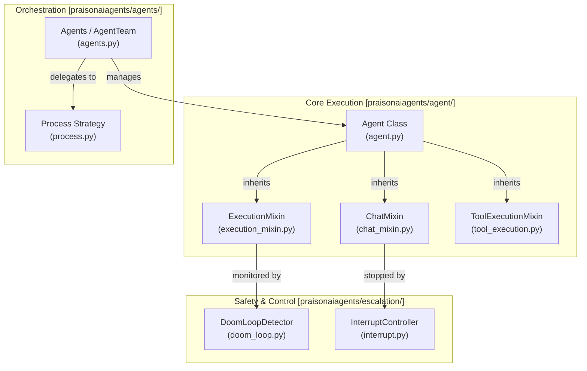
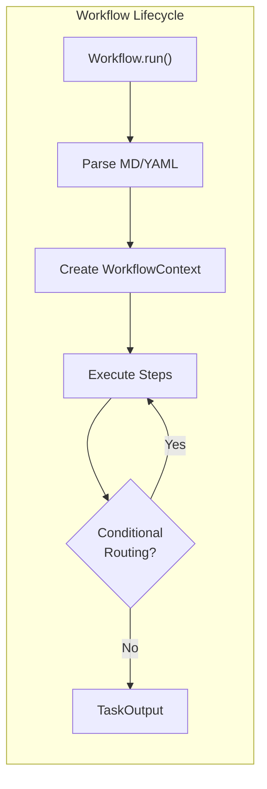

<!-- source: DeepWiki mcp.deepwiki.com · repo MervinPraison/PraisonAI · page 3 Execution and Control · fetched 2026-10-26 -->

# Execution and Control

Relevant source files

The following files were used as context for generating this wiki page:

- [src/praisonai-agents/praisonaiagents/agent/agent.py](src/praisonai-agents/praisonaiagents/agent/agent.py)
- [src/praisonai-agents/praisonaiagents/agent/chat_mixin.py](src/praisonai-agents/praisonaiagents/agent/chat_mixin.py)
- [src/praisonai-agents/praisonaiagents/agent/durable.py](src/praisonai-agents/praisonaiagents/agent/durable.py)
- [src/praisonai-agents/praisonaiagents/agent/execution_mixin.py](src/praisonai-agents/praisonaiagents/agent/execution_mixin.py)
- [src/praisonai-agents/praisonaiagents/agent/interrupt.py](src/praisonai-agents/praisonaiagents/agent/interrupt.py)
- [src/praisonai-agents/praisonaiagents/agent/loop_detection.py](src/praisonai-agents/praisonaiagents/agent/loop_detection.py)
- [src/praisonai-agents/praisonaiagents/agent/tool_execution.py](src/praisonai-agents/praisonaiagents/agent/tool_execution.py)
- [src/praisonai-agents/praisonaiagents/agents/agents.py](src/praisonai-agents/praisonaiagents/agents/agents.py)
- [src/praisonai-agents/praisonaiagents/config/feature_configs.py](src/praisonai-agents/praisonaiagents/config/feature_configs.py)
- [src/praisonai-agents/praisonaiagents/escalation/doom_loop.py](src/praisonai-agents/praisonaiagents/escalation/doom_loop.py)
- [src/praisonai-agents/praisonaiagents/llm/llm.py](src/praisonai-agents/praisonaiagents/llm/llm.py)
- [src/praisonai-agents/praisonaiagents/llm/openai_client.py](src/praisonai-agents/praisonaiagents/llm/openai_client.py)
- [src/praisonai-agents/praisonaiagents/llm/sanitize.py](src/praisonai-agents/praisonaiagents/llm/sanitize.py)
- [src/praisonai-agents/praisonaiagents/plugins/loop_detection_plugin.py](src/praisonai-agents/praisonaiagents/plugins/loop_detection_plugin.py)
- [src/praisonai-agents/praisonaiagents/tools/call_executor.py](src/praisonai-agents/praisonaiagents/tools/call_executor.py)
- [src/praisonai-agents/praisonaiagents/tools/path_overlap.py](src/praisonai-agents/praisonaiagents/tools/path_overlap.py)
- [src/praisonai-agents/praisonaiagents/workflows/workflows.py](src/praisonai-agents/praisonaiagents/workflows/workflows.py)
- [src/praisonai-agents/tests/integration/test_responses_api.py](src/praisonai-agents/tests/integration/test_responses_api.py)
- [src/praisonai-agents/tests/test_deferred_progress_tools.py](src/praisonai-agents/tests/test_deferred_progress_tools.py)
- [src/praisonai-agents/tests/test_native_deferred_parity.py](src/praisonai-agents/tests/test_native_deferred_parity.py)
- [src/praisonai-agents/tests/test_parallel_tools.py](src/praisonai-agents/tests/test_parallel_tools.py)
- [src/praisonai-agents/tests/test_tool_timeout.py](src/praisonai-agents/tests/test_tool_timeout.py)
- [src/praisonai-agents/tests/unit/agent/test_durable_run.py](src/praisonai-agents/tests/unit/agent/test_durable_run.py)
- [src/praisonai-agents/tests/unit/agent/test_loop_detector_wiring.py](src/praisonai-agents/tests/unit/agent/test_loop_detector_wiring.py)
- [src/praisonai-agents/tests/unit/llm/test_durable_tool_dispatch.py](src/praisonai-agents/tests/unit/llm/test_durable_tool_dispatch.py)
- [src/praisonai-agents/tests/unit/test_compaction_wiring.py](src/praisonai-agents/tests/unit/test_compaction_wiring.py)
- [src/praisonai-agents/tests/unit/test_doom_loop_no_progress_boundary.py](src/praisonai-agents/tests/unit/test_doom_loop_no_progress_boundary.py)
- [src/praisonai-agents/tests/unit/test_loop_detection.py](src/praisonai-agents/tests/unit/test_loop_detection.py)

## Purpose and Scope

This document provides an overview of how PraisonAI executes and controls agent tasks through workflows, process strategies, planning modes, and safety mechanisms. It covers the core execution engine, task status management, flow control, and loop detection.

For detailed information on specific subsystems:
- **Workflow System** ([Workflow System](#3.1)) — AgentFlow, control structures (route, parallel, loop), and `WorkflowContext`.
- **Process Strategies** ([Process Strategies](#3.2)) — Sequential, parallel, hierarchical, and workflow process types.
- **Planning System** ([Planning System](#3.3)) — `PlanningAgent`, TodoList execution, and Project Reconstruction Plans (PRP).
- **Reflection System** ([Reflection System](#3.4)) — Self-reflection capabilities and evaluator-optimizer patterns.
- **Loop Detection and Safety Escalation** ([Loop Detection and Safety Escalation](#3.5)) — `DoomLoopDetector`, `LoopDetectionPlugin`, and `InterruptController`.

## Execution Architecture

PraisonAI's execution system centers on the `Agents` class and the `Agent` mixin architecture, which orchestrates task execution using configurable process strategies. The architecture separates task definition, agent assignment, and execution flow.

### Code-to-Logic Mapping

The following diagram maps high-level execution concepts to the specific code entities that implement them.

Sources: [src/praisonai-agents/praisonaiagents/agent/agent.py:15-32](), [src/praisonai-agents/praisonaiagents/agents/agents.py:9-11](), [src/praisonai-agents/praisonaiagents/agent/execution_mixin.py:73-74]()

## Durable Execution and RunJournal

PraisonAI supports **Durable Execution**, allowing agent runs to be interrupted and resumed without losing state. This is managed by the `RunJournal` and `DurableRunContext`.

| Component | File | Purpose |
|-----------|------|---------|
| `RunJournal` | [praisonaiagents/runtime/journal.py]() | Persistence layer for execution events (Tool calls, Decisions) |
| `DurableRunContext` | [praisonaiagents/agent/durable.py]() | Wraps tool execution to ensure idempotency and replay |
| `ExecutionConfig` | [praisonaiagents/config/feature_configs.py]() | Configures `durable=True` and `journal_path` |

**Durable Flow:**
1. **Event Recording**: Every tool call and LLM decision is recorded as a `JournalEvent` [tests/unit/agent/test_durable_run.py:73-78]().
2. **Idempotency**: Tools are called with an `idempotency_key` derived from the run ID and iteration index to prevent duplicate side effects [tests/unit/agent/test_durable_run.py:62-72]().
3. **Resume**: On restart, the `DurableRunContext` replays events from the journal to restore the agent's state before continuing [tests/unit/agent/test_durable_run.py:184-190]().

Sources: [src/praisonai-agents/tests/unit/agent/test_durable_run.py:29-42](), [src/praisonai-agents/praisonaiagents/agent/chat_mixin.py:81-87](), [src/praisonai-agents/praisonaiagents/agent/tool_execution.py:98-106]()

## Workflow and Step Control

The `Workflow` system (AgentFlow) allows for complex, multi-step task sequences defined in YAML or Markdown.

**Key Control Features:**
- **Variable Substitution**: Uses `{{previous_output}}` and `{{input}}` to pass data between steps [src/praisonai-agents/praisonaiagents/workflows/workflows.py:118-139]().
- **JSON Parsing**: Automatically extracts structured data from LLM outputs, handling markdown code blocks and schema echoes [src/praisonai-agents/praisonaiagents/workflows/workflows.py:62-116]().
- **Parallelism**: Supports concurrent execution of branches to improve throughput.

For details, see [Workflow System](#3.1).

Sources: [src/praisonai-agents/praisonaiagents/workflows/workflows.py:21-40](), [src/praisonai-agents/praisonaiagents/workflows/workflows.py:186-193]()

## Tool Execution and Parallelism

The `ToolExecutionMixin` manages how agents interact with external functions. It supports both sequential and parallel tool calling.

- **Parallel Tool Calls**: Enabled via `parallel_tool_calls=True`. The `ToolCallExecutor` uses a thread pool to execute multiple tools simultaneously when requested by the LLM [src/praisonai-agents/praisonaiagents/tools/call_executor.py:4-12]().
- **Deferred Results**: Tools can return a `DeferredToolResult` to signal long-running background work. The agent records the handle and continues, resolving the result in a later turn [src/praisonai-agents/praisonaiagents/tools/call_executor.py:104-117]().
- **Timeouts and Retries**: Tools support `timeout_ms` and exponential backoff via `BackoffPolicy` [src/praisonai-agents/praisonaiagents/agent/tool_execution.py:36-57]().

Sources: [src/praisonai-agents/praisonaiagents/agent/tool_execution.py:1-21](), [src/praisonai-agents/praisonaiagents/tools/call_executor.py:129-145]()

## Safety: Loop Detection and Escalation

To prevent runaway execution and "doom loops," PraisonAI employs a two-tier detection system.

1. **DoomLoopDetector**: Monitors high-level patterns such as `REPEATED_ACTION` (calling the same tool with same args), `REPEATED_FAILURE`, and `NO_PROGRESS` [src/praisonai-agents/praisonaiagents/escalation/doom_loop.py]().
2. **LoopDetectionPlugin**: A low-level plugin that uses content hashing to detect "ping-pong" oscillations in conversation history [src/praisonai-agents/praisonaiagents/plugins/loop_detection_plugin.py]().
3. **InterruptController**: Provides a mechanism for cooperative cancellation, allowing a parent process to signal an agent to stop gracefully [src/praisonai-agents/praisonaiagents/agent/interrupt.py]().

For details, see [Loop Detection and Safety Escalation](#3.5).

Sources: [src/praisonai-agents/praisonaiagents/agent/agent.py:31](), [src/praisonai-agents/praisonaiagents/agent/chat_mixin.py:30-72]()

## Planning and Reflection

Execution can be enhanced by enabling planning or reflection phases.

- **Planning**: The `PlanningAgent` generates a `TodoList` before the main agent starts. This plan is stored and updated as steps are completed [src/praisonai-agents/praisonaiagents/config/feature_configs.py:255-274]().
- **Reflection**: Uses a `run_until` evaluation loop where an evaluator agent reviews the primary agent's output against a `ReflectionConfig`. If criteria aren't met, the agent is prompted to self-correct [src/praisonai-agents/praisonaiagents/config/feature_configs.py:287-308]().

For details, see [Planning System](#3.3) and [Reflection System](#3.4).

Sources: [src/praisonai-agents/praisonaiagents/config/feature_configs.py:7-8](), [src/praisonai-agents/praisonaiagents/config/feature_configs.py:255-308]()

---

