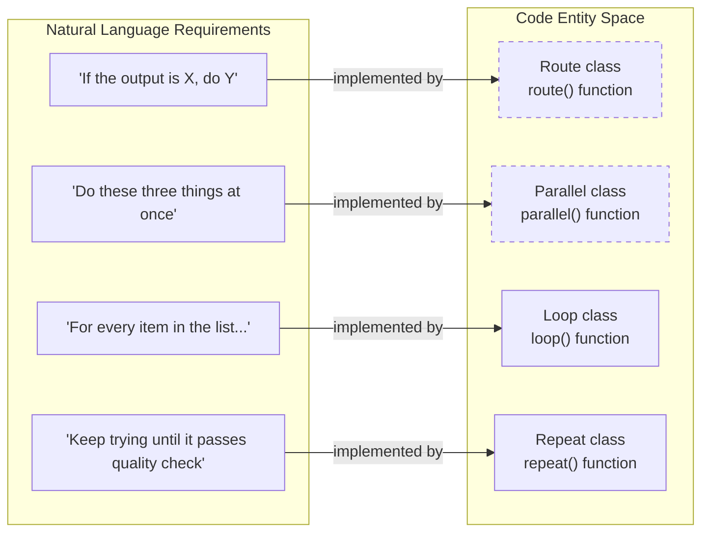
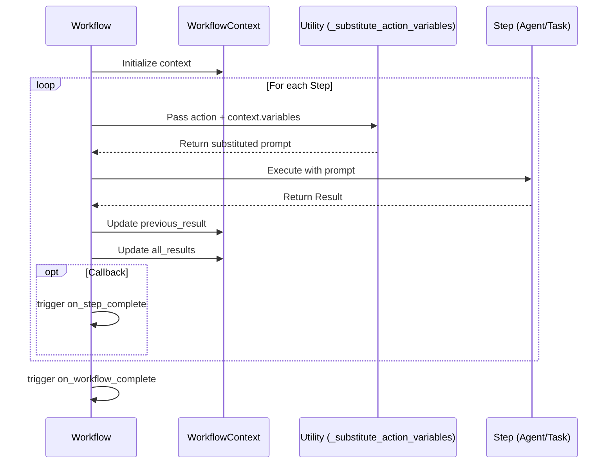

<!-- source: DeepWiki mcp.deepwiki.com · repo MervinPraison/PraisonAI · page 3.1 Workflow System · fetched 2026-10-26 -->

# Workflow System

<details>
<summary>Relevant source files</summary>

The following files were used as context for generating this wiki page:

- [api.md](api.md)
- [src/praisonai-agents/praisonaiagents/workflows/workflows.py](src/praisonai-agents/praisonaiagents/workflows/workflows.py)

</details>


## Purpose and Scope

The Workflow System provides deterministic, multi-step execution pipelines with advanced control flow patterns for orchestrating agents and tasks. It enables sequential, conditional, parallel, and iterative execution patterns through both programmatic (Python) and declarative (YAML/Markdown) interfaces.

This document covers the `Workflow` class, control flow constructs (`route()`, `parallel()`, `loop()`, `repeat()`), workflow context management, and the system for auto-discovery and parsing of workflow definitions.

---

## Core Architecture

The workflow system is built around the `Workflow` class which orchestrates execution of steps. Each step can be an `Agent`, `Task`, custom function, or a control flow object.

### Workflow Class Structure

```mermaid
graph TB
    Workflow["Workflow<br/>(praisonaiagents.workflows.workflows.Workflow)"]
    WorkflowContext["WorkflowContext<br/>(praisonaiagents.workflows.workflows.WorkflowContext)"]
    StepResult["StepResult<br/>(praisonaiagents.workflows.workflows.StepResult)"]
    
    Workflow -->|"manages"| WorkflowContext
    Workflow -->|"produces"| StepResult
    
    subgraph "Step Types"
        Agent["Agent<br/>(praisonaiagents.agent.agent.Agent)"]
        Task["Task<br/>(praisonaiagents.task.task.Task)"]
        Route["Route<br/>(praisonaiagents.workflows.workflows.Route)"]
        Parallel["Parallel<br/>(praisonaiagents.workflows.workflows.Parallel)"]
        Loop["Loop<br/>(praisonaiagents.workflows.workflows.Loop)"]
        Repeat["Repeat<br/>(praisonaiagents.workflows.workflows.Repeat)"]
    end
    
    Workflow -->|"executes"| Agent
    Workflow -->|"executes"| Task
    Workflow -->|"executes"| Route
    Workflow -->|"executes"| Parallel
    Workflow -->|"executes"| Loop
    Workflow -->|"executes"| Repeat
    
    subgraph "State Tracking"
        Status["status: not_started|running|completed"]
        StepStatuses["step_statuses: Dict[str, str]"]
    end
    
    Workflow -->|"tracks"| Status
    Workflow -->|"tracks"| StepStatuses
```



**Sources:** [src/praisonai-agents/praisonaiagents/workflows/workflows.py:54-185](), [api.md:10-27]()

### Workflow Initialization Parameters

The `Workflow` class accepts several configuration objects and parameters to control execution behavior.

| Parameter | Type | Description |
|-----------|------|-------------|
| `steps` | `List[Any]` | Ordered list of steps to execute. [src/praisonai-agents/praisonaiagents/workflows/workflows.py:207]() |
| `variables` | `Dict[str, Any]` | Initial workflow variables for template substitution. [src/praisonai-agents/praisonaiagents/workflows/workflows.py:208]() |
| `planning` | `bool` | Enable planning mode for each step. [src/praisonai-agents/praisonaiagents/workflows/workflows.py:209]() |
| `reasoning` | `bool` | Enable chain-of-thought reasoning. [src/praisonai-agents/praisonaiagents/workflows/workflows.py:210]() |
| `on_step_complete` | `Callable` | Callback after each step execution. [src/praisonai-agents/praisonaiagents/workflows/workflows.py:212]() |

**Sources:** [src/praisonai-agents/praisonaiagents/workflows/workflows.py:206-226]()

---

## Control Flow Patterns

The workflow system provides four primary control flow patterns implemented as specialized classes in `praisonaiagents.workflows.workflows`.

### Natural Language to Code Mapping

This diagram maps common natural language workflow requirements to specific code entities and functions within the `praisonaiagents` package.



**Sources:** [src/praisonai-agents/praisonaiagents/workflows/workflows.py:1001-1150]()

### Pattern Execution Logic

1.  **`route(routes: Dict[str, List])`**:
    *   Uses a classifier (string match or LLM) to evaluate the `previous_result`.
    *   Matches the result against keys in the `routes` dictionary.
    *   Executes the branch associated with the matching key.
    *   **Source:** [src/praisonai-agents/praisonaiagents/workflows/workflows.py:1001-1035]()

2.  **`parallel(steps: List)`**:
    *   Executes multiple steps concurrently using `asyncio.gather`.
    *   Limits concurrency via `DEFAULT_MAX_PARALLEL_WORKERS` (default 3) to prevent rate limiting.
    *   **Source:** [src/praisonai-agents/praisonaiagents/workflows/workflows.py:43](), [src/praisonai-agents/praisonaiagents/workflows/workflows.py:1038-1065]()

3.  **`loop(step, over: str, parallel: bool = False)`**:
    *   Iterates over a collection stored in `WorkflowContext.variables`.
    *   Can iterate over CSV files (`from_csv`) or text files (`from_file`).
    *   **Source:** [src/praisonai-agents/praisonaiagents/workflows/workflows.py:1068-1115]()

4.  **`repeat(step, until: Callable, max_iterations: int = 10)`**:
    *   Implements the evaluator-optimizer pattern.
    *   Executes a step repeatedly until the `until` predicate returns `True` or `max_iterations` is reached.
    *   **Source:** [src/praisonai-agents/praisonaiagents/workflows/workflows.py:1118-1149]()

---

## WorkflowContext and Data Flow

The `WorkflowContext` object is the central state container passed between steps.

### WorkflowContext Structure

| Attribute | Type | Purpose |
|-----------|------|---------|
| `input` | `str` | The original input string provided to `workflow.start()`. |
| `previous_result` | `Optional[str]` | The string output of the immediate predecessor step. |
| `current_step` | `str` | The name/ID of the step currently being executed. |
| `variables` | `Dict[str, Any]` | A shared dictionary for persisting data across the entire workflow. |
| `all_results` | `List[StepResult]` | A history of all execution outcomes in the workflow. |

**Sources:** [src/praisonai-agents/praisonaiagents/workflows/workflows.py:186-203]()

### Variable Substitution
The system performs template substitution in prompts and actions using the `_substitute_action_variables` utility. It replaces `{{variable_name}}`, `{{input}}`, and `{{previous_output}}`. If `{{previous_output}}` is not explicitly placed, it is automatically appended as context.

**Sources:** [src/praisonai-agents/praisonaiagents/workflows/workflows.py:118-139]()

---

## YAML and Markdown Workflows

PraisonAI supports defining workflows in YAML or Markdown files, typically stored in `.praisonai/workflows/`.

### Storage and Discovery
The `Workflow` system can auto-discover definitions from the filesystem.
*   **Path:** `.praisonai/workflows/`
*   **Supported Formats:** `.yaml`, `.yml`, `.md`
*   **Source:** [src/praisonai-agents/praisonaiagents/workflows/workflows.py:8-20]()

### Parsing Logic
The system uses `_parse_json_output` to extract structured data from LLM responses, handling:
1.  Direct JSON strings.
2.  Markdown code blocks (`` ```json ... ``` ``).
3.  Schema echoes (where the LLM returns the data wrapped in a schema definition).

**Sources:** [src/praisonai-agents/praisonaiagents/workflows/workflows.py:62-116](), [src/praisonai-agents/praisonaiagents/workflows/workflows.py:141-183]()

---

## Execution Lifecycle

### Step Execution Sequence



**Sources:** [src/praisonai-agents/praisonaiagents/workflows/workflows.py:250-400]()

### Thread Safety
The `Workflow` class implements a `_run_lock` (initialized via `_RUN_LOCK_INIT_GUARD`) to prevent concurrent execution of `run()` or `astart()` on the same instance, ensuring state consistency in the `WorkflowContext`.

**Sources:** [src/praisonai-agents/praisonaiagents/workflows/workflows.py:50-53](), [src/praisonai-agents/praisonaiagents/workflows/workflows.py:228]()

---

