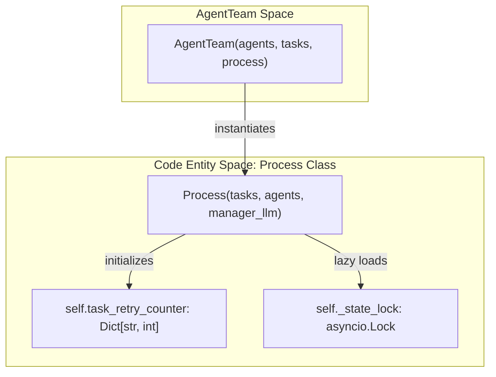
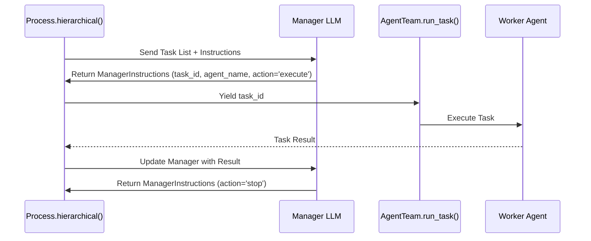

<!-- source: DeepWiki mcp.deepwiki.com · repo MervinPraison/PraisonAI · page 3.2 Process Strategies · fetched 2026-10-26 -->

# Process Strategies

<details>
<summary>Relevant source files</summary>

The following files were used as context for generating this wiki page:

- [examples/guardrail_example_fixed.py](examples/guardrail_example_fixed.py)
- [examples/python/frameworks/custom_adapter/pyproject.toml](examples/python/frameworks/custom_adapter/pyproject.toml)
- [src/praisonai-agents/praisonaiagents/bus/bus.py](src/praisonai-agents/praisonaiagents/bus/bus.py)
- [src/praisonai-agents/praisonaiagents/memory/core.py](src/praisonai-agents/praisonaiagents/memory/core.py)
- [src/praisonai-agents/praisonaiagents/memory/memory.py](src/praisonai-agents/praisonaiagents/memory/memory.py)
- [src/praisonai-agents/praisonaiagents/process/manager_schema.py](src/praisonai-agents/praisonaiagents/process/manager_schema.py)
- [src/praisonai-agents/praisonaiagents/process/process.py](src/praisonai-agents/praisonaiagents/process/process.py)
- [src/praisonai-agents/praisonaiagents/task/task.py](src/praisonai-agents/praisonaiagents/task/task.py)
- [src/praisonai-agents/praisonaiagents/utils/async_bridge.py](src/praisonai-agents/praisonaiagents/utils/async_bridge.py)
- [src/praisonai-agents/test_guardrail_return_types.py](src/praisonai-agents/test_guardrail_return_types.py)
- [src/praisonai-agents/tests/test_memory_convenience_api.py](src/praisonai-agents/tests/test_memory_convenience_api.py)
- [src/praisonai-agents/tests/unit/bus/test_event_bus.py](src/praisonai-agents/tests/unit/bus/test_event_bus.py)
- [src/praisonai-agents/tests/unit/config/test_small_model_routing.py](src/praisonai-agents/tests/unit/config/test_small_model_routing.py)
- [src/praisonai-agents/tests/unit/process/test_hierarchical_selection.py](src/praisonai-agents/tests/unit/process/test_hierarchical_selection.py)
- [src/praisonai-agents/tests/unit/process/test_manager_schema.py](src/praisonai-agents/tests/unit/process/test_manager_schema.py)
- [src/praisonai/examples/python/frameworks/pydantic_ai/agents.yaml](src/praisonai/examples/python/frameworks/pydantic_ai/agents.yaml)
- [src/praisonai/praisonai/_framework_availability.py](src/praisonai/praisonai/_framework_availability.py)
- [src/praisonai/praisonai/framework_adapters/registry.py](src/praisonai/praisonai/framework_adapters/registry.py)
- [src/praisonai/praisonai/framework_adapters/workflow_framework.py](src/praisonai/praisonai/framework_adapters/workflow_framework.py)
- [src/praisonai/tests/e2e/README.md](src/praisonai/tests/e2e/README.md)
- [src/praisonai/tests/e2e/agno_e2e/test_agno_real.py](src/praisonai/tests/e2e/agno_e2e/test_agno_real.py)
- [src/praisonai/tests/e2e/google_adk_e2e/test_google_adk_real.py](src/praisonai/tests/e2e/google_adk_e2e/test_google_adk_real.py)
- [src/praisonai/tests/e2e/pydantic_ai_e2e/test_pydantic_ai_real.py](src/praisonai/tests/e2e/pydantic_ai_e2e/test_pydantic_ai_real.py)
- [src/praisonai/tests/unit/test_agno_frameworks_integration.py](src/praisonai/tests/unit/test_agno_frameworks_integration.py)
- [src/praisonai/tests/unit/test_framework_entry_point_discovery.py](src/praisonai/tests/unit/test_framework_entry_point_discovery.py)
- [src/praisonai/tests/unit/test_framework_registry_helpers.py](src/praisonai/tests/unit/test_framework_registry_helpers.py)
- [src/praisonai/tests/unit/test_google_adk_frameworks_integration.py](src/praisonai/tests/unit/test_google_adk_frameworks_integration.py)
- [src/praisonai/tests/unit/test_pydantic_ai_frameworks_integration.py](src/praisonai/tests/unit/test_pydantic_ai_frameworks_integration.py)
- [src/praisonai/tests/unit/test_workflow_framework_validation.py](src/praisonai/tests/unit/test_workflow_framework_validation.py)

</details>


## Purpose and Scope

This document describes the execution strategies available in PraisonAI for coordinating multi-agent task execution: **sequential**, **parallel**, **hierarchical**, and **workflow**. Each strategy determines how tasks are distributed across agents, when they execute, and how results flow between them.

For technical details on the workflow patterns (routing, loops, conditionals) within the workflow process type, see [Workflow System](3.1). For planning-based execution, see [Planning System](3.3).

---

## Process Type Overview

PraisonAI's `AgentTeam` and `Process` classes support four core process strategies. The `Process` class acts as the orchestrator, managing the lifecycle and iteration of tasks.

| Process Type | Execution Model | Implementation Class/Method | Use Case |
|--------------|----------------|-----------------------------|----------|
| `"sequential"` | Linear, one after another | `Process.sequential()` | Linear pipelines, dependent steps |
| `"parallel"` | Concurrent execution | `Process.parallel()` | Independent tasks, speed optimization |
| `"hierarchical"` | Manager-worker delegation | `Process.hierarchical()` | Dynamic task creation, complex coordination |
| `"workflow"` | Advanced control flow | `Process.workflow()` | Routing, loops, repeat-until loops |

**Sources:** [src/praisonai-agents/praisonaiagents/process/process.py:20-35](), [src/praisonai-agents/praisonaiagents/agents/agents.py:200-429]()

---

## The Process Class

The `Process` class in `praisonaiagents/process/process.py` is the central engine for task coordination. It maintains the state of task retries, iteration counts, and provides generators that `AgentTeam` consumes to execute tasks.

### Data Flow and Initialization



The `Process` constructor initializes retry counters and state locks used for thread-safe execution during complex workflows.

**Sources:** [src/praisonai-agents/praisonaiagents/process/process.py:25-75]()

---

## Sequential Process

Sequential execution runs tasks in the order they are defined. In `AgentTeam`, if the process is sequential, the framework automatically sets the `next_tasks` for each task to point to the following task in the list, creating a linked chain.

### Context Propagation
Results from previous tasks are automatically added to the next task's context. The system uses `process_task_context` to extract `task.result.raw` from completed tasks.

**Sources:** [src/praisonai-agents/praisonaiagents/agents/agents.py:476-482](), [src/praisonai-agents/praisonaiagents/agents/agents.py:983-1001]()

---

## Parallel Process

Parallel execution allows multiple agents to work simultaneously. The `Process.parallel()` generator yields all task IDs immediately.

### Async Execution Implementation
In `AgentTeam.arun_all_tasks()`, parallel tasks are handled using `asyncio.gather()`.

**Key Logic:**
1. Tasks marked for async execution are collected in a list.
2. If a synchronous task is encountered, the system "flushes" the pending async tasks using `await asyncio.gather(*tasks_to_run)`.
3. Synchronous tasks are executed using `loop.run_in_executor`.

**Sources:** [src/praisonai-agents/praisonaiagents/agents/agents.py:839-863]()

---

## Hierarchical Process

Hierarchical execution uses a "Manager" agent to delegate tasks. The manager uses a specific JSON schema to communicate instructions back to the process engine.

### Manager Schema (`ManagerInstructions`)
The system uses a strict Pydantic model `ManagerInstructions` to ensure the LLM provides valid delegation commands. This model uses `extra="forbid"` to comply with OpenAI's strict structured output requirements.

**Sources:** [src/praisonai-agents/praisonaiagents/process/manager_schema.py:6-24]()

### Hierarchical Delegation Flow



**Sources:** [src/praisonai-agents/praisonaiagents/process/process.py:250-350](), [src/praisonai-agents/praisonaiagents/process/manager_schema.py:6-24]()

---

## Workflow Process

The workflow process enables advanced logic such as conditional routing and loops. It leverages the `AgentFlow` patterns.

### Validation and Feedback
The `Process` class includes logic to handle validation failures. If a task result is rejected (e.g., status is `invalid_output` or `retry`), the process engine can feed this back to the agent for another attempt.

**Key Function:** `_process_validation_outcome` converts raw LLM decision strings (like "retry" or "failed") into typed `AgentRunOutcome` objects.

**Sources:** [src/praisonai-agents/praisonaiagents/process/process.py:82-162](), [src/praisonai-agents/praisonaiagents/run_outcome.py:11-20]()

---

## Framework Adapters and Process Support

PraisonAI supports external frameworks (CrewAI, AutoGen) through the `FrameworkAdapterRegistry`. However, not all frameworks support all process types (specifically Workflows).

### Capability Gating
The system checks the `SUPPORTS_WORKFLOW` capability flag on an adapter before allowing a workflow process to start.

```python
# Validation logic in workflow_framework.py
if adapter_capability(framework, "SUPPORTS_WORKFLOW", registry=registry) is True:
    return
```

**Sources:** [src/praisonai/praisonai/framework_adapters/workflow_framework.py:11-37](), [src/praisonai/praisonai/framework_adapters/registry.py:32-74]()

---

## Summary of Execution Methods

| Method | File Path | Role |
|--------|-----------|------|
| `AgentTeam.run_all_tasks()` | `praisonaiagents/agents/agents.py` | Primary entry point for synchronous execution. |
| `AgentTeam.arun_all_tasks()` | `praisonaiagents/agents/agents.py` | Primary entry point for asynchronous execution. |
| `Process.sequential()` | `praisonaiagents/process/process.py` | Generator for linear task IDs. |
| `Process.hierarchical()` | `praisonaiagents/process/process.py` | Orchestrates manager LLM calls and worker task yields. |
| `validate_decision_string()` | `praisonaiagents/run_outcome.py` | Maps strings like "reject" to `RunStatus.INVALID_OUTPUT`. |

**Sources:** [src/praisonai-agents/praisonaiagents/process/process.py:164-350](), [src/praisonai-agents/praisonaiagents/agents/agents.py:811-876](), [src/praisonai-agents/praisonaiagents/run_outcome.py:11-40]()

---

