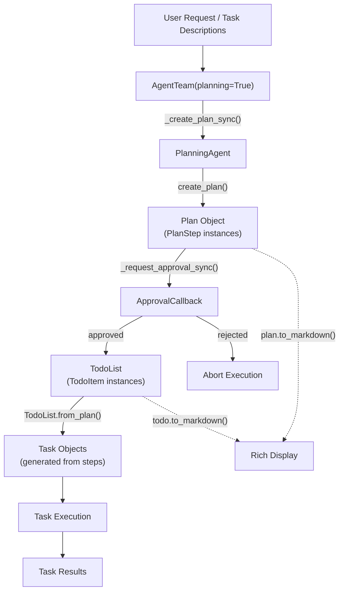
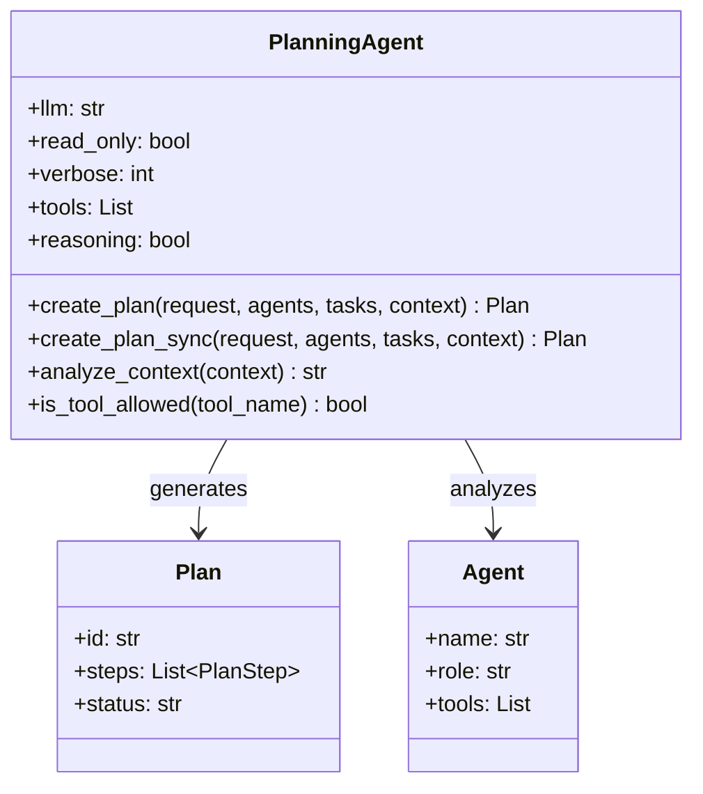
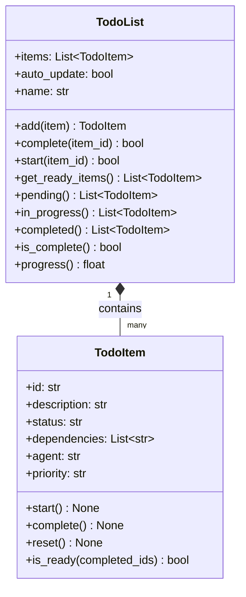
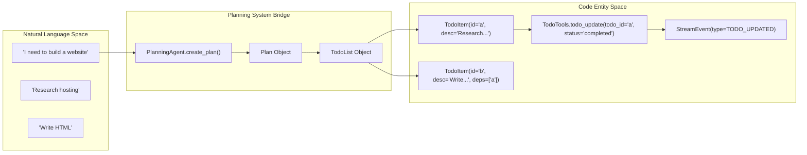

<!-- source: DeepWiki mcp.deepwiki.com · repo MervinPraison/PraisonAI · page 3.3 Planning System · fetched 2026-10-26 -->

# Planning System

Relevant source files

The following files were used as context for generating this wiki page:

- [api.md](api.md)
- [src/praisonai-agents/praisonaiagents/planning/todo.py](src/praisonai-agents/praisonaiagents/planning/todo.py)
- [src/praisonai-agents/praisonaiagents/streaming/__init__.py](src/praisonai-agents/praisonaiagents/streaming/__init__.py)
- [src/praisonai-agents/praisonaiagents/streaming/events.py](src/praisonai-agents/praisonaiagents/streaming/events.py)
- [src/praisonai-agents/praisonaiagents/streaming/progress.py](src/praisonai-agents/praisonaiagents/streaming/progress.py)
- [src/praisonai-agents/praisonaiagents/tools/shell_tools.py](src/praisonai-agents/praisonaiagents/tools/shell_tools.py)
- [src/praisonai-agents/praisonaiagents/tools/todo_tools.py](src/praisonai-agents/praisonaiagents/tools/todo_tools.py)
- [src/praisonai-agents/tests/unit/streaming/test_progress_compositor.py](src/praisonai-agents/tests/unit/streaming/test_progress_compositor.py)
- [src/praisonai-agents/tests/unit/streaming/test_tool_progress.py](src/praisonai-agents/tests/unit/streaming/test_tool_progress.py)
- [src/praisonai-bot/praisonai_bot/bots/_streaming.py](src/praisonai-bot/praisonai_bot/bots/_streaming.py)
- [src/praisonai-bot/tests/unit/bots/test_streaming_flood_control.py](src/praisonai-bot/tests/unit/bots/test_streaming_flood_control.py)

## Purpose and Scope

The Planning System provides AI-driven task decomposition and structured execution orchestration in PraisonAI. When enabled, a specialized `PlanningAgent` analyzes complex requests, generates step-by-step implementation plans with dependency tracking, and coordinates execution through a `TodoList` mechanism. This enables multi-agent workflows to break down high-level goals into concrete, executable steps with automatic agent assignment and context propagation.

For autonomous agent execution patterns, see [Autonomy and Handoff](#2.6). For workflow control structures (loops, conditionals), see [Workflow System](#3.1). For process orchestration strategies (sequential, parallel, hierarchical), see [Process Strategies](#3.2).

---

## Architecture Overview

The Planning System operates as a meta-layer above standard task execution, intercepting workflow initialization to generate optimized execution plans before any tasks run.

### Planning System Flow

**Sources:** [src/praisonai-agents/praisonaiagents/agent/agent.py:26](), [src/praisonai-agents/praisonaiagents/planning/todo.py:101-112]()

---

## Core Components

### PlanningAgent

The `PlanningAgent` is a specialized agent that analyzes requests and generates structured implementation plans. It operates in read-only mode (cannot execute tools that modify state) and uses LLM reasoning to decompose tasks.

**Key Responsibilities:**
- Analyze user requests and existing task definitions.
- Map requirements to available agents and their capabilities.
- Generate ordered execution steps with dependencies.
- Assign agents to steps based on role matching.
- Provide reasoning for step decomposition.

**Code Entity:** `praisonaiagents.PlanningAgent`

**Implementation Details:**
- Defined in `praisonaiagents` core as a specialized agent type [api.md:26]().
- Supports both async (`create_plan`) and sync interfaces.
- Tool restrictions are enforced to ensure planning remains a high-level reasoning task rather than an execution task.

**Sources:** [api.md:26](), [api.md:146-152]()

---

### TodoList and TodoItem

The `TodoList` provides execution tracking and progress monitoring for plan steps. It is generated from a `Plan` and maintains real-time status as tasks complete.

**TodoItem Status Flow:**
- `pending` → `in_progress` → `completed` [src/praisonai-agents/praisonaiagents/planning/todo.py:43]().
- `reset()` returns item to `pending` for retry scenarios [src/praisonai-agents/praisonaiagents/planning/todo.py:82-83]().
- `is_ready()` checks if all dependencies are satisfied before allowing a step to start [src/praisonai-agents/praisonaiagents/planning/todo.py:86-98]().

**Sources:** [src/praisonai-agents/praisonaiagents/planning/todo.py:28-99](), [src/praisonai-agents/praisonaiagents/planning/todo.py:101-238]()

---

### TodoTools Integration

The system includes a `TodoTools` class that allows agents to programmatically interact with todo lists during execution. This enables agents to update their own progress or add new sub-tasks dynamically.

**Key Operations:**
- `todo_add`: Adds a new item to the persistent todo list [src/praisonai-agents/praisonaiagents/tools/todo_tools.py:78-113]().
- `todo_list`: Retrieves and filters the current list [src/praisonai-agents/praisonaiagents/tools/todo_tools.py:115-141]().
- `todo_update`: Updates status (e.g., to `in_progress` or `completed`) [src/praisonai-agents/praisonaiagents/tools/todo_tools.py:144-199]().

**Live Updates:**
The `TodoTools` class uses `emit_todo_update` to publish the full ordered list to subscribed frontends via the streaming progress channel [src/praisonai-agents/praisonaiagents/tools/todo_tools.py:65-75]().

**Sources:** [src/praisonai-agents/praisonaiagents/tools/todo_tools.py:16-199](), [src/praisonai-agents/praisonaiagents/streaming/events.py:35]()

---

## Streaming and Progress Composition

The Planning System integrates with the `Streaming` module to provide live feedback during plan execution.

### Progress Compositor

The `ProgressLine` and `merge_progress_line` functions turn typed `StreamEvent` objects into a stable status view [src/praisonai-agents/praisonaiagents/streaming/progress.py:2-24]().

- **Correlation:** Start and finish events share a correlation ID (e.g., `tool_call_id` or `step_id`) so the status line updates in place rather than appending duplicates [src/praisonai-agents/praisonaiagents/streaming/progress.py:66-90]().
- **State Glyphs:** Uses specific symbols for states: `⏳` (running), `✓` (done), and `✗` (error) [src/praisonai-agents/praisonaiagents/streaming/progress.py:40-44]().
- **Precedence:** Error states take precedence and are not downgraded by late-arriving events [src/praisonai-agents/praisonaiagents/streaming/progress.py:159-166]().

### Bot Channel Streaming

For bot interfaces (Telegram, Slack), the `DraftStreamer` manages progressive message edits based on these events [src/praisonai-bot/praisonai_bot/bots/_streaming.py:129-154]().

- **Flood Control:** Implements adaptive backoff for message edits to avoid rate limits (429 errors) [src/praisonai-bot/praisonai_bot/bots/_streaming.py:80-83]().
- **Reasoning Stripping:** Automatically removes `<think>` and `<reasoning>` tags from the streamed output so internal agent thoughts don't leak to the user [src/praisonai-bot/praisonai_bot/bots/_streaming.py:37-54]().

**Sources:** [src/praisonai-agents/praisonaiagents/streaming/progress.py:48-64](), [src/praisonai-agents/praisonaiagents/streaming/progress.py:105-170](), [src/praisonai-bot/praisonai_bot/bots/_streaming.py:57-109](), [src/praisonai-bot/tests/unit/bots/test_streaming_flood_control.py:147-179]()

---

## Plan Storage and Persistence

Plans and TodoLists can be persisted to disk, enabling session continuity.

**Default Storage:**
- Persistent todo lists are saved as JSON files [src/praisonai-agents/praisonaiagents/tools/todo_tools.py:33-36]().
- Uses `~/.praisonai/todos.json` by default or a workspace-specific path [src/praisonai-agents/praisonaiagents/tools/todo_tools.py:36]().

**Serialization:**
- `TodoItem` supports `to_dict()` and `from_dict()` for JSON serialization [src/praisonai-agents/praisonaiagents/planning/todo.py:49-72]().
- The `TodoList` class manages the collection of these items and tracks overall completion progress [src/praisonai-agents/praisonaiagents/planning/todo.py:208-217]().

**Sources:** [src/praisonai-agents/praisonaiagents/tools/todo_tools.py:28-63](), [src/praisonai-agents/praisonaiagents/planning/todo.py:49-72]()

---

## Mapping Natural Language to Code Entities

The Planning System bridges high-level user intentions to specific code executions.

**Key Code Mappings:**

| Natural Language Concept | Code Entity | File Location |
| :--- | :--- | :--- |
| "Planning Agent" | `PlanningAgent` | [api.md:26]() |
| "Checklist" | `TodoList` | [src/praisonai-agents/praisonaiagents/planning/todo.py:101]() |
| "Task Item" | `TodoItem` | [src/praisonai-agents/praisonaiagents/planning/todo.py:28]() |
| "Dependency" | `TodoItem.dependencies` | [src/praisonai-agents/praisonaiagents/planning/todo.py:44]() |
| "Progress Event" | `StreamEventType.TODO_UPDATED` | [src/praisonai-agents/praisonaiagents/streaming/events.py:35]() |
| "Safe Shell Execution" | `ShellTools.execute_command` | [src/praisonai-agents/praisonaiagents/tools/shell_tools.py:48]() |

**Sources:** [api.md:26](), [src/praisonai-agents/praisonaiagents/planning/todo.py:28-112](), [src/praisonai-agents/praisonaiagents/streaming/events.py:23-42](), [src/praisonai-agents/praisonaiagents/tools/shell_tools.py:48-78]()

---

