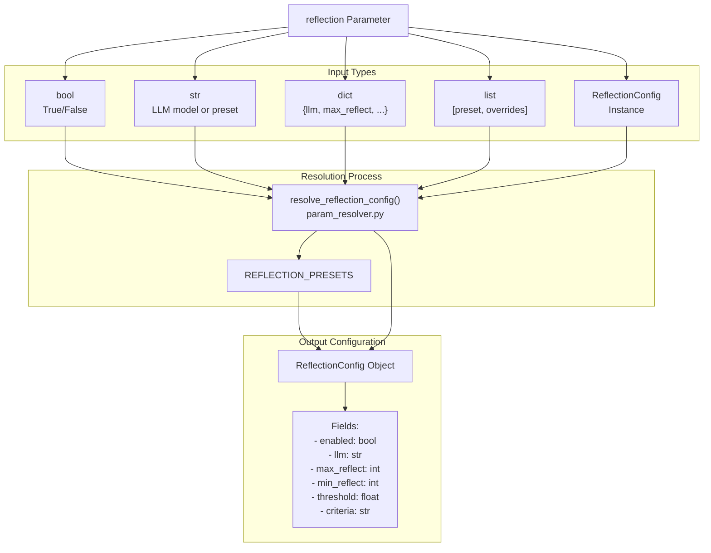
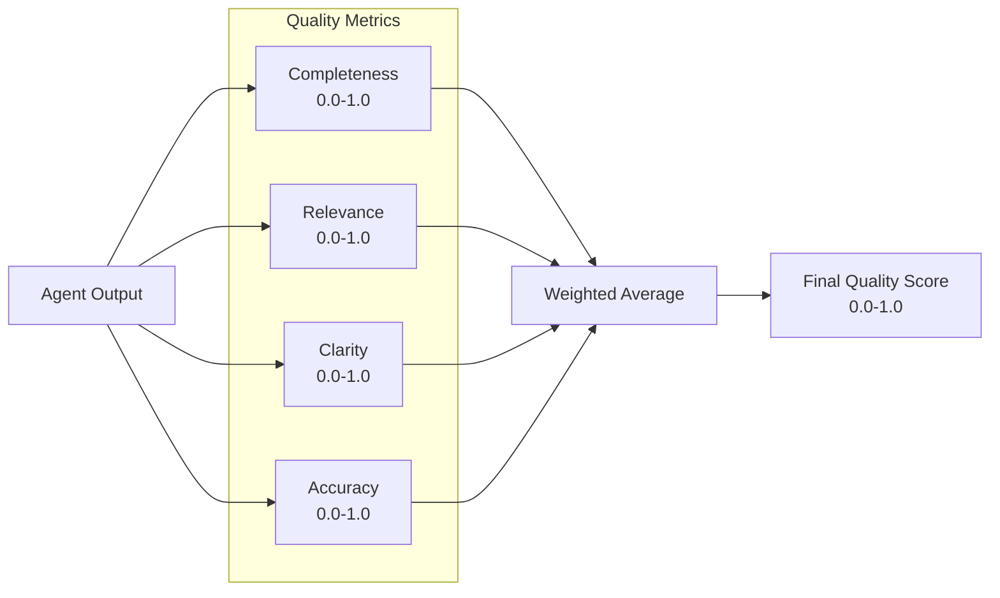
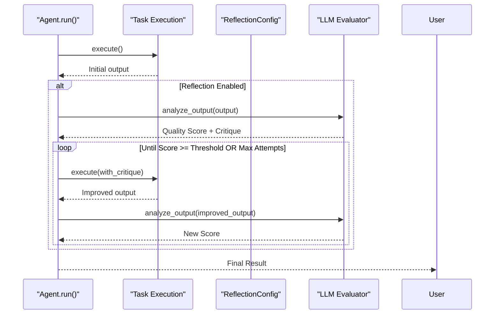
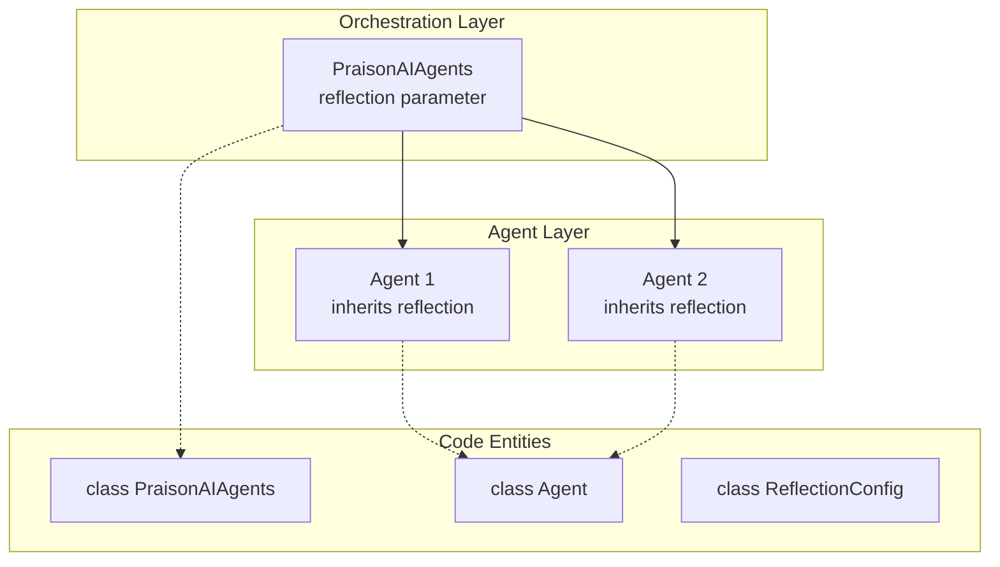

<!-- source: DeepWiki mcp.deepwiki.com · repo MervinPraison/PraisonAI · page 3.4 Reflection System · fetched 2026-10-26 -->

# Reflection System

<details>
<summary>Relevant source files</summary>

The following files were used as context for generating this wiki page:

- [README.md](README.md)
- [api.md](api.md)
- [src/praisonai/README.md](src/praisonai/README.md)

</details>


The Reflection System provides self-assessment capabilities for AI agents, allowing them to evaluate and iteratively improve their outputs before finalizing task results. The system implements quality-driven iteration where agents analyze their work against task requirements and reflection criteria, then attempt to enhance outputs that fall below quality thresholds.

For information about task execution control, see [Workflow System](3.1). For agent-level safety validation, see [Guardrails](6.1). For long-term quality tracking, see [Memory Management](4.1).

## Overview

The Reflection System operates as a post-execution evaluation layer that intercepts agent outputs, evaluates them against quality criteria, and triggers re-generation when outputs are insufficient. Unlike guardrails which enforce hard constraints, reflection focuses on iterative quality improvement through self-critique.

### Key Components

| Component | Description | Implementation |
|-----------|-------------|----------------|
| **Reflection Configuration** | Consolidated parameter accepting bool, dict, or `ReflectionConfig` | Replaces legacy `self_reflect`, `max_reflect`, `min_reflect`, `reflect_llm` parameters |
| **Quality Evaluator** | LLM-based assessment of output quality | Uses `calculate_quality_metrics` to score completeness, relevance, clarity, accuracy |
| **Iteration Controller** | Manages reflection attempts and thresholds | Enforces min/max reflection bounds and quality thresholds |
| **Output Refinement** | Re-executes agent logic with reflection feedback | Provides critique as context for next attempt |

Sources: [src/praisonai-agents/praisonaiagents/agent/agent.py:1-200](), [src/praisonai-agents/praisonaiagents/config/feature_configs.py:1-50]()

## Reflection Configuration

### Consolidated Reflection Parameter

The reflection system uses a unified parameter that accepts multiple input formats with precedence-based resolution handled by the `param_resolver`.

**Precedence Order:**
1. `ReflectionConfig` instance (highest)
2. Dictionary with reflection config
3. List: `[preset_name, overrides_dict]`
4. String: LLM model name or preset name
5. Boolean: `True` enables with defaults, `False` disables

**Configuration Diagram**



Sources: [src/praisonai-agents/praisonaiagents/agent/agent.py:150-250](), [src/praisonai-agents/praisonaiagents/config/feature_configs.py:15-45]()

### Legacy Parameters (Deprecated)

The following parameters are maintained for backward compatibility but superseded by the `reflection` parameter in the `Agent` class:

| Legacy Parameter | Type | Purpose | Default |
|-----------------|------|---------|---------|
| `self_reflect` | bool | Enable/disable reflection | False |
| `max_reflect` | int | Maximum reflection attempts | 3 |
| `min_reflect` | int | Minimum reflection attempts | 1 |
| `reflect_llm` | str | LLM model for reflection | "gpt-4o-mini" |

Sources: [src/praisonai-agents/praisonaiagents/agent/agent.py:80-120]()

## Reflection Levels

The Reflection System supports predefined quality levels that configure iteration depth and evaluation rigor:

### Minimal Reflection
- **max_reflect**: 1 iteration
- **min_reflect**: 0
- **threshold**: 0.5 (50% quality score)
- **Use Case**: Fast execution where basic quality checks suffice.

### Standard Reflection (Default)
- **max_reflect**: 3 iterations
- **min_reflect**: 1 (always attempts once)
- **threshold**: 0.7 (70% quality score)
- **Use Case**: General-purpose tasks requiring reliable output quality.

### Thorough Reflection
- **max_reflect**: 5 iterations
- **min_reflect**: 2 (always attempts at least twice)
- **threshold**: 0.85 (85% quality score)
- **Use Case**: Critical tasks where output quality is paramount.

Sources: [src/praisonai-agents/praisonaiagents/config/feature_configs.py:20-60]()

## Quality Evaluation

### Quality Metrics Calculation

The reflection system evaluates outputs across four dimensions using LLM-based assessment.

**Quality Dimensions:**



**Default Weights:**
- Completeness: 25%
- Relevance: 25%
- Clarity: 25%
- Accuracy: 25%

The `ReflectionOutput` type defined in `api.md` captures these structured results.

Sources: [api.md:10-10](), [src/praisonai-agents/praisonaiagents/agent/agent.py:500-600]()

## Reflection Workflow

### Execution Flow



Sources: [src/praisonai-agents/praisonaiagents/agent/agent.py:550-700](), [api.md:10-10]()

### Stopping Conditions
1. Quality score meets or exceeds `threshold`.
2. Maximum reflection attempts reached (`max_reflect`).
3. No quality improvement detected across iterations (doom-loop protection).

Sources: [src/praisonai-agents/praisonaiagents/agent/agent.py:650-680]()

## Integration with Agent System

### Multi-Agent Reflection Propagation

The `PraisonAIAgents` (or `AgentTeam`) class stores the reflection configuration and propagates it to all contained agents.



Sources: [api.md:26-26](), [src/praisonai-agents/praisonaiagents/agent/agent.py:180-220]()

### Reflection vs. Guardrails

The Reflection System and Guardrails serve complementary quality assurance roles:

| Aspect | Reflection System | Guardrails System |
|--------|------------------|-------------------|
| **Purpose** | Iterative quality improvement | Hard constraint enforcement |
| **Approach** | Soft thresholds with scoring | Pass/fail validation (`GuardrailResult`) |
| **Evaluation** | LLM-based quality assessment | Function or LLM-based rules |
| **Output** | `ReflectionOutput` | `GuardrailResult` |

Sources: [api.md:10-15](), [src/praisonai-agents/praisonaiagents/agent/agent.py:600-650]()

## Performance Considerations

### Computational Cost
Reflection introduces additional LLM calls proportional to iteration attempts. Users can optimize this by specifying a cheaper model for the reflection phase:

```python
agent = Agent(
    llm="gpt-4o",
    reflection={
        "llm": "gpt-4o-mini", # Cheaper evaluator
        "max_reflect": 2
    }
)
```

Sources: [src/praisonai-agents/praisonaiagents/agent/agent.py:190-210](), [src/praisonai-agents/praisonaiagents/config/feature_configs.py:30-40]()

---

