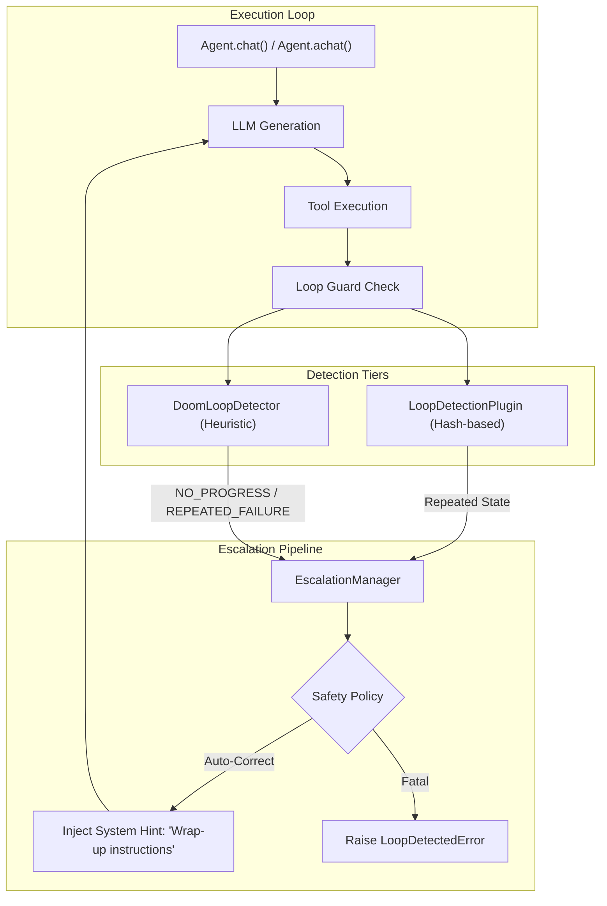
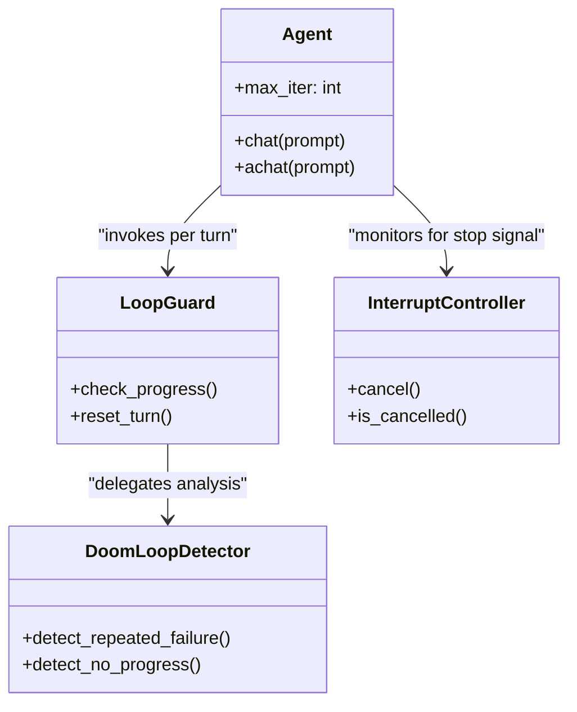

<!-- source: DeepWiki mcp.deepwiki.com · repo MervinPraison/PraisonAI · page 3.5 Loop Detection and Safety Escalation · fetched 2026-10-26 -->

# Loop Detection and Safety Escalation

Relevant source files

The following files were used as context for generating this wiki page:

- [src/praisonai-agents/praisonaiagents/agent/agent.py](src/praisonai-agents/praisonaiagents/agent/agent.py)
- [src/praisonai-agents/praisonaiagents/agent/chat_mixin.py](src/praisonai-agents/praisonaiagents/agent/chat_mixin.py)
- [src/praisonai-agents/praisonaiagents/agent/durable.py](src/praisonai-agents/praisonaiagents/agent/durable.py)
- [src/praisonai-agents/praisonaiagents/agent/execution_mixin.py](src/praisonai-agents/praisonaiagents/agent/execution_mixin.py)
- [src/praisonai-agents/praisonaiagents/agent/interrupt.py](src/praisonai-agents/praisonaiagents/agent/interrupt.py)
- [src/praisonai-agents/praisonaiagents/agent/loop_detection.py](src/praisonai-agents/praisonaiagents/agent/loop_detection.py)
- [src/praisonai-agents/praisonaiagents/agent/tool_execution.py](src/praisonai-agents/praisonaiagents/agent/tool_execution.py)
- [src/praisonai-agents/praisonaiagents/agent/unified_execution_mixin.py](src/praisonai-agents/praisonaiagents/agent/unified_execution_mixin.py)
- [src/praisonai-agents/praisonaiagents/agents/agents.py](src/praisonai-agents/praisonaiagents/agents/agents.py)
- [src/praisonai-agents/praisonaiagents/config/feature_configs.py](src/praisonai-agents/praisonaiagents/config/feature_configs.py)
- [src/praisonai-agents/praisonaiagents/escalation/doom_loop.py](src/praisonai-agents/praisonaiagents/escalation/doom_loop.py)
- [src/praisonai-agents/praisonaiagents/escalation/loop_guard.py](src/praisonai-agents/praisonaiagents/escalation/loop_guard.py)
- [src/praisonai-agents/praisonaiagents/llm/llm.py](src/praisonai-agents/praisonaiagents/llm/llm.py)
- [src/praisonai-agents/praisonaiagents/llm/openai_client.py](src/praisonai-agents/praisonaiagents/llm/openai_client.py)
- [src/praisonai-agents/praisonaiagents/llm/sanitize.py](src/praisonai-agents/praisonaiagents/llm/sanitize.py)
- [src/praisonai-agents/praisonaiagents/llm/streaming_protocol.py](src/praisonai-agents/praisonaiagents/llm/streaming_protocol.py)
- [src/praisonai-agents/praisonaiagents/plugins/loop_detection_plugin.py](src/praisonai-agents/praisonaiagents/plugins/loop_detection_plugin.py)
- [src/praisonai-agents/praisonaiagents/tools/call_executor.py](src/praisonai-agents/praisonaiagents/tools/call_executor.py)
- [src/praisonai-agents/praisonaiagents/tools/path_overlap.py](src/praisonai-agents/praisonaiagents/tools/path_overlap.py)
- [src/praisonai-agents/tests/integration/test_agent_decomposition_real.py](src/praisonai-agents/tests/integration/test_agent_decomposition_real.py)
- [src/praisonai-agents/tests/integration/test_responses_api.py](src/praisonai-agents/tests/integration/test_responses_api.py)
- [src/praisonai-agents/tests/test_architectural_fixes.py](src/praisonai-agents/tests/test_architectural_fixes.py)
- [src/praisonai-agents/tests/test_deferred_progress_tools.py](src/praisonai-agents/tests/test_deferred_progress_tools.py)
- [src/praisonai-agents/tests/test_native_deferred_parity.py](src/praisonai-agents/tests/test_native_deferred_parity.py)
- [src/praisonai-agents/tests/test_parallel_tools.py](src/praisonai-agents/tests/test_parallel_tools.py)
- [src/praisonai-agents/tests/test_tool_timeout.py](src/praisonai-agents/tests/test_tool_timeout.py)
- [src/praisonai-agents/tests/unit/agent/test_durable_run.py](src/praisonai-agents/tests/unit/agent/test_durable_run.py)
- [src/praisonai-agents/tests/unit/agent/test_loop_detector_wiring.py](src/praisonai-agents/tests/unit/agent/test_loop_detector_wiring.py)
- [src/praisonai-agents/tests/unit/llm/test_durable_tool_dispatch.py](src/praisonai-agents/tests/unit/llm/test_durable_tool_dispatch.py)
- [src/praisonai-agents/tests/unit/test_compaction_wiring.py](src/praisonai-agents/tests/unit/test_compaction_wiring.py)
- [src/praisonai-agents/tests/unit/test_doom_loop_no_progress_boundary.py](src/praisonai-agents/tests/unit/test_doom_loop_no_progress_boundary.py)
- [src/praisonai-agents/tests/unit/test_loop_detection.py](src/praisonai-agents/tests/unit/test_loop_detection.py)
- [src/praisonai-agents/tests/unit/test_loop_guard_no_progress.py](src/praisonai-agents/tests/unit/test_loop_guard_no_progress.py)

PaisonAI implements a multi-layered safety architecture designed to prevent infinite execution cycles, detect non-productive agent behavior, and provide cooperative cancellation mechanisms. This system operates across two primary tiers: deterministic state tracking (ping-pong detection) and heuristic behavior analysis (Doom Loop detection).

## Two-Tier Loop Detection Architecture

The system utilizes two distinct mechanisms to monitor agent turns and tool interactions, ensuring that agents do not get stuck in repetitive patterns or "doom loops" where progress has stalled.

### 1. LoopDetectionPlugin (Deterministic)
The `LoopDetectionPlugin` provides low-level, hash-based detection of repeated state transitions [praisonaiagents/plugins/loop_detection_plugin.py](). It focuses on identifying "ping-pong" behavior where an agent repeats the exact same sequence of actions or tool calls.

*   **Ping-Pong Detection**: Tracks a history of state hashes. If the same state hash appears multiple times within a sliding window, it triggers a loop alert.
*   **Hash Calculation**: Computes hashes based on the combination of the last tool call, its arguments, and the resulting output.

### 2. DoomLoopDetector (Heuristic)
The `DoomLoopDetector` operates at a higher semantic level, analyzing the *quality* of the agent's progress [praisonaiagents/escalation/doom_loop.py](). It classifies failures into specific categories to inform the escalation pipeline.

| Category | Description |
| :--- | :--- |
| `REPEATED_ACTION` | The agent is calling the same tool with the same arguments repeatedly, even if the output varies slightly. |
| `REPEATED_FAILURE` | A specific tool or sequence of tools is consistently returning errors. |
| `NO_PROGRESS` | The agent is generating tokens and taking actions, but the semantic distance toward the goal is not decreasing. |

### Data Flow: Loop Detection to Escalation

The following diagram illustrates how the `Agent` execution loop interacts with the detection systems.

**Loop Detection and Escalation Flow**

**Sources:** [praisonaiagents/agent/chat_mixin.py:73-150](), [praisonaiagents/escalation/doom_loop.py:1-50](), [praisonaiagents/plugins/loop_detection_plugin.py:1-40]()

## Safety Escalation Pipeline

When a loop or stall is detected, the system does not immediately terminate unless the behavior is deemed unrecoverable. Instead, it follows an escalation pipeline managed by the `LoopGuard` [praisonaiagents/escalation/loop_guard.py]().

### Maximum Step Wrap-up
As an agent approaches its maximum allowed iterations (`max_iter`), the `ChatMixin` injects a specific prompt to encourage a graceful conclusion rather than a hard cut-off [praisonaiagents/llm/openai_client.py:28-32]().

*   **Prompt**: `_MAX_STEPS_WRAPUP_PROMPT` is appended to the system instructions when the step budget is nearly exhausted [praisonaiagents/llm/openai_client.py:28-32]().
*   **Goal**: Forces the model to summarize work completed and note incomplete items.

### Error Classification and Handling
The system distinguishes between fatal and non-fatal tool errors during the execution loop [praisonaiagents/agent/tool_execution.py:20-50]().

*   **ToolExecutionError**: Used to wrap failures during tool calls.
*   **is_retryable**: A flag on `ToolExecutionError` that determines if the `DoomLoopDetector` should increment the failure count or trigger an immediate stop [praisonaiagents/agent/tool_execution.py:20-25]().

**Entity Mapping: Safety Controls**

**Sources:** [praisonaiagents/agent/agent.py:15-32](), [praisonaiagents/escalation/loop_guard.py:10-60](), [praisonaiagents/agent/interrupt.py:5-30]()

## Cooperative Cancellation

The `InterruptController` provides a mechanism for external systems (or parent workflows) to gracefully stop an agent's execution [praisonaiagents/agent/interrupt.py]().

### InterruptController Features
*   **Turn-based Tokens**: The `ChatMixin` creates a `_TurnCancelToken` at the start of every interaction [praisonaiagents/agent/chat_mixin.py:30-72]().
*   **Thread Safety**: Uses `threading.Event` or `asyncio.Event` depending on the execution context to signal cancellation across thread boundaries.
*   **Cooperative Polling**: The agent checks the token status before each LLM call and tool execution. If `is_set()` returns true, the agent raises an `InterruptedError` and halts [praisonaiagents/agent/chat_mixin.py:56-59]().

## Durable Execution and Resumption

For long-running tasks, loop detection is integrated with the `RunJournal` to ensure that safety state persists across process restarts [praisonaiagents/agent/durable.py]().

*   **JournalEvent**: Every iteration, tool call, and tool result is recorded as a `JournalEvent` [praisonaiagents/runtime/journal.py]().
*   **Idempotency**: The `DurableRunContext` uses stable idempotency keys (e.g., `run-1:0:charge_card`) to ensure that if a tool call was part of a detected loop and then resumed, the system recognizes the previous attempt [tests/unit/agent/test_durable_run.py:167-195]().

### Summary of Safety Classes

| Class | File Path | Role |
| :--- | :--- | :--- |
| `LoopGuard` | [praisonaiagents/escalation/loop_guard.py]() | Orchestrates turn-level progress checks. |
| `DoomLoopDetector` | [praisonaiagents/escalation/doom_loop.py]() | Heuristic analysis of repetitive/failing behavior. |
| `InterruptController` | [praisonaiagents/agent/interrupt.py]() | Provides cancellation signaling. |
| `_TurnCancelToken` | [praisonaiagents/agent/chat_mixin.py]() | Per-interaction cancellation state tracker. |
| `RunJournal` | [praisonaiagents/runtime/journal.py]() | Persists execution history for safety auditing. |

**Sources:** [praisonaiagents/agent/chat_mixin.py:30-72](), [praisonaiagents/agent/durable.py:1-50](), [praisonaiagents/runtime/journal.py:1-100](), [praisonaiagents/agent/tool_execution.py:20-60]()

---

