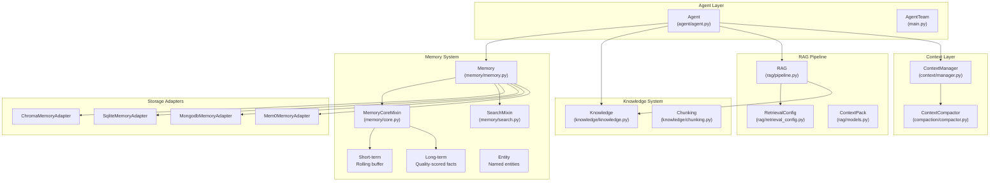
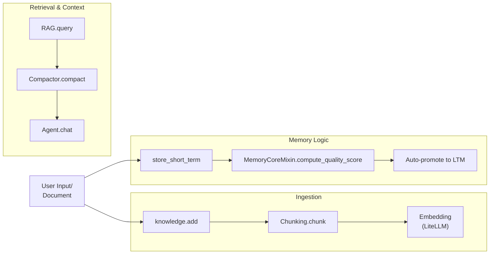

<!-- source: DeepWiki mcp.deepwiki.com · repo MervinPraison/PraisonAI · page 4 Memory and Knowledge Systems · fetched 2026-10-26 -->

# Memory and Knowledge Systems

<details>
<summary>Relevant source files</summary>

The following files were used as context for generating this wiki page:

- [api.md](api.md)
- [examples/guardrail_example_fixed.py](examples/guardrail_example_fixed.py)
- [src/praisonai-agents/praisonaiagents/bus/bus.py](src/praisonai-agents/praisonaiagents/bus/bus.py)
- [src/praisonai-agents/praisonaiagents/memory/core.py](src/praisonai-agents/praisonaiagents/memory/core.py)
- [src/praisonai-agents/praisonaiagents/memory/memory.py](src/praisonai-agents/praisonaiagents/memory/memory.py)
- [src/praisonai-agents/praisonaiagents/process/manager_schema.py](src/praisonai-agents/praisonaiagents/process/manager_schema.py)
- [src/praisonai-agents/praisonaiagents/process/process.py](src/praisonai-agents/praisonaiagents/process/process.py)
- [src/praisonai-agents/praisonaiagents/task/task.py](src/praisonai-agents/praisonaiagents/task/task.py)
- [src/praisonai-agents/praisonaiagents/utils/async_bridge.py](src/praisonai-agents/praisonaiagents/utils/async_bridge.py)
- [src/praisonai-agents/test_guardrail_return_types.py](src/praisonai-agents/test_guardrail_return_types.py)
- [src/praisonai-agents/tests/test_memory_convenience_api.py](src/praisonai-agents/tests/test_memory_convenience_api.py)
- [src/praisonai-agents/tests/unit/bus/test_event_bus.py](src/praisonai-agents/tests/unit/bus/test_event_bus.py)
- [src/praisonai-agents/tests/unit/config/test_small_model_routing.py](src/praisonai-agents/tests/unit/config/test_small_model_routing.py)
- [src/praisonai-agents/tests/unit/process/test_hierarchical_selection.py](src/praisonai-agents/tests/unit/process/test_hierarchical_selection.py)
- [src/praisonai-agents/tests/unit/process/test_manager_schema.py](src/praisonai-agents/tests/unit/process/test_manager_schema.py)

</details>


## Purpose and Scope

This document provides an overview of PraisonAI's memory and knowledge architecture, which enables agents to maintain context, learn from interactions, and retrieve relevant information. The system consists of four integrated subsystems:

- **Memory Management** ([Memory Management](#4.1)) - Multi-tier memory (Short-term, Long-term, Entity, Episodic) for conversation context and learned facts.
- **Knowledge Management** ([Knowledge Management](#4.2)) - Document ingestion, chunking strategies, and persistent vector storage.
- **RAG System** ([RAG System](#4.3)) - Retrieval-augmented generation pipeline with hybrid search, reranking, and citation support.
- **Context Management** ([Context Management](#4.4)) - Context optimization, compression (compaction), and token budgeting.

For tool integration and MCP protocol support, see [Tool Systems](#5). For agent orchestration patterns, see [Multi-Agent Orchestration](#2.5).

## Architecture Overview

The memory and knowledge systems form a layered architecture where each component serves a distinct purpose while sharing common storage backends. The core `Memory` class [src/praisonai-agents/praisonaiagents/memory/memory.py:39-100]() acts as a central coordinator, now using a protocol-driven adapter pattern [src/praisonai-agents/praisonaiagents/memory/memory.py:133-156]() to support diverse backends like ChromaDB, SQLite, Redis, and MongoDB.

### System Component Diagram



Sources: [src/praisonai-agents/praisonaiagents/agent/agent.py](), [src/praisonai-agents/praisonaiagents/memory/memory.py](), [src/praisonai-agents/praisonaiagents/memory/core.py](), [src/praisonai-agents/praisonaiagents/knowledge/knowledge.py](), [src/praisonai-agents/praisonaiagents/rag/pipeline.py]()

### Data Flow and Processing Pipeline



Sources: [src/praisonai-agents/praisonaiagents/memory/core.py:20-88](), [src/praisonai-agents/praisonaiagents/knowledge/knowledge.py](), [src/praisonai-agents/praisonaiagents/rag/pipeline.py]()

## Memory Tiers

PraisonAI implements a multi-tier memory architecture. The `Memory` class [src/praisonai-agents/praisonaiagents/memory/memory.py:39]() coordinates these tiers via mixins:

| Tier | Class Method | Description | Quality Threshold |
|------|-------------|-------------|-------------------|
| **Short-term (STM)** | `store_short_term()` | Ephemeral context for current turns. | N/A |
| **Long-term (LTM)** | `store_long_term()` | Persistent facts and important insights. | 7.5+ [src/praisonai-agents/praisonaiagents/memory/core.py:78]() |
| **Entity** | `store_entity()` | Structured data about people, places, or orgs. | N/A |
| **User** | `store_user_memory()` | Preferences and history specific to a user ID. | N/A |

### Memory Quality and Promotion
The system automatically calculates a quality score for incoming content using `compute_quality_score` [src/praisonai-agents/praisonaiagents/memory/core.py:44](). If `auto_promote` is enabled and the score meets the threshold (typically 7.5), the content is automatically promoted from STM to LTM [src/praisonai-agents/praisonaiagents/memory/core.py:78-82]().

### Convenience API
For simple use cases, the `Memory` class provides a high-level API:
- `remember(text)`: Thin alias for `store_long_term` [src/praisonai-agents/tests/test_memory_convenience_api.py:35]().
- `recall(query)`: Search across long-term memory [src/praisonai-agents/tests/test_memory_convenience_api.py:37]().
- `forget(memory_id/query)`: Remove specific records [src/praisonai-agents/tests/test_memory_convenience_api.py:49-61]().

For detailed memory operations, backends, and Dakera decay-weighted memory, see [Memory Management](#4.1).

## Knowledge Base

The `Knowledge` class manages document ingestion and indexing. It supports various strategies for breaking down documents into retrieval-ready pieces.

### Chunking Strategies
The `Chunking` system supports multiple methods to optimize retrieval performance:
- **RecursiveCharacter**: Splits by semantic boundaries (paragraphs, sentences).
- **Semantic**: Uses embeddings to find natural breaks in meaning.
- **FixedSize**: Uniform token-based chunks.

```python
from praisonaiagents import Knowledge

knowledge = Knowledge(
    sources=["path/to/docs"],
    collection_name="tech_docs"
)
# Search knowledge
results = knowledge.search("How to configure memory?", limit=3)
```

Sources: [src/praisonai-agents/praisonaiagents/knowledge/knowledge.py](), [src/praisonai-agents/praisonaiagents/agent/agent.py:68-69]()

For document readers and indexing strategies, see [Knowledge Management](#4.2).

## RAG System

The RAG (Retrieval-Augmented Generation) system bridges knowledge storage and LLM generation. It is accessed via `Agent.query()` [src/praisonai-agents/praisonaiagents/agent/agent.py:67]() or `Agent.rag_query()` [src/praisonai-agents/praisonaiagents/agent/agent.py:69]().

### Retrieval Pipeline
1. **RetrievalPolicy**: Determines if retrieval is needed (e.g., `ALWAYS`, `AUTO`, `NEVER`).
2. **Hybrid Search**: Combines vector similarity with keyword matching.
3. **Reranking**: Re-orders initial results using a more expensive cross-encoder for precision.
4. **ContextPack**: A structured container for retrieved chunks, metadata, and scores [src/praisonai-agents/praisonaiagents/rag/models.py]().

For hybrid retrieval details and citation management, see [RAG System](#4.3).

## Context Management

Context management ensures the LLM receives the most relevant information within its token limits.

### Compaction and Summarization
When conversation history grows too large, the `ContextCompactor` [src/praisonai-agents/praisonaiagents/compaction/compactor.py]() applies strategies to reduce token usage:
- **Summarization**: Uses a `small_model` (if configured) to condense old messages into a summary [src/praisonai-agents/tests/unit/config/test_small_model_routing.py:59-62]().
- **Sliding Window**: Drops oldest messages to stay under the budget.
- **Pre-compaction Flush**: Clears ephemeral state before heavy summarization.

### Small Model Routing
Auxiliary tasks like summarization and guardrail evaluation are routed to a `small_model` (e.g., GPT-4o-mini) to save costs and latency, falling back to the primary model if not configured [src/praisonai-agents/tests/unit/config/test_small_model_routing.py:40-87]().

For context optimization and compression algorithms, see [Context Management](#4.4).

## Storage Backends

PraisonAI supports multiple backends through an adapter registry [src/praisonai-agents/praisonaiagents/memory/memory.py:18-19]().

| Backend | Code Identifier | Best For |
|---------|-----------------|----------|
| **ChromaDB** | `chroma` | Default vector store for RAG. |
| **SQLite** | `sqlite` | Local persistent structured storage. |
| **MongoDB** | `mongodb` | Distributed applications and large-scale storage. |
| **Mem0** | `mem0` | Graph-based relationship tracking. |
| **In-Memory** | `in_memory` | Testing and ephemeral sessions. |

Sources: [src/praisonai-agents/praisonaiagents/memory/memory.py:139-145]()

---

