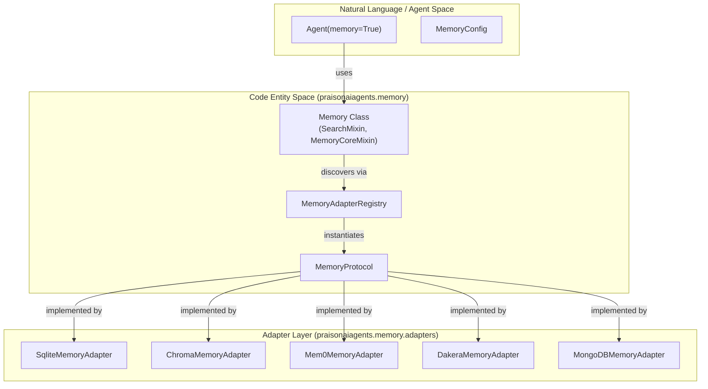
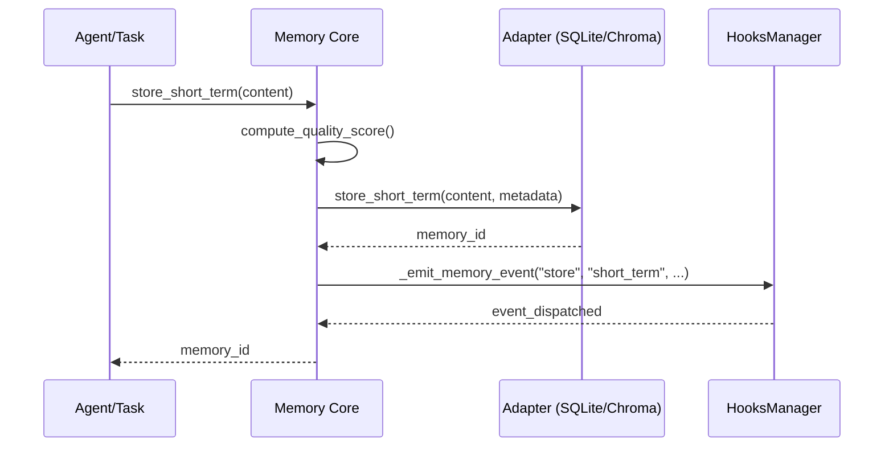

<!-- source: DeepWiki mcp.deepwiki.com · repo MervinPraison/PraisonAI · page 4.1 Memory Management · fetched 2026-10-26 -->

# Memory Management

<details>
<summary>Relevant source files</summary>

The following files were used as context for generating this wiki page:

- [examples/guardrail_example_fixed.py](examples/guardrail_example_fixed.py)
- [examples/python/eval/recipe_optimization_loop.py](examples/python/eval/recipe_optimization_loop.py)
- [examples/python/tools/cli/app.py](examples/python/tools/cli/app.py)
- [examples/python/tools/e2b/single_agent.py](examples/python/tools/e2b/single_agent.py)
- [src/praisonai-agents/praisonaiagents/bus/bus.py](src/praisonai-agents/praisonaiagents/bus/bus.py)
- [src/praisonai-agents/praisonaiagents/knowledge/adapters/__init__.py](src/praisonai-agents/praisonaiagents/knowledge/adapters/__init__.py)
- [src/praisonai-agents/praisonaiagents/knowledge/adapters/registry.py](src/praisonai-agents/praisonaiagents/knowledge/adapters/registry.py)
- [src/praisonai-agents/praisonaiagents/knowledge/index.py](src/praisonai-agents/praisonaiagents/knowledge/index.py)
- [src/praisonai-agents/praisonaiagents/knowledge/models.py](src/praisonai-agents/praisonaiagents/knowledge/models.py)
- [src/praisonai-agents/praisonaiagents/llm/adapters/__init__.py](src/praisonai-agents/praisonaiagents/llm/adapters/__init__.py)
- [src/praisonai-agents/praisonaiagents/llm/protocols.py](src/praisonai-agents/praisonaiagents/llm/protocols.py)
- [src/praisonai-agents/praisonaiagents/memory/__init__.py](src/praisonai-agents/praisonaiagents/memory/__init__.py)
- [src/praisonai-agents/praisonaiagents/memory/adapters/__init__.py](src/praisonai-agents/praisonaiagents/memory/adapters/__init__.py)
- [src/praisonai-agents/praisonaiagents/memory/adapters/factories.py](src/praisonai-agents/praisonaiagents/memory/adapters/factories.py)
- [src/praisonai-agents/praisonaiagents/memory/adapters/in_memory_adapter.py](src/praisonai-agents/praisonaiagents/memory/adapters/in_memory_adapter.py)
- [src/praisonai-agents/praisonaiagents/memory/adapters/registry.py](src/praisonai-agents/praisonaiagents/memory/adapters/registry.py)
- [src/praisonai-agents/praisonaiagents/memory/adapters/sqlite_adapter.py](src/praisonai-agents/praisonaiagents/memory/adapters/sqlite_adapter.py)
- [src/praisonai-agents/praisonaiagents/memory/core.py](src/praisonai-agents/praisonaiagents/memory/core.py)
- [src/praisonai-agents/praisonaiagents/memory/hooks.py](src/praisonai-agents/praisonaiagents/memory/hooks.py)
- [src/praisonai-agents/praisonaiagents/memory/memory.py](src/praisonai-agents/praisonaiagents/memory/memory.py)
- [src/praisonai-agents/praisonaiagents/memory/rules_manager.py](src/praisonai-agents/praisonaiagents/memory/rules_manager.py)
- [src/praisonai-agents/praisonaiagents/memory/workflows.py](src/praisonai-agents/praisonaiagents/memory/workflows.py)
- [src/praisonai-agents/praisonaiagents/process/manager_schema.py](src/praisonai-agents/praisonaiagents/process/manager_schema.py)
- [src/praisonai-agents/praisonaiagents/process/process.py](src/praisonai-agents/praisonaiagents/process/process.py)
- [src/praisonai-agents/praisonaiagents/rag/pipeline.py](src/praisonai-agents/praisonaiagents/rag/pipeline.py)
- [src/praisonai-agents/praisonaiagents/rag/protocols.py](src/praisonai-agents/praisonaiagents/rag/protocols.py)
- [src/praisonai-agents/praisonaiagents/task/task.py](src/praisonai-agents/praisonaiagents/task/task.py)
- [src/praisonai-agents/praisonaiagents/utils/adapter_registry.py](src/praisonai-agents/praisonaiagents/utils/adapter_registry.py)
- [src/praisonai-agents/praisonaiagents/utils/async_bridge.py](src/praisonai-agents/praisonaiagents/utils/async_bridge.py)
- [src/praisonai-agents/test_guardrail_return_types.py](src/praisonai-agents/test_guardrail_return_types.py)
- [src/praisonai-agents/tests/test_memory_convenience_api.py](src/praisonai-agents/tests/test_memory_convenience_api.py)
- [src/praisonai-agents/tests/unit/bus/test_event_bus.py](src/praisonai-agents/tests/unit/bus/test_event_bus.py)
- [src/praisonai-agents/tests/unit/config/test_small_model_routing.py](src/praisonai-agents/tests/unit/config/test_small_model_routing.py)
- [src/praisonai-agents/tests/unit/memory/test_dakera_adapter.py](src/praisonai-agents/tests/unit/memory/test_dakera_adapter.py)
- [src/praisonai-agents/tests/unit/process/test_hierarchical_selection.py](src/praisonai-agents/tests/unit/process/test_hierarchical_selection.py)
- [src/praisonai-agents/tests/unit/process/test_manager_schema.py](src/praisonai-agents/tests/unit/process/test_manager_schema.py)
- [src/praisonai-agents/tests/unit/test_adapter_registry.py](src/praisonai-agents/tests/unit/test_adapter_registry.py)
- [src/praisonai-agents/tests/unit/test_glob_rules_activation.py](src/praisonai-agents/tests/unit/test_glob_rules_activation.py)
- [src/praisonai/tests/test.py](src/praisonai/tests/test.py)

</details>


PraisonAI provides a multi-tier memory system designed for persistent agent state and knowledge storage. The system distinguishes between ephemeral interaction context and persistent factual knowledge through four primary memory tiers: **Short-Term**, **Long-Term**, **Entity**, and **Episodic**. All memory operations follow a protocol-driven architecture, allowing for pluggable backends and zero overhead when disabled.

## Memory Architecture

The memory system is built on a modular, mixin-based architecture that separates core logic from specific storage implementations.

### Tiered Memory Model

| Memory Tier | Purpose | Implementation Details |
| :--- | :--- | :--- |
| **Short-Term (STM)** | Ephemeral context | Rolling buffer for recent interactions. [src/praisonai-agents/praisonaiagents/memory/memory.py:42]() |
| **Long-Term (LTM)** | Persistent facts | Stores high-quality information promoted from STM or explicitly stored. [src/praisonai-agents/praisonaiagents/memory/memory.py:43]() |
| **Entity Memory** | Structured data | Stores information about named entities (people, places, orgs). [src/praisonai-agents/praisonaiagents/memory/memory.py:44]() |
| **Episodic Memory** | History | Interaction history with temporal context. [src/praisonai-agents/praisonaiagents/memory/memory.py:46]() |

### Code Entity Space to Storage Mapping

This diagram maps high-level memory concepts to the underlying code entities and storage adapters.


**Sources:** [src/praisonai-agents/praisonaiagents/memory/memory.py:39-48](), [src/praisonai-agents/praisonaiagents/memory/adapters/registry.py:15-31]()

## Core Implementation

The `Memory` class serves as the primary entry point. It inherits from `SearchMixin` and `MemoryCoreMixin` to provide unified access to different storage backends [src/praisonai-agents/praisonaiagents/memory/memory.py:39]().

### Protocol-Driven Initialization
During initialization, the `Memory` class resolves the requested provider and retrieves the corresponding adapter from the `MemoryAdapterRegistry` [src/praisonai-agents/praisonaiagents/memory/memory.py:133-156]().

```python
# Provider mapping logic in Memory class
provider_mapping = {
    "rag": "chroma",  # Default
    "mem0": "mem0",
    "mongodb": "mongodb",
    "sqlite": "sqlite",
    "none": "in_memory"
}
```
**Sources:** [src/praisonai-agents/praisonaiagents/memory/memory.py:140-146]()

### Adapter Registry and Factories
Heavy dependencies (like ChromaDB or MongoDB) are lazy-loaded via factories to keep the core package lightweight [src/praisonai-agents/praisonaiagents/memory/adapters/factories.py:1-15]().

- **Registry:** `MemoryAdapterRegistry` manages the mapping between provider names and their implementation classes or factories [src/praisonai-agents/praisonaiagents/memory/adapters/registry.py:15-31]().
- **Factories:** Functions like `create_chroma_memory_adapter` handle conditional imports and provide installation hints if a dependency is missing [src/praisonai-agents/praisonaiagents/memory/adapters/factories.py:80-104]().

**Sources:** [src/praisonai-agents/praisonaiagents/memory/adapters/registry.py:15-31](), [src/praisonai-agents/praisonaiagents/memory/adapters/factories.py:80-104]()

## Memory Storage Logic

### Short-Term Memory and Quality Scoring
When content is stored in STM via `store_short_term`, the system calculates a `quality_score` [src/praisonai-agents/praisonaiagents/memory/core.py:20-45]().

- **Promotion Logic:** If `auto_promote` is enabled and the `quality_score` exceeds a threshold (default `7.5`), the content is automatically mirrored to Long-Term Memory [src/praisonai-agents/praisonaiagents/memory/core.py:78-83]().
- **Structured Results:** The `store_short_term_structured` method returns a `MemoryResult` object, providing explicit success/failure status and identifying which adapter was used [src/praisonai-agents/praisonaiagents/memory/core.py:90-110]().

**Sources:** [src/praisonai-agents/praisonaiagents/memory/core.py:20-83](), [src/praisonai-agents/praisonaiagents/memory/core.py:90-110]()

### Dakera Decay-Weighted Memory
PraisonAI supports **Dakera**, a specialized memory backend that provides decay-weighted vector recall [src/praisonai-agents/praisonaiagents/memory/adapters/factories.py:134-163]().

- **Namespace:** Memories are scoped by `agent_id` [src/praisonai-agents/praisonaiagents/memory/adapters/factories.py:151]().
- **Decay:** Retrieval prioritizes information based on a combination of semantic similarity and temporal relevance (importance scores) [src/praisonai-agents/praisonaiagents/memory/adapters/factories.py:139-140]().

**Sources:** [src/praisonai-agents/praisonaiagents/memory/adapters/factories.py:134-163]()

## Memory Hooks and Events

The system includes a hooks mechanism to allow external systems to react to memory operations.


**Sources:** [src/praisonai-agents/praisonaiagents/memory/core.py:59-86](), [src/praisonai-agents/praisonaiagents/memory/hooks.py]()

## Integration with Processes

Memory is tightly integrated into the `Process` and `Task` execution flow.

- **Task Execution:** When a `Task` is initialized, it can be assigned a specific `Memory` instance [src/praisonai-agents/praisonaiagents/task/task.py:73]().
- **Process State:** During hierarchical or sequential execution, the `Process` class manages shared state, ensuring that memory context is available to agents as they perform their assigned tasks [src/praisonai-agents/praisonaiagents/process/process.py:20-48]().
- **Validation Feedback:** Validation outcomes (success, failure, retry) are captured and can be stored in memory to influence future agent decisions [src/praisonai-agents/praisonaiagents/process/process.py:82-101]().

**Sources:** [src/praisonai-agents/praisonaiagents/task/task.py:73](), [src/praisonai-agents/praisonaiagents/process/process.py:20-48](), [src/praisonai-agents/praisonaiagents/process/process.py:82-101]()

## Summary of Backends

| Adapter | Factory Function | Backend Service |
| :--- | :--- | :--- |
| `sqlite` | N/A (Core) | SQLite (local file) |
| `in_memory` | N/A (Core) | Python dictionary (volatile) |
| `chroma` | `create_chroma_memory_adapter` | ChromaDB (Vector) |
| `mem0` | `create_mem0_memory_adapter` | Mem0 (Vector/Graph) |
| `mongodb` | `create_mongodb_memory_adapter` | MongoDB (Document/Vector) |
| `dakera` | `create_dakera_memory_adapter` | Dakera (Decay-weighted) |

**Sources:** [src/praisonai-agents/praisonaiagents/memory/adapters/__init__.py:37-45](), [src/praisonai-agents/praisonaiagents/memory/adapters/factories.py:53-172]()

---

