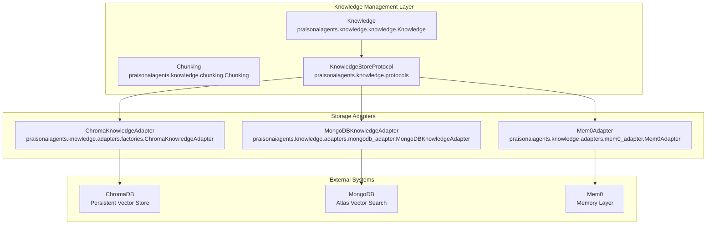
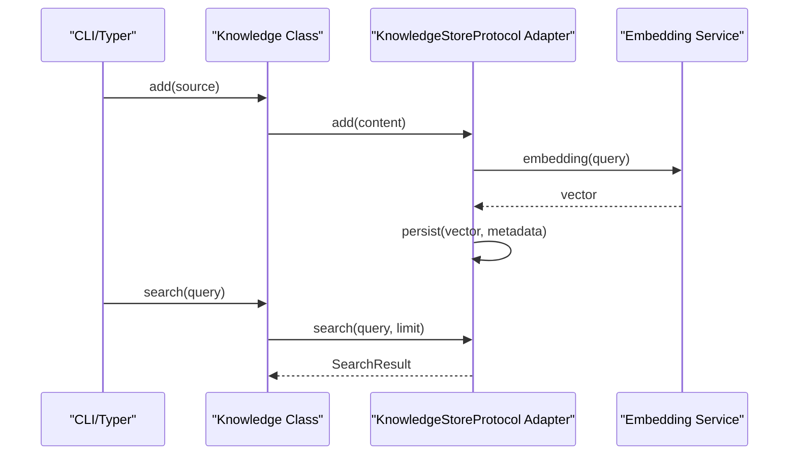

<!-- source: DeepWiki mcp.deepwiki.com · repo MervinPraison/PraisonAI · page 4.2 Knowledge Management · fetched 2026-10-26 -->

# Knowledge Management

<details>
<summary>Relevant source files</summary>

The following files were used as context for generating this wiki page:

- [src/praisonai-agents/praisonaiagents/knowledge/adapters/factories.py](src/praisonai-agents/praisonaiagents/knowledge/adapters/factories.py)
- [src/praisonai-agents/praisonaiagents/knowledge/adapters/mem0_adapter.py](src/praisonai-agents/praisonaiagents/knowledge/adapters/mem0_adapter.py)
- [src/praisonai-agents/praisonaiagents/knowledge/adapters/mongodb_adapter.py](src/praisonai-agents/praisonaiagents/knowledge/adapters/mongodb_adapter.py)
- [src/praisonai-agents/praisonaiagents/knowledge/knowledge.py](src/praisonai-agents/praisonaiagents/knowledge/knowledge.py)
- [src/praisonai-agents/praisonaiagents/knowledge/protocols.py](src/praisonai-agents/praisonaiagents/knowledge/protocols.py)
- [src/praisonai-agents/praisonaiagents/llm/unified_adapters.py](src/praisonai-agents/praisonaiagents/llm/unified_adapters.py)
- [src/praisonai-agents/praisonaiagents/storage/base.py](src/praisonai-agents/praisonaiagents/storage/base.py)
- [src/praisonai-agents/praisonaiagents/tools/base.py](src/praisonai-agents/praisonaiagents/tools/base.py)
- [src/praisonai-agents/praisonaiagents/tools/decorator.py](src/praisonai-agents/praisonaiagents/tools/decorator.py)
- [src/praisonai-agents/praisonaiagents/tools/injected.py](src/praisonai-agents/praisonaiagents/tools/injected.py)
- [src/praisonai-agents/praisonaiagents/tools/schema.py](src/praisonai-agents/praisonaiagents/tools/schema.py)
- [src/praisonai-agents/test_unified_llm.py](src/praisonai-agents/test_unified_llm.py)
- [src/praisonai-agents/tests/integration/test_default_token_tracking_real.py](src/praisonai-agents/tests/integration/test_default_token_tracking_real.py)
- [src/praisonai-agents/tests/test_tool_schema_parity.py](src/praisonai-agents/tests/test_tool_schema_parity.py)
- [src/praisonai-agents/tests/unit/eval/test_base.py](src/praisonai-agents/tests/unit/eval/test_base.py)
- [src/praisonai-agents/tests/unit/eval/test_grader.py](src/praisonai-agents/tests/unit/eval/test_grader.py)
- [src/praisonai-agents/tests/unit/knowledge/test_adapters.py](src/praisonai-agents/tests/unit/knowledge/test_adapters.py)
- [src/praisonai-agents/tests/unit/knowledge/test_embedding_failure.py](src/praisonai-agents/tests/unit/knowledge/test_embedding_failure.py)
- [src/praisonai-agents/tests/unit/llm/test_default_token_tracking.py](src/praisonai-agents/tests/unit/llm/test_default_token_tracking.py)
- [src/praisonai-agents/tests/unit/test_architectural_fixes_unit.py](src/praisonai-agents/tests/unit/test_architectural_fixes_unit.py)
- [src/praisonai-agents/tests/unit/test_launch_mcp_delegation.py](src/praisonai-agents/tests/unit/test_launch_mcp_delegation.py)
- [src/praisonai-agents/tests/unit/test_tool_decorator_approval.py](src/praisonai-agents/tests/unit/test_tool_decorator_approval.py)
- [src/praisonai-agents/tests/unit/workflows/test_nested_patterns.py](src/praisonai-agents/tests/unit/workflows/test_nested_patterns.py)
- [src/praisonai-code/praisonai_code/cli/commands/retrieval.py](src/praisonai-code/praisonai_code/cli/commands/retrieval.py)
- [src/praisonai-code/praisonai_code/cli/features/knowledge_cli.py](src/praisonai-code/praisonai_code/cli/features/knowledge_cli.py)
- [src/praisonai-code/tests/unit/test_query_command_agent.py](src/praisonai-code/tests/unit/test_query_command_agent.py)
- [src/praisonai/tests/unit/cli/test_knowledge_cli.py](src/praisonai/tests/unit/cli/test_knowledge_cli.py)

</details>


The Knowledge Management system in PraisonAI provides agents with the ability to store, search, and retrieve information from persistent knowledge bases. This system enables agents to access relevant context and documentation during task execution, supporting both vector-based semantic search and traditional text-based retrieval methods.

This document covers the knowledge storage backends, integration patterns with agents and tasks, and configuration options. For information about memory systems that store agent interactions and context, see [Memory Management](4.1). For tool integrations that provide external data access, see [Tool Integration](5.1).

## Architecture Overview

The knowledge management system is built around the `Knowledge` class which provides a unified interface for different storage backends using a protocol-driven architecture.

### Core Knowledge Architecture



Sources: [src/praisonai-agents/praisonaiagents/knowledge/knowledge.py:53-75](), [src/praisonai-agents/praisonaiagents/knowledge/adapters/factories.py:105-139](), [src/praisonai-agents/praisonaiagents/knowledge/adapters/mem0_adapter.py:24-38]()

### Knowledge Integration Flow



Sources: [src/praisonai-code/praisonai_code/cli/commands/retrieval.py:109-152](), [src/praisonai-agents/praisonaiagents/knowledge/adapters/factories.py:140-193]()

## Storage Backends and Adapters

The knowledge system uses a factory-based approach to instantiate storage adapters, enabling lazy loading of heavy dependencies like `chromadb` or `mem0`.

### ChromaDB Adapter
ChromaDB is the default vector store for local persistence. It is managed via `ChromaKnowledgeAdapter` which handles collection initialization and similarity search.

- **Initialization**: Creates a `PersistentClient` at the project data directory [src/praisonai-agents/praisonaiagents/knowledge/adapters/factories.py:121-129]().
- **Search Logic**: Converts text queries into vectors using the `embedding` utility before querying the Chroma collection [src/praisonai-agents/praisonaiagents/knowledge/adapters/factories.py:146-156]().
- **Filtering**: Supports scoped searches by `user_id`, `agent_id`, and `run_id` using ChromaDB's `$and` operator [src/praisonai-agents/praisonaiagents/knowledge/adapters/factories.py:161-193]().

### MongoDB Adapter
The MongoDB backend provides enterprise-grade storage with Atlas Vector Search.

- **Implementation**: Managed via `MongoDBKnowledgeAdapter` [src/praisonai-agents/praisonaiagents/knowledge/adapters/factories.py:51-74]().
- **Configuration**: Requires `connection_string`, `database`, and `collection` names [src/praisonai-agents/praisonaiagents/knowledge/knowledge.py:132-141]().

### Mem0 Adapter
Mem0 integration focuses on semantic memory and relationship-aware storage.

- **Lazy Loading**: `mem0` is only imported when the adapter is instantiated to optimize startup time [src/praisonai-agents/praisonaiagents/knowledge/adapters/mem0_adapter.py:66-80]().
- **Scope Enforcement**: Requires at least one of `user_id`, `agent_id`, or `run_id` to perform operations, raising `ScopeRequiredError` otherwise [src/praisonai-agents/praisonaiagents/knowledge/adapters/mem0_adapter.py:86-109]().
- **Normalization**: Ensures metadata is always returned as a dictionary, converting `None` results to `{}` for downstream stability [src/praisonai-agents/praisonaiagents/knowledge/adapters/mem0_adapter.py:111-135]().

Sources: [src/praisonai-agents/praisonaiagents/knowledge/knowledge.py:12-48](), [src/praisonai-agents/praisonaiagents/knowledge/adapters/mem0_adapter.py:24-64](), [src/praisonai-agents/praisonaiagents/knowledge/adapters/factories.py:25-49]()

## Document Ingestion and Chunking

The system processes documents through a pipeline of extraction and segmentation.

### MarkItDown Integration
The `Knowledge` class uses `MarkItDown` to convert various file formats into clean markdown text before indexing [src/praisonai-agents/praisonaiagents/knowledge/knowledge.py:82-86]().

### Chunking Strategies
The `Chunking` class (referenced in `knowledge.py`) handles the division of large documents into manageable segments.

| Strategy | Description | Default Parameters |
| :--- | :--- | :--- |
| **RecursiveCharacter** | Splits text based on a hierarchy of characters (newlines, spaces). | `chunk_size: 512`, `overlap: 50` |
| **Semantic** | Uses embeddings to find natural break points in meaning. | N/A |
| **FixedSize** | Simple character or token count splitting. | N/A |

Sources: [src/praisonai-agents/praisonaiagents/knowledge/knowledge.py:5](), [src/praisonai-code/praisonai_code/cli/commands/retrieval.py:137-149]()

## Knowledge Class API

The `Knowledge` class is the primary entry point for developers.

### Initialization and Config
The class accepts a `config` dictionary which it merges with internal defaults. It determines the persistence directory using `get_project_data_dir()` [src/praisonai-agents/praisonaiagents/knowledge/knowledge.py:94-101]().

### Key Methods
- `add(source)`: Ingests a file, directory, or URL.
- `search(query, limit=10)`: Performs semantic retrieval across the configured backend.
- `store(content)`: Directly stores a string as a knowledge chunk.

Sources: [src/praisonai-agents/praisonaiagents/knowledge/knowledge.py:53-75](), [src/praisonai-code/praisonai_code/cli/commands/retrieval.py:109-128]()

## CLI Operations

PraisonAI provides a unified retrieval CLI via the `praisonai index` and `praisonai query` commands.

### Indexing
The `index` command processes sources and stores them in a named collection.
```bash
praisonai index ./docs --collection research
```
It uses a `Progress` spinner and reports the number of chunks successfully stored [src/praisonai-code/praisonai_code/cli/commands/retrieval.py:81-162]().

### Querying
The `query` command allows testing retrieval with optional profiling of wall time and memory usage.
```bash
praisonai query "What is the system architecture?" --collection research --profile
```
Sources: [src/praisonai-code/praisonai_code/cli/commands/retrieval.py:179-200](), [src/praisonai-code/praisonai_code/cli/commands/retrieval.py:26-79]()

## Knowledge Context in Tools

Tools can access knowledge context through the `Injected` type marker. This allows a tool to receive the current agent's knowledge state without exposing it to the LLM's tool schema.

```python
from praisonaiagents import tool
from praisonaiagents.tools import Injected

@tool
def search_docs(query: str, state: Injected[dict]) -> str:
    # state contains session_id, agent_id, and access to memory/knowledge
    return f"Searching for {query} in session {state.get('session_id')}"
```

Sources: [src/praisonai-agents/praisonaiagents/tools/injected.py:32-49](), [src/praisonai-agents/praisonaiagents/tools/decorator.py:144-148]()

---

