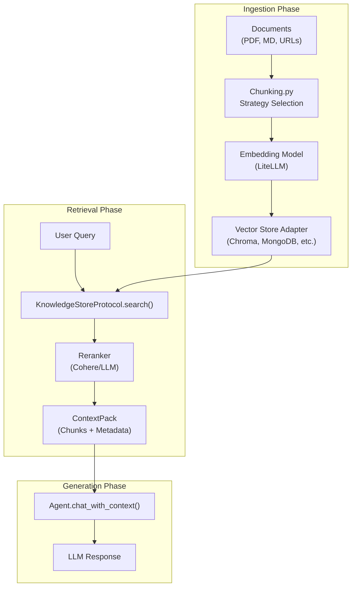
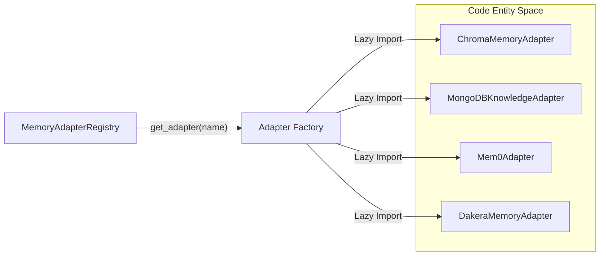

<!-- source: DeepWiki mcp.deepwiki.com · repo MervinPraison/PraisonAI · page 4.3 RAG System · fetched 2026-10-26 -->

# RAG System

<details>
<summary>Relevant source files</summary>

The following files were used as context for generating this wiki page:

- [api.md](api.md)
- [src/praisonai-agents/praisonaiagents/knowledge/adapters/__init__.py](src/praisonai-agents/praisonaiagents/knowledge/adapters/__init__.py)
- [src/praisonai-agents/praisonaiagents/knowledge/adapters/mem0_adapter.py](src/praisonai-agents/praisonaiagents/knowledge/adapters/mem0_adapter.py)
- [src/praisonai-agents/praisonaiagents/knowledge/adapters/mongodb_adapter.py](src/praisonai-agents/praisonaiagents/knowledge/adapters/mongodb_adapter.py)
- [src/praisonai-agents/praisonaiagents/knowledge/adapters/registry.py](src/praisonai-agents/praisonaiagents/knowledge/adapters/registry.py)
- [src/praisonai-agents/praisonaiagents/knowledge/index.py](src/praisonai-agents/praisonaiagents/knowledge/index.py)
- [src/praisonai-agents/praisonaiagents/knowledge/knowledge.py](src/praisonai-agents/praisonaiagents/knowledge/knowledge.py)
- [src/praisonai-agents/praisonaiagents/knowledge/models.py](src/praisonai-agents/praisonaiagents/knowledge/models.py)
- [src/praisonai-agents/praisonaiagents/llm/adapters/__init__.py](src/praisonai-agents/praisonaiagents/llm/adapters/__init__.py)
- [src/praisonai-agents/praisonaiagents/llm/protocols.py](src/praisonai-agents/praisonaiagents/llm/protocols.py)
- [src/praisonai-agents/praisonaiagents/memory/adapters/__init__.py](src/praisonai-agents/praisonaiagents/memory/adapters/__init__.py)
- [src/praisonai-agents/praisonaiagents/memory/adapters/factories.py](src/praisonai-agents/praisonaiagents/memory/adapters/factories.py)
- [src/praisonai-agents/praisonaiagents/memory/adapters/in_memory_adapter.py](src/praisonai-agents/praisonaiagents/memory/adapters/in_memory_adapter.py)
- [src/praisonai-agents/praisonaiagents/memory/adapters/registry.py](src/praisonai-agents/praisonaiagents/memory/adapters/registry.py)
- [src/praisonai-agents/praisonaiagents/memory/adapters/sqlite_adapter.py](src/praisonai-agents/praisonaiagents/memory/adapters/sqlite_adapter.py)
- [src/praisonai-agents/praisonaiagents/rag/pipeline.py](src/praisonai-agents/praisonaiagents/rag/pipeline.py)
- [src/praisonai-agents/praisonaiagents/rag/protocols.py](src/praisonai-agents/praisonaiagents/rag/protocols.py)
- [src/praisonai-agents/praisonaiagents/storage/base.py](src/praisonai-agents/praisonaiagents/storage/base.py)
- [src/praisonai-agents/praisonaiagents/utils/adapter_registry.py](src/praisonai-agents/praisonaiagents/utils/adapter_registry.py)
- [src/praisonai-agents/tests/unit/eval/test_base.py](src/praisonai-agents/tests/unit/eval/test_base.py)
- [src/praisonai-agents/tests/unit/eval/test_grader.py](src/praisonai-agents/tests/unit/eval/test_grader.py)
- [src/praisonai-agents/tests/unit/knowledge/test_adapters.py](src/praisonai-agents/tests/unit/knowledge/test_adapters.py)
- [src/praisonai-agents/tests/unit/memory/test_dakera_adapter.py](src/praisonai-agents/tests/unit/memory/test_dakera_adapter.py)
- [src/praisonai-agents/tests/unit/test_adapter_registry.py](src/praisonai-agents/tests/unit/test_adapter_registry.py)
- [src/praisonai-agents/tests/unit/test_architectural_fixes_unit.py](src/praisonai-agents/tests/unit/test_architectural_fixes_unit.py)
- [src/praisonai-agents/tests/unit/workflows/test_nested_patterns.py](src/praisonai-agents/tests/unit/workflows/test_nested_patterns.py)

</details>


## Purpose and Scope

The Retrieval-Augmented Generation (RAG) system in PraisonAI enables agents to retrieve and utilize information from external documents and knowledge bases to ground their responses. This system bridges the gap between static LLM knowledge and private or real-time data by processing documents through a pipeline of chunking, embedding, vector storage, and reranking.

The RAG system is built on a protocol-driven architecture, allowing for interchangeable backends for vector storage, embedding models, and rerankers [src/praisonai-agents/praisonaiagents/knowledge/knowledge.py:74-76]().

---

## RAG Pipeline Architecture

The pipeline transforms natural language queries into relevant context through several discrete stages.

### End-to-End Data Flow


**Sources:** [src/praisonai-agents/praisonaiagents/knowledge/knowledge.py:5-6](), [src/praisonai-agents/praisonaiagents/knowledge/knowledge.py:114-117]()

### Core Classes and Entities

| Entity | Code Reference | Purpose |
| :--- | :--- | :--- |
| `Knowledge` | `knowledge.py` | Main entry point for managing document ingestion and retrieval [src/praisonai-agents/praisonaiagents/knowledge/knowledge.py:53-54](). |
| `ContextPack` | `agent.py` | A container for retrieved chunks and metadata passed to the LLM [src/praisonai-agents/praisonaiagents/agent/agent.py:39](). |
| `RAGResult` | `agent.py` | Structured output containing the final answer, citations, and source metadata [src/praisonai-agents/praisonaiagents/agent/agent.py:67-69](). |
| `KnowledgeStoreProtocol` | `protocols.py` | Interface defining standard methods like `search`, `add`, and `delete` [src/praisonai-agents/tests/unit/knowledge/test_adapters.py:165-179](). |

---

## Vector Store Adapters

PraisonAI uses an adapter pattern to support multiple vector databases. These are lazy-loaded to keep the core package lightweight [src/praisonai-agents/praisonaiagents/memory/adapters/factories.py:1-15]().

### Adapter Registry and Initialization


**Sources:** [src/praisonai-agents/praisonaiagents/memory/adapters/registry.py:15-32](), [src/praisonai-agents/praisonaiagents/memory/adapters/__init__.py:37-45]()

### Supported Backends

| Backend | Adapter Class | Features |
| :--- | :--- | :--- |
| **ChromaDB** | `ChromaMemoryAdapter` | Default local persistent storage using HNSW [src/praisonai-agents/praisonaiagents/knowledge/knowledge.py:97-111](). |
| **MongoDB** | `MongoDBKnowledgeAdapter` | Supports Atlas Vector Search with automatic indexing [src/praisonai-agents/praisonaiagents/knowledge/adapters/mongodb_adapter.py:17-28](). |
| **Mem0** | `Mem0Adapter` | Combines vector search with entity relationship mapping [src/praisonai-agents/praisonaiagents/knowledge/adapters/mem0_adapter.py:24-38](). |
| **Dakera** | `DakeraMemoryAdapter` | Decay-weighted vector recall for time-sensitive context [src/praisonai-agents/praisonaiagents/memory/adapters/factories.py:134-163](). |

---

## Retrieval and Reranking

### Hybrid Retrieval
The system supports `hybrid` retrieval, combining dense vector search (semantic) with BM25 (keyword matching) [src/praisonai-agents/praisonaiagents/knowledge/knowledge.py:127-140]().

### Reranking Logic
Reranking is used to refine the initial retrieval results. It can be enabled via the `reranker` configuration [src/praisonai-agents/praisonaiagents/knowledge/knowledge.py:114-117]().
* **Cohere Rerank:** Uses the Cohere API for high-accuracy reordering.
* **LLM Rerank:** Uses an LLM to evaluate chunk relevance to the query.
* **Normalization:** The `Mem0Adapter` specifically normalizes results to ensure metadata is never `None`, preventing downstream processing errors [src/praisonai-agents/praisonaiagents/knowledge/adapters/mem0_adapter.py:111-135]().

---

## Agent Integration

Agents interact with the RAG system through several high-level methods defined in the `Agent` class [src/praisonai-agents/praisonaiagents/agent/agent.py:67-69]().

### Retrieval Methods in `Agent` Class

| Method | Description |
| :--- | :--- |
| `agent.query(question)` | Performs retrieval, generates an answer, and returns a `RAGResult` [src/praisonai-agents/praisonaiagents/agent/agent.py:67](). |
| `agent.rag_query(question)` | Explicit RAG execution, identical to `query` [src/praisonai-agents/praisonaiagents/agent/agent.py:69](). |
| `agent.chat_with_context(msg, context)` | Allows manual injection of a `ContextPack` into a chat turn [src/praisonai-agents/praisonaiagents/agent/agent.py:39](). |

### Context Policy
The `ContextPolicy` determines how retrieved information is formatted within the prompt. It manages token budgeting and ensures the most relevant information is prioritized during generation [src/praisonai-agents/praisonaiagents/llm/adapters/__init__.py:11-14]().

---

## Configuration: `RetrievalConfig`

The RAG behavior is controlled via a configuration dictionary passed to the `Knowledge` or `Agent` class.

```python
# Example Knowledge Configuration
base_config = {
    "vector_store": {
        "provider": "chroma",
        "config": {
            "collection_name": "praisonai_knowledge",
            "path": persist_dir
        }
    },
    "reranker": {
        "enabled": False,
        "default_rerank": False
    },
    "embedder": {
        "provider": "openai",
        "config": {"model": "text-embedding-3-small"}
    }
}
```
**Sources:** [src/praisonai-agents/praisonaiagents/knowledge/knowledge.py:102-118](), [src/praisonai-agents/praisonaiagents/knowledge/adapters/mongodb_adapter.py:98-104]()

---

## Citations and Metadata

Every retrieval result is encapsulated in a `SearchResultItem`, which includes:
* **Text:** The actual content chunk.
* **Score:** The similarity or rerank score.
* **Metadata:** A dictionary containing the source file, page number, or `user_id`/`agent_id` scopes [src/praisonai-agents/praisonaiagents/knowledge/adapters/mem0_adapter.py:111-135]().

The `Mem0Adapter` enforces scope requirements, ensuring that operations like `search` or `add` are always associated with a specific identifier (user, agent, or run) to maintain multi-tenant isolation [src/praisonai-agents/praisonaiagents/knowledge/adapters/mem0_adapter.py:86-109]().

**Sources:**
- `src/praisonai-agents/praisonaiagents/knowledge/knowledge.py:53-165`
- `src/praisonai-agents/praisonaiagents/agent/agent.py:39-69`
- `src/praisonai-agents/praisonaiagents/knowledge/adapters/mem0_adapter.py:24-209`
- `src/praisonai-agents/praisonaiagents/memory/adapters/factories.py:53-172`
- `src/praisonai-agents/praisonaiagents/knowledge/adapters/mongodb_adapter.py:17-188`

---

