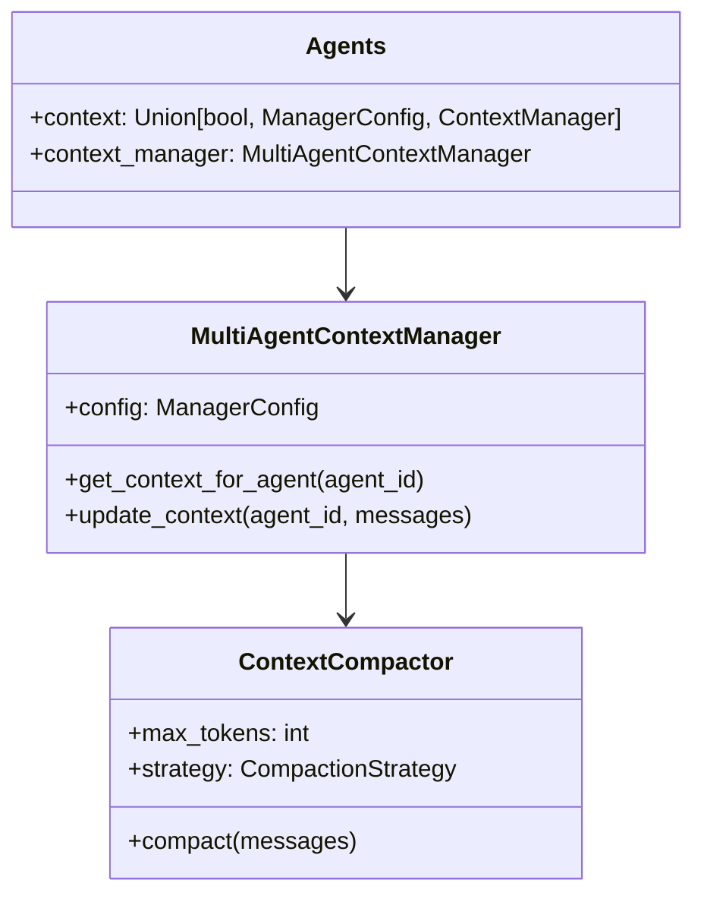

<!-- source: DeepWiki mcp.deepwiki.com · repo MervinPraison/PraisonAI · page 4.4 Context Management · fetched 2026-10-26 -->

# Context Management

<details>
<summary>Relevant source files</summary>

The following files were used as context for generating this wiki page:

- [api.md](api.md)
- [src/praisonai-agents/praisonaiagents/compaction/__init__.py](src/praisonai-agents/praisonaiagents/compaction/__init__.py)
- [src/praisonai-agents/praisonaiagents/compaction/compactor.py](src/praisonai-agents/praisonaiagents/compaction/compactor.py)
- [src/praisonai-agents/praisonaiagents/compaction/config.py](src/praisonai-agents/praisonaiagents/compaction/config.py)
- [src/praisonai-agents/praisonaiagents/compaction/memory_flush.py](src/praisonai-agents/praisonaiagents/compaction/memory_flush.py)
- [src/praisonai-agents/praisonaiagents/compaction/protocols.py](src/praisonai-agents/praisonaiagents/compaction/protocols.py)
- [src/praisonai-agents/praisonaiagents/compaction/result.py](src/praisonai-agents/praisonaiagents/compaction/result.py)
- [src/praisonai-agents/praisonaiagents/config/__init__.py](src/praisonai-agents/praisonaiagents/config/__init__.py)
- [src/praisonai-agents/praisonaiagents/config/resolver.py](src/praisonai-agents/praisonaiagents/config/resolver.py)
- [src/praisonai-agents/praisonaiagents/memory/file_memory.py](src/praisonai-agents/praisonaiagents/memory/file_memory.py)
- [src/praisonai-agents/tests/integration/test_pre_compaction_memory_flush_real.py](src/praisonai-agents/tests/integration/test_pre_compaction_memory_flush_real.py)
- [src/praisonai-agents/tests/unit/compaction/test_compaction.py](src/praisonai-agents/tests/unit/compaction/test_compaction.py)
- [src/praisonai-agents/tests/unit/compaction/test_in_loop_compaction.py](src/praisonai-agents/tests/unit/compaction/test_in_loop_compaction.py)
- [src/praisonai-agents/tests/unit/compaction/test_memory_flush.py](src/praisonai-agents/tests/unit/compaction/test_memory_flush.py)
- [src/praisonai-agents/tests/unit/test_security_audit_fixes.py](src/praisonai-agents/tests/unit/test_security_audit_fixes.py)
- [src/praisonai/praisonai/cli/commands/config.py](src/praisonai/praisonai/cli/commands/config.py)

</details>


## Purpose and Scope

Context management in PraisonAI controls how information flows between tasks and agents during workflow execution. This system determines which previous task results, knowledge base data, and validation feedback are included in each agent's prompt to ensure relevant information is available while avoiding context window overflow. 

This page details the **Context Compactor**, **Memory Flush** strategies, and **Token Budgeting** mechanisms that prevent context window overflow in long-running agentic loops.

For information about persistent memory storage and retrieval, see [Memory Management](). For knowledge base and RAG integration, see [Knowledge Management]() and [RAG System]().

## Overview

Context management operates at two levels in PraisonAI:

1.  **Task-level context**: Controls which previous task outputs are passed to subsequent tasks [src/praisonai-agents/praisonaiagents/process/process.py:146-203]().
2.  **Context Optimization & Compaction**: Manages the live conversation buffer using strategies like truncation, sliding windows, and LLM-based summarization [src/praisonai-agents/praisonaiagents/compaction/compactor.py:66-121]().

## Context Optimization and Compaction

The `ContextCompactor` class manages the conversation history to fit within `max_tokens`. It supports several strategies to reduce context size while preserving essential information.

### Compaction Strategies
The `CompactionStrategy` enum defines how the context is reduced [src/praisonai-agents/praisonaiagents/compaction/strategy.py:1-10]():

| Strategy | Behavior |
| :--- | :--- |
| `TRUNCATE` | Removes the oldest messages (excluding system messages) until the budget is met [src/praisonai-agents/praisonaiagents/compaction/compactor.py:220-250](). |
| `SLIDING` | Maintains a fixed-size window of the most recent messages. |
| `SUMMARIZE` | Uses a heuristic or local model to summarize older turns. |
| `LLM_SUMMARIZE` | Calls an LLM to generate a structured summary of compacted turns [src/praisonai-agents/praisonaiagents/compaction/compactor.py:330-360](). |
| `SMART` | Combines tool result pruning with truncation/summarization. |

### The Compaction Flow

```mermaid
graph TD
    "Agent.run()" --> "Check Token Limit"
    "Check Token Limit" -- "Over Limit" --> "run_pre_compaction_flush()"
    "run_pre_compaction_flush()" -- "Extract Durable Facts" --> "Memory Instance"
    "Memory Instance" --> "ContextCompactor.compact()"
    "ContextCompactor.compact()" -- "Strategy: TRUNCATE/SUMMARIZE" --> "New Message List"
    "New Message List" --> "LLM Call"
```
Sources: [src/praisonai-agents/praisonaiagents/compaction/compactor.py:220-300](), [src/praisonai-agents/praisonaiagents/compaction/memory_flush.py:18-50]()

## Memory Flush (Pre-Compaction)

Before context is permanently deleted or summarized by the compactor, PraisonAI can perform a "Pre-Compaction Memory Flush". This extracts durable facts from the messages about to be removed and stores them in Long-Term Memory.

### Implementation Details
- **Trigger**: Runs automatically if `pre_compaction_memory_flush` is enabled in `ExecutionConfig` [src/praisonai-agents/praisonaiagents/config/feature_configs.py:130]().
- **Agentic Extraction**: A temporary, lightweight agent is created to scan the "older slice" of messages for facts worth remembering [src/praisonai-agents/praisonaiagents/compaction/memory_flush.py:210-240]().
- **Atomic Commits**: Uses `_AtomicCommitGuard` to ensure that memory writes only happen if the extraction completes before the timeout [src/praisonai-agents/praisonaiagents/compaction/memory_flush.py:123-162]().
- **Non-Blocking**: The flush is "best-effort." If it hits the `timeout_seconds` limit, it aborts to avoid delaying the main agent loop [src/praisonai-agents/praisonaiagents/compaction/memory_flush.py:168-198]().

### Configuration
```python
from praisonaiagents import ExecutionConfig, PreCompactionMemoryFlushConfig

config = ExecutionConfig(
    context_compaction=True,
    pre_compaction_memory_flush=PreCompactionMemoryFlushConfig(
        enabled=True,
        timeout_seconds=5.0,
        min_turns_to_flush=3
    )
)
```
Sources: [src/praisonai-agents/praisonaiagents/config/feature_configs.py:130](), [src/praisonai-agents/tests/unit/compaction/test_memory_flush.py:42-62]()

## Token Budgeting

PraisonAI uses a dual-approach for token counting to balance accuracy and speed.

### Accurate vs. Heuristic Counting
- **Accurate**: Uses `tiktoken` to count tokens exactly for supported models [src/praisonai-agents/praisonaiagents/compaction/compactor.py:156-161]().
- **Heuristic**: A fast character-based estimation (approx. 4 characters per token) used as a fallback if `tiktoken` is unavailable or for speed [src/praisonai-agents/praisonaiagents/compaction/compactor.py:163-164]().
- **Offline Safety**: The `ContextCompactor` performs a one-time probe (`_accurate_tokeniser_available`) to check if `tiktoken` can run without a network download (crucial for CI/CD and air-gapped environments) [src/praisonai-agents/praisonaiagents/compaction/compactor.py:28-63]().

### Token Thresholds
Configured via `CompactionConfig` [src/praisonai-agents/praisonaiagents/compaction/config.py:42-50]():
- `max_tokens`: The hard limit that triggers compaction.
- `target_tokens`: The desired token count after compaction (default 75% of max).
- `preserve_recent`: The number of recent messages to keep verbatim, regardless of token count.

## In-Loop Context Management

For agents using tools, context can grow rapidly within a single task execution. PraisonAI implements "In-Loop Compaction" to manage this.

1.  **Tool Result Pruning**: Large tool outputs (e.g., a full web page crawl) are truncated or summarized if they exceed `max_tool_result_size` [src/praisonai-agents/praisonaiagents/compaction/config.py:67]().
2.  **Clear-then-Compact**: If tool results take up more than `clear_threshold_pct` (default 50%) of the window, the system clears old tool results while keeping the most recent `keep_recent_tool_results` [src/praisonai-agents/praisonaiagents/compaction/config.py:53-56]().

## Context Manager Class (Multi-Agent)

The `Agents` class uses a lazy-initialized `context_manager` to coordinate context across a team.


Sources: [src/praisonai-agents/praisonaiagents/agents/agents.py:539-582](), [src/praisonai-agents/praisonaiagents/compaction/compactor.py:66-91]()

### Summary of Key Components

| Component | File Path | Role |
| :--- | :--- | :--- |
| `ContextCompactor` | `src/praisonai-agents/praisonaiagents/compaction/compactor.py` | Core logic for reducing message list size. |
| `MemoryFlush` | `src/praisonai-agents/praisonaiagents/compaction/memory_flush.py` | Extracts facts before compaction deletes them. |
| `CompactionConfig` | `src/praisonai-agents/praisonaiagents/compaction/config.py` | Defines thresholds and strategies. |
| `PreCompactionMemoryFlushConfig` | `src/praisonai-agents/praisonaiagents/config/feature_configs.py` | Configuration for the flush-to-memory behavior. |

Sources: [src/praisonai-agents/praisonaiagents/compaction/compactor.py:66-121](), [src/praisonai-agents/praisonaiagents/compaction/memory_flush.py:1-20](), [src/praisonai-agents/praisonaiagents/compaction/config.py:42-84]()

---

