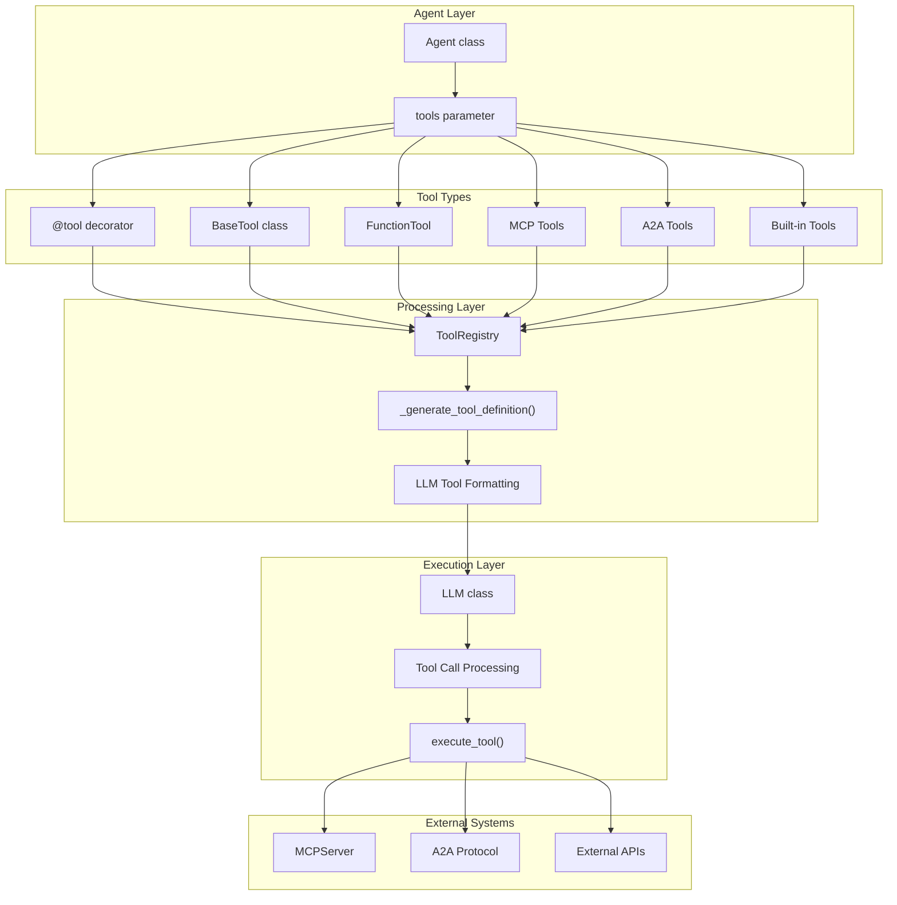
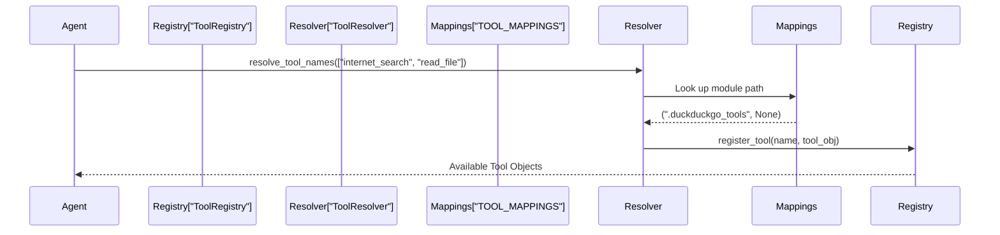

<!-- source: DeepWiki mcp.deepwiki.com · repo MervinPraison/PraisonAI · page 5 Tool Systems · fetched 2026-10-26 -->

# Tool Systems

<details>
<summary>Relevant source files</summary>

The following files were used as context for generating this wiki page:

- [src/praisonai-agents/praisonaiagents/knowledge/adapters/factories.py](src/praisonai-agents/praisonaiagents/knowledge/adapters/factories.py)
- [src/praisonai-agents/praisonaiagents/knowledge/protocols.py](src/praisonai-agents/praisonaiagents/knowledge/protocols.py)
- [src/praisonai-agents/praisonaiagents/llm/unified_adapters.py](src/praisonai-agents/praisonaiagents/llm/unified_adapters.py)
- [src/praisonai-agents/praisonaiagents/tools/__init__.py](src/praisonai-agents/praisonaiagents/tools/__init__.py)
- [src/praisonai-agents/praisonaiagents/tools/base.py](src/praisonai-agents/praisonaiagents/tools/base.py)
- [src/praisonai-agents/praisonaiagents/tools/decorator.py](src/praisonai-agents/praisonaiagents/tools/decorator.py)
- [src/praisonai-agents/praisonaiagents/tools/injected.py](src/praisonai-agents/praisonaiagents/tools/injected.py)
- [src/praisonai-agents/praisonaiagents/tools/schema.py](src/praisonai-agents/praisonaiagents/tools/schema.py)
- [src/praisonai-agents/test_unified_llm.py](src/praisonai-agents/test_unified_llm.py)
- [src/praisonai-agents/tests/integration/test_default_token_tracking_real.py](src/praisonai-agents/tests/integration/test_default_token_tracking_real.py)
- [src/praisonai-agents/tests/test_tool_schema_parity.py](src/praisonai-agents/tests/test_tool_schema_parity.py)
- [src/praisonai-agents/tests/unit/knowledge/test_embedding_failure.py](src/praisonai-agents/tests/unit/knowledge/test_embedding_failure.py)
- [src/praisonai-agents/tests/unit/llm/test_default_token_tracking.py](src/praisonai-agents/tests/unit/llm/test_default_token_tracking.py)
- [src/praisonai-agents/tests/unit/test_launch_mcp_delegation.py](src/praisonai-agents/tests/unit/test_launch_mcp_delegation.py)
- [src/praisonai-agents/tests/unit/test_tool_decorator_approval.py](src/praisonai-agents/tests/unit/test_tool_decorator_approval.py)
- [src/praisonai-code/praisonai_code/cli/commands/retrieval.py](src/praisonai-code/praisonai_code/cli/commands/retrieval.py)
- [src/praisonai-code/praisonai_code/cli/features/knowledge_cli.py](src/praisonai-code/praisonai_code/cli/features/knowledge_cli.py)
- [src/praisonai-code/tests/unit/test_query_command_agent.py](src/praisonai-code/tests/unit/test_query_command_agent.py)
- [src/praisonai/tests/unit/cli/test_knowledge_cli.py](src/praisonai/tests/unit/cli/test_knowledge_cli.py)

</details>


Tool systems enable agents to interact with external services, execute functions, and extend their capabilities beyond language model responses. PraisonAI provides a flexible tool architecture supporting multiple tool formats, discovery mechanisms, and execution patterns.

This page provides an overview of the tool ecosystem. For detailed implementation guides, see:
- **[Tool Integration](#5.1)** — `@tool` decorator, `BaseTool` class, `ToolRegistry`, parallel execution, and multimodal results.
- **[MCP Protocol](#5.2)** — Model Context Protocol client/server modes, transports (stdio, SSE), and the `praisonai-mcp` package.
- **[A2A Protocol](#5.3)** — Agent-to-Agent protocol for inter-agent discovery and task management.
- **[Custom Tools and Plugins](#5.4)** — Creating custom tools, the `PluginManager`, and built-in tool categories (shell, file, git, etc.).
- **[Skills System](#5.5)** — The `SkillManager`, self-improvement loops, and skill lifecycle management.

## Tool Architecture Overview

PraisonAI's tool system is built on a layered architecture that handles tool discovery, definition, execution, and monitoring. The system supports multiple tool formats and seamlessly integrates with external protocols like MCP and A2A.

**System Architecture**



Sources: [src/praisonai-agents/praisonaiagents/tools/__init__.py:8-20](), [src/praisonai-agents/praisonaiagents/tools/decorator.py:98-117](), [src/praisonai-agents/praisonaiagents/tools/base.py:179-192]()

## Tool Types and Protocols

PraisonAI supports multiple tool formats, enabling integration with various frameworks and custom implementations. The system uses `ToolRegistry` to manage these definitions.

**Supported Tool Formats**

| Tool Type | Usage | Code Entity |
|-----------|-------|-------------|
| `@tool` Decorator | Annotate Python functions | `tool` [src/praisonai-agents/praisonaiagents/tools/decorator.py:12-30]() |
| `BaseTool` Class | Subclass for complex tools | `BaseTool` [src/praisonai-agents/praisonaiagents/tools/base.py:179-192]() |
| `FunctionTool` | Auto-wrapper for callables | `FunctionTool` [src/praisonai-agents/praisonaiagents/tools/decorator.py:98-117]() |
| MCP Tools | Model Context Protocol | `praisonai-mcp` |
| A2A Tools | Agent-to-Agent protocol | `A2AProtocol` |
| Built-in Tools | 100+ pre-built utilities | `TOOL_MAPPINGS` [src/praisonai-agents/praisonaiagents/tools/__init__.py:48-155]() |

**Tool Format Detection and Schema Generation**

The system uses `build_parameters_schema` to convert Python type hints into JSON Schema for LLM tool-calling. It handles complex types like `Optional`, `Union`, and `Literal` [src/praisonai-agents/praisonaiagents/tools/schema.py:23-40]().

```mermaid
graph TD
    subgraph "Natural Language / LLM Space"
        LLMSchema["JSON Schema (OpenAI Format)"]
        ToolDesc["Tool Description (Docstring)"]
    end

    subgraph "Code Entity Space"
        Func["Python Function"]
        BaseT["BaseTool subclass"]
        ParamSchema["build_parameters_schema()"]
        AnnToJSON["annotation_to_json_schema()"]
    end

    Func -->|inspect.signature| ParamSchema
    BaseT -->|run() method| ParamSchema
    ParamSchema --> AnnToJSON
    AnnToJSON -->|Type Hints to JSON| LLMSchema
    Func -->|__doc__| ToolDesc
```

Sources: [src/praisonai-agents/praisonaiagents/tools/schema.py:23-40](), [src/praisonai-agents/praisonaiagents/tools/decorator.py:165-180]()

## Advanced Tool Execution

PraisonAI extends standard tool execution with features for resilience, state injection, and multimodal outputs.

### State Injection
Tools can receive the current agent context (agent ID, session ID, memory) without exposing these internal details to the LLM's tool schema using the `Injected` type marker [src/praisonai-agents/praisonaiagents/tools/injected.py:32-48]().

### Multimodal Results
The `ToolResult` class supports structured `content` containing text, images, or files, allowing tools to return visual data to vision-capable models [src/praisonai-agents/praisonaiagents/tools/base.py:32-55]().

### Resilience and Safety
- **Circuit Breakers**: Prevents cascading failures when external tools are unstable [src/praisonai-agents/praisonaiagents/tools/__init__.py:35-45]().
- **Human Approval**: Tools can be gated by risk levels (`critical`, `high`, `medium`, `low`) [src/praisonai-agents/praisonaiagents/tools/decorator.py:44-44]().
- **Retry Policies**: Configurable `RetryPolicy` and `FallbackChain` for handling transient tool errors [src/praisonai-agents/praisonaiagents/tools/__init__.py:32-32]().

## Tool Discovery and Registration

Tools are managed via a centralized `ToolRegistry`. The registry supports lazy loading through `TOOL_MAPPINGS` to maintain high performance even with hundreds of available tools [src/praisonai-agents/praisonaiagents/tools/__init__.py:48-155]().

**Tool Discovery Flow**



Sources: [src/praisonai-agents/praisonaiagents/tools/registry.py:18-18](), [src/praisonai-agents/praisonaiagents/tools/resolver.py:19-19](), [src/praisonai-agents/praisonaiagents/tools/__init__.py:48-155]()

## Monitoring and Telemetry

The tool system integrates with `TelemetryCollector` to track usage metrics, performance, and errors. This is vital for auditing agent behavior and calculating operational costs.

| Metric | Source | Implementation |
|--------|--------|----------------|
| Tool Usage | `execute_tool` | `track_tool_usage` [src/praisonai-agents/praisonaiagents/llm/openai_client.py:121-128]() |
| Token Consumption | LLM Response | `_track_token_usage` [src/praisonai-agents/tests/unit/llm/test_default_token_tracking.py:50-55]() |
| Execution Success | `ToolResult` | `ToolResult.success` [src/praisonai-agents/praisonaiagents/tools/base.py:57-65]() |

Sources: [src/praisonai-agents/tests/unit/llm/test_default_token_tracking.py:15-43](), [src/praisonai-agents/praisonaiagents/llm/openai_client.py:96-138]()

---

