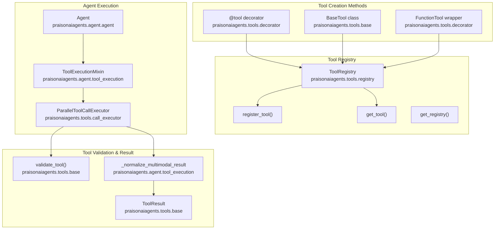
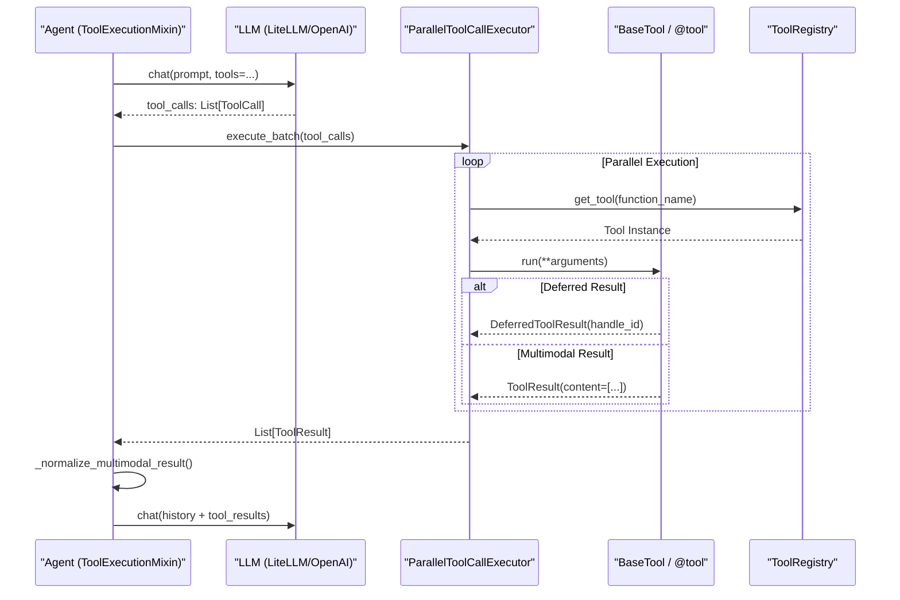

<!-- source: DeepWiki mcp.deepwiki.com · repo MervinPraison/PraisonAI · page 5.1 Tool Integration · fetched 2026-10-26 -->

# Tool Integration

Relevant source files

The following files were used as context for generating this wiki page:

- [.env.example](.env.example)
- [src/praisonai-agents/praisonaiagents/agent/agent.py](src/praisonai-agents/praisonaiagents/agent/agent.py)
- [src/praisonai-agents/praisonaiagents/agent/chat_mixin.py](src/praisonai-agents/praisonaiagents/agent/chat_mixin.py)
- [src/praisonai-agents/praisonaiagents/agent/durable.py](src/praisonai-agents/praisonaiagents/agent/durable.py)
- [src/praisonai-agents/praisonaiagents/agent/execution_mixin.py](src/praisonai-agents/praisonaiagents/agent/execution_mixin.py)
- [src/praisonai-agents/praisonaiagents/agent/interrupt.py](src/praisonai-agents/praisonaiagents/agent/interrupt.py)
- [src/praisonai-agents/praisonaiagents/agent/loop_detection.py](src/praisonai-agents/praisonaiagents/agent/loop_detection.py)
- [src/praisonai-agents/praisonaiagents/agent/tool_execution.py](src/praisonai-agents/praisonaiagents/agent/tool_execution.py)
- [src/praisonai-agents/praisonaiagents/agents/agents.py](src/praisonai-agents/praisonaiagents/agents/agents.py)
- [src/praisonai-agents/praisonaiagents/config/feature_configs.py](src/praisonai-agents/praisonaiagents/config/feature_configs.py)
- [src/praisonai-agents/praisonaiagents/escalation/doom_loop.py](src/praisonai-agents/praisonaiagents/escalation/doom_loop.py)
- [src/praisonai-agents/praisonaiagents/knowledge/adapters/factories.py](src/praisonai-agents/praisonaiagents/knowledge/adapters/factories.py)
- [src/praisonai-agents/praisonaiagents/knowledge/protocols.py](src/praisonai-agents/praisonaiagents/knowledge/protocols.py)
- [src/praisonai-agents/praisonaiagents/llm/llm.py](src/praisonai-agents/praisonaiagents/llm/llm.py)
- [src/praisonai-agents/praisonaiagents/llm/openai_client.py](src/praisonai-agents/praisonaiagents/llm/openai_client.py)
- [src/praisonai-agents/praisonaiagents/llm/sanitize.py](src/praisonai-agents/praisonaiagents/llm/sanitize.py)
- [src/praisonai-agents/praisonaiagents/llm/unified_adapters.py](src/praisonai-agents/praisonaiagents/llm/unified_adapters.py)
- [src/praisonai-agents/praisonaiagents/plugins/loop_detection_plugin.py](src/praisonai-agents/praisonaiagents/plugins/loop_detection_plugin.py)
- [src/praisonai-agents/praisonaiagents/tools/__init__.py](src/praisonai-agents/praisonaiagents/tools/__init__.py)
- [src/praisonai-agents/praisonaiagents/tools/base.py](src/praisonai-agents/praisonaiagents/tools/base.py)
- [src/praisonai-agents/praisonaiagents/tools/call_executor.py](src/praisonai-agents/praisonaiagents/tools/call_executor.py)
- [src/praisonai-agents/praisonaiagents/tools/clarify.py](src/praisonai-agents/praisonaiagents/tools/clarify.py)
- [src/praisonai-agents/praisonaiagents/tools/decorator.py](src/praisonai-agents/praisonaiagents/tools/decorator.py)
- [src/praisonai-agents/praisonaiagents/tools/injected.py](src/praisonai-agents/praisonaiagents/tools/injected.py)
- [src/praisonai-agents/praisonaiagents/tools/path_overlap.py](src/praisonai-agents/praisonaiagents/tools/path_overlap.py)
- [src/praisonai-agents/praisonaiagents/tools/protocols/__init__.py](src/praisonai-agents/praisonaiagents/tools/protocols/__init__.py)
- [src/praisonai-agents/praisonaiagents/tools/protocols/tool_protocol.py](src/praisonai-agents/praisonaiagents/tools/protocols/tool_protocol.py)
- [src/praisonai-agents/praisonaiagents/tools/registry.py](src/praisonai-agents/praisonaiagents/tools/registry.py)
- [src/praisonai-agents/praisonaiagents/tools/schema.py](src/praisonai-agents/praisonaiagents/tools/schema.py)
- [src/praisonai-agents/test_unified_llm.py](src/praisonai-agents/test_unified_llm.py)
- [src/praisonai-agents/tests/integration/test_default_token_tracking_real.py](src/praisonai-agents/tests/integration/test_default_token_tracking_real.py)
- [src/praisonai-agents/tests/integration/test_responses_api.py](src/praisonai-agents/tests/integration/test_responses_api.py)
- [src/praisonai-agents/tests/test_deferred_progress_tools.py](src/praisonai-agents/tests/test_deferred_progress_tools.py)
- [src/praisonai-agents/tests/test_native_deferred_parity.py](src/praisonai-agents/tests/test_native_deferred_parity.py)
- [src/praisonai-agents/tests/test_parallel_tools.py](src/praisonai-agents/tests/test_parallel_tools.py)
- [src/praisonai-agents/tests/test_plugin_system.py](src/praisonai-agents/tests/test_plugin_system.py)
- [src/praisonai-agents/tests/test_tool_schema_parity.py](src/praisonai-agents/tests/test_tool_schema_parity.py)
- [src/praisonai-agents/tests/test_tool_timeout.py](src/praisonai-agents/tests/test_tool_timeout.py)
- [src/praisonai-agents/tests/unit/agent/test_durable_run.py](src/praisonai-agents/tests/unit/agent/test_durable_run.py)
- [src/praisonai-agents/tests/unit/agent/test_loop_detector_wiring.py](src/praisonai-agents/tests/unit/agent/test_loop_detector_wiring.py)
- [src/praisonai-agents/tests/unit/knowledge/test_embedding_failure.py](src/praisonai-agents/tests/unit/knowledge/test_embedding_failure.py)
- [src/praisonai-agents/tests/unit/llm/test_default_token_tracking.py](src/praisonai-agents/tests/unit/llm/test_default_token_tracking.py)
- [src/praisonai-agents/tests/unit/llm/test_durable_tool_dispatch.py](src/praisonai-agents/tests/unit/llm/test_durable_tool_dispatch.py)
- [src/praisonai-agents/tests/unit/test_compaction_wiring.py](src/praisonai-agents/tests/unit/test_compaction_wiring.py)
- [src/praisonai-agents/tests/unit/test_doom_loop_no_progress_boundary.py](src/praisonai-agents/tests/unit/test_doom_loop_no_progress_boundary.py)
- [src/praisonai-agents/tests/unit/test_launch_mcp_delegation.py](src/praisonai-agents/tests/unit/test_launch_mcp_delegation.py)
- [src/praisonai-agents/tests/unit/test_loop_detection.py](src/praisonai-agents/tests/unit/test_loop_detection.py)
- [src/praisonai-agents/tests/unit/test_tool_decorator_approval.py](src/praisonai-agents/tests/unit/test_tool_decorator_approval.py)
- [src/praisonai-agents/tests/unit/tools/test_availability_gating.py](src/praisonai-agents/tests/unit/tools/test_availability_gating.py)
- [src/praisonai-agents/tests/unit/tools/test_clarify_tool.py](src/praisonai-agents/tests/unit/tools/test_clarify_tool.py)
- [src/praisonai-code/praisonai_code/cli/commands/retrieval.py](src/praisonai-code/praisonai_code/cli/commands/retrieval.py)
- [src/praisonai-code/praisonai_code/cli/features/knowledge_cli.py](src/praisonai-code/praisonai_code/cli/features/knowledge_cli.py)
- [src/praisonai-code/tests/unit/test_query_command_agent.py](src/praisonai-code/tests/unit/test_query_command_agent.py)
- [src/praisonai/tests/unit/cli/test_knowledge_cli.py](src/praisonai/tests/unit/cli/test_knowledge_cli.py)

## Purpose and Scope

This document covers the core tool integration system in PraisonAI, including the `@tool` decorator, `BaseTool` class, `FunctionTool` wrapper, and `ToolRegistry` for discovering and managing tools. It details the execution pipeline including parallel tool calls, deferred results, multimodal outputs, and security features like path sanitization and argument validation.

For information about creating pip-installable tool packages and auto-discovery mechanisms, see [Custom Tools and Plugins](#5.4). For integrating external tools via Model Context Protocol, see [MCP Protocol](#5.2). For agent-to-agent tool exposure, see [A2A Protocol](#5.3).

## Tool System Architecture

The tool system provides three primary interfaces for creating tools: function decoration with `@tool`, subclassing `BaseTool`, and direct `FunctionTool` wrapping. All tools are registered in a centralized `ToolRegistry` that handles discovery, validation, and retrieval.

### Tool Integration Overview

**Sources:** [src/praisonai-agents/praisonaiagents/agent/agent.py:20-22](), [src/praisonai-agents/praisonaiagents/tools/decorator.py:98-103](), [src/praisonai-agents/praisonaiagents/tools/call_executor.py:129-146](), [src/praisonai-agents/praisonaiagents/agent/tool_execution.py:133-160]()

### Tool Execution Flow

**Sources:** [src/praisonai-agents/praisonaiagents/agent/tool_execution.py:1-20](), [src/praisonai-agents/praisonaiagents/tools/call_executor.py:120-146](), [src/praisonai-agents/praisonaiagents/llm/llm.py:26-28]()

## Core Components

### @tool Decorator
The `@tool` decorator converts functions into `FunctionTool` instances. It supports state injection via `Injected[T]` and human-approval gating.

**File Location:** [src/praisonai-agents/praisonaiagents/tools/decorator.py]()

- **Argument Sanitization:** Uses `build_parameters_schema` to exclude injected parameters from the LLM-visible schema [src/praisonai-agents/praisonaiagents/tools/decorator.py:165-181]().
- **Approval Gating:** Supports `approval=True` or specific risk levels ("critical", "high", etc.) [src/praisonai-agents/praisonaiagents/tools/decorator.py:129-138]().
- **State Injection:** Detects `Injected` type hints to pass `Agent`, `AgentState`, or custom context [src/praisonai-agents/praisonaiagents/tools/decorator.py:144-145]().

### BaseTool and FunctionTool
`BaseTool` provides the interface for all tools. `FunctionTool` is the concrete implementation wrapping Python functions.

- **Multimodal Support:** Tools can return structured content (images, files) via `ToolResult.content` [src/praisonai-agents/praisonaiagents/agent/tool_execution.py:133-160]().
- **Path Overlap Protection:** Security logic in file tools prevents directory traversal [src/praisonai-agents/praisonaiagents/tools/__init__.py:72-81]().

### ToolRegistry
A singleton for managing tool lifecycle and discovery.
- **Discovery:** Supports string-name resolution and lazy loading of built-in tool modules [src/praisonai-agents/praisonaiagents/tools/registry.py:1-18]().
- **Availability Gating:** Tools can define an `availability` callable to check environment requirements (e.g., API keys) before being exposed to the LLM [src/praisonai-agents/praisonaiagents/tools/decorator.py:111-112]().

## Advanced Execution Features

### ParallelToolCallExecutor
Handles the simultaneous execution of multiple tool calls requested by an LLM in a single turn.
- **Thread Safety:** Uses `concurrent.futures.ThreadPoolExecutor` with a bounded pool [src/praisonai-agents/praisonaiagents/tools/call_executor.py:1-12]().
- **Timeout Management:** Respects `timeout_ms` per tool call, raising `ToolTimeoutError` if exceeded [src/praisonai-agents/praisonaiagents/tools/call_executor.py:71-72]().

### DeferredToolResult
Enables "long-running" tools to return a handle instead of blocking the agent's execution loop.
- **Handle Registration:** The `DeferredResolver` tracks pending handles [src/praisonai-agents/praisonaiagents/tools/call_executor.py:104-117]().
- **Native Parity:** Both LiteLLM and Native OpenAI paths support re-injecting deferred results into history [src/praisonai-agents/praisonaiagents/llm/openai_client.py:41-67]().

### Multimodal Tool Results
The system normalizes diverse tool outputs (MCP, ToolResult, or bare dicts) into OpenAI-compatible multimodal message parts.
- **Image Handling:** Automatically converts local paths or raw bytes into Base64 data URIs [src/praisonai-agents/praisonaiagents/agent/tool_execution.py:65-130]().
- **Byte Limits:** Enforces `MULTIMODAL_IMAGE_BYTE_LIMIT` (default 5MB) to prevent context window exhaustion [src/praisonai-agents/praisonaiagents/agent/tool_execution.py:61-62]().

## Built-in Tools

| Category | Tools | Source |
| :--- | :--- | :--- |
| **Search** | `duckduckgo`, `tavily`, `exa`, `searxng` | [src/praisonai-agents/praisonaiagents/tools/__init__.py:48-54]() |
| **Execution** | `execute_code`, `execute_command` | [src/praisonai-agents/praisonaiagents/tools/__init__.py:64-91]() |
| **Files** | `read_file`, `write_file`, `list_files` | [src/praisonai-agents/praisonaiagents/tools/__init__.py:72-81]() |
| **Web** | `crawl4ai`, `spider_tools` | [src/praisonai-agents/praisonaiagents/tools/__init__.py:56-62]() |

**Sources:** [src/praisonai-agents/praisonaiagents/tools/__init__.py:48-160]()

## Tool Configuration

Tool behavior is governed by `ExecutionConfig` and `ToolExecutionConfig`.
- **Output Limits:** `DEFAULT_TOOL_OUTPUT_LIMIT` (16,000 chars) prevents massive tool outputs from crashing the model [src/praisonai-agents/praisonaiagents/config/feature_configs.py:42-45]().
- **Retry & Backoff:** `BackoffPolicy` provides exponential backoff with jitter for failed tool calls [src/praisonai-agents/praisonaiagents/agent/tool_execution.py:36-57]().
- **Durable Execution:** If `durable=True`, tool results are recorded in a `RunJournal` for resumption after failure [src/praisonai-agents/tests/unit/agent/test_durable_run.py:15-27]().

**Sources:** [src/praisonai-agents/praisonaiagents/config/feature_configs.py:42-45](), [src/praisonai-agents/praisonaiagents/agent/tool_execution.py:36-57]()

---

