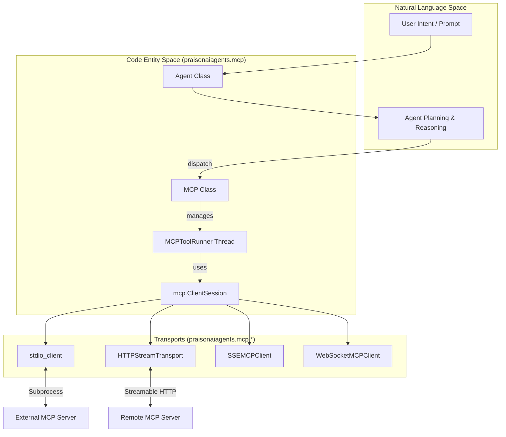
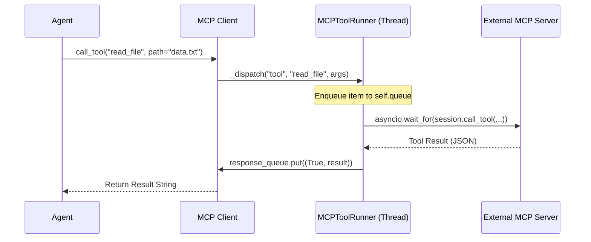

<!-- source: DeepWiki mcp.deepwiki.com · repo MervinPraison/PraisonAI · page 5.2 MCP Protocol · fetched 2026-10-26 -->

# MCP Protocol

Relevant source files

The following files were used as context for generating this wiki page:

- [examples/python/mcp/filesystem-mcp.py](examples/python/mcp/filesystem-mcp.py)
- [src/praisonai-agents/praisonaiagents/_config.py](src/praisonai-agents/praisonaiagents/_config.py)
- [src/praisonai-agents/praisonaiagents/agent/message_queue.py](src/praisonai-agents/praisonaiagents/agent/message_queue.py)
- [src/praisonai-agents/praisonaiagents/agent/summarization.py](src/praisonai-agents/praisonaiagents/agent/summarization.py)
- [src/praisonai-agents/praisonaiagents/bus/__init__.py](src/praisonai-agents/praisonaiagents/bus/__init__.py)
- [src/praisonai-agents/praisonaiagents/eval/__init__.py](src/praisonai-agents/praisonaiagents/eval/__init__.py)
- [src/praisonai-agents/praisonaiagents/llm/rate_limiter.py](src/praisonai-agents/praisonaiagents/llm/rate_limiter.py)
- [src/praisonai-agents/praisonaiagents/llm/schema_utils.py](src/praisonai-agents/praisonaiagents/llm/schema_utils.py)
- [src/praisonai-agents/praisonaiagents/mcp/__init__.py](src/praisonai-agents/praisonaiagents/mcp/__init__.py)
- [src/praisonai-agents/praisonaiagents/mcp/mcp.py](src/praisonai-agents/praisonaiagents/mcp/mcp.py)
- [src/praisonai-agents/praisonaiagents/mcp/mcp_http_stream.py](src/praisonai-agents/praisonaiagents/mcp/mcp_http_stream.py)
- [src/praisonai-agents/praisonaiagents/mcp/mcp_schema_utils.py](src/praisonai-agents/praisonaiagents/mcp/mcp_schema_utils.py)
- [src/praisonai-agents/praisonaiagents/mcp/mcp_sse.py](src/praisonai-agents/praisonaiagents/mcp/mcp_sse.py)
- [src/praisonai-agents/praisonaiagents/mcp/mcp_websocket.py](src/praisonai-agents/praisonaiagents/mcp/mcp_websocket.py)
- [src/praisonai-agents/praisonaiagents/skills/__init__.py](src/praisonai-agents/praisonaiagents/skills/__init__.py)
- [src/praisonai-agents/praisonaiagents/trace/__init__.py](src/praisonai-agents/praisonaiagents/trace/__init__.py)
- [src/praisonai-agents/praisonaiagents/trace/redact.py](src/praisonai-agents/praisonaiagents/trace/redact.py)
- [src/praisonai-agents/tests/mcp-http-stream-example.py](src/praisonai-agents/tests/mcp-http-stream-example.py)
- [src/praisonai-agents/tests/smoke_core_phase_a_real.py](src/praisonai-agents/tests/smoke_core_phase_a_real.py)
- [src/praisonai-agents/tests/test_http_stream_basic.py](src/praisonai-agents/tests/test_http_stream_basic.py)
- [src/praisonai-agents/tests/test_mcp_http_stream.py](src/praisonai-agents/tests/test_mcp_http_stream.py)
- [src/praisonai-agents/tests/test_mcp_optional_import.py](src/praisonai-agents/tests/test_mcp_optional_import.py)
- [src/praisonai-agents/tests/test_rate_limiter_retry.py](src/praisonai-agents/tests/test_rate_limiter_retry.py)
- [src/praisonai-agents/tests/test_rate_limiter_tokens.py](src/praisonai-agents/tests/test_rate_limiter_tokens.py)
- [src/praisonai-agents/tests/unit/agent/test_core_phase_a.py](src/praisonai-agents/tests/unit/agent/test_core_phase_a.py)
- [src/praisonai-mcp/praisonai_mcp/_version.py](src/praisonai-mcp/praisonai_mcp/_version.py)
- [src/praisonai-mcp/pyproject.toml](src/praisonai-mcp/pyproject.toml)
- [src/praisonai-mcp/uv.lock](src/praisonai-mcp/uv.lock)
- [src/praisonai/praisonai/replay/judge.py](src/praisonai/praisonai/replay/judge.py)

## Purpose and Scope

The Model Context Protocol (MCP) is a standardized protocol implemented in PraisonAI for exposing and consuming AI tools across different systems. MCP enables agents to interact with external tool servers and exposes PraisonAI's own tools as MCP-compatible servers. 

The implementation resides primarily in `praisonaiagents.mcp` and the standalone `praisonai-mcp` package. It supports multiple transport mechanisms including `stdio`, `HTTP Stream`, `SSE`, and `WebSocket`.

For general tool integration patterns, see [Tool Integration](5.1). For agent-to-agent communication, see [A2A Protocol](5.3).

---

## MCP Architecture Overview

### System Design and Data Flow

**Sources:** [src/praisonai-agents/praisonaiagents/mcp/mcp.py:25-58](), [src/praisonai-agents/praisonaiagents/mcp/__init__.py:1-13](), [src/praisonai-agents/praisonaiagents/mcp/mcp_http_stream.py:155-170]()

### Key Components

| Component | Role | Location |
|-----------|------|----------|
| `MCP` | Main entry point for MCP client operations. | [src/praisonai-agents/praisonaiagents/mcp/mcp.py:355-356]() |
| `MCPToolRunner` | A dedicated thread for running asynchronous MCP operations in a synchronous agent environment. | [src/praisonai-agents/praisonaiagents/mcp/mcp.py:25-29]() |
| `HTTPStreamTransport` | Implements the "Streamable HTTP" transport protocol (Revision 2025-11-25). | [src/praisonai-agents/praisonaiagents/mcp/mcp_http_stream.py:155-166]() |
| `MCPServer` | Hosting component for exposing agents/tools to external clients. | [src/praisonai-mcp/pyproject.toml:4]() |
| `ThreadLocalEventLoop` | Utility to manage async event loops across multiple threads safely. | [src/praisonai-agents/praisonaiagents/mcp/mcp_schema_utils.py:1-10]() |

---

## Client Mode: Consuming MCP Servers

### MCP Class and Threading Model
The `MCP` class uses a `MCPToolRunner` (inheriting from `threading.Thread`) to handle the asynchronous lifecycle of the MCP protocol. This allows the core Agent system, which is often synchronous, to interact with async MCP servers without blocking the main execution flow.

**Key Lifecycle Methods:**
- `_run_async()`: Sets up the `ClientSession` and performs capability negotiation for tools, resources, and prompts [src/praisonai-agents/praisonaiagents/mcp/mcp.py:47-67]().
- `_dispatch()`: Thread-safe queue-based mechanism to send requests (`tool`, `resource`, or `prompt`) to the runner thread [src/praisonai-agents/praisonaiagents/mcp/mcp.py:129-157]().

### Transport Support

#### 1. stdio Transport
Used for local process communication. It spawns a subprocess and communicates via `stdin`/`stdout` using `StdioServerParameters` [src/praisonai-agents/praisonaiagents/mcp/mcp.py:16-17]().

#### 2. HTTP Stream Transport
Implemented in `HTTPStreamTransport`, this follows the latest MCP Protocol revisions.
- **Headers:** Includes `Mcp-Protocol-Version` (default `2025-03-26`) and `Mcp-Session-Id` [src/praisonai-agents/praisonaiagents/mcp/mcp_http_stream.py:169-186]().
- **Resumability:** Supports `Last-Event-ID` for SSE resumability [src/praisonai-agents/praisonaiagents/mcp/mcp_http_stream.py:165-179]().

#### 3. SSE Transport
The `SSEMCPClient` connects to servers via Server-Sent Events. It wraps discovered tools into `SSEMCPTool` objects that provide a synchronous `__call__` interface for agents [src/praisonai-agents/praisonaiagents/mcp/mcp_sse.py:35-80]().

**Sources:** [src/praisonai-agents/praisonaiagents/mcp/mcp_http_stream.py:1-20](), [src/praisonai-agents/praisonaiagents/mcp/mcp_sse.py:1-20]()

---

## Server Mode: praisonai-mcp

The `praisonai-mcp` package provides the infrastructure to host PraisonAI agents and tools as MCP servers.

### MCPServer and serve_agents
The server mode allows external clients (like Cursor or Claude Desktop) to call PraisonAI tools.
- **serve_agents**: Function to wrap multiple agents and expose their capabilities via an MCP server.
- **agent_adapter**: Converts internal Agent tool definitions into MCP-compliant schemas using `build_openai_tool_dict` and `function_to_mcp_schema`.

**Sources:** [src/praisonai-mcp/pyproject.toml:1-17](), [src/praisonai-agents/praisonaiagents/mcp/mcp_schema_utils.py:1-38]()

### Authentication and Elicitation
The server supports optional authentication and elicitation patterns (requesting missing info from the user).
- **Auth:** Optional dependency group `auth` includes `httpx` for verifying credentials [src/praisonai-mcp/pyproject.toml:24-26]().
- **Schema Utils:** `fix_array_schemas` ensures that tool parameter definitions are compatible with client-side LLM expectations [src/praisonai-agents/praisonaiagents/mcp/__init__.py:40]().

---

## Utilities and Optimization

### Rate Limiting
MCP calls are subject to the global `RateLimiter`. It uses a token bucket algorithm to control `requests_per_minute` and `tokens_per_minute` [src/praisonai-agents/praisonaiagents/llm/rate_limiter.py:34-64]().
- **Async Support:** `acquire_async()` allows non-blocking waits for rate limit availability [src/praisonai-agents/praisonaiagents/llm/rate_limiter.py:59]().

### Lazy Loading System
To minimize startup overhead, the MCP module uses a lazy loading mechanism via `create_lazy_getattr`. Optional components like `WebSocketMCPClient` or `OAuthCallbackHandler` are only imported when accessed [src/praisonai-agents/praisonaiagents/mcp/__init__.py:29-61]().

**Sources:** [src/praisonai-agents/praisonaiagents/mcp/__init__.py:14-25](), [src/praisonai-agents/praisonaiagents/llm/rate_limiter.py:1-22]()

---

## Data Flow: Tool Execution

**Sources:** [src/praisonai-agents/praisonaiagents/mcp/mcp.py:78-95](), [src/praisonai-agents/praisonaiagents/mcp/mcp.py:149-157]()

---

## Testing and Reliability

### Optional Imports
The system is designed to be resilient to missing dependencies. If the `mcp` package is not installed, `MCP_AVAILABLE` is set to `False`, and attempts to use MCP will raise an `ImportError` with specific installation instructions [src/praisonai-agents/tests/test_mcp_optional_import.py:68-89]().

### Timeout Handling
All MCP operations include configurable timeouts (default 60s). If a server fails to respond, the `MCPToolRunner` catches `asyncio.TimeoutError` and returns a failure message to the agent [src/praisonai-agents/praisonaiagents/mcp/mcp.py:87-88]().

**Sources:** [src/praisonai-agents/praisonaiagents/mcp/mcp.py:28-38](), [src/praisonai-agents/tests/test_mcp_optional_import.py:1-20]()

---

