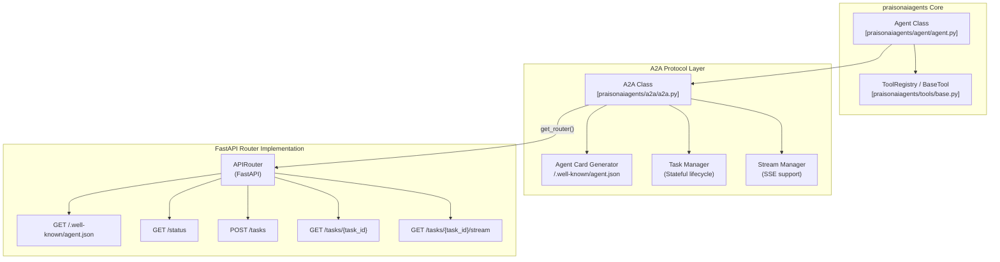
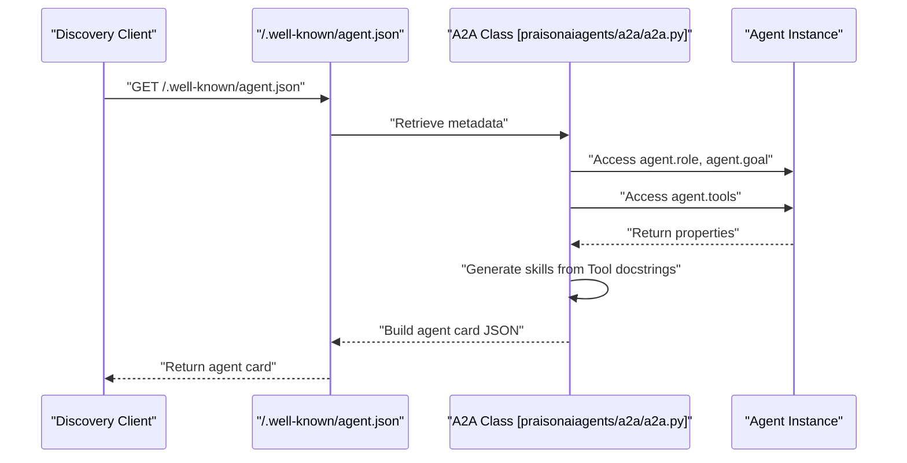
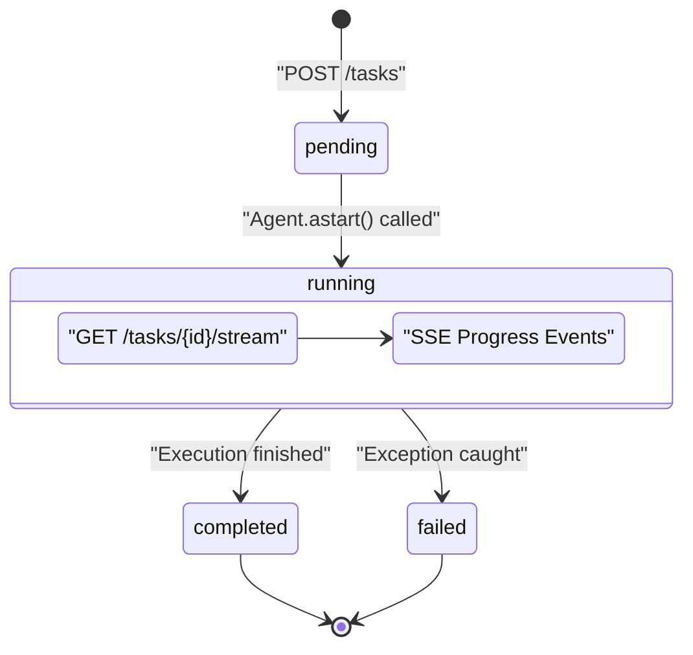

<!-- source: DeepWiki mcp.deepwiki.com · repo MervinPraison/PraisonAI · page 5.3 A2A Protocol · fetched 2026-10-26 -->

# A2A Protocol

<details>
<summary>Relevant source files</summary>

The following files were used as context for generating this wiki page:

- [README.md](README.md)
- [api.md](api.md)
- [src/praisonai/README.md](src/praisonai/README.md)

</details>


## Purpose and Scope

This page documents the Agent-to-Agent (A2A) Protocol implementation in PraisonAI. The A2A Protocol enables inter-agent communication, discovery, and collaboration across distributed AI systems. It allows PraisonAI agents to be exposed as discoverable services that other agents can interact with through standardized endpoints.

The protocol provides a declarative way to expose agent capabilities, manage long-running tasks, and integrate with the A2UI declarative agent UI.

---

## Overview

The A2A Protocol provides a standardized way for AI agents to:
- Publish their capabilities through agent cards (JSON metadata) [README.md:1170]().
- Accept and manage tasks from other agents [README.md:1170]().
- Stream results in real-time via Server-Sent Events (SSE) [README.md:1170]().
- Maintain stateful task lifecycles [README.md:1170]().
- Auto-generate skill descriptions from tools [README.md:1170]().

The protocol implementation centers around the `A2A` class which wraps a PraisonAI `Agent` and exposes it via FastAPI endpoints following the A2A specification [README.md:1170]().

**Sources:** [README.md:1170](), [api.md:515-527]()

---

## System Architecture

The following diagram bridges the "Natural Language Space" of protocol concepts to the "Code Entity Space" of the `praisonaiagents` library.



**A2A Protocol Architecture**

The `A2A` class wraps an `Agent` instance, utilizing its `role`, `goal`, and `tools` to populate the discovery metadata [README.md:1170](). It then maps standard protocol endpoints to the agent's internal `start()` and `astart()` methods [api.md:31-94]().

**Sources:** [README.md:1170](), [api.md:515-527](), [api.md:31-94]()

---

## Core Components

### A2A Class

The `A2A` class is the primary interface for exposing agents. It encapsulates an agent and provides HTTP endpoints for discovery and task execution.

| Component | Purpose | Source |
|-----------|---------|--------|
| `A2A(agent, url)` | Wraps an `Agent` instance and configures base URL | [api.md:518]() |
| `get_router()` | Returns FastAPI `APIRouter` with protocol endpoints | [api.md:520]() |
| Agent Card generation | Auto-generates JSON metadata from agent properties | [README.md:1170]() |
| Skills extraction | Derives skills list from agent's tools | [README.md:1170]() |
| Task lifecycle | Tracks states: `pending`, `running`, `completed`, `failed` | [README.md:1170]() |

**Key Initialization:**
```python
from praisonaiagents import Agent, A2A

agent = Agent(name="Assistant", tools=[...])
a2a = A2A(agent=agent, url="http://localhost:8000/a2a")
router = a2a.get_router()
```

**Sources:** [README.md:1170](), [api.md:518-520]()

---

## Agent Discovery Flow

The discovery process allows external entities to understand an agent's capabilities without prior manual configuration.



**Agent Discovery Sequence**

External agents discover capabilities by requesting the well-known agent card endpoint. The A2A server auto-generates the card from the underlying Agent's properties and tools [README.md:1170]().

**Sources:** [README.md:1170](), [api.md:515-527]()

---

## Task Lifecycle and Streaming

Tasks progress through distinct states as the agent processes them. The A2A protocol implementation uses the `Agent.start()` or `Agent.astart()` methods to trigger execution [api.md:94-95]().

### Task State Machine



**Task State Transitions**

- **`pending`**: Task created in the internal store but not yet picked up by the executor [README.md:1170]().
- **`running`**: The agent is currently invoking tools or LLM calls.
- **`completed`**: The `Agent.run()` method has returned a final string or structured output [api.md:90]().
- **`failed`**: An unhandled exception occurred during agent execution.

**Sources:** [README.md:1170](), [api.md:90-95]()

---

## API Endpoints

### Discovery Endpoint
**`GET /.well-known/agent.json`**
Returns the agent card describing capabilities and skills [README.md:1170]().

### Task Management
- **`POST /tasks`**: Creates a new task. Requires a `prompt` in the request body [README.md:1170]().
- **`GET /tasks/{task_id}`**: Retrieves current task state and results [README.md:1170]().
- **`GET /tasks/{task_id}/stream`**: Streams task progress via Server-Sent Events (SSE). Emits `progress` and `result` events [README.md:1170]().

**Sources:** [README.md:1170]()

---

## Skills Extraction Logic

The A2A protocol automatically generates a skills list from the agent's available tools [README.md:1170]().

| Tool Type | Extraction Logic |
|-----------|------------------|
| **Python Function** | Uses function name as skill ID and docstring as description. |
| **BaseTool Subclass** | Uses `name` attribute and `description` attribute [api.md:19-20](). |
| **MCP Tool** | Proxies the name and description provided by the MCP server schema. |

**Sources:** [README.md:1170](), [api.md:19-20]()

---

## Integration with FastAPI

The `A2A` class is designed to integrate seamlessly with FastAPI applications.

```python
from praisonaiagents import Agent, A2A
from fastapi import FastAPI

# 1. Define Agent
agent = Agent(name="Researcher", role="Web Searcher", tools=[search_tool])

# 2. Wrap with A2A
a2a = A2A(agent=agent, url="http://localhost:8000/a2a")

# 3. Mount Router
app = FastAPI()
app.include_router(a2a.get_router())
```

This pattern allows multiple agents to be hosted within a single FastAPI application by providing different `base_path` values to the `get_router()` method [README.md:1170]().

**Sources:** [README.md:1170](), [api.md:515-527]()

---

