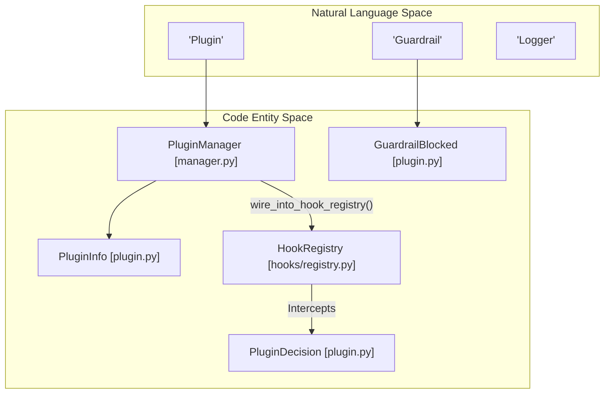
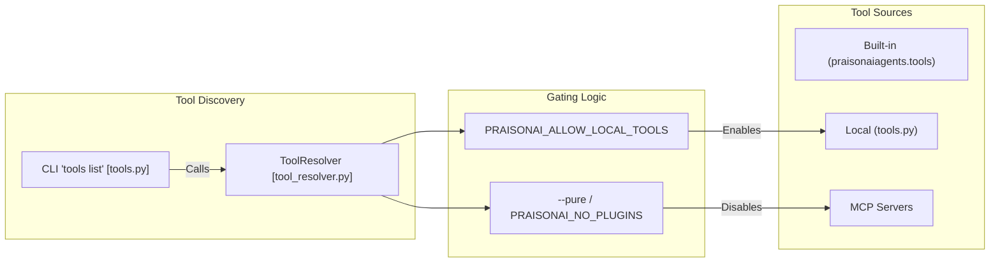
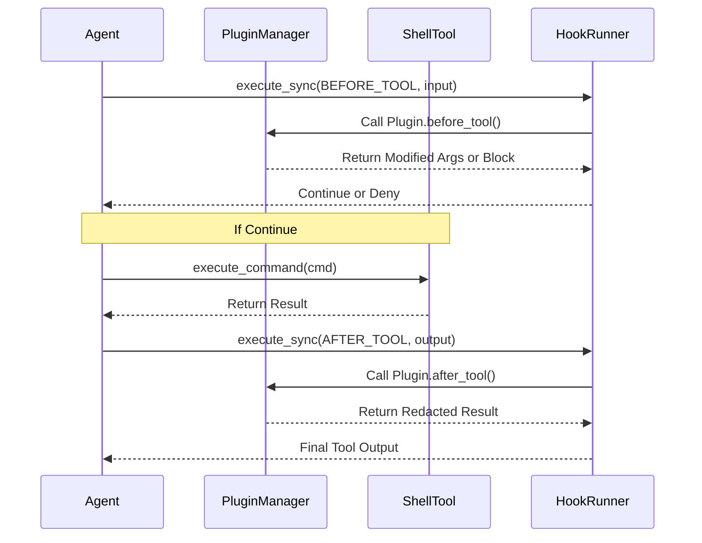

<!-- source: DeepWiki mcp.deepwiki.com · repo MervinPraison/PraisonAI · page 5.4 Custom Tools and Plugins · fetched 2026-10-26 -->

# Custom Tools and Plugins

Relevant source files

The following files were used as context for generating this wiki page:

- [src/praisonai-agents/praisonaiagents/config/loader.py](src/praisonai-agents/praisonaiagents/config/loader.py)
- [src/praisonai-agents/praisonaiagents/lsp/__init__.py](src/praisonai-agents/praisonaiagents/lsp/__init__.py)
- [src/praisonai-agents/praisonaiagents/lsp/client.py](src/praisonai-agents/praisonaiagents/lsp/client.py)
- [src/praisonai-agents/praisonaiagents/lsp/config.py](src/praisonai-agents/praisonaiagents/lsp/config.py)
- [src/praisonai-agents/praisonaiagents/planning/todo.py](src/praisonai-agents/praisonaiagents/planning/todo.py)
- [src/praisonai-agents/praisonaiagents/plugins/__init__.py](src/praisonai-agents/praisonaiagents/plugins/__init__.py)
- [src/praisonai-agents/praisonaiagents/plugins/discovery.py](src/praisonai-agents/praisonaiagents/plugins/discovery.py)
- [src/praisonai-agents/praisonaiagents/plugins/manager.py](src/praisonai-agents/praisonaiagents/plugins/manager.py)
- [src/praisonai-agents/praisonaiagents/plugins/plugin.py](src/praisonai-agents/praisonaiagents/plugins/plugin.py)
- [src/praisonai-agents/praisonaiagents/session/title.py](src/praisonai-agents/praisonaiagents/session/title.py)
- [src/praisonai-agents/praisonaiagents/streaming/__init__.py](src/praisonai-agents/praisonaiagents/streaming/__init__.py)
- [src/praisonai-agents/praisonaiagents/streaming/events.py](src/praisonai-agents/praisonaiagents/streaming/events.py)
- [src/praisonai-agents/praisonaiagents/streaming/progress.py](src/praisonai-agents/praisonaiagents/streaming/progress.py)
- [src/praisonai-agents/praisonaiagents/tools/_file_locks.py](src/praisonai-agents/praisonaiagents/tools/_file_locks.py)
- [src/praisonai-agents/praisonaiagents/tools/edit_tools.py](src/praisonai-agents/praisonaiagents/tools/edit_tools.py)
- [src/praisonai-agents/praisonaiagents/tools/file_tools.py](src/praisonai-agents/praisonaiagents/tools/file_tools.py)
- [src/praisonai-agents/praisonaiagents/tools/lsp_tools.py](src/praisonai-agents/praisonaiagents/tools/lsp_tools.py)
- [src/praisonai-agents/praisonaiagents/tools/shell_tools.py](src/praisonai-agents/praisonaiagents/tools/shell_tools.py)
- [src/praisonai-agents/praisonaiagents/tools/todo_tools.py](src/praisonai-agents/praisonaiagents/tools/todo_tools.py)
- [src/praisonai-agents/tests/test_plugin_registry_and_gate.py](src/praisonai-agents/tests/test_plugin_registry_and_gate.py)
- [src/praisonai-agents/tests/unit/lsp/test_lsp.py](src/praisonai-agents/tests/unit/lsp/test_lsp.py)
- [src/praisonai-agents/tests/unit/plugins/test_hook_bridge.py](src/praisonai-agents/tests/unit/plugins/test_hook_bridge.py)
- [src/praisonai-agents/tests/unit/plugins/test_plugin_options.py](src/praisonai-agents/tests/unit/plugins/test_plugin_options.py)
- [src/praisonai-agents/tests/unit/plugins/test_plugins.py](src/praisonai-agents/tests/unit/plugins/test_plugins.py)
- [src/praisonai-agents/tests/unit/session/test_title_gen.py](src/praisonai-agents/tests/unit/session/test_title_gen.py)
- [src/praisonai-agents/tests/unit/streaming/test_progress_compositor.py](src/praisonai-agents/tests/unit/streaming/test_progress_compositor.py)
- [src/praisonai-agents/tests/unit/streaming/test_tool_progress.py](src/praisonai-agents/tests/unit/streaming/test_tool_progress.py)
- [src/praisonai-agents/tests/unit/tools/test_edit_tools.py](src/praisonai-agents/tests/unit/tools/test_edit_tools.py)
- [src/praisonai-agents/tests/unit/tools/test_file_tools.py](src/praisonai-agents/tests/unit/tools/test_file_tools.py)
- [src/praisonai-agents/tests/unit/tools/test_lsp_tools.py](src/praisonai-agents/tests/unit/tools/test_lsp_tools.py)
- [src/praisonai-bot/praisonai_bot/bots/_streaming.py](src/praisonai-bot/praisonai_bot/bots/_streaming.py)
- [src/praisonai-bot/tests/unit/bots/test_streaming_flood_control.py](src/praisonai-bot/tests/unit/bots/test_streaming_flood_control.py)
- [src/praisonai-code/praisonai_code/cli/commands/plugins.py](src/praisonai-code/praisonai_code/cli/commands/plugins.py)
- [src/praisonai-code/praisonai_code/cli/commands/tools.py](src/praisonai-code/praisonai_code/cli/commands/tools.py)
- [src/praisonai-code/tests/unit/test_tools_list_mcp.py](src/praisonai-code/tests/unit/test_tools_list_mcp.py)
- [src/praisonai/praisonai/cli/configuration/config.schema.json](src/praisonai/praisonai/cli/configuration/config.schema.json)

## Purpose and Scope

This page provides a technical deep-dive into the PraisonAI plugin and custom tool system. It covers the dynamic discovery architecture, the `PluginManager` lifecycle, hook-based extensions, and the specialized built-in tool categories (Shell, Edit, LSP, etc.). PraisonAI employs a multi-tiered extension model where tools provide capabilities and plugins provide runtime lifecycle interceptions (e.g., guardrails, logging, loop detection).

---

## Plugin System Architecture

The plugin system is managed by the `PluginManager` class, which handles discovery, loading, and wiring into the core agent runtime.

### Plugin Discovery and Loading

PraisonAI supports multiple discovery paths for plugins:
1.  **Entry Points**: Plugins registered in `pyproject.toml` or `setup.py` under the `praisonai.plugins` group [praisonai-agents/praisonaiagents/plugins/manager.py:170]().
2.  **Directory Discovery**: Dynamic loading of single-file plugins from `.praisonai/plugins/` or global directories [praisonai-agents/praisonaiagents/plugins/manager.py:49-50]().
3.  **Manual Registration**: Direct instantiation and registration via `PluginManager.register(plugin)` [praisonai-agents/praisonaiagents/plugins/manager.py:159]().

### Plugin Lifecycle Hooks

Plugins intercept agent execution via `PluginHook` (an alias for `HookEvent`) [praisonai-agents/praisonaiagents/plugins/plugin.py:20]().

| Hook Point | Description | Data Flow |
| :--- | :--- | :--- |
| `before_agent` | Before agent starts processing a prompt | Rewrite prompt or `PluginDecision.deny` [praisonai-agents/praisonaiagents/plugins/plugin.py:156-165]() |
| `before_tool` | Before a tool is executed | Modify arguments or block execution [praisonai-agents/praisonaiagents/plugins/plugin.py:171-180]() |
| `after_tool` | After tool execution completes | Redact sensitive data or block result propagation [praisonai-agents/praisonaiagents/plugins/plugin.py:182-190]() |
| `on_config` | During plugin initialization | Receive per-plugin options from `config.yaml` [praisonai-agents/praisonaiagents/plugins/manager.py:130-140]() |

### Natural Language to Code: Plugin Bridge

This diagram shows how natural language "Plugins" map to specific code entities and how they intercept the execution flow.

**Sources:** [praisonai-agents/praisonaiagents/plugins/manager.py:39](), [praisonai-agents/praisonaiagents/plugins/plugin.py:23](), [praisonai-agents/praisonaiagents/plugins/plugin.py:42](), [praisonai-agents/praisonaiagents/plugins/manager.py:189-191]()

---

## Built-in Tool Categories

PraisonAI includes specialized toolsets for advanced agent capabilities. These are gated by the `PRAISONAI_ALLOW_LOCAL_TOOLS` environment variable for security.

### 1. Shell Tools (`ShellTools`)
Provides safe execution of system commands with resource limits.
*   **Security**: Uses `shell=False` to prevent command injection [praisonai-agents/praisonaiagents/tools/shell_tools.py:123]().
*   **Approval**: Critical commands are wrapped in `@require_approval(risk_level="critical")` [praisonai-agents/praisonaiagents/tools/shell_tools.py:47-48]().
*   **Overflow Handling**: If output exceeds `max_output_size`, it spills to a temporary artifact file rather than truncating the middle [praisonai-agents/praisonaiagents/tools/shell_tools.py:134-154]().

### 2. Edit Tools (`EditTools`)
Advanced file manipulation with fuzzy matching support.
*   **Fuzzy Replace**: Matches blocks based on similarity thresholds (`_BLOCK_ANCHOR_THRESHOLD = 0.7`) to handle indentation or whitespace differences [praisonai-agents/praisonaiagents/tools/edit_tools.py:20]().
*   **Diagnostics**: Can automatically run linters/formatters after an edit to ensure code quality [praisonai-agents/praisonaiagents/tools/edit_tools.py:49-70]().
*   **Path Safety**: Enforces workspace containment using `realpath` and `commonpath` [praisonai-agents/praisonaiagents/tools/edit_tools.py:106-134]().

### 3. LSP Tools (`lsp_tools.py`)
Exposes Language Server Protocol features to agents for codebase navigation.
*   **Capabilities**: `lsp_definition`, `lsp_references`, `lsp_hover`, and `lsp_document_symbols` [praisonai-agents/praisonaiagents/tools/lsp_tools.py:10-14]().
*   **Graceful Degradation**: Lazily probes for installed language servers (e.g., `pyright`, `typescript-language-server`) and provides installation hints if missing [praisonai-agents/praisonaiagents/tools/lsp_tools.py:89-100]().

### Tool Availability Gating

**Sources:** [praisonai-code/praisonai_code/cli/commands/tools.py:159-162](), [praisonai-agents/praisonaiagents/plugins/manager.py:25-36](), [praisonai-agents/praisonaiagents/tools/shell_tools.py:19]()

---

## The Plugin Bridge and Hook Execution

The `PluginManager` acts as a bridge between high-level `Plugin` classes and the low-level `HookRunner`.

### Hook Transformation
When a plugin is "wired" into the registry, its methods are adapted into hook callbacks. For example, a plugin's `before_tool` method is wrapped to handle `PluginDecision` or `GuardrailBlocked` exceptions and convert them into `HookResult` objects [praisonai-agents/tests/unit/plugins/test_hook_bridge.py:11-29]().

### Loop Detection Plugin
A specialized plugin, `LoopDetectionPlugin`, monitors for "ping-pong" behavior (repeated identical tool calls or failures). It uses a hash-based detection mechanism to identify cycles and can trigger a `PluginDecision.block()` to stop the agent before it exhausts the token budget [praisonai-agents/praisonaiagents/plugins/plugin.py:74-84]().

### Data Flow: Tool Execution with Hooks

**Sources:** [praisonai-agents/praisonaiagents/plugins/manager.py:189-191](), [praisonai-agents/tests/unit/plugins/test_hook_bridge.py:171-184](), [praisonai-agents/praisonaiagents/plugins/plugin.py:171-190]()

---

## Configuration and Options

Plugins can be configured via the unified `config.yaml`. The `PluginManager` delivers these options to plugins during the `on_config` lifecycle event.

*   **Enabling Plugins**: Use the `plugins` section in configuration or `PRAISONAI_PLUGINS=plugin1,plugin2` environment variable [praisonai-agents/praisonaiagents/plugins/__init__.py:124-153]().
*   **Plugin Options**: Delivered as a dictionary to `Plugin.on_config(options)` [praisonai-agents/praisonaiagents/plugins/manager.py:130-157]().
*   **Discovery Suppression**: The `--pure` CLI flag or `PRAISONAI_NO_PLUGINS=true` env var disables all external plugin discovery for a "clean" run [praisonai-agents/praisonaiagents/plugins/manager.py:25-36]().

**Sources:**
*   `PluginManager` implementation: [praisonai-agents/praisonaiagents/plugins/manager.py:39-157]()
*   `Plugin` base class and hooks: [praisonai-agents/praisonaiagents/plugins/plugin.py:107-200]()
*   Shell tool security: [praisonai-agents/praisonaiagents/tools/shell_tools.py:79-126]()
*   Edit tool fuzzy logic: [praisonai-agents/praisonaiagents/tools/edit_tools.py:19-31]()
*   LSP navigation tools: [praisonai-agents/praisonaiagents/tools/lsp_tools.py:1-35]()
*   Plugin enabling API: [praisonai-agents/praisonaiagents/plugins/__init__.py:124-205]()

---

