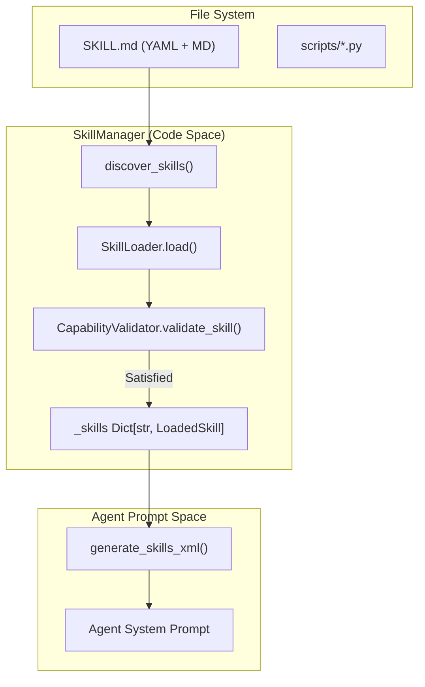
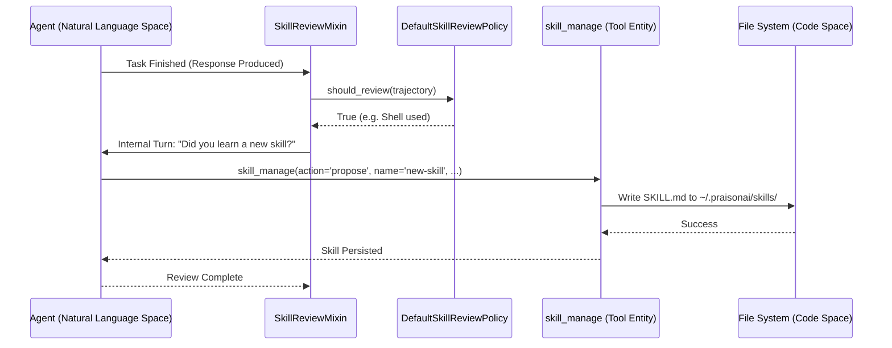

<!-- source: DeepWiki mcp.deepwiki.com · repo MervinPraison/PraisonAI · page 5.5 Skills System · fetched 2026-10-26 -->

# Skills System

Relevant source files

The following files were used as context for generating this wiki page:

- [src/praisonai-agents/praisonaiagents/agent/skill_review.py](src/praisonai-agents/praisonaiagents/agent/skill_review.py)
- [src/praisonai-agents/praisonaiagents/skills/bundles.py](src/praisonai-agents/praisonaiagents/skills/bundles.py)
- [src/praisonai-agents/praisonaiagents/skills/capability_validator.py](src/praisonai-agents/praisonaiagents/skills/capability_validator.py)
- [src/praisonai-agents/praisonaiagents/skills/discovery.py](src/praisonai-agents/praisonaiagents/skills/discovery.py)
- [src/praisonai-agents/praisonaiagents/skills/learn.py](src/praisonai-agents/praisonaiagents/skills/learn.py)
- [src/praisonai-agents/praisonaiagents/skills/loader.py](src/praisonai-agents/praisonaiagents/skills/loader.py)
- [src/praisonai-agents/praisonaiagents/skills/manager.py](src/praisonai-agents/praisonaiagents/skills/manager.py)
- [src/praisonai-agents/praisonaiagents/skills/models.py](src/praisonai-agents/praisonaiagents/skills/models.py)
- [src/praisonai-agents/praisonaiagents/skills/parser.py](src/praisonai-agents/praisonaiagents/skills/parser.py)
- [src/praisonai-agents/praisonaiagents/skills/protocols.py](src/praisonai-agents/praisonaiagents/skills/protocols.py)
- [src/praisonai-agents/praisonaiagents/skills/remote.py](src/praisonai-agents/praisonaiagents/skills/remote.py)
- [src/praisonai-agents/praisonaiagents/skills/validator.py](src/praisonai-agents/praisonaiagents/skills/validator.py)
- [src/praisonai-agents/praisonaiagents/tools/skill_tools.py](src/praisonai-agents/praisonaiagents/tools/skill_tools.py)
- [src/praisonai-agents/tests/test_aworkflow_loop_expansion.py](src/praisonai-agents/tests/test_aworkflow_loop_expansion.py)
- [src/praisonai-agents/tests/unit/skills/test_bundles.py](src/praisonai-agents/tests/unit/skills/test_bundles.py)
- [src/praisonai-agents/tests/unit/skills/test_capability_validator.py](src/praisonai-agents/tests/unit/skills/test_capability_validator.py)
- [src/praisonai-agents/tests/unit/skills/test_lifecycle.py](src/praisonai-agents/tests/unit/skills/test_lifecycle.py)
- [src/praisonai-agents/tests/unit/skills/test_loader.py](src/praisonai-agents/tests/unit/skills/test_loader.py)
- [src/praisonai-agents/tests/unit/skills/test_manager.py](src/praisonai-agents/tests/unit/skills/test_manager.py)
- [src/praisonai-agents/tests/unit/skills/test_parser.py](src/praisonai-agents/tests/unit/skills/test_parser.py)
- [src/praisonai-agents/tests/unit/skills/test_reload.py](src/praisonai-agents/tests/unit/skills/test_reload.py)
- [src/praisonai-agents/tests/unit/skills/test_remote.py](src/praisonai-agents/tests/unit/skills/test_remote.py)
- [src/praisonai-agents/tests/unit/skills/test_self_improve.py](src/praisonai-agents/tests/unit/skills/test_self_improve.py)
- [src/praisonai-agents/tests/unit/skills/test_validator.py](src/praisonai-agents/tests/unit/skills/test_validator.py)
- [src/praisonai-code/praisonai_code/cli/commands/skills.py](src/praisonai-code/praisonai_code/cli/commands/skills.py)
- [src/praisonai/praisonai/cli/commands/skills.py](src/praisonai/praisonai/cli/commands/skills.py)

The **Skills System** in PraisonAI is a modular architecture for extending agent capabilities using grounded, reusable instructions and scripts. Unlike simple tools, a "Skill" is a packaged capability defined by a `SKILL.md` file containing YAML frontmatter for metadata/requirements and a Markdown body for instructions. It supports autonomous discovery, capability-based gating, and a self-improvement loop where agents can author or refine skills based on session outcomes.

## Architecture and SkillManager

The `SkillManager` is the central coordinator for the skills lifecycle. It handles discovery from local and remote sources, validates environment requirements, and renders skills into the system prompt.

### Key Classes and Data Flow

*   **`SkillManager`**: Manages the in-memory index of `LoadedSkill` objects. It provides methods for discovery, activation, and prompt generation [src/praisonai-agents/praisonaiagents/skills/manager.py:23-42]().
*   **`LoadedSkill`**: Wraps `SkillProperties` and tracks runtime state, such as activation status and usage telemetry [src/praisonai-agents/praisonaiagents/skills/loader.py:16-30]().
*   **`SkillProperties`**: Data model for parsed `SKILL.md` frontmatter, including name, description, and requirements [src/praisonai-agents/praisonaiagents/skills/models.py:146-177]().
*   **`SkillLoader`**: Handles the physical reading of `SKILL.md` and associated scripts [src/praisonai-agents/praisonaiagents/skills/loader.py:65-80]().

### Skill Discovery and Resolution
Skills are discovered by scanning directories for `SKILL.md` files. The system supports "shadowing," where skills in user-defined directories take precedence over default ones [src/praisonai-agents/praisonaiagents/skills/manager.py:163-172]().

**Sources:**
[src/praisonai-agents/praisonaiagents/skills/manager.py:23-91](), [src/praisonai-agents/praisonaiagents/skills/models.py:146-177](), [src/praisonai-agents/praisonaiagents/skills/discovery.py:10-40]()

## Skill Bundles

**Skill Bundles** are named sets of skills defined in `BUNDLE.yaml` files. They allow grouping related capabilities (e.g., `@web-dev` or `@security-audit`) for easy assignment to agents.

*   **`BundleManifest`**: Represents a bundle's metadata and member skills [src/praisonai-agents/praisonaiagents/skills/bundles.py:15-35]().
*   **Resolution**: The `SkillManager.resolve()` method recursively expands bundle selectors (prefixed with `@`) into a flat list of skill names, handling nested bundles and preventing circular dependencies [src/praisonai-agents/praisonaiagents/skills/bundles.py:133-186]().

**Sources:**
[src/praisonai-agents/praisonaiagents/skills/bundles.py:15-186](), [src/praisonai-agents/tests/unit/skills/test_bundles.py:37-60]()

## Capability Validation

The `CapabilityValidator` ensures that a skill is only offered to an agent if its environment requirements are met. This prevents agents from attempting tasks for which they lack the necessary tools or credentials.

### Enforcement Levels
The system supports four levels of enforcement via `EnforcementLevel` [src/praisonai-agents/praisonaiagents/skills/capability_validator.py:19-24]():
1.  **`DISABLED`**: No checks performed.
2.  **`TELEMETRY`**: Logs missing requirements but allows activation.
3.  **`WARN`**: Logs warnings and sets skill state to `DEGRADED`.
4.  **`STRICT`**: Blocks activation and sets state to `UNAVAILABLE` if requirements are missing.

### Requirement Gates
Skills can define requirements in their frontmatter [src/praisonai-agents/praisonaiagents/skills/models.py:28-51]():
*   **`requires_tools`**: List of tool names that must be in the agent's registry.
*   **`requires_servers`**: Required MCP servers.
*   **`requires_env`**: Necessary environment variables.
*   **`fallback_for_tools`**: Inverse gate; the skill is only offered if the specified tools are *absent* (e.g., a "fetch-web-via-curl" skill offered only when a dedicated "browser" tool is missing) [src/praisonai-agents/praisonaiagents/skills/models.py:39-44]().

**Sources:**
[src/praisonai-agents/praisonaiagents/skills/capability_validator.py:19-191](), [src/praisonai-agents/praisonaiagents/skills/models.py:28-120]()

## Self-Improvement Loop

The `SkillReviewMixin` enables an autonomous feedback loop where agents evaluate their own performance to identify and author new skills.

### Implementation Logic
1.  **Post-Task Trigger**: After a task completes, if `self_improve=True` is set on the `Agent`, the `_run_skill_review` method is called [src/praisonai-agents/praisonaiagents/agent/skill_review.py:129-136]().
2.  **Policy Check**: The `DefaultSkillReviewPolicy` determines if a review is necessary (e.g., if specific tools like `shell` were used) [src/praisonai-agents/tests/unit/skills/test_self_improve.py:12-20]().
3.  **Isolated Turn**: The agent performs a short, internal "review turn" using a restricted toolset containing only `skill_manage`. This turn is re-entrancy guarded and its history is trimmed to prevent pollution of the main chat history [src/praisonai-agents/praisonaiagents/agent/skill_review.py:116-128]().
4.  **Skill Authoring**: If the agent identifies a reusable pattern, it uses `skill_manage` to propose or create a new `SKILL.md` [src/praisonai-agents/praisonaiagents/agent/skill_review.py:143-158]().

**Sources:**
[src/praisonai-agents/praisonaiagents/agent/skill_review.py:1-170](), [src/praisonai-agents/tests/unit/skills/test_self_improve.py:1-120]()

## Skill Execution and Shell Rendering

Skills can include executable scripts (Python, Bash, Node.js) located in a `scripts/` subdirectory.

*   **`SkillTools.run_skill_script`**: A tool that executes these scripts within a workspace boundary, handling path resolution and timeouts [src/praisonai-agents/praisonaiagents/tools/skill_tools.py:52-68]().
*   **Shell Rendering**: The system can render shell command blocks within skill instructions. `render_shell_blocks` parses these blocks to ensure they are presented correctly to the agent or executed safely [src/praisonai-agents/praisonaiagents/skills/shell_render.py:1-20]().

**Sources:**
[src/praisonai-agents/praisonaiagents/tools/skill_tools.py:52-144](), [src/praisonai-agents/praisonaiagents/skills/shell_render.py:1-20]()

## Skills CLI Commands

The system provides a comprehensive CLI for managing skills, bridging the gap between natural language requests and file-system entities.

| Command | Function | Code Entity |
| :--- | :--- | :--- |
| `praisonai skills list` | Lists all discovered skills and their states. | `skills_list` [src/praisonai-code/praisonai_code/cli/commands/skills.py:97]() |
| `praisonai skills learn` | Authors a new skill from provided sources/docs. | `skills_learn` [src/praisonai-code/praisonai_code/cli/commands/skills.py:135]() |
| `praisonai skills install` | Installs a skill from a local path or Git URL. | `skills_install` [src/praisonai-code/praisonai_code/cli/commands/skills.py:177]() |
| `praisonai skills validate` | Checks a skill directory for spec compliance. | `skills_validate` [src/praisonai-code/praisonai_code/cli/commands/skills.py:111]() |
| `praisonai skills bundle list` | Lists available skill bundles. | `bundle_list` [src/praisonai-code/praisonai_code/cli/commands/skills.py:16]() |

**Sources:**
[src/praisonai-code/praisonai_code/cli/commands/skills.py:1-220]()

## System Integration Diagrams

### Skill Activation Lifecycle
This diagram shows how a skill moves from a file on disk to an active instruction in the agent's system prompt.

**Sources:**
[src/praisonai-agents/praisonaiagents/skills/manager.py:102-131](), [src/praisonai-agents/praisonaiagents/skills/loader.py:65-80](), [src/praisonai-agents/praisonaiagents/skills/capability_validator.py:91-191]()

### Self-Improvement Data Flow
This diagram bridges the agent's natural language reasoning about its performance to the creation of code entities (Skills).

**Sources:**
[src/praisonai-agents/praisonaiagents/agent/skill_review.py:129-158](), [src/praisonai-agents/tests/unit/skills/test_self_improve.py:76-84](), [src/praisonai-agents/praisonaiagents/tools/skill_tools.py:19-45]()

---

